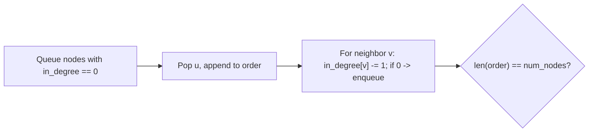

# 18. Topological Sort (Graph)

## 1. Trigger Signals (When to Use)
* Tasks/courses have **prerequisites or dependencies** (`u` must come before `v`).
* Problem asks for a **valid build/execution order**, **Alien Dictionary**, or **cycle detection in a directed graph**.

---

## 2. Mental Model (Kahn's Algorithm)



---

## 3. Reusable Python Template

```python
from collections import defaultdict, deque


def topological_sort(num_nodes: int, edges: list[tuple[int, int]]) -> list[int]:
    graph: dict[int, list[int]] = defaultdict(list)
    in_degree = [0] * num_nodes

    for u, v in edges:  # u -> v (u must come before v)
        graph[u].append(v)
        in_degree[v] += 1

    q = deque(i for i in range(num_nodes) if in_degree[i] == 0)
    order: list[int] = []

    while q:
        u = q.popleft()
        order.append(u)
        for v in graph[u]:
            in_degree[v] -= 1
            if in_degree[v] == 0:
                q.append(v)

    return order if len(order) == num_nodes else []  # [] means cycle exists
```

---

## 4. Must-Know Classic Problems

### Problem A: Course Schedule II
Input gives `[course, prereq]`, so edge is `prereq -> course`.
* **Time:** $O(V + E)$ | **Space:** $O(V + E)$

```python
def find_order(num_courses: int, prerequisites: list[list[int]]) -> list[int]:
    return topological_sort(num_courses, [(pre, crs) for crs, pre in prerequisites])
```

### Problem B: Alien Dictionary (Derive Character Order)
Compare adjacent words `w1, w2` to find the first differing char `(c1 -> c2)`; watch for invalid prefix `"abc"` before `"ab"`.
* **Time:** $O(C)$ total characters | **Space:** $O(1)$ (26-letter alphabet)

---

## 5. Edge Cases & Common Traps
* **Edge direction:** `[course, prereq]` means `prereq -> course`, NOT `course -> prereq`.
* **Disconnected components & isolated nodes:** Initialize `in_degree` for **all** `0..num_nodes - 1` so nodes with 0 edges still appear in `order`.
* **Cycle detection:** If `len(order) < num_nodes`, a cycle exists and no valid ordering is possible.

---

## 6. Rapid Follow-Up Q&As
- **Q: Kahn's BFS vs. DFS Topological Sort?**  
  **A:** **Kahn's BFS** is iterative (no recursion limit issues) and detects cycles naturally via `len(order) < V`. **DFS** pushes nodes on post-order exit and reverses the list (using 3-color `0/1/2` state for cycle detection).
