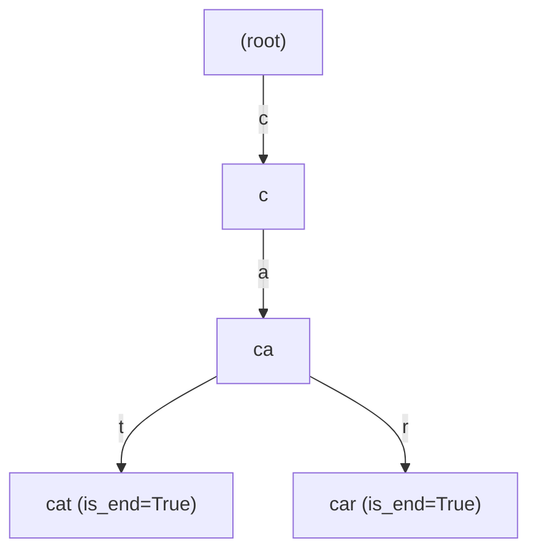

# 19. Trie (Prefix Tree)

## 1. Trigger Signals (When to Use)
* Problem involves **autocomplete**, **prefix matching (`starts_with`)**, **word dictionary with `.` wildcards**, or **Word Search II** on a board.
* Looking up many words sharing common prefixes faster than scanning a list.

---

## 2. Mental Model



---

## 3. Reusable Python Template

```python
class TrieNode:
    def __init__(self) -> None:
        self.children: dict[str, "TrieNode"] = {}
        self.is_end: bool = False


class Trie:
    def __init__(self) -> None:
        self.root = TrieNode()

    def insert(self, word: str) -> None:
        node = self.root
        for ch in word:
            if ch not in node.children:
                node.children[ch] = TrieNode()
            node = node.children[ch]
        node.is_end = True

    def search(self, word: str) -> bool:
        node = self._walk(word)
        return node is not None and node.is_end

    def starts_with(self, prefix: str) -> bool:
        return self._walk(prefix) is not None

    def _walk(self, text: str) -> TrieNode | None:
        node = self.root
        for ch in text:
            if ch not in node.children:
                return None
            node = node.children[ch]
        return node
```

---

## 4. Must-Know Classic Problems

### Problem A: Design Add and Search Words (Wildcard `.`)
When `ch == '.'`, DFS across all `node.children.values()`.
* **Time:** $O(L)$ exact, $O(26^L)$ worst-case with wildcards | **Space:** $O(\text{total chars})$

```python
class WordDictionary(Trie):
    def search_wildcard(self, word: str) -> bool:
        def dfs(idx: int, node: TrieNode) -> bool:
            if idx == len(word):
                return node.is_end
            ch = word[idx]
            if ch == ".":
                return any(dfs(idx + 1, child) for child in node.children.values())
            if ch not in node.children:
                return False
            return dfs(idx + 1, node.children[ch])

        return dfs(0, self.root)
```

---

## 5. Edge Cases & Common Traps
* **Prefix vs. Full Word:** `"car"` inserted does NOT mean `search("ca")` is `True`—check `node.is_end`.
* **Memory in Python:** For huge dictionaries, using `__slots__ = ("children", "is_end")` on `TrieNode` cuts memory significantly.

---

## 6. Rapid Follow-Up Q&As
- **Q: Trie vs. Hash Set for word lookup?**  
  **A:** Both are $O(L)$ for exact `search()`, but a **Trie** supports $O(L)$ `starts_with(prefix)` and lexicographical/wildcard traversal without scanning all keys.
