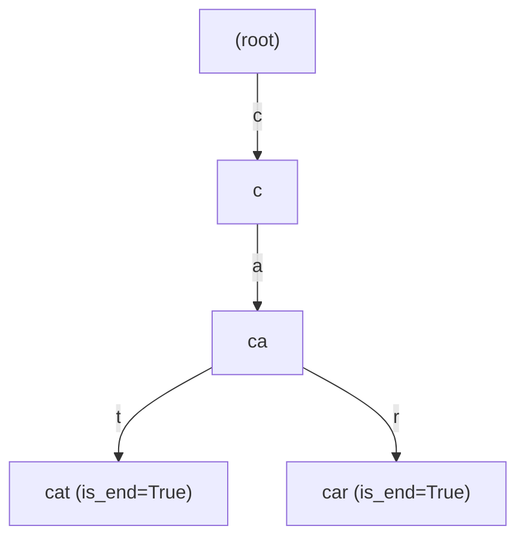

# 19. Trie (Prefix Tree)

## 1. Trigger Signals & Brute Force -> Optimal
* **Triggers:** **Autocomplete**, **`starts_with(prefix)`**, **wildcard `.` dictionary**, or **Word Search II** on a board.
* **Brute Force → Optimal:** Scanning a word list takes $O(N \cdot L)$ per prefix query. A Trie resolves queries in **$O(L)$** time (where $L$ is word length).

---

## 2. Mental Model



---

## 3. Reusable Python Template

```python
class TrieNode:
    """Single character node in a Prefix Tree."""

    __slots__ = ("children", "is_end")

    def __init__(self) -> None:
        self.children: dict[str, "TrieNode"] = {}
        self.is_end: bool = False


class Trie:
    """Prefix Tree supporting O(L) insert, exact search, and prefix lookup."""

    def __init__(self) -> None:
        self.root = TrieNode()

    def insert(self, word: str) -> None:
        """Insert `word` into the Trie."""
        node = self.root
        for ch in word:
            if ch not in node.children:
                node.children[ch] = TrieNode()
            node = node.children[ch]
        node.is_end = True

    def search(self, word: str) -> bool:
        """Return True only if exact `word` was inserted."""
        node = self._walk(word)
        return node is not None and node.is_end

    def starts_with(self, prefix: str) -> bool:
        """Return True if any inserted word starts with `prefix`."""
        return self._walk(prefix) is not None

    def _walk(self, text: str) -> TrieNode | None:
        node = self.root
        for ch in text:
            if ch not in node.children:
                return None
            node = node.children[ch]
        return node
```

---

## 4. Must-Know Classic Problems

### Problem A: Design Add and Search Words (Wildcard `.`)
* **Time:** $O(L)$ exact, $O(26^L)$ worst-case wildcards | **Space:** $O(\text{total chars})$

```python
class WordDictionary(Trie):
    """Trie extended to support '.' wildcard matching any single character."""

    def search_wildcard(self, word: str) -> bool:
        def dfs(idx: int, node: TrieNode) -> bool:
            if idx == len(word):
                return node.is_end
            ch = word[idx]
            if ch == ".":
                return any(dfs(idx + 1, child) for child in node.children.values())
            if ch not in node.children:
                return False
            return dfs(idx + 1, node.children[ch])

        return dfs(0, self.root)

# Example: insert("bad"); search_wildcard(".ad") -> True
```

---

## 5. Edge Cases & Pattern vs. Pattern
* **Prefix vs. Word:** Inserting `"car"` means `starts_with("ca") == True`, but `search("ca") == False` unless `is_end` is `True`.

| Pattern | When to Choose |
| :--- | :--- |
| **Trie** | Prefix queries, autocomplete, wildcard matching, pruning board DFS. |
| **Hash Set (`set`)** | Exact whole-word lookup only (simpler, lower memory). |

---

## 6. Rapid Follow-Up Q&As
* **Q: Why use `__slots__` on `TrieNode`?**  
  **A:** Eliminating per-node `__dict__` cuts memory overhead dramatically when storing thousands of words.
