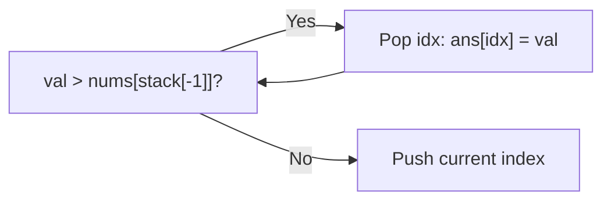

# 20. Stacks & Monotonic Stack ⭐

## 1. Trigger Signals & Brute Force -> Optimal
* **Triggers:** **Valid parentheses**, expression evaluation, **Next Greater / Smaller Element**, **Daily Temperatures**, or **Largest Rectangle in Histogram**.
* **Brute Force → Optimal:** Scanning right for each element takes $O(n^2)$. A monotonic stack resolves each element in amortized $O(1)$, giving **$O(n)$ total time**.

---

## 2. Mental Model & Dry-Run Trace



**Dry-Run (`temps = [73, 74, 75, 71, 69, 72]`, Daily Temperatures):**
1. `i=0 (73)`: `stack=[0]`
2. `i=1 (74)`: `74 > 73` → pop `0`, `ans[0] = 1 - 0 = 1` → `stack=[1]`
3. `i=2 (75)`: `75 > 74` → pop `1`, `ans[1] = 2 - 1 = 1` → `stack=[2]`
4. `i=3 (71), i=4 (69)`: decreasing → `stack=[2, 3, 4]`
5. `i=5 (72)`: pops `4 (69)` (`ans[4]=1`) and `3 (71)` (`ans[3]=2`) → `stack=[2, 5]`.

---

## 3. Reusable Python Template (Next Greater Element)

```python
def next_greater_elements(nums: list[int]) -> list[int]:
    """For each element, return the first greater value to its right, or -1."""
    res = [-1] * len(nums)
    stack: list[int] = []  # Monotonic decreasing stack of indices

    for i, val in enumerate(nums):
        while stack and nums[stack[-1]] < val:
            idx = stack.pop()
            res[idx] = val
        stack.append(i)
    return res

# Example: next_greater_elements([2, 1, 2, 4, 3]) -> [4, 2, 4, -1, -1]
```

---

## 4. Must-Know Classic Problems

### Problem A: Valid Parentheses
* **Time:** $O(n)$ | **Space:** $O(n)$

```python
def is_valid_parens(s: str) -> bool:
    """Return True if all brackets in `s` are properly nested and closed."""
    pairs = {")": "(", "]": "[", "}": "{"}
    stack: list[str] = []
    for ch in s:
        if ch in pairs:
            if not stack or stack.pop() != pairs[ch]:
                return False
        else:
            stack.append(ch)
    return not stack

# Example: is_valid_parens("({[]})") -> True; is_valid_parens("(]") -> False
```

### Problem B: Daily Temperatures
* **Time:** $O(n)$ | **Space:** $O(n)$

```python
def daily_temperatures(temps: list[int]) -> list[int]:
    """Return days to wait for a warmer temperature for each day."""
    ans = [0] * len(temps)
    stack: list[int] = []
    for i, t in enumerate(temps):
        while stack and temps[stack[-1]] < t:
            prev = stack.pop()
            ans[prev] = i - prev
        stack.append(i)
    return ans

# Example: daily_temperatures([73, 74, 75, 71, 69, 72]) -> [1, 1, 0, 2, 1, 0]
```

---

## 5. Edge Cases & Pattern vs. Pattern
* **Store indices, not values:** Indices let you compute both values (`nums[idx]`) and distances/widths (`i - idx`).

| Pattern | When to Choose |
| :--- | :--- |
| **Monotonic Stack** | Next/previous greater/smaller element in $O(n)$. |
| **Monotonic Deque** | **Sliding Window Maximum** over a fixed window `k`. |

---

## 6. Rapid Follow-Up Q&As
* **Q: Why is a Monotonic Stack $O(n)$ despite the nested `while` loop?**  
  **A:** Every index is pushed once and popped at most once, bounding total operations to $\le 2n = O(n)$.
