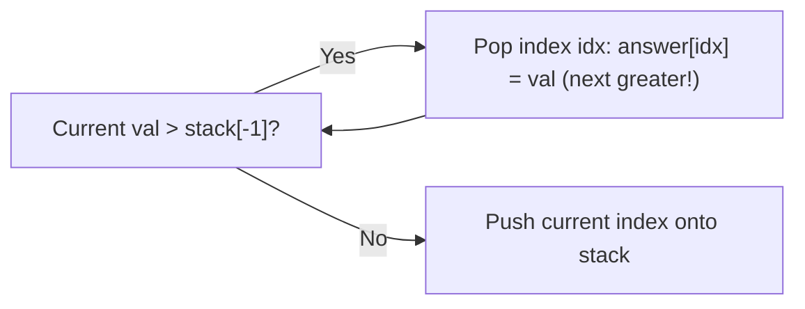

# 20. Stacks & Monotonic Stack

## 1. Trigger Signals (When to Use)
* **Standard Stack:** Matching brackets/tags, expression evaluation, flattening nested structures.
* **Monotonic Stack:** **Next Greater / Next Smaller Element**, **Daily Temperatures**, **Largest Rectangle in Histogram**.

---

## 2. Mental Model (Monotonic Decreasing Stack)



---

## 3. Reusable Python Template (Next Greater Element)

```python
def next_greater_indices(nums: list[int]) -> list[int]:
    res = [-1] * len(nums)
    stack: list[int] = []  # Stores indices with decreasing values

    for i, val in enumerate(nums):
        while stack and nums[stack[-1]] < val:
            idx = stack.pop()
            res[idx] = val
        stack.append(i)
    return res
```

---

## 4. Must-Know Classic Problems

### Problem A: Valid Parentheses
* **Time:** $O(n)$ | **Space:** $O(n)$

```python
def is_valid_parens(s: str) -> bool:
    pairs = {")": "(", "]": "[", "}": "{"}
    stack: list[str] = []
    for ch in s:
        if ch in pairs:
            if not stack or stack.pop() != pairs[ch]:
                return False
        else:
            stack.append(ch)
    return not stack
```

### Problem B: Daily Temperatures
Wait days until a warmer temperature (`i - prev_idx`).
* **Time:** $O(n)$ | **Space:** $O(n)$

```python
def daily_temperatures(temps: list[int]) -> list[int]:
    ans = [0] * len(temps)
    stack: list[int] = []
    for i, t in enumerate(temps):
        while stack and temps[stack[-1]] < t:
            prev = stack.pop()
            ans[prev] = i - prev
        stack.append(i)
    return ans
```

---

## 5. Edge Cases & Common Traps
* **Store indices, not values**, in monotonic stacks whenever you need distances (`i - prev`) or widths (Largest Rectangle in Histogram).
* **Leftover elements:** Elements still on the stack at the end have no next greater/smaller element (default `-1` or `0`).

---

## 6. Rapid Follow-Up Q&As
- **Q: Why is a Monotonic Stack $O(n)$ if there is a `while` loop inside a `for` loop?**  
  **A:** Every index is pushed at most once and popped at most once, so total stack operations across the entire array are $\le 2n = O(n)$.
