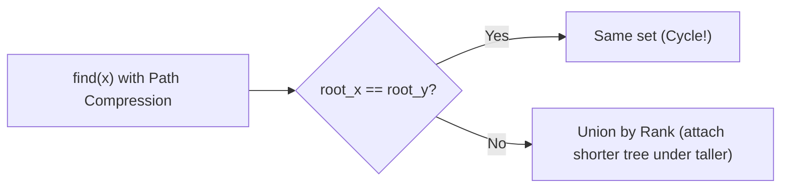

# 21. Union-Find (Disjoint Set)

## 1. Trigger Signals & Brute Force -> Optimal
* **Triggers:** **Dynamic connectivity** ("are A and B connected?"), **counting components** as edges arrive, **cycle in an undirected graph**, or **Accounts Merge**.
* **Brute Force → Optimal:** Running DFS/BFS per edge query takes $O(V + E)$ each time. Union-Find with **Path Compression + Union by Rank** answers queries in **$O(\alpha(n)) \approx O(1)$** amortized time.

---

## 2. Mental Model & Dry-Run Trace



---

## 3. Reusable Python Template

```python
class UnionFind:
    """Disjoint Set Union (DSU) with Path Compression and Union by Rank."""

    def __init__(self, n: int) -> None:
        self.parent = list(range(n))
        self.rank = [0] * n
        self.components = n

    def find(self, x: int) -> int:
        """Find root representative of `x` with path compression."""
        if self.parent[x] != x:
            self.parent[x] = self.find(self.parent[x])
        return self.parent[x]

    def union(self, x: int, y: int) -> bool:
        """Merge sets of `x` and `y`. Return False if already in the same set."""
        rx, ry = self.find(x), self.find(y)
        if rx == ry:
            return False  # Cycle / already connected
        if self.rank[rx] < self.rank[ry]:
            rx, ry = ry, rx
        self.parent[ry] = rx
        if self.rank[rx] == self.rank[ry]:
            self.rank[rx] += 1
        self.components -= 1
        return True
```

---

## 4. Must-Know Classic Problems

### Problem A: Redundant Connection (Find Cycle-Creating Edge)
* **Time:** $O(n \cdot \alpha(n)) \approx O(n)$ | **Space:** $O(n)$

```python
def find_redundant_connection(edges: list[list[int]]) -> list[int]:
    """Return the edge that creates a cycle in a 1-indexed undirected graph."""
    uf = UnionFind(len(edges) + 1)  # +1 for 1-indexed nodes
    for u, v in edges:
        if not uf.union(u, v):
            return [u, v]
    return []

# Example: find_redundant_connection([[1,2],[1,3],[2,3]]) -> [2, 3]
```

### Problem B: Number of Connected Components in an Undirected Graph
* **Time:** $O(V + E \cdot \alpha(V))$ | **Space:** $O(V)$

```python
def count_components(n: int, edges: list[list[int]]) -> int:
    """Return number of connected components in an undirected graph of `n` nodes."""
    uf = UnionFind(n)
    for u, v in edges:
        uf.union(u, v)
    return uf.components

# Example: count_components(5, [[0,1],[1,2],[3,4]]) -> 2
```

---

## 5. Edge Cases & Pattern vs. Pattern
* **1-indexed nodes:** Allocate `UnionFind(n + 1)` when nodes start at `1`.

| Pattern | When to Choose |
| :--- | :--- |
| **Union-Find** | **Undirected** dynamic connectivity and cycle detection. |
| **[Topological Sort](18-topological-sort.md)** | **Directed** dependency ordering and directed cycle detection. |

---

## 6. Rapid Follow-Up Q&As
* **Q: What is the time complexity of `find` and `union`?**  
  **A:** $O(\alpha(n))$ amortized per operation, where $\alpha$ is the inverse Ackermann function ($\le 4$ for all practical inputs).
