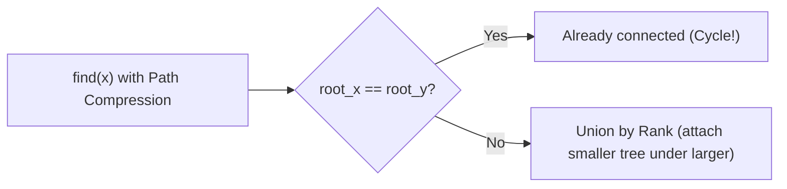

# 21. Union-Find (Disjoint Set)

## 1. Trigger Signals (When to Use)
* **Dynamic connectivity** ("are A and B in the same group/network?").
* Counting **connected components** as edges are added.
* **Cycle detection in an undirected graph** (Redundant Connection) or **Accounts Merge** / Kruskal's MST.

---

## 2. Mental Model



---

## 3. Reusable Python Template

```python
class UnionFind:
    def __init__(self, n: int) -> None:
        self.parent = list(range(n))
        self.rank = [0] * n
        self.components = n

    def find(self, x: int) -> int:
        if self.parent[x] != x:
            self.parent[x] = self.find(self.parent[x])  # Path compression
        return self.parent[x]

    def union(self, x: int, y: int) -> bool:
        rx, ry = self.find(x), self.find(y)
        if rx == ry:
            return False  # Already connected
        if self.rank[rx] < self.rank[ry]:
            rx, ry = ry, rx
        self.parent[ry] = rx
        if self.rank[rx] == self.rank[ry]:
            self.rank[rx] += 1
        self.components -= 1
        return True
```

---

## 4. Must-Know Classic Problems

### Problem A: Redundant Connection (Find Cycle-Creating Edge)
* **Time:** $O(n \cdot \alpha(n)) \approx O(n)$ | **Space:** $O(n)$

```python
def find_redundant_connection(edges: list[list[int]]) -> list[int]:
    uf = UnionFind(len(edges) + 1)
    for u, v in edges:
        if not uf.union(u, v):
            return [u, v]
    return []
```

### Problem B: Number of Connected Components in an Undirected Graph
* **Time:** $O(V + E \cdot \alpha(V))$ | **Space:** $O(V)$

```python
def count_components(n: int, edges: list[list[int]]) -> int:
    uf = UnionFind(n)
    for u, v in edges:
        uf.union(u, v)
    return uf.components
```

---

## 5. Edge Cases & Common Traps
* **1-indexed vs. 0-indexed nodes:** Initialize `UnionFind(n + 1)` if nodes are numbered `1..n` (as in Redundant Connection).
* **Directed graphs:** Union-Find does **not** detect cycles in *directed* graphs—use Topological Sort / 3-color DFS instead.

---

## 6. Rapid Follow-Up Q&As
- **Q: What is the time complexity with Path Compression + Union by Rank?**  
  **A:** $O(\alpha(n))$ amortized per operation, where $\alpha$ is the inverse Ackermann function ($\le 4$ for all practical input sizes).
