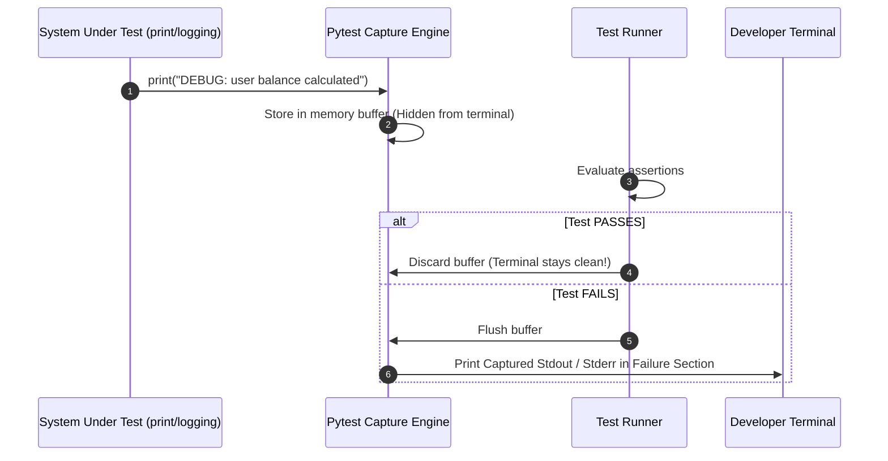

# Debugging Test Failures: CLI Diagnostics & Interactive PDB 🐞

> **Authoritative Sources & Literature:**
> - Brian Okken: *Python Testing with pytest* (Chapter 2: Understanding Test Failures, Chapter 11: Debugging Test Failures, Pragmatic Bookshelf)
> - Python Standard Library: *pdb — The Python Debugger & PEP 553 breakpoint()*
> - Holger Krekel: *Pytest Capture Architecture & Traceback Formatting* (docs.pytest.org)

---

## 1. Conceptual Definition & Core Mental Model

When an automated test fails, your primary goal is to **minimize Mean Time to Resolution (MTTR)**.

In naive workflows, developers add ad-hoc `print()` statements across their codebase and re-run the entire test suite. In professional engineering, developers leverage **interactive post-mortem debugging**, **traceback filtering**, **local variable introspection**, and **output capture inspection**.

```
                           [ Test Fails with AssertionError ]
                                          │
             ┌────────────────────────────┼────────────────────────────┐
             ▼                            ▼                            ▼
      [ CLI Diagnostics ]        [ Output Inspection ]       [ Interactive Debugger ]
       --tb=short                 -s (No capture)             --pdb (Drop into frame)
       -l (--showlocals)          caplog (Inspect logs)       breakpoint()
       --lf (--last-failed)       capsys (Inspect stdout)     Inspect live state in memory
```

---

## 2. Why This Is Critical in Modern Python Backend Engineering

1. **Eliminating the "Print-and-Rerun" Loop**: If a test takes 5 seconds to set up database state, adding print statements and re-running 10 times wastes minutes. Dropping directly into the Python debugger (`--pdb`) at the exact point of failure allows inspecting live in-memory objects immediately.
2. **Untangling Massive Tracebacks**: Deep call stacks across web frameworks (FastAPI routing $\rightarrow$ Starlette middleware $\rightarrow$ SQLAlchemy engine $\rightarrow$ Psycopg driver) produce 200-line tracebacks. Pytest's traceback modifiers (`--tb=short`, `--tb=line`) cut through framework noise to display the exact application line that failed.
3. **Validating Structured Observability & Logs**: Backend systems communicate system health via structured logs (`structlog`, standard `logging`). The `caplog` fixture allows testing that the appropriate warning and error events were logged without polluting the terminal.

---

## 3. Internal Mechanics: The Pytest Capture Protocol

By default, pytest **captures all standard output (`stdout`) and standard error (`stderr`)** during test execution:



To bypass output capture and see print statements in real time, pass the **`-s`** flag (`--capture=no`).

---

## 4. Essential Pytest Debugging CLI Flags

### Execution Flow Control
| Flag | Description | Production Use Case |
| :--- | :--- | :--- |
| `-x` | Stop immediately on the first failure | Fast feedback in local development |
| `--maxfail=N` | Stop after $N$ failures | CI builds to prevent massive log dumps |
| `--lf` / `--last-failed` | Re-run **only** tests that failed in the last run | Iterating on bug fixes |
| `--ff` / `--failed-first` | Run failed tests first, then remaining tests | Full validation after bug fixes |

### Traceback & Variable Formatting
| Flag | Description | Production Use Case |
| :--- | :--- | :--- |
| `--tb=short` | Short traceback (just the failing line) | Recommended default in `pyproject.toml` |
| `--tb=line` | Exactly one line per failed test | High-level triage of 50+ failures |
| `--tb=native` | Standard Python traceback format | Debugging C-extensions or external libs |
| `-l` / `--showlocals` | Print all local variables in the traceback | Debugging state without attaching PDB |

### Interactive Debugging
| Flag | Description | Production Use Case |
| :--- | :--- | :--- |
| `--pdb` | Drop into PDB at the exact line of failure | Post-mortem failure analysis |
| `--trace` | Drop into PDB at the beginning of each test | Stepping through a test line by line |
| `-s` | Disable all stdout/stderr capture | Seeing live prints and debug logs |

---

## 5. Master PDB Interactive Commands Cheat Sheet

When `--pdb` or `breakpoint()` halts execution, you enter the Python debugger prompt (`(Pdb)`):

| Command | Action | Example |
| :--- | :--- | :--- |
| **`p <expr>`** | Print expression value | `p user.balance` |
| **`pp <expr>`** | Pretty-print complex dictionaries/lists | `pp response.json()` |
| **`l`** | List 11 lines of source code around current frame | `l` |
| **`ll`** | List the entire source code of current function | `ll` |
| **`n`** | Next: execute current line and step over function calls | `n` |
| **`s`** | Step: execute current line and step **into** function calls | `s` |
| **`c`** | Continue: resume execution until next failure/breakpoint | `c` |
| **`q`** | Quit: abort debugger and terminate pytest immediately | `q` |
| **`u`** | Up: move one frame up the call stack (to caller) | `u` |
| **`d`** | Down: move one frame down the call stack | `d` |
| **`w`** | Where: print complete call stack traceback | `w` |

---

## 6. Using Python 3.7+ Native `breakpoint()`

Instead of passing `--pdb` to halt on failure, you can set a programmatic breakpoint anywhere in your application or test code using Python's built-in `breakpoint()`:

```python
def test_complex_calculation():
    order = create_order(items=["book", "pen"])
    total = order.calculate_subtotal()
    
    # Execution halts here! Pytest automatically disables capture and drops into PDB!
    breakpoint()
    
    assert total == 25.00
```

---

## 7. Testing Logs with the Built-in `caplog` Fixture

In backend APIs, verifying that warnings and error events are logged with correct levels is critical:

```python
# src/billing/processor.py
import logging

logger = logging.getLogger(__name__)

def charge_account(account_id: str, amount: float):
    if amount > 5000.0:
        logger.warning(f"High-value transaction flagged for account {account_id}: ${amount}")
    # Process charge...
```

### Asserting on Logs in Pytest

```python
# tests/unit/test_billing_logs.py
import logging
from src.billing.processor import charge_account

def test_high_value_transaction_emits_warning(caplog):
    # Set logging level for the test
    caplog.set_level(logging.WARNING)

    # Act
    charge_account("ACC_999", 7500.0)

    # 1. Assert string appears anywhere in captured text
    assert "High-value transaction flagged for account ACC_999: $7500.0" in caplog.text

    # 2. Inspect structured log records
    assert len(caplog.records) == 1
    record = caplog.records[0]
    assert record.levelname == "WARNING"
    assert record.name == "src.billing.processor"
```

---

## 8. Practical Python Implementation: Step-by-Step Walkthrough

We will diagnose a subtle **Discount Calculation Bug** using `--showlocals` and `--pdb`.

### Step 1: The Failing Application Code

```python
# src/pricing/discounts.py
from decimal import Decimal

def compute_order_discount(subtotal: Decimal, coupon_code: str | None) -> Decimal:
    discount_rate = Decimal("0.00")
    if coupon_code == "SUMMER20":
        discount_rate = Decimal("0.20")
    elif coupon_code == "VIP50":
        discount_rate = Decimal("0.50")

    # Bug: Subtotal was rounded before applying discount!
    discount = (subtotal * discount_rate).quantize(Decimal("0.01"))
    return discount
```

### Step 2: The Failing Test

```python
# tests/unit/test_discounts.py
from decimal import Decimal
from src.pricing.discounts import compute_order_discount

def test_summer_discount_calculation():
    subtotal = Decimal("149.99")
    discount = compute_order_discount(subtotal, "SUMMER20")
    # 149.99 * 0.20 = 29.998 -> Rounds to 30.00
    assert discount == Decimal("30.00")
```

### Step 3: Triage with `--showlocals` (`-l`)

```bash
pytest tests/unit/test_discounts.py -l --tb=short
```

Pytest prints:
```text
_____________________ test_summer_discount_calculation _____________________
tests/unit/test_discounts.py:7: in test_summer_discount_calculation
    assert discount == Decimal("30.00")
E   AssertionError: assert Decimal('29.99') == Decimal('30.00')

Local variables:
coupon_code = 'SUMMER20'
discount    = Decimal('29.99')
subtotal    = Decimal('149.99')
```
*Diagnosis*: Without attaching a debugger, `-l` immediately showed that `discount` evaluated to `29.99` instead of `30.00` due to default `ROUND_HALF_EVEN` rounding in Decimal arithmetic!

---

## 9. Framework-Specific Integration: FastAPI & HTTPX Failure Triage

When an endpoint returns an unexpected HTTP status code (e.g. `500` instead of `200`), inspecting the response body is essential:

```python
# tests/integration/test_endpoint_debug.py
import pytest
from httpx import AsyncClient

@pytest.mark.asyncio
async def test_order_creation_debug(async_client: AsyncClient):
    response = await async_client.post("/api/v1/orders", json={"item": "invalid"})

    # If status code is unexpected, print the response JSON directly in assertion:
    assert response.status_code == 201, f"API Failed with status {response.status_code}: {response.text}"
```

---

## 10. Real-World Enterprise Backend Scenario: The Rapid Iteration Fix Cycle

When a developer breaks 12 tests across different modules during a major refactoring:
1. Run `pytest -x --tb=short`: Halts immediately on the very first failure, keeping the terminal readable.
2. Run `pytest --pdb --maxfail=1`: Drops into PDB at the point of failure to inspect live object state.
3. Fix the bug in production code.
4. Run `pytest --lf`: Runs **only** the 12 tests that failed previously, validating the fix in 2 seconds.
5. Run `pytest`: Runs the full suite to verify zero regressions.

---

## 11. Anti-Patterns & Common Pitfalls

### Anti-Pattern 1: Committed `breakpoint()` Calls
Accidentally committing `breakpoint()` into production code.
- **Consequence**: CI builds hang indefinitely waiting for interactive terminal input, consuming pipeline minutes until the runner times out!
- **Protection**: Use a linter (`ruff` with rule `T100` / `flake8-debugger`) or pre-commit hook that automatically blocks commits containing `breakpoint()` or `import pdb`.

### Anti-Pattern 2: The "Wall of Text" Traceback
Running pytest without `--tb=short` on large async web frameworks, resulting in 400 lines of Starlette/FastAPI internals that obscure the application failure.

---

## 12. Best Practices & Production Guidelines

1. **Standardize `--tb=short` in `pyproject.toml`**: Keep failure tracebacks concise and readable by default.
2. **Master the `--lf` Workflow**: Never re-run a 5,000-test suite just to test a one-line fix; iterate with `pytest --lf`.
3. **Use `caplog` for Telemetry Testing**: Never test logging with `capsys` or print statements; use `caplog` to inspect structured log records.
4. **Use `-l` on CI Failures**: Add `-l` (`--showlocals`) to CI test commands so when a remote test fails, local variable values are printed in the build logs.

---

## 13. Trade-Off Analysis: Debugging Techniques

| Technique | Feedback Speed | Interactivity | Code Modification Required? | Risk in CI |
| :--- | :--- | :--- | :--- | :--- |
| **`pytest --pdb`** | Instant | Full Interactive | No | **High (Hangs CI if run)** |
| **`breakpoint()`** | Instant | Full Interactive | Yes | **High (Hangs CI if committed)** |
| **`pytest -l` (Show locals)** | Very Fast | Read-only | No | **Zero (Safe in CI)** |
| **`print()` with `-s`** | Slow | Read-only | Yes (Needs cleanup) | Low |
| **`caplog` Fixture** | Fast | Automated Assertions | No | **Zero (Standard testing)** |

---

## 14. Diagnostic & Debugging Playbook: CLI Commands

```bash
# 1. Stop immediately on first failure with short traceback and local variables
pytest -x --tb=short -l

# 2. Re-run only the tests that failed in the last run
pytest --lf

# 3. Drop into interactive PDB at the exact line of assertion failure
pytest --pdb -x

# 4. Run tests with live, uncaptured stdout and logging output
pytest -s

# 5. Drop into PDB at the start of a specific test
pytest tests/unit/test_orders.py::test_checkout --trace
```

---

## 15. Senior Staff Interview Questions & Deep Dives

### Question 1: How does pytest's output capture mechanism work under the hood, and what are the differences between `--capture=fd` and `--capture=sys`?
**Answer**:
- **`--capture=sys`** (Default): Pytest intercepts Python-level standard streams by replacing `sys.stdout` and `sys.stderr` with internal in-memory StringIO buffers (`io.TextIOWrapper`). It captures output produced by Python `print()` calls and standard library loggers. However, it cannot capture output produced by C-extensions (such as C-level `printf` calls from libraries like NumPy or database drivers).
- **`--capture=fd`**: Pytest redirects the underlying file descriptors (FD 1 for stdout, FD 2 for stderr) at the operating system level using `os.dup2`. This captures both Python-level output and low-level C-extension `printf` output, but incurs slightly higher I/O overhead.
- In both modes, pytest suspends capturing if `breakpoint()` or `--pdb` is triggered so the interactive terminal works normally.

### Question 2: How can a CI/CD pipeline be protected against hanging indefinitely when a developer accidentally commits a `breakpoint()`?
**Answer**:
1. **Environment Flag**: Set `PYTHONBREAKPOINT=0` in the CI pipeline environment. When `PYTHONBREAKPOINT=0`, Python treats all `breakpoint()` calls as no-ops, completely preventing the interpreter from dropping into PDB.
2. **Pre-Commit Linting**: Integrate `ruff` or `flake8` with the `T100` rule (`flake8-debugger`) in the pre-commit configuration. This statically scans git diffs and rejects any commit containing `breakpoint()`, `pdb.set_trace()`, or `import pdb`.
3. **Pytest Timeout**: Configure `pytest-timeout` (`--timeout=30`) so that if any test hangs for longer than 30 seconds for any reason, the test process is terminated with a fatal error.

---

## 16. Hands-on Engineering Exercises & Challenges

### Exercise 1: Triage with PDB Post-Mortem
Write a test that compares two large nested dictionaries with one mismatched sub-key.
1. Run `pytest tests/test_dict.py --pdb`.
2. When the failure halts in PDB, use `pp actual_dict` and `pp expected_dict` to inspect the discrepancy.
3. Use `w` to inspect the stack trace.
4. Exit cleanly with `q`.

### Exercise 2: Testing Structured Logging with `caplog`
Write a function `process_refund(refund_id: str, amount: float)` that logs an `INFO` message on start and an `ERROR` message if amount exceeds \$10,000.
1. Write a test asserting that attempting a \$15,000 refund emits an `ERROR` log containing the refund ID.
2. Assert that `caplog.records[0].levelname == "ERROR"`.

---

## 17. Summary, Cross-References & Further Reading

Mastering pytest debugging tools turns painful troubleshooting into a rapid, structured science. By combining `--tb=short`, `--showlocals`, `--lf`, `caplog`, and interactive `--pdb` diagnostics, senior backend engineers isolate and resolve complex bugs in seconds.

### Cross-References:
- Previous: [Exception Testing & Negative Test Paths](exception-testing.md)
- Next: [Unit Testing: Function & Algorithmic Testing](../unit-testing/function-testing.md)
- [Pytest Smart Assertions](../pytest-fundamentals/assertions.md)
- [Pytest Installation & Configuration](../pytest-fundamentals/installation-and-configuration.md)
