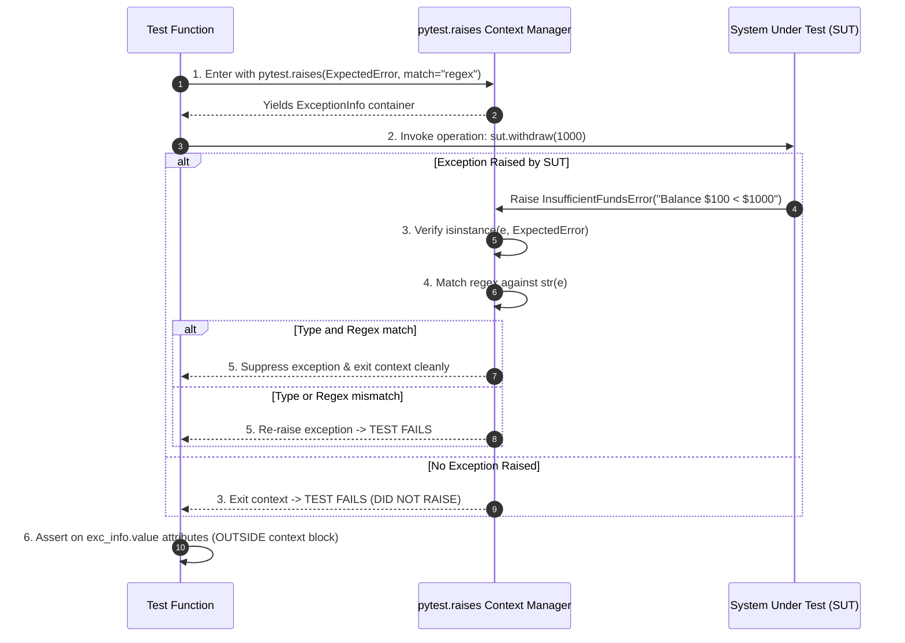

# Exception Testing & Negative Test Paths with `pytest.raises` ⚠️

> **Authoritative Sources & Literature:**
> - Brian Okken: *Python Testing with pytest* (Chapter 2: Writing Test Functions - Expecting Exceptions, Pragmatic Bookshelf)
> - Python Language Reference: *Section 8: Errors and Exceptions*
> - Gerard Meszaros: *xUnit Test Patterns: Refactoring Test Code* (Expected Exception Testing Pattern)

---

## 1. Conceptual Definition & Core Mental Model

In backend systems, verifying what happens when things go **wrong** (negative paths, validation errors, unauthorized access, domain rule violations) is just as critical as testing the happy path.

### The Anti-Pattern: Manual `try...except`
Before `pytest`, developers tested exceptions using imperative `try...except` blocks:

```python
# ❌ IMPERATIVE ANTI-PATTERN: Verbose, error-prone, and easy to mess up!
def test_division_by_zero_bad():
    try:
        divide(10, 0)
        assert False, "Expected ZeroDivisionError, but no exception was raised!"
    except ZeroDivisionError as e:
        assert "division by zero" in str(e)
```
**Failure Mode**: If the developer forgets the `assert False` statement, a function that fails to raise any exception will **silently pass the test**!

### The Pytest Solution: Declarative `pytest.raises`
`pytest.raises` is an idiomatic context manager that asserts an exact exception type is raised, verifies its error message using regular expressions, and captures the exception object for deep inspection:

```python
# ✅ IDIOMATIC PYTEST: Declarative and fail-safe
import pytest

def test_division_by_zero_good():
    with pytest.raises(ZeroDivisionError, match="division by zero"):
        divide(10, 0)
```

---

## 2. Why This Is Critical in Modern Python Backend Engineering

1. **Preventing Accidental False Passes**: If a function that is supposed to reject invalid data fails to raise an error, `pytest.raises` immediately fails the test with:
   `Failed: DID NOT RAISE <class 'ValueError'>`.
2. **Preventing Error Masquerading**: If you test a function with `with pytest.raises(ValueError):`, but an internal typo raises `TypeError: 'NoneType' object is not subscriptable`, pytest does **not** mask the error; it fails the test and prints the full `TypeError` traceback.
3. **Validating Structured Error Payloads**: Modern enterprise backends use custom domain exception hierarchies with rich attributes (e.g. `error_code`, `http_status`, `retry_after_seconds`). `pytest.raises` provides full access to inspect these custom attributes.

---

## 3. Internal Mechanics: The Exception Capture Protocol



---

## 4. Standard Syntax, Signatures & Key Options

### Basic Exception Matching
```python
import pytest

def test_simple_exception():
    with pytest.raises(ValueError):
        int("not-a-number")
```

### Regex Matching with `match`
The `match` parameter accepts a regular expression pattern matched against `str(exception)`. This guarantees that you are testing the **exact error message**, not a generic error:

```python
# Exact or partial regex matching
with pytest.raises(ValueError, match=r"invalid literal for int\(\)"):
    int("invalid")

# Anchored regex matching
with pytest.raises(PermissionError, match=r"^User 'usr_\d+' is not an admin$"):
    check_admin_access(user_id="usr_42")
```

### Inspecting the Captured Exception (`exc_info`)
To inspect attributes on the exception instance, bind the context manager to a variable using `as exc_info`:

```python
def test_inspect_exception_attributes():
    with pytest.raises(CustomAPIException) as exc_info:
        process_transaction(amount=-50)

    # CRITICAL: Assertions on exc_info must be placed OUTSIDE the with block!
    assert exc_info.type is CustomAPIException
    assert exc_info.value.status_code == 400
    assert exc_info.value.error_code == "ERR_NEGATIVE_AMOUNT"
```

---

## 5. Lifecycle, Execution Flow & Teardown Mechanics

> [!CAUTION]
> **The Placement Rule for `pytest.raises`**:
> Any code placed **inside** the `with pytest.raises()` block *after* the line that raises the exception **will never execute**!
>
> ```python
> # ❌ BAD: Assertion inside the block NEVER runs!
> with pytest.raises(ValueError):
>     raise_value_error()
>     assert False # Unreachable!
>     assert some_variable == 10 # This assertion never runs!
>
> # ✅ GOOD: Place subsequent assertions OUTSIDE the with block
> with pytest.raises(ValueError) as exc_info:
>     raise_value_error()
>
> assert exc_info.value.code == 10 # Runs and validates properly!
> ```

---

## 6. Scopes, Hierarchy, or Test Boundaries: Exception Inheritance

In Python, exceptions inherit from base classes. Be precise about which level of the hierarchy you assert:

```python
# Domain Exception Hierarchy
class BankingError(Exception): pass
class AccountError(BankingError): pass
class InsufficientFundsError(AccountError): pass
```

- `with pytest.raises(BankingError):` will pass if `InsufficientFundsError` is raised (because it is a subclass).
- **Production Standard**: Always assert the **leaf exception class** (`InsufficientFundsError`) unless you are specifically testing base class polymorphism. Asserting the base class risks masking other unexpected subclasses.

---

## 7. Pytest Fixture & `conftest.py` Integration Patterns

You can define custom assertion helper fixtures for validating standard REST API error shapes:

```python
# tests/conftest.py
import pytest

@pytest.fixture
def assert_api_error():
    """Helper fixture to validate standardized API error dictionaries."""
    def _assert_error(response, expected_status: int, expected_code: str):
        assert response.status_code == expected_status
        payload = response.json()
        assert payload["error"]["code"] == expected_code
        assert "timestamp" in payload["error"]
    return _assert_error
```

---

## 8. Practical Python Implementation: Step-by-Step Walkthrough

We will build a **Fintech Bank Account Withdrawal Engine** with custom structured exceptions and test all negative paths.

### Step 1: Define Custom Domain Exception Hierarchy

```python
# src/domain/exceptions.py
from decimal import Decimal

class BankingError(Exception):
    """Base exception for all banking operations."""
    pass

class InsufficientFundsError(BankingError):
    """Raised when an account lacks funds for a withdrawal."""
    def __init__(self, account_id: str, requested: Decimal, available: Decimal):
        self.account_id = account_id
        self.requested = requested
        self.available = available
        self.shortage = requested - available
        super().__init__(
            f"Account '{account_id}' has insufficient funds: "
            f"requested {requested}, available {available} (shortage: {self.shortage})"
        )

class AccountFrozenError(BankingError):
    """Raised when attempting transactions on a frozen account."""
    def __init__(self, account_id: str, reason: str):
        self.account_id = account_id
        self.reason = reason
        super().__init__(f"Account '{account_id}' is frozen: {reason}")
```

### Step 2: Define Domain Service

```python
# src/domain/account.py
from decimal import Decimal
from src.domain.exceptions import InsufficientFundsError, AccountFrozenError

class BankAccount:
    def __init__(self, account_id: str, balance: Decimal, is_frozen: bool = False):
        self.account_id = account_id
        self.balance = balance
        self.is_frozen = is_frozen

    def withdraw(self, amount: Decimal) -> Decimal:
        if self.is_frozen:
            raise AccountFrozenError(self.account_id, reason="Suspected AML fraud")

        if amount <= Decimal("0.00"):
            raise ValueError("Withdrawal amount must be strictly positive")

        if amount > self.balance:
            raise InsufficientFundsError(
                account_id=self.account_id,
                requested=amount,
                available=self.balance,
            )

        self.balance -= amount
        return self.balance
```

### Step 3: Implement Exhaustive Negative Tests

```python
# tests/unit/test_account_exceptions.py
import pytest
from decimal import Decimal
from src.domain.account import BankAccount
from src.domain.exceptions import InsufficientFundsError, AccountFrozenError

def test_withdraw_insufficient_funds_raises_custom_exception():
    account = BankAccount(account_id="ACC_100", balance=Decimal("250.00"))

    # Act & Assert: Verify exact exception type and regex match
    with pytest.raises(
        InsufficientFundsError,
        match=r"^Account 'ACC_100' has insufficient funds: requested 300\.00, available 250\.00"
    ) as exc_info:
        account.withdraw(Decimal("300.00"))

    # Inspect custom structured attributes on the exception instance!
    error = exc_info.value
    assert error.account_id == "ACC_100"
    assert error.requested == Decimal("300.00")
    assert error.available == Decimal("250.00")
    assert error.shortage == Decimal("50.00")

    # Assert account balance remained completely invariant
    assert account.balance == Decimal("250.00")

def test_withdraw_frozen_account_raises_account_frozen_error():
    frozen_account = BankAccount(account_id="ACC_LOCKED", balance=Decimal("500.00"), is_frozen=True)

    with pytest.raises(AccountFrozenError, match="Suspected AML fraud") as exc_info:
        frozen_account.withdraw(Decimal("50.00"))

    assert exc_info.value.account_id == "ACC_LOCKED"
    assert exc_info.value.reason == "Suspected AML fraud"

def test_negative_withdrawal_amount_raises_value_error():
    account = BankAccount(account_id="ACC_100", balance=Decimal("100.00"))

    with pytest.raises(ValueError, match="Withdrawal amount must be strictly positive"):
        account.withdraw(Decimal("-10.00"))
```

---

## 9. Framework-Specific Integration: FastAPI Exception Handlers

In FastAPI, domain exceptions are converted into HTTP responses via custom exception handlers:

```python
# src/main.py
from fastapi import FastAPI, Request, status
from fastapi.responses import JSONResponse
from src.domain.exceptions import InsufficientFundsError

app = FastAPI()

@app.exception_handler(InsufficientFundsError)
async def insufficient_funds_handler(request: Request, exc: InsufficientFundsError):
    return JSONResponse(
        status_code=status.HTTP_400_BAD_REQUEST,
        content={
            "error_code": "INSUFFICIENT_FUNDS",
            "message": str(exc),
            "shortage": str(exc.shortage),
        }
    )
```

### Testing the HTTP Mapping

```python
# tests/integration/test_error_mapping.py
import pytest
from httpx import AsyncClient, ASGITransport
from src.main import app

@pytest.mark.asyncio
async def test_insufficient_funds_maps_to_http_400():
    async with AsyncClient(transport=ASGITransport(app=app), base_url="http://test") as client:
        response = await client.post("/api/v1/withdraw", json={"account_id": "ACC_1", "amount": "9999.00"})
        
        assert response.status_code == 400
        payload = response.json()
        assert payload["error_code"] == "INSUFFICIENT_FUNDS"
        assert payload["shortage"] == "9899.00"
```

---

## 10. Real-World Enterprise Backend Scenario: B2B Rate Limiting

In an enterprise API gateway:
- When a client sends 101 requests in 1 minute, a `RateLimitExceededError` is raised.
- The exception contains structured fields: `retry_after_seconds=42`, `client_id="acme_corp"`.
- Unit tests verify that `exc_info.value.retry_after_seconds` is calculated accurately based on the Redis bucket timestamp.

---

## 11. Anti-Patterns & Common Pitfalls

### Anti-Pattern 1: Catching Generic `Exception`
```python
# ❌ DANGEROUS: Catches ANYTHING, masking internal bugs!
with pytest.raises(Exception):
    calculate_tax(user) # If user is None and raises AttributeError, test passes!
```
- **Fix**: Always specify the exact leaf exception type (e.g. `TaxCalculationError`).

### Anti-Pattern 2: Omitting the `match` Regex
```python
# ❌ LOOSE: Any ValueError passes!
with pytest.raises(ValueError):
    register_user(email="bad", age=25)
    # If it raised ValueError("Age must be over 18"), test passes even though email was the target!
```
- **Fix**: Always provide `match=r"Invalid email format"`.

### Anti-Pattern 3: Placing Post-Assertions Inside the `with` Block
Placing assertions after the raising statement inside the `with` block will cause those assertions to never execute.

---

## 12. Best Practices & Production Guidelines

1. **Always Use `match=...`**: Enforce that the exception was triggered for the exact intended reason.
2. **Design Domain Exception Hierarchies**: Create explicit, structured exception classes with typed attributes rather than raising bare `Exception("message")`.
3. **Verify State Invariance After Exceptions**: Ensure that when an exception is raised, the database session is rolled back and in-memory balances are unchanged.
4. **Assert Custom Attributes on `exc_info.value`**: Don't just assert on the message string; assert on structured error codes and numerical amounts.

---

## 13. Trade-Off Analysis: Exception Testing Approaches

| Approach | Syntax Style | Message Regex Checking | Attribute Inspection | Fails if No Error Raised? |
| :--- | :--- | :--- | :--- | :--- |
| **`with pytest.raises()`** | Declarative | **Native (`match=...`)** | **Native (`exc_info.value`)** | **Yes (`DID NOT RAISE`)** |
| **`unittest.TestCase.assertRaises`** | Context Manager | Supported (`assertRaisesRegex`) | Cumbersome | Yes |
| **Manual `try...except`** | Imperative | Manual regex | Manual | **No (unless `assert False`)** |

---

## 14. Diagnostic & Debugging Playbook

```bash
# If pytest.raises fails because of regex mismatch, pytest prints:
# Pattern: 'Expected pattern'
#   Value: 'Actual message produced by code'

# To print the full traceback of an unexpected exception that caused a failure:
pytest --tb=short
```

---

## 15. Senior Staff Interview Questions & Deep Dives

### Question 1: How does `pytest.raises` work under the hood, and how does it differentiate between an expected exception, an unexpected exception, and no exception at all?
**Answer**:
`pytest.raises` returns an instance of `pytest.ExceptionInfo`, which implements the Python context manager protocol (`__enter__` and `__exit__`).
1. In `__enter__`, it returns an empty `ExceptionInfo` container.
2. The wrapped test block executes.
3. In `__exit__(exc_type, exc_val, exc_tb)`:
   - If `exc_type is None` (no exception occurred), it raises `pytest.fail("DID NOT RAISE {expected}")`.
   - If `exc_type` is an unexpected exception (not a subclass of the target exception), it returns `False`, causing Python to re-raise the unexpected exception and fail the test with its original traceback.
   - If `issubclass(exc_type, expected_exception)`: it records the exception in `ExceptionInfo.value`. If `match` was provided, it searches `str(exc_val)` using `re.search()`. If the regex matches, it returns `True`, suppressing the exception so the test continues; if the regex does not match, it raises `pytest.fail("Pattern '...' does not match '...'")`.

### Question 2: Why should domain exceptions never inherit directly from `BaseException`?
**Answer**:
In Python, the top-level exception is `BaseException`, from which `Exception`, `SystemExit`, `KeyboardInterrupt`, and `GeneratorExit` inherit. Application and domain exceptions must **always** inherit from `Exception` (or a subclass of `Exception`). If a domain exception inherits directly from `BaseException`, standard `except Exception:` blocks across web framework middlewares (FastAPI, Flask) will fail to catch it, causing unhandled worker crashes and killing the server process rather than returning a clean `HTTP 500` or `HTTP 400` JSON response.

---

## 16. Hands-on Engineering Exercises & Challenges

### Exercise 1: Refactoring a Buggy Manual Try/Except Test
Given:
```python
def test_parse_bad_json():
    try:
        parse_json("{invalid}")
    except ValueError:
        pass
```
1. Explain the critical bug in this test.
2. Refactor it using `with pytest.raises(JSONDecodeError, match=...)`.
3. Verify that if `parse_json` is changed to return `None` instead of raising, the refactored test fails immediately.

### Exercise 2: Testing a Custom Overdraft Exception with Attributes
Create a custom `OverdraftError` with attributes `limit: Decimal` and `attempted: Decimal`. Write a test using `pytest.raises` that verifies both attributes directly on `exc_info.value`.

---

## 17. Summary, Cross-References & Further Reading

Negative path testing is the hallmark of mature backend engineering. By mastering `pytest.raises`, enforcing regex message matching with `match`, and verifying structured exception attributes, backend teams guarantee that applications fail safely and predictably.

### Cross-References:
- Previous: [Async Testing with pytest-asyncio & AnyIO](async-testing.md)
- Next: [Debugging Test Failures: CLI Flags & Interactive PDB](debugging-tests.md)
- [Software Testing Fundamentals: Boundary Values](../foundations/software-testing-fundamentals.md)
- [FastAPI Request Validation Testing](../fastapi-testing/request-validation.md)
