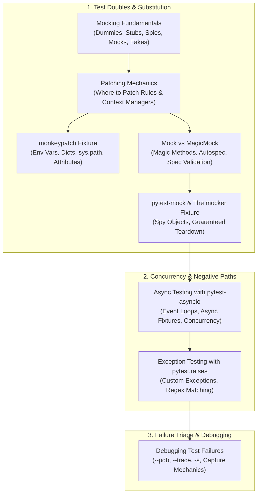

# Advanced Pytest: Runtime Interception, Test Doubles & Async Testing 🎛️

> **Authoritative Sources & Literature:**
> - Brian Okken: *Python Testing with pytest* (Chapter 8: Built-in Fixtures, Chapter 11: Debugging Test Failures, Pragmatic Bookshelf)
> - Gerard Meszaros: *xUnit Test Patterns: Refactoring Test Code* (Test Double Patterns, Addison-Wesley)
> - Michael Foord: *Python unittest.mock Architecture & Specification* (docs.python.org)
> - Nathaniel J. Smith: *Notes on Structured Concurrency, Trio & AnyIO*

---

## 📖 Module Overview

Writing isolated, deterministic tests for modern Python backend applications requires manipulating the runtime:
- Substituting slow or volatile external systems (Stripe, Twilio, AWS S3) with controlled test doubles.
- Safely modifying process-level state (environment variables, `sys.modules`, system paths) without leaking mutations across tests.
- Navigating the subtleties of Python's dynamic object model (`Mock` vs. `MagicMock`, magic methods, and `autospec`).
- Verifying asynchronous, non-blocking coroutines running on Python's event loop (`pytest-asyncio`, `anyio`).
- Pinpointing root causes of test failures using interactive terminal debuggers (`--pdb`).

This module provides senior backend engineers with an authoritative manual for mastering runtime interception, test doubles, and asynchronous testing.

---

## 🗺️ Module Guides

### 1. [Mocking Fundamentals & The Test Double Spectrum](mocking.md)
Deconstruct Gerard Meszaros' classic test double taxonomy: **Dummy**, **Stub**, **Spy**, **Mock**, and **Fake**. Learn when each should be used in modern backend architectures and why in-memory Fakes are superior to over-mocked unit tests.

### 2. [Patching Mechanics & Target Location Rules](patching.md)
Master Python's `unittest.mock.patch`. Learn the fundamental rule of patching: *"Patch where an object is looked up, not where it is defined"*. Contrast context managers, function decorators, and class decorators.

### 3. [Safe Runtime Substitution with `monkeypatch`](monkeypatch.md)
Use pytest's built-in `monkeypatch` fixture to safely modify environment variables (`setenv`), dictionary configurations (`setitem`), class attributes (`setattr`), and Python's `sys.path` with 100% guaranteed teardown restoration.

### 4. [`Mock` vs. `MagicMock` & Spec Validation](mock-vs-magicmock.md)
Understand Python's two primary mock classes. Deep dive into magic method dispatch (`__enter__`, `__exit__`, `__iter__`, `__len__`, `__getitem__`). Prevent "silent pass" bugs using `spec=True` and `create_autospec=True`.

### 5. [Idiomatic Mocking with `pytest-mock`](pytest-mock.md)
Eliminate nested `@patch` decorator bloat using the `mocker` fixture. Master Spy objects (`mocker.spy`) to inspect real function execution without modifying behavior, and stub return values safely.

### 6. [Async Testing with `pytest-asyncio` & AnyIO](async-testing.md)
Test modern asynchronous backends (FastAPI, Starlette, Async SQLAlchemy). Understand event loop lifecycles, async fixtures, testing concurrent tasks, and avoiding unhandled coroutine warnings.

### 7. [Exception Testing & Negative Test Paths](exception-testing.md)
Verify error handling and business invariants. Master `pytest.raises`, inspecting exception attributes (`exc_info.value`), matching error messages with regex, and asserting negative paths.

### 8. [Debugging Test Failures: CLI Flags & Interactive PDB](debugging-tests.md)
Triage failures in seconds. Master `--pdb`, `--trace`, `-s` (capture bypass), `-vv`, and `--tb=short`. Learn how to inspect local variables at the point of assertion failure.

---

## 📊 Summary of Test Double Mechanics

| Test Double | Purpose | Modifies State? | Verification Style | Typical Backend Usage |
| :--- | :--- | :--- | :--- | :--- |
| **Dummy** | Satisfy required method signatures | No | None | Unused logger or auth context |
| **Stub** | Return hardcoded canned responses | No | None | Currency conversion rate stub |
| **Spy** | Record call parameters on real object | No | Behavioral | Verifying audit logger invocations |
| **Mock** | Assert behavioral expectations | No | Behavioral (`assert_called_once`) | Third-party Stripe charge gateway |
| **Fake** | Real working in-memory shortcut | Yes (In-memory) | **State Verification** | In-memory `dict`-backed repository |

---

## ⏭️ Next Steps

Begin with **[Mocking Fundamentals](mocking.md)** to establish clear boundaries for test doubles.
