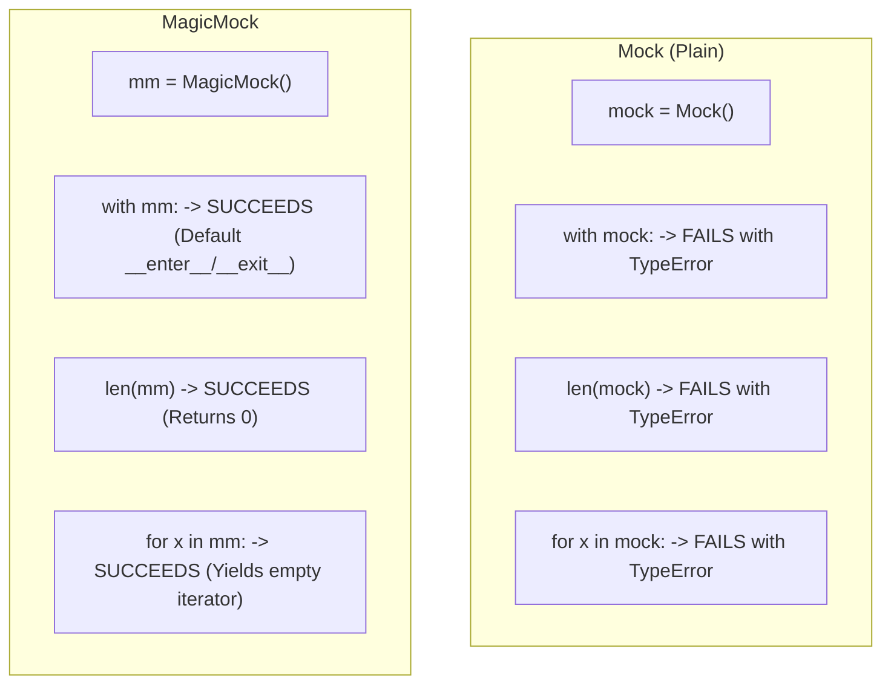
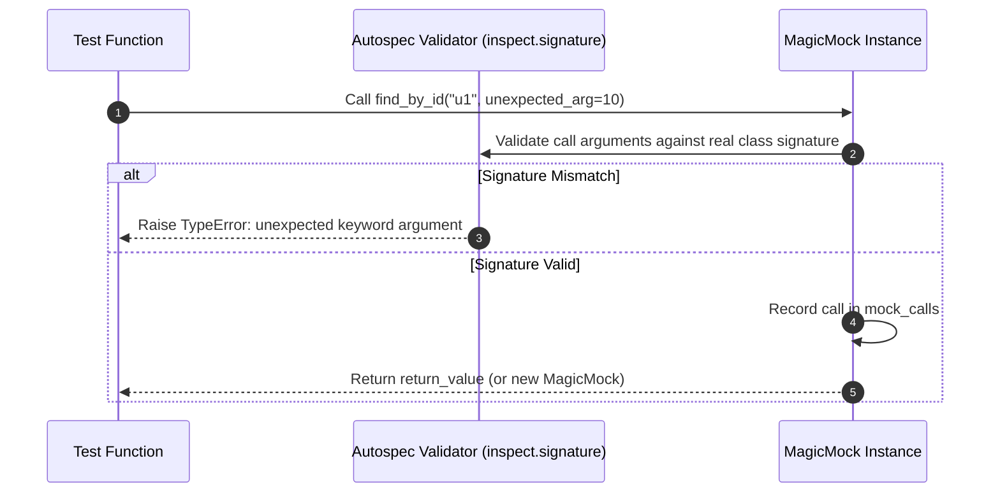

# `Mock` vs. `MagicMock` & Spec Validation 🪄

> **Authoritative Sources & Literature:**
> - Michael Foord: *Python unittest.mock Architecture & Internals* (docs.python.org)
> - Brian Okken: *Python Testing with pytest* (Chapter 8: Built-in Fixtures, Pragmatic Bookshelf)
> - Python Language Reference: *Section 3.3 Special Method Names (Dunder Methods)*

---

## 1. Conceptual Definition & Core Mental Model

In Python's standard `unittest.mock` library, two primary classes generate test doubles: **`Mock`** and **`MagicMock`**.

While they appear similar on the surface, they handle Python's **Special Methods (Dunder / Magic Methods)** completely differently:
- **`Mock`**: A general-purpose callable double. It does **not** implement magic methods by default (e.g., `__enter__`, `__exit__`, `__iter__`, `__len__`, `__getitem__`).
- **`MagicMock`**: A subclass of `Mock` that pre-implements default implementations of almost all standard Python dunder methods.

```
                  [ NonCallableMock ]
                           │
                        [ Mock ] (No default magic methods)
                           │
                     [ MagicMock ] (Pre-implements __enter__, __iter__, etc.)
                           │
                     [ AsyncMock ] (Implements async def, __aenter__, __aexit__)
```

### Why Does Python Have Both?
In Python's internal C-API, magic methods (like `__len__` or `__enter__`) are looked up on the **class** (`type(instance).__enter__`), bypassing instance-level `__dict__` attribute lookups for performance reasons. `MagicMock` handles this complex metaclass plumbing automatically.

---

## 2. Why This Is Critical in Modern Python Backend Engineering

1. **Context Manager Testing (`with` statements)**: Modern backends constantly use context managers: database sessions (`with db.begin(): ...`), distributed locks (`with redis_lock: ...`), file operations (`with open(...) as f: ...`). Using a plain `Mock` causes Python to crash with:
   `TypeError: 'Mock' object does not support the context manager protocol`.
2. **Collection & Iteration Testing**: Testing code that iterates over database result sets (`for row in results: ...`) or checks collection size (`len(queue)`).
3. **The "Silent Pass" Disaster**: By default, both `Mock` and `MagicMock` dynamically create a new mock instance whenever any attribute is accessed. If your code calls `user_repo.fnd_by_id()` (misspelled `find_by_id`), the un-specced mock silently succeeds, masking fatal runtime bugs!

---

## 3. Comparison: Dunder Method Support



| Dunder Protocol | `Mock` | `MagicMock` Default Behavior |
| :--- | :--- | :--- |
| Context Manager (`with obj:`) | ❌ `TypeError` | ✅ `__enter__` returns self; `__exit__` returns `None` |
| Length (`len(obj)`) | ❌ `TypeError` | ✅ Returns `0` (or configured int) |
| Iteration (`for x in obj:`) | ❌ `TypeError` | ✅ Returns empty `iter([])` |
| Indexing (`obj[key]`) | ❌ `TypeError` | ✅ Returns new `MagicMock()` |
| String Representation (`str(obj)`) | `<Mock id='...'>` | `<MagicMock id='...'>` |
| Truthiness (`bool(obj)`) | `True` | `True` |

---

## 4. Standard Syntax, Signatures & Key Options

### Customizing Magic Methods on `MagicMock`
```python
from unittest.mock import MagicMock

# 1. Customizing Context Manager return value
mock_db = MagicMock()
mock_session = MagicMock()
mock_db.__enter__.return_value = mock_session

with mock_db as session:
    assert session is mock_session

# 2. Customizing Collection Length
mock_queue = MagicMock()
mock_queue.__len__.return_value = 42
assert len(mock_queue) == 42

# 3. Customizing Iteration
mock_cursor = MagicMock()
mock_cursor.__iter__.return_value = iter([{"id": 1}, {"id": 2}])
assert [row["id"] for row in mock_cursor] == [1, 2]

# 4. Customizing Dictionary / Subscript Access
mock_cache = MagicMock()
mock_cache.__getitem__.return_value = "cached_data"
assert mock_cache["user_100"] == "cached_data"
```

---

## 5. Eliminating False Passes with Spec Validation

An un-specced mock creates any attribute you ask for:

```python
# ❌ DANGEROUS: Silent pass on non-existent methods!
mock_repo = MagicMock()
mock_repo.delete_all_users_permanently() # Typo / Non-existent method!
# Test PASSES! Production CRASHES with AttributeError!
```

### Level 1: `spec=RealClass`
Restricts available attributes to those present on `RealClass`:

```python
from src.repositories import UserRepository

# Restricts attributes to UserRepository
mock_repo = MagicMock(spec=UserRepository)

# Non-existent attribute raises immediate error!
mock_repo.non_existent_method()
# Raises: AttributeError: Mock object has no attribute 'non_existent_method'
```
*Limitation*: While it checks attribute existence, it does **not** check function argument counts or parameter names!

### Level 2: `spec_set=RealClass`
Even stricter than `spec`. Disallows setting new attributes on the mock instance that did not exist on the class.

### Level 3: `create_autospec` (The Production Standard)
Inspects the real class using reflection (`inspect.signature`) and validates:
1. Method existence.
2. Argument counts.
3. Keyword parameter names.

```python
from unittest.mock import create_autospec
from src.repositories import UserRepository

# If UserRepository.find_by_id(self, user_id: str) exists:
mock_repo = create_autospec(UserRepository, instance=True)

# 1. Calling non-existent method -> AttributeError
mock_repo.fnd_by_id("u1") # FAILS: AttributeError

# 2. Calling with wrong argument count -> TypeError
mock_repo.find_by_id() # FAILS: TypeError: missing a required argument: 'user_id'
```

---

## 6. Lifecycle, Execution Flow & Teardown Mechanics



---

## 7. Scopes, Hierarchy, or Test Boundaries

```
[ When to use Mock ]
  └── Raw callbacks, simple functions, or when magic methods should NOT evaluate

[ When to use MagicMock ]
  └── Objects used with 'with', 'for', 'len()', '[]', or arithmetic operators

[ When to use AsyncMock (Python 3.8+) ]
  └── Async functions (async def), 'async with', and 'async for'

[ When to use create_autospec ]
  └── ALWAYS when mocking domain services, repositories, and business classes!
```

---

## 8. Pytest Fixture & `conftest.py` Integration Patterns

```python
# tests/conftest.py
import pytest
from unittest.mock import create_autospec
from src.adapters.postgres_repo import PostgresUserRepository

@pytest.fixture
def mock_user_repo() -> PostgresUserRepository:
    """
    Specced mock guaranteed to mirror the real UserRepository interface!
    instance=True ensures it behaves like an instantiated object, not the class.
    """
    mock = create_autospec(PostgresUserRepository, instance=True)
    mock.get_by_id.return_value = None
    return mock
```

---

## 9. Practical Python Implementation: Step-by-Step Walkthrough

We will build a **Database Transaction Manager** and demonstrate why `Mock` fails, how `MagicMock` succeeds, and how `create_autospec` catches signature drift.

### Step 1: Define Production Code

```python
# src/database/transaction.py
class DatabaseTransaction:
    def __init__(self, connection_str: str):
        self.connection_str = connection_str

    def __enter__(self):
        # Starts database transaction
        return self

    def __exit__(self, exc_type, exc_val, exc_tb):
        # Commits or rolls back
        return False

    def execute_query(self, query: str, timeout: int = 30) -> list:
        # Real SQL query execution
        return [{"status": "OK"}]
```

### Step 2: The Failure of Plain `Mock`

```python
# tests/unit/test_transaction.py
import pytest
from unittest.mock import Mock, MagicMock, create_autospec
from src.database.transaction import DatabaseTransaction

def test_plain_mock_fails_as_context_manager():
    mock_tx = Mock()
    
    # Attempting to use plain Mock as context manager explodes!
    with pytest.raises(TypeError, match="does not support the context manager protocol"):
        with mock_tx:
            pass

def test_magic_mock_succeeds_as_context_manager():
    mock_tx = MagicMock()
    
    # MagicMock pre-implements __enter__ and __exit__!
    with mock_tx as tx:
        assert tx is mock_tx

def test_autospec_catches_signature_mismatch():
    # create_autospec enforces the exact parameters of execute_query(query, timeout=30)
    mock_tx = create_autospec(DatabaseTransaction, instance=True)
    
    # 1. Calling with invalid parameter name raises TypeError immediately!
    with pytest.raises(TypeError, match="unexpected keyword argument 'invalid_param'"):
        mock_tx.execute_query("SELECT 1", invalid_param=True)

    # 2. Calling with missing mandatory parameter raises TypeError!
    with pytest.raises(TypeError, match="missing a required argument: 'query'"):
        mock_tx.execute_query()
```

---

## 10. Framework-Specific Integration: SQLAlchemy Session Context Managers

In SQLAlchemy 2.0, database sessions are context managers (`with Session(engine) as session:`):

```python
# tests/unit/test_sqlalchemy_mock.py
from unittest.mock import MagicMock

def test_sqlalchemy_session_mock():
    # Must use MagicMock to satisfy context manager protocol
    mock_session = MagicMock()
    
    # Simulate: with session.begin():
    mock_session.begin.return_value = MagicMock()
    
    with mock_session.begin():
        mock_session.add({"id": 1})
        
    mock_session.add.assert_called_once_with({"id": 1})
```

---

## 11. Real-World Enterprise Backend Scenario: Redis Distributed Locks

In an enterprise background job processor:
- A Celery task wraps critical section execution in a Redis distributed lock:
  ```python
  with redis_client.lock("payout_job_lock", timeout=60):
      process_daily_payouts()
  ```
- If tested with a plain `Mock()`, the test crashes with `TypeError`.
- With `MagicMock(spec=redis.Redis)`, the lock's `__enter__` and `__exit__` simulate lock acquisition and release seamlessly, and `spec` verifies that `.lock()` was called with valid parameters.

---

## 12. Anti-Patterns & Common Pitfalls

### Anti-Pattern 1: The Vanilla Un-Specced Mock
```python
# ❌ DANGEROUS: Allows any typo to pass
repo = MagicMock()
repo.find_by_user_idd("u1") # Passes silently!
```
- **Fix**: Use `create_autospec(RealClass, instance=True)`.

### Anti-Pattern 2: Manually Overriding `__bool__` Improperly
```python
# ❌ BUG: MagicMock evaluates to True by default in if statements
mock_result = MagicMock()
if not mock_result: # This branch NEVER executes!
    ...
```
- **Fix**: Explicitly set `mock_result.__bool__.return_value = False`.

---

## 13. Best Practices & Production Guidelines

1. **Default to `create_autospec` for Domain Classes**: Never use raw `Mock()` or raw `MagicMock()` when mocking classes that exist in your codebase.
2. **Use `instance=True` with `create_autospec`**: When mocking an instance of a class rather than the class itself, always pass `instance=True`.
3. **Use `AsyncMock` for Coroutines**: If mocking an `async def` function, use `AsyncMock` (or `MagicMock` with `asyncio_mode="auto"`).
4. **Use `spec_set` to Prevent Attribute Pollution**: `spec_set` prevents tests from accidentally writing to misspelled mock attributes.

---

## 14. Trade-Off Analysis: Mocking Classes

| Feature | `Mock` | `MagicMock` | `create_autospec` |
| :--- | :--- | :--- | :--- |
| **Context Managers (`with`)** | ❌ Fails | ✅ Supported | ✅ Supported (if on real class) |
| **Iterators (`for`)** | ❌ Fails | ✅ Supported | ✅ Supported (if on real class) |
| **Catches Method Typos?** | ❌ No | ❌ No | ✅ **Yes (`AttributeError`)** |
| **Validates Arguments?** | ❌ No | ❌ No | ✅ **Yes (`TypeError`)** |
| **Setup Cost** | Trivial | Trivial | Minimal reflection overhead |

---

## 15. Diagnostic & Debugging Playbook

```python
# Check if a mock is a MagicMock
from unittest.mock import MagicMock
print("Is MagicMock?", isinstance(my_mock, MagicMock))

# Print all methods allowed on a specced mock
print("Allowed spec attributes:", dir(my_mock))

# Check mock calls
print("Calls received:", my_mock.mock_calls)
```

---

## 16. Senior Staff Interview Questions & Deep Dives

### Question 1: Why does Python's standard `Mock` fail when used in a `with` statement, while `MagicMock` succeeds?
**Answer**:
In Python's data model, special (dunder) methods are looked up on the **type/class** of the object rather than its instance dictionary (`type(obj).__enter__` instead of `obj.__enter__`). In a plain `Mock`, the class is `Mock`, which does not define `__enter__` or `__exit__`. Even if you assign `mock.__enter__ = Mock()`, the C-level slot lookup in Python's interpreter fails, raising `TypeError: 'Mock' object does not support the context manager protocol`. `MagicMock` creates a dynamic class that defines all standard dunder methods on the class level, routing each call to an internal mock instance attribute so that the context manager protocol is satisfied.

### Question 2: What is the operational difference between `spec=TargetClass` and `create_autospec(TargetClass)`?
**Answer**:
- `spec=TargetClass` only performs a shallow attribute check: it restricts attribute access on the mock to names present in `dir(TargetClass)`. However, if you access a method on the mock (`mock.my_method`), that method returns a standard un-specced `MagicMock` that will accept **any arbitrary arguments**, even if the real method takes zero parameters!
- `create_autospec(TargetClass)` recursively traverses the target class, inspecting the function signatures of every method using `inspect.signature`. It replaces each method with a specced mock that actively validates call arguments against the real signature at runtime, raising a `TypeError` if required parameters are missing or unexpected arguments are supplied.

---

## 17. Hands-on Engineering Exercises & Challenges

### Exercise 1: Demonstrating Context Manager Mocking
Write a class `FileManager` with an `open_file(path)` method that returns a context manager.
1. Write a test that attempts to mock `FileManager` with `Mock()` and observe the `TypeError`.
2. Replace it with `MagicMock()` and configure `__enter__.return_value = "file_contents"`.
3. Verify the test passes.

### Exercise 2: Catching a Signature Drift with `create_autospec`
You have an `EmailService` with method `send(recipient: str, body: str, priority: int = 1)`.
1. Create a `MagicMock(spec=EmailService)` and call `send("user@test.com")` (missing `body`). Observe that the test passes!
2. Replace it with `create_autospec(EmailService, instance=True)`.
3. Observe that `create_autospec` immediately catches the missing argument with a `TypeError`.

---

## 18. Summary, Cross-References & Further Reading

Understanding the distinction between `Mock` and `MagicMock`, and adopting `create_autospec` as standard practice, prevents false-positive passes and fragile tests. By speccing mocks against real classes, backend teams ensure their test doubles stay synchronized with production code.

### Cross-References:
- Previous: [Safe Runtime Substitution with monkeypatch](monkeypatch.md)
- Next: [Idiomatic Mocking with pytest-mock](pytest-mock.md)
- [Mocking Fundamentals & The Test Double Spectrum](mocking.md)
- [Async Testing with pytest-asyncio](async-testing.md)
