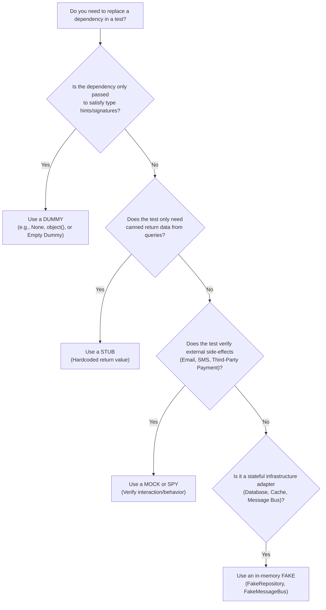
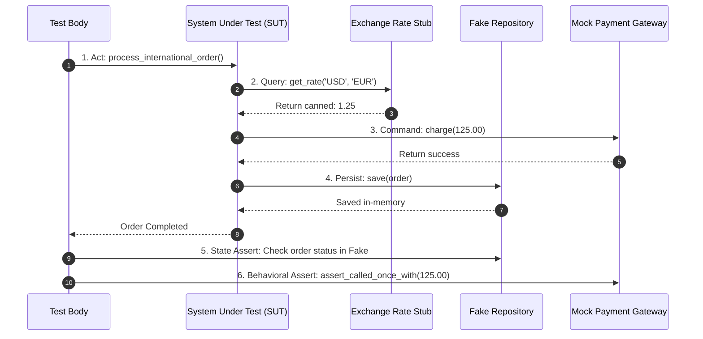

# Mocking Fundamentals & The Test Double Spectrum 🎭

> **Authoritative Sources & Literature:**
> - Gerard Meszaros: *xUnit Test Patterns: Refactoring Test Code* (Test Double Patterns, Addison-Wesley)
> - Martin Fowler: *Mocks Aren't Stubs* (martinfowler.com)
> - Brian Okken: *Python Testing with pytest* (Chapter 8: Built-in Fixtures, Pragmatic Bookshelf)
> - Harry Percival & Bob Gregory: *Architecture Patterns with Python* (Fake Repositories vs. Mocks)

---

## 1. Conceptual Definition & Core Mental Model

In software engineering, **Test Double** is the generic umbrella term coined by Gerard Meszaros for any case where a production dependency is replaced with a stand-in object for testing purposes.

In everyday developer conversation, the word "mock" is frequently misapplied as a catch-all for all test doubles. However, equating all test doubles to mocks leads to brittle, over-specified test suites.

### The Five Flavors of Test Doubles (Meszaros Taxonomy)

```
                          [ Test Double Spectrum ]
                                     │
         ┌──────────────┬────────────┼────────────┬──────────────┐
         ▼              ▼            ▼            ▼              ▼
     [ DUMMY ]      [ STUB ]      [ SPY ]      [ MOCK ]       [ FAKE ]
    Passed, but    Returns      Wraps real   Asserts        Working in-memory
    never used     canned data  & records    interactions   implementation
```

1. **Dummy**: Objects passed to satisfy parameter lists or type checkers, but never actually invoked or inspected during execution.
2. **Stub**: Objects providing canned, hardcoded responses to queries during the test, avoiding complex computational logic.
3. **Spy**: Wrappers around real or stubbed objects that silently record invocation metadata (arguments, execution count, call order) for later inspection.
4. **Mock**: Pre-programmed with behavioral expectations and assertions (`assert_called_once_with(...)`). The test fails if interactions deviate from the pre-programmed script.
5. **Fake**: A fully functional, lightweight implementation that takes shortcuts to eliminate heavy I/O (e.g. an in-memory `dict`-backed repository instead of PostgreSQL).

---

## 2. Why This Is Critical in Modern Python Backend Engineering

1. **Eliminating Fragile Behavioral Coupling**: When developers use Mocks for everything, unit tests become coupled to private implementation details (e.g., asserting that `mock_repo.get()` was called exactly once). Renaming or refactoring internal methods breaks dozens of tests even when the business outcome is completely unchanged.
2. **Isolating Third-Party Side Effects**: Operations that cost money, mutate external state, or send unrecoverable communications (Stripe charges, Twilio SMS, AWS S3 deletions, SendGrid emails) **must** be isolated via Mocks or Spies.
3. **Sub-Millisecond Feedback**: Replacing database round-trips and network latency with in-memory Fakes allows 1,000 unit tests to execute in under 1 second.

---

## 3. Test Double Decision Matrix



---

## 4. Standard Syntax, Signatures & Key Options

### Implementing the 5 Test Doubles in Python

```python
from unittest.mock import Mock, MagicMock
from typing import Protocol, List

# 1. DUMMY: Satisfies type signature; never executed
class DummyLogger:
    def log(self, message: str) -> None:
        pass

# 2. STUB: Canned return data
class StubExchangeRateService:
    def get_rate(self, base: str, target: str) -> float:
        return 1.25 # Hardcoded canned response

# 3. SPY: Records execution history
class SpyAuditDispatcher:
    def __init__(self):
        self.dispatched_events: List[str] = []

    def dispatch(self, event_name: str) -> None:
        self.dispatched_events.append(event_name)

# 4. MOCK: Programmed with behavioral expectations
mock_payment_gateway = Mock(spec=["charge"])
mock_payment_gateway.charge.return_value = {"id": "ch_999", "status": "PAID"}
# Later verified: mock_payment_gateway.charge.assert_called_once_with(100.0)

# 5. FAKE: Working in-memory shortcut
class FakeUserRepository:
    def __init__(self):
        self._users = {}

    def save(self, user):
        self._users[user.id] = user

    def get_by_id(self, user_id):
        return self._users.get(user_id)
```

---

## 5. Lifecycle, Execution Flow & Teardown Mechanics



---

## 6. Scopes, Hierarchy, or Test Boundaries

| Test Double | Verification Style | Primary Architectural Tier |
| :--- | :--- | :--- |
| **Dummy** | No Verification | Cross-cutting utilities (logging, tracing) |
| **Stub** | State Verification (on SUT) | Secondary Driven Ports (Read queries, external APIs) |
| **Spy** | Behavioral / Interaction Verification | Internal Domain Events & Telemetry |
| **Mock** | Behavioral / Interaction Verification | Critical Third-Party Side Effects (Stripe, Twilio) |
| **Fake** | **State Verification** | Persistence Repositories & Storage Adapters |

---

## 7. Pytest Fixture & `conftest.py` Integration Patterns

```python
# tests/conftest.py
import pytest
from unittest.mock import Mock
from tests.doubles.fakes import FakeOrderRepository
from tests.doubles.stubs import StubTaxService

@pytest.fixture
def fake_order_repo() -> FakeOrderRepository:
    """Fresh in-memory fake repository for every test."""
    return FakeOrderRepository()

@pytest.fixture
def stub_tax_service() -> StubTaxService:
    """Configured stub returning zero tax."""
    return StubTaxService(fixed_rate=0.0)

@pytest.fixture
def mock_sms_gateway() -> Mock:
    """Mock SMS gateway programmed with expectations."""
    gateway = Mock(spec=["send_sms"])
    gateway.send_sms.return_value = True
    return gateway
```

---

## 8. Practical Python Implementation: Step-by-Step Walkthrough

We will build an **E-Commerce Checkout Workflow** that demonstrates all five test doubles in a single cohesive test suite.

### Step 1: Define Application Domain & Interfaces

```python
# src/domain/checkout.py
from dataclasses import dataclass
from decimal import Decimal
from typing import Protocol, List

class LoggerPort(Protocol):
    def info(self, msg: str) -> None: ...

class ExchangeRatePort(Protocol):
    def get_rate(self, base_currency: str, target_currency: str) -> Decimal: ...

class PaymentGatewayPort(Protocol):
    def process_charge(self, token: str, amount: Decimal) -> str: ...

class EventDispatcherPort(Protocol):
    def publish(self, event_type: str, payload: dict) -> None: ...

class OrderRepositoryPort(Protocol):
    def save(self, order_id: str, total: Decimal) -> None: ...
    def get(self, order_id: str) -> Decimal | None: ...

class CheckoutService:
    def __init__(
        self,
        exchange: ExchangeRatePort,
        gateway: PaymentGatewayPort,
        repo: OrderRepositoryPort,
        events: EventDispatcherPort,
        logger: LoggerPort,
    ) -> None:
        self.exchange = exchange
        self.gateway = gateway
        self.repo = repo
        self.events = events
        self.logger = logger

    def checkout(
        self,
        order_id: str,
        amount_usd: Decimal,
        customer_currency: str,
        payment_token: str
    ) -> str:
        self.logger.info(f"Starting checkout for order {order_id}")
        
        # 1. Query rate (Uses STUB)
        rate = self.exchange.get_rate("USD", customer_currency)
        total_charged = (amount_usd * rate).quantize(Decimal("0.01"))

        # 2. Execute financial transaction (Uses MOCK)
        charge_id = self.gateway.process_charge(payment_token, total_charged)

        # 3. Persist order (Uses FAKE)
        self.repo.save(order_id, total_charged)

        # 4. Dispatch event (Uses SPY)
        self.events.publish("ORDER_COMPLETED", {"order_id": order_id, "charge_id": charge_id})

        return charge_id
```

### Step 2: Implement Test Doubles and Test Case

```python
# tests/unit/test_checkout_workflow.py
import pytest
from decimal import Decimal
from unittest.mock import Mock
from src.domain.checkout import CheckoutService

# 1. DUMMY: Passed to satisfy signature, does nothing
class DummyLogger:
    def info(self, msg: str) -> None:
        pass

# 2. STUB: Returns predictable exchange rate
class StubExchangeRate:
    def get_rate(self, base: str, target: str) -> Decimal:
        return Decimal("1.20") # 1 USD = 1.20 EUR

# 3. SPY: Records emitted events
class SpyEventDispatcher:
    def __init__(self):
        self.events_emitted = []

    def publish(self, event_type: str, payload: dict) -> None:
        self.events_emitted.append((event_type, payload))

# 4. FAKE: Working in-memory persistence
class FakeOrderRepository:
    def __init__(self):
        self.orders = {}

    def save(self, order_id: str, total: Decimal) -> None:
        self.orders[order_id] = total

    def get(self, order_id: str) -> Decimal | None:
        return self.orders.get(order_id)


def test_checkout_orchestrates_all_collaborators():
    # Arrange
    dummy_logger = DummyLogger()
    stub_exchange = StubExchangeRate()
    spy_events = SpyEventDispatcher()
    fake_repo = FakeOrderRepository()
    
    # 5. MOCK: External Stripe Payment Gateway
    mock_gateway = Mock(spec=["process_charge"])
    mock_gateway.process_charge.return_value = "ch_stripe_success_99"

    service = CheckoutService(
        exchange=stub_exchange,
        gateway=mock_gateway,
        repo=fake_repo,
        events=spy_events,
        logger=dummy_logger,
    )

    # Act
    charge_id = service.checkout(
        order_id="ORD-101",
        amount_usd=Decimal("100.00"),
        customer_currency="EUR",
        payment_token="tok_visa_4242",
    )

    # Assert 1: Return value verified
    assert charge_id == "ch_stripe_success_99"

    # Assert 2: Behavioral verification on external MOCK
    mock_gateway.process_charge.assert_called_once_with("tok_visa_4242", Decimal("120.00"))

    # Assert 3: State verification on in-memory FAKE
    assert fake_repo.get("ORD-101") == Decimal("120.00")

    # Assert 4: Inspection of SPY record
    assert len(spy_events.events_emitted) == 1
    event_type, payload = spy_events.events_emitted[0]
    assert event_type == "ORDER_COMPLETED"
    assert payload["order_id"] == "ORD-101"
```

---

## 9. Framework-Specific Integration: FastAPI Dependency Swapping

In FastAPI, substituting test doubles is accomplished using `app.dependency_overrides`:

```python
# tests/unit/test_api_with_fake.py
import pytest
from httpx import AsyncClient, ASGITransport
from src.main import app
from src.dependencies import get_order_repository

def test_api_checkout_with_fake_repo(fake_order_repo):
    # Swap real SQLAlchemy database repo with our in-memory fake!
    app.dependency_overrides[get_order_repository] = lambda: fake_order_repo
    
    # Run API tests with 100% in-memory speed
    # ...
    app.dependency_overrides.clear()
```

---

## 10. Real-World Enterprise Backend Scenario: B2B Multi-Bank Wire Transfers

In an enterprise banking platform processing SWIFT wire transfers:
- **Bank Communication Engine**: A `Mock` verifies that the exact ISO 20022 XML payload was transmitted to the Federal Reserve or SWIFT network.
- **Audit Ledger**: A `Spy` records compliance entries to ensure audit logging occurs in real time.
- **Ledger Database**: A `Fake` maintains account balances in memory to calculate debits and credits instantly.
- **Risk Evaluation**: A `Stub` returns a risk score of `0.05` to test the standard processing path, and `0.95` to test the fraud-freeze path.

---

## 11. Anti-Patterns & Common Pitfalls

### Anti-Pattern 1: The "Mock Everything" Trap (Mockist Extremism)
Mocking domain entities, value objects, and utility functions.
```python
# ❌ FRAGILE: Mocking a domain Money object!
def test_calc(mocker):
    mock_money = mocker.patch("domain.Money")
    mock_money.__add__.return_value = 100
    # Any refactoring of Money breaks this test immediately!
```
- **Rule**: Never mock pure domain models or value objects. Use real objects in memory (Sociable Unit Tests).

### Anti-Pattern 2: Mocking Without `spec=True`
Calling non-existent methods on a standard `Mock()` passes silently!
```python
# ❌ SILENT BUG: Misspelled method 'charge_credt_card' never raises an error!
mock_gateway = Mock()
mock_gateway.charge_credt_card(100) # Passes silently!
```
- **Fix**: Always specify `spec=MyClass` or `spec=["method1", "method2"]`.

---

## 12. Best Practices & Production Guidelines

1. **Prefer Fakes over Mocks for Persistence**: Build an in-memory dictionary fake for repositories. It supports genuine state verification and is completely immune to internal method refactoring.
2. **Reserve Mocks for External I/O Boundaries**: Use `unittest.mock.Mock` strictly for calls that leave your process boundary (third-party HTTP APIs, message brokers, SMS gateways).
3. **Use Spies for Unobtrusive Inspection**: When you want to verify that an event was dispatched or a metric was logged without replacing the underlying behavior, wrap the collaborator in a Spy.
4. **Always Clean Up Patches**: Use `pytest-mock`'s `mocker` fixture instead of manual `patch()` calls to avoid leaking mocks into other tests.

---

## 13. Trade-Off Analysis: The 5 Test Doubles

| Double | Implementation Cost | Refactoring Resilience | Primary Verification | Risk of Leaking |
| :--- | :--- | :--- | :--- | :--- |
| **Dummy** | Trivial ($0$) | Maximum | None | Zero |
| **Stub** | Very Low | High | State (on SUT) | Zero |
| **Spy** | Low | Moderate | Interaction History | Zero |
| **Mock** | Moderate | Low (Coupled to calls) | Behavioral Expectation | High (if unpatched) |
| **Fake** | Moderate (Write once) | **Highest** | **State Verification** | Zero |

---

## 14. Diagnostic & Debugging Playbook

```python
# Inspect all calls received by a Mock
print(mock_gateway.mock_calls)

# Inspect exact arguments of the most recent call
print(mock_gateway.call_args)

# Print complete history of calls as a list of call() objects
print(mock_gateway.call_args_list)

# Reset mock interaction state between actions
mock_gateway.reset_mock()
```

---

## 15. Senior Staff Interview Questions & Deep Dives

### Question 1: What is the fundamental philosophical difference between State Verification and Behavioral Verification, and how does it affect test maintenance?
**Answer**:
- **State Verification** (favored by Chicago/Detroit school) checks the state of the system and its collaborators *after* an action has finished (e.g. querying a FakeRepository to ensure an order was saved with `status="PAID"`). It treats the SUT as a black box and does not care *how* the SUT arrived at the result. Consequently, developers can freely refactor internal loops, private helper methods, and algorithms without breaking tests.
- **Behavioral Verification** (favored by London school) asserts on the *interactions* between objects during execution (e.g. asserting `mock_repo.save.assert_called_once()`). It tightly couples tests to implementation details. If a developer refactors the service to batch-save orders (`repo.save_all()`), the behavioral test breaks even though the application functions correctly.
- **Staff Recommendation**: Default to State Verification using real domain objects and Fake repositories. Reserve Behavioral Verification strictly for external side-effect boundaries where no persistent state is observable (e.g., third-party payment APIs, emails, SMS).

### Question 2: Why do Harry Percival and Bob Gregory advocate for "Fake Repositories" over `unittest.mock.patch` in *Architecture Patterns with Python*?
**Answer**:
Mocks configured via `unittest.mock.patch` create "magical" runtime substitutions that bypass Python's type checker and can easily diverge from the real interface. A **Fake Repository** explicitly implements the same `typing.Protocol` interface as the real SQLAlchemy repository. If the repository interface changes, `mypy` or the test suite immediately catches the discrepancy in both the real and fake adapters. Furthermore, Fake Repositories store real domain entities in memory, allowing service-layer tests to verify complex transactional logic and invariant checks with genuine state mutations in microseconds.

---

## 16. Hands-on Engineering Exercises & Challenges

### Exercise 1: Building a Protocol-Compliant Fake Repository
1. Define a `PaymentHistoryRepository(Protocol)` with `.add(payment)` and `.get_by_user(user_id)`.
2. Implement `FakePaymentHistoryRepository` using an in-memory dictionary.
3. Write a unit test using the fake and verify behavior using pure state assertions.

### Exercise 2: Implementing a Method Spy Without Modifying Behavior
Using standard Python, write a `MethodSpy` wrapper that wraps an instance of a real `TaxCalculator`. It records every call to `.calculate()` and its arguments in a list, but delegates to the real `TaxCalculator` to compute real tax values.

---

## 17. Summary, Cross-References & Further Reading

Mastering the Test Double spectrum prevents the pitfall of "mockist extremism" and allows backend engineers to build resilient, maintainable test suites. By using in-memory Fakes for storage, Stubs for queries, and Mocks/Spies strictly for side-effect boundaries, engineering teams achieve both lightning execution speed and high refactoring freedom.

### Cross-References:
- Previous: [Pytest Plugin Ecosystem & Custom Hooks](../pytest-fundamentals/plugins.md)
- Next: [Patching Mechanics & Target Location Rules](patching.md)
- [`Mock` vs. `MagicMock`](mock-vs-magicmock.md)
- [Repository Pattern & Fake Repositories](../architecture-and-testing/repository-pattern.md)
