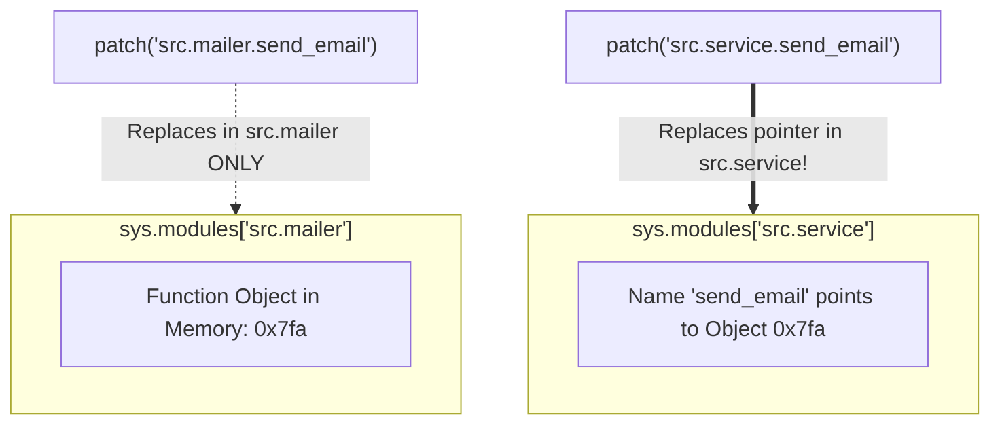
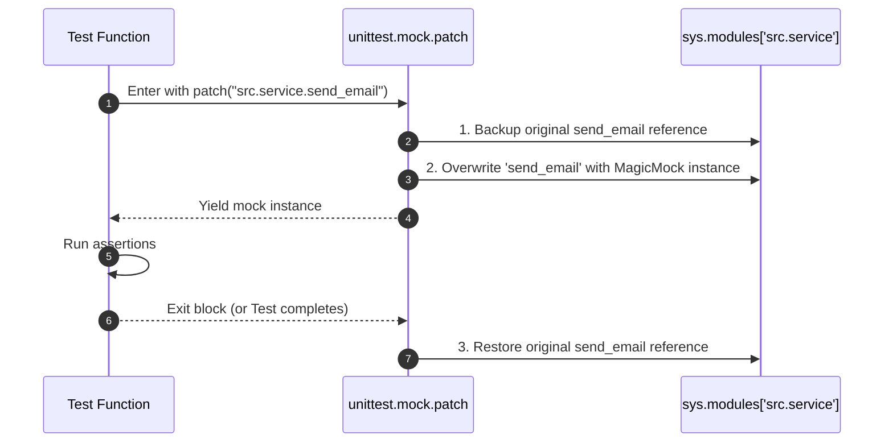

# Patching Mechanics & Target Location Rules 🎯

> **Authoritative Sources & Literature:**
> - Michael Foord: *Python unittest.mock - Where to Patch Guide* (docs.python.org)
> - Brian Okken: *Python Testing with pytest* (Chapter 8: Built-in Fixtures, Pragmatic Bookshelf)
> - Ned Batchelder: *Python Names and Binding Internals*

---

## 1. Conceptual Definition & Core Mental Model

In Python, **patching** is the runtime interception mechanism that temporarily replaces an attribute, function, or class within a specific module namespace with a test double (`Mock` or `MagicMock`) and automatically restores the original reference when the test finishes.

### The Golden Rule of Patching (Michael Foord's Principle)
> **"Patch where an object is LOOKED UP, not where it is DEFINED."**

In Python, symbols are not global pointers; they are names bound to objects within individual module namespaces. When `module_b` imports a function from `module_a`, `module_b` holds its **own local reference** to that function. Patching `module_a` does nothing to `module_b`'s local reference!

```
       [ Definition Module: src/gateways/stripe.py ]
                         │
             from src.gateways.stripe import charge
                         │
                         ▼
       [ Consuming Module: src/services/billing.py ]
          (Holds its OWN reference: billing.charge)
                         ▲
                         │
        CORRECT PATCH: patch("src.services.billing.charge")
        WRONG PATCH:   patch("src.gateways.stripe.charge")  <-- FAILS!
```

---

## 2. Why This Is Critical in Modern Python Backend Engineering

1. **The #1 Cause of Broken Tests**: More engineering hours are wasted on tests that pass or fail unexpectedly because the patch targeted the wrong namespace than on any other mocking issue.
2. **Eliminating Unintended Real I/O**: If a developer patches `requests.get` at the wrong location, their test might accidentally execute real HTTP requests across the public internet, triggering real charges or rate limits.
3. **Decorator Argument Ordering Traps**: When stacking multiple `@patch` decorators, Python applies them from the **bottom up**, injecting parameters into the test function in **reverse order**.

---

## 3. Internal Mechanics: Python Name Binding & Namespaces

Consider two files:

```python
# src/mailer.py (Where it is DEFINED)
def send_email(to: str, subject: str) -> bool:
    # Real SMTP network call
    ...

# src/service.py (Where it is LOOKED UP)
from src.mailer import send_email

def register_user(email: str):
    # Calls the local name 'send_email' in src.service's __dict__!
    send_email(email, "Welcome!")
```

When Python executes `from src.mailer import send_email` inside `src/service.py`:
1. It loads `src/mailer.py` into `sys.modules["src.mailer"]`.
2. It takes the function object `send_email` and binds it to `sys.modules["src.service"].__dict__["send_email"]`.



If you patch `src.mailer.send_email`, you only replace the pointer in `sys.modules["src.mailer"]`. The `src.service` module continues executing the real, original function object at `0x7fa`!

---

## 4. Standard Syntax, Signatures & Key Options

### Approach A: The `@patch` Decorator
```python
from unittest.mock import patch

@patch("src.service.send_email")
def test_user_registration(mock_send):
    mock_send.return_value = True
    register_user("alice@example.com")
    mock_send.assert_called_once_with("alice@example.com", "Welcome!")
```

### Approach B: Context Manager (`with patch()`)
Ideal for scoping the patch to a single block of lines:

```python
from unittest.mock import patch

def test_user_registration_context():
    with patch("src.service.send_email") as mock_send:
        mock_send.return_value = True
        register_user("alice@example.com")
        mock_send.assert_called_once()
    # Original send_email is automatically restored outside this block!
```

### Approach C: `patch.object()`
When you already have a direct reference to the target class or instance, `patch.object` is cleaner and eliminates string typo risks:

```python
from unittest.mock import patch
from src.services import payment_service

def test_payment():
    # Patches the attribute directly on the imported module object
    with patch.object(payment_service, "process_charge") as mock_charge:
        mock_charge.return_value = "ch_mock_123"
        ...
```

### Approach D: `patch.dict()` for Environment Variables
```python
from unittest.mock import patch
import os

def test_environment_patch():
    with patch.dict(os.environ, {"DATABASE_URL": "sqlite:///:memory:"}):
        assert os.environ["DATABASE_URL"] == "sqlite:///:memory:"
```

---

## 5. Controlling Behaviors: `return_value` vs. `side_effect`

A patched mock can return static data or dynamic behaviors:

```python
# 1. Static return value
mock_client.get_user.return_value = {"id": "1", "name": "Alice"}

# 2. Raising an exception on call
mock_client.get_user.side_effect = ConnectionError("Stripe API Timeout")

# 3. Dynamic sequence of return values (iterated on each call)
mock_client.get_status.side_effect = ["PENDING", "PROCESSING", "COMPLETED"]

# 4. Custom dynamic callback function
def dynamic_pricing(sku, quantity):
    return 10.0 * quantity if sku == "BOOK" else 20.0 * quantity

mock_calc.calculate.side_effect = dynamic_pricing
```

---

## 6. Lifecycle, Execution Flow & Teardown Mechanics



---

## 7. The Reverse Parameter Ordering Trap

When multiple `@patch` decorators are stacked, they are applied from **bottom to top**, meaning the parameters are injected into the test function in **reverse order**:

```python
# ❌ BEWARE: Stacking decorators injects parameters in REVERSE order!
@patch("src.service.audit_logger")   # Applied LAST  -> Injected FIRST
@patch("src.service.stripe_client")  # Applied MIDDLE-> Injected SECOND
@patch("src.service.send_email")     # Applied FIRST -> Injected THIRD
def test_order_workflow(
    mock_email,    # Matches bottom patch: send_email
    mock_stripe,   # Matches middle patch: stripe_client
    mock_logger,   # Matches top patch: audit_logger
):
    ...
```

---

## 8. Pytest Fixture & `conftest.py` Integration Patterns

Instead of stacking messy decorators, wrap patches in composable `yield` fixtures:

```python
# tests/conftest.py
import pytest
from unittest.mock import patch, MagicMock
from typing import Generator

@pytest.fixture
def mock_email_sender() -> Generator[MagicMock, None, None]:
    """Clean, fixture-wrapped patch with guaranteed teardown."""
    with patch("src.service.send_email") as mock_send:
        mock_send.return_value = True
        yield mock_send

# tests/unit/test_service.py
def test_registration(mock_email_sender):
    # Injected as a clean fixture parameter!
    register_user("bob@example.com")
    mock_email_sender.assert_called_once()
```

---

## 9. Practical Python Implementation: Step-by-Step Walkthrough

We will build an **AWS S3 File Storage Uploader** and prove the "where to patch" principle.

### Step 1: Define Application Structure

```python
# src/storage/s3_client.py
import boto3

def upload_file_to_s3(bucket: str, key: str, data: bytes) -> bool:
    """Real implementation calling AWS Boto3."""
    client = boto3.client("s3")
    client.put_object(Bucket=bucket, Key=key, Body=data)
    return True

# src/services/document_service.py
# Look here! upload_file_to_s3 is imported into document_service's namespace!
from src.storage.s3_client import upload_file_to_s3

class DocumentService:
    @staticmethod
    def archive_invoice(invoice_id: str, content: bytes) -> str:
        s3_key = f"invoices/{invoice_id}.pdf"
        success = upload_file_to_s3(bucket="corporate-vault", key=s3_key, data=content)
        if not success:
            raise RuntimeError("Upload failed")
        return f"s3://corporate-vault/{s3_key}"
```

### Step 2: Demonstrating the Wrong vs. Right Patch

```python
# tests/unit/test_document_service.py
import pytest
from unittest.mock import patch
from src.services.document_service import DocumentService

# ❌ WRONG: Patching where it was DEFINED (src.storage.s3_client)
# In real life, this would attempt a REAL AWS network call and CRASH!
def test_archive_invoice_wrong_patch():
    with patch("src.storage.s3_client.upload_file_to_s3") as mock_upload:
        mock_upload.return_value = True
        
        # This will call the REAL function because document_service already imported it!
        # DocumentService.archive_invoice("INV_001", b"PDF_DATA")
        # mock_upload.assert_called_once() -> FAILS (Not called!)
        pass


# ✅ CORRECT: Patching where it is LOOKED UP (src.services.document_service)
def test_archive_invoice_correct_patch():
    with patch("src.services.document_service.upload_file_to_s3") as mock_upload:
        mock_upload.return_value = True

        uri = DocumentService.archive_invoice("INV_001", b"PDF_DATA")

        assert uri == "s3://corporate-vault/invoices/INV_001.pdf"
        mock_upload.assert_called_once_with(
            bucket="corporate-vault",
            key="invoices/INV_001.pdf",
            data=b"PDF_DATA"
        )
```

---

## 10. Framework-Specific Integration: FastAPI BackgroundTasks

When FastAPI endpoints dispatch background tasks, patch the worker function in the route module namespace:

```python
# src/api/routes.py
from fastapi import APIRouter, BackgroundTasks
from src.workers.mailer import send_welcome_email

router = APIRouter()

@router.post("/signup")
async def signup(email: str, background_tasks: BackgroundTasks):
    background_tasks.add_task(send_welcome_email, email)
    return {"status": "enqueued"}

# tests/integration/test_signup.py
import pytest
from unittest.mock import patch
from httpx import AsyncClient

@pytest.mark.asyncio
async def test_signup_enqueues_email(async_client: AsyncClient):
    # Patch where looked up: src.api.routes.send_welcome_email
    with patch("src.api.routes.send_welcome_email") as mock_task:
        response = await async_client.post("/signup?email=test@test.com")
        assert response.status_code == 200
        mock_task.assert_called_once_with("test@test.com")
```

---

## 11. Real-World Enterprise Backend Scenario: Stripe Webhook Replay Attacks

In a fintech payments backend:
- An idempotency service validates incoming Stripe webhook event IDs against a Redis cache.
- The unit test patches `src.billing.webhook_handler.redis_client.setnx` to return `False` (simulating a duplicate event ID).
- The test asserts that the handler immediately returns `HTTP 200` without charging the customer or crediting the account a second time.

---

## 12. Anti-Patterns & Common Pitfalls

### Anti-Pattern 1: Manual `patcher.start()` Without `stop()`
```python
# ❌ DISASTER: Leaves patch active globally across all subsequent tests!
def test_bad_patch():
    patcher = patch("src.mailer.send")
    mock = patcher.start() # Leaks if test crashes before stop!
    ...
    patcher.stop()

# ✅ GOOD: Always use context manager or pytest-mock
```

### Anti-Pattern 2: The "Import-As" Alias Blindspot
```python
# src/service.py
import src.mailer as email_tool

# If you patch "src.service.send", it crashes with AttributeError!
# You MUST patch "src.service.email_tool.send"!
```

### Anti-Pattern 3: Patching Without `autospec=True`
Standard `patch("target")` creates a mock that accepts any method call, even methods that do not exist on the real class!
- **Fix**: Always use `patch("target", autospec=True)`.

---

## 13. Best Practices & Production Guidelines

1. **Follow the Rule of Lookup**: If `service.py` contains `from utils import helper`, you must patch `service.helper`.
2. **Use `patch.object()` When Objects Are Imported**: If you have imported the module, `patch.object(module, "helper")` is immune to string typo errors.
3. **Prefer `pytest-mock`'s `mocker` Fixture**: Eliminates indentation pyramids from context managers and avoids reverse-ordering decorator confusion.
4. **Use `autospec=True`**: Enforces that signatures, arguments, and method names match the real production class.

---

## 14. Trade-Off Analysis: Patching Strategies

| Approach | Syntax Ergonomics | Teardown Safety | Parameter Ordering | Best Use Case |
| :--- | :--- | :--- | :--- | :--- |
| **`@patch` Decorator** | High | Automatic | **Reversed Order** | Single function mock |
| **`with patch()` Context Manager** | Moderate (Indentation) | Automatic | Clean | Scoped block within test |
| **`patch.object()`** | High (No string targets) | Automatic | Clean | Patching imported classes |
| **`mocker.patch()` (pytest-mock)** | **Maximum (Flat syntax)** | **Guaranteed** | **Direct Assignment** | **Production Standard** |

---

## 15. Diagnostic & Debugging Playbook

```python
# Check what object is currently residing in the target namespace
import src.services.document_service as doc_service
print("Current target:", doc_service.upload_file_to_s3)

# If the patch is failing to intercept, verify its call count
print("Mock calls:", mock_upload.call_count)
print("Mock history:", mock_upload.mock_calls)
```

---

## 16. Senior Staff Interview Questions & Deep Dives

### Question 1: Explain why `from datetime import datetime` combined with `patch("datetime.datetime.now")` often fails in Python tests, and how to fix it.
**Answer**:
1. When a consuming module executes `from datetime import datetime`, Python copies the reference of the `datetime` class from the `datetime` module into the consuming module's local namespace (`sys.modules["my_service"].__dict__["datetime"]`).
2. The built-in `datetime` module is implemented in C (`_datetime`). C-extension types are immutable; attempting to patch `datetime.datetime.now` directly raises `TypeError: can't set attributes on built-in/extension type 'datetime.datetime'`.
3. Even if it were mutable, patching `datetime.datetime` in the standard library would not affect `my_service` if it imported the class directly.
**Fixes**:
- Patch where looked up: `patch("my_service.datetime")` with a mock class whose `.now()` method returns the target time.
- Or better: use a specialized time-mocking tool like `time-machine` or `freezegun`, which hooks into Python's C-level time inspection hooks cleanly.

### Question 2: What is the risk of using `patch()` without `autospec=True`, and what failure modes does `autospec` prevent?
**Answer**:
By default, `patch()` substitutes the target with a vanilla `MagicMock`. A vanilla mock returns a new mock for *any* attribute or method accessed, regardless of whether that attribute exists on the real class.
- **Silent Bug 1: Renamed Methods**: If production code renames `user.get_permissions()` to `user.get_roles()`, a test calling `user.get_permissions()` still passes because the un-specced mock creates a dummy method on the fly!
- **Silent Bug 2: Signature Mismatches**: If the real method requires two arguments `def charge(amount, currency)`, but the test calls `charge(amount)` (missing required argument), a vanilla mock accepts the call without error.
Configuring `autospec=True` forces the mock to inspect the real object's signature and attributes via reflection, immediately raising `AttributeError` on non-existent methods and `TypeError` on mismatched argument counts.

---

## 17. Hands-on Engineering Exercises & Challenges

### Exercise 1: Diagnosing and Fixing a Lookup Namespace Failure
Given two modules:
- `src/crypto.py`: defines `generate_salt()`.
- `src/auth.py`: executes `from src.crypto import generate_salt`.
A test tries to patch `patch("src.crypto.generate_salt")` and fails to intercept.
1. Reproduce the failure.
2. Fix the patch path so the test intercepts the call.
3. Rewrite the test using `patch.object()` to avoid string path errors.

### Exercise 2: Patching a Multi-Step Sequential Side Effect
Patch an external HTTP retry client such that:
- First invocation raises `httpx.ConnectTimeout`.
- Second invocation raises `httpx.ConnectTimeout`.
- Third invocation returns a mock response with `status_code=200`.
Verify that your retry service attempts exactly 3 calls and returns successfully.

---

## 18. Summary, Cross-References & Further Reading

Mastering patching mechanics hinges on the core principle of target lookup: always patch where the object is evaluated, not where it was authored. By avoiding manual patcher start/stop calls, watching out for decorator parameter ordering, and leveraging `autospec=True`, backend engineers build reliable, leak-free test doubles.

### Cross-References:
- Previous: [Mocking Fundamentals & The Test Double Spectrum](mocking.md)
- Next: [Safe Runtime Substitution with monkeypatch](monkeypatch.md)
- [`Mock` vs. `MagicMock`](mock-vs-magicmock.md)
- [Idiomatic Mocking with pytest-mock](pytest-mock.md)
