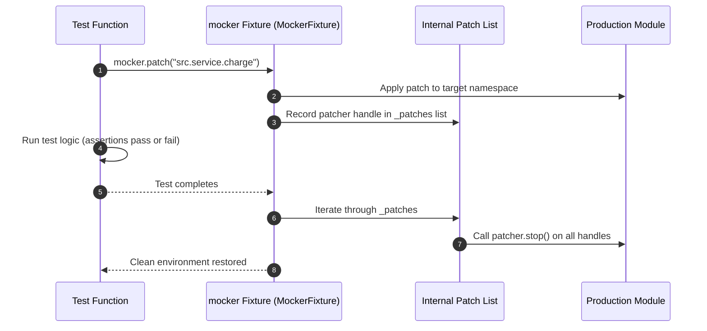
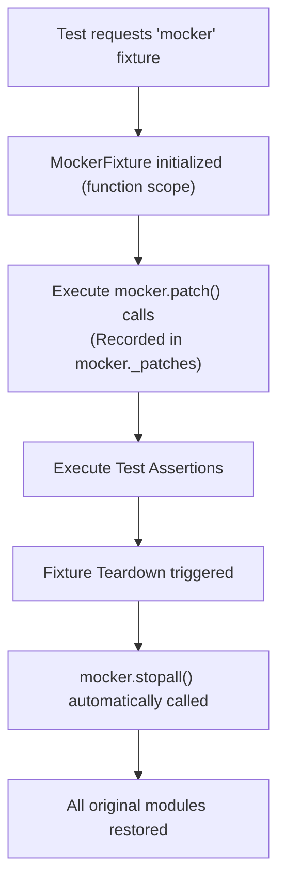

# Idiomatic Mocking with `pytest-mock` & The `mocker` Fixture 🧪

> **Authoritative Sources & Literature:**
> - Bruno Oliveira: *pytest-mock Documentation & Architecture* (github.com/pytest-dev/pytest-mock)
> - Brian Okken: *Python Testing with pytest* (Chapter 8: Built-in and Third-Party Plugins, Pragmatic Bookshelf)
> - Gerard Meszaros: *xUnit Test Patterns: Refactoring Test Code* (Test Spy Pattern)

---

## 1. Conceptual Definition & Core Mental Model

In standard Python, `unittest.mock.patch` is typically used as a decorator or context manager. However, in modern backend testing, these patterns create significant friction:
- **Decorator Stacking**: Multiple `@patch` decorators apply in reverse order, leading to confusing parameter signatures.
- **Context Manager Pyramids**: Multiple `with patch():` blocks create an ugly "Pyramid of Doom" with four levels of indentation.

**`pytest-mock`** solves this by providing the **`mocker` fixture**. It provides a flat, procedural API over `unittest.mock` while guaranteeing that **all patches, mocks, and spies are automatically undone at the end of the test**.

```
                  Standard @patch               pytest-mock (mocker)
             ┌───────────────────────┐        ┌───────────────────────┐
             │ @patch("dep3")        │        │ def test_workflow(   │
             │ @patch("dep2")        │        │     mocker            │
             │ @patch("dep1")        │        │ ):                    │
             │ def test(m1, m2, m3): │        │     p1 = mocker.patch │
             │     # Reversed order! │        │     p2 = mocker.patch │
             │     ...               │        │     p3 = mocker.patch │
             └───────────────────────┘        └───────────────────────┘
```

---

## 2. Why This Is Critical in Modern Python Backend Engineering

1. **Flat, Readable Test Bodies**: Eliminates deep indentation and eliminates the decorator parameter inversion trap.
2. **First-Class Test Spies (`mocker.spy`)**: Allows developers to record and assert on invocations of real methods **without replacing their implementation**.
3. **Guaranteed Teardown Restoration**: If an assertion fails midway through a test, `mocker` guarantees that all patches are stopped, preventing patch leakage into subsequent tests.

---

## 3. Internal Mechanics: The `mocker` Fixture Lifecycle

Under the hood, the `mocker` fixture wraps `unittest.mock._patch` objects in an internal registry:



---

## 4. Standard Syntax, Signatures & Key Options

### Installing the Plugin
```bash
pip install pytest-mock
```

### Core API Methods on `mocker`

```python
def test_mocker_capabilities(mocker):
    # 1. Patch by string path
    mock_send = mocker.patch("src.services.mailer.send_email", return_value=True)

    # 2. Patch on an imported object directly (cleaner!)
    from src.services import payment
    mock_charge = mocker.patch.object(payment, "charge", return_value="ch_123")

    # 3. Create a Test Spy on a REAL method
    from src.calculators import tax_calc
    spy_calc = mocker.spy(tax_calc, "compute_vat")

    # 4. Create standalone specced mocks
    standalone_mock = mocker.MagicMock(spec=["read", "write"])

    # 5. Create an AsyncMock for coroutines
    async_mock = mocker.AsyncMock(return_value={"status": "ok"})
```

---

## 5. The Power of `mocker.spy` (Real Execution + Inspection)

A **Spy** wraps a real object. Unlike a standard mock, **the real code actually executes**, but the spy records all calls, arguments, and return values:

```python
# src/analytics.py
def track_metric(metric_name: str, value: float) -> str:
    # Real business logic
    formatted = f"{metric_name.upper()}:{value:.2f}"
    return formatted

# tests/unit/test_analytics.py
def test_track_metric_with_spy(mocker):
    import src.analytics as analytics
    
    # Wrap track_metric in a Spy
    spy = mocker.spy(analytics, "track_metric")

    # Act: Real function executes and returns real string!
    result = analytics.track_metric("cpu_load", 0.852)

    # 1. Assert real output
    assert result == "CPU_LOAD:0.85"

    # 2. Assert interaction history via the Spy!
    spy.assert_called_once_with("cpu_load", 0.852)
    assert spy.spy_return == "CPU_LOAD:0.85"
```

---

## 6. Lifecycle, Execution Flow & Teardown Mechanics



---

## 7. Scopes, Hierarchy, or Test Boundaries

By default, the `mocker` fixture is strictly **`function`-scoped**.

If you need to mock a resource across an entire test class or test session, `pytest-mock` provides:
- **`class_mocker`**: Class-scoped mocker fixture.
- **`module_mocker`**: Module-scoped mocker fixture.
- **`session_mocker`**: Session-scoped mocker fixture.

> [!WARNING]
> Only use `session_mocker` for strictly immutable third-party integrations (e.g., disabling Datadog telemetry globally for the entire test suite).

---

## 8. Practical Python Implementation: Step-by-Step Walkthrough

We will refactor an **Order Checkout Workflow** that has 3 mocked dependencies (Stripe Payment, SMS Notification, and Tax Calculation).

### The "Before": Painful Decorator Stacking
```python
# ❌ BEFORE: Decorator stacking with reverse argument order
from unittest.mock import patch

@patch("src.services.tax.calculate_vat")        # Injected 3rd
@patch("src.services.sms.send_sms")             # Injected 2nd
@patch("src.services.stripe.process_payment")   # Injected 1st
def test_checkout_messy(mock_stripe, mock_sms, mock_tax):
    mock_stripe.return_value = "ch_123"
    mock_sms.return_value = True
    mock_tax.return_value = 10.0
    
    checkout(order_id="ORD-1", amount=100.0)
    
    mock_stripe.assert_called_once()
    mock_sms.assert_called_once()
```

### The "After": Clean Procedural Mocking with `mocker`
```python
# ✅ AFTER: Clean, readable, flat code with mocker
def test_checkout_idiomatic(mocker):
    # Direct, intuitive, un-reversed definitions!
    mock_stripe = mocker.patch("src.services.stripe.process_payment", return_value="ch_123")
    mock_sms = mocker.patch("src.services.sms.send_sms", return_value=True)
    mock_tax = mocker.patch("src.services.tax.calculate_vat", return_value=10.0)

    checkout(order_id="ORD-1", amount=100.0)

    mock_stripe.assert_called_once()
    mock_sms.assert_called_once()
    mock_tax.assert_called_once()
```

---

## 9. Framework-Specific Integration: FastAPI Background Task Mocking

When testing FastAPI routes that trigger background workers, `mocker` keeps the test concise:

```python
# tests/integration/test_registration.py
import pytest
from httpx import AsyncClient

@pytest.mark.asyncio
async def test_register_dispatches_email(async_client: AsyncClient, mocker):
    # Patch the background worker task directly
    mock_send = mocker.patch("src.api.routes.send_email_task")

    response = await async_client.post("/api/v1/register", json={"email": "alice@test.com"})

    assert response.status_code == 200
    mock_send.assert_called_once_with("alice@test.com")
```

---

## 10. Real-World Enterprise Backend Scenario: Fintech Audit Compliance

In an enterprise banking platform:
- We must verify that when a user transfers funds, an audit log event is transmitted to Datadog.
- We want the real database transfer logic to execute in memory, but we want to verify the exact audit event parameters.
- **Solution**: We use `mocker.spy(audit_logger, "record_event")` to assert that the audit log payload contains the user's IP, timestamp, and transaction ID, while allowing the rest of the application to execute naturally.

---

## 11. Anti-Patterns & Common Pitfalls

### Anti-Pattern 1: Spying on a Slow External API
```python
# ❌ DISASTER: Spying on real Stripe charges in a unit test!
def test_payment_bad(mocker):
    import stripe
    # mocker.spy calls the REAL method! This will attempt a real network call!
    mocker.spy(stripe.Charge, "create")
```
- **Rule**: Only use `mocker.spy` on **internal code** (pure math, logging, domain events). Use `mocker.patch` for external network I/O.

### Anti-Pattern 2: Forgetting `autospec=True`
```python
# ❌ LOOSE: Allows typos on mock methods
mocker.patch("src.services.OrderService.process")

# ✅ STRICT: Enforces real class signature
mocker.patch("src.services.OrderService.process", autospec=True)
```

---

## 12. Best Practices & Production Guidelines

1. **Standardize on `mocker` Across the Entire Repository**: Prohibit `@patch` decorators in pull requests to keep test styling consistent.
2. **Use `mocker.patch.object` Whenever Possible**: Avoid string path errors by passing imported classes/modules directly.
3. **Use `mocker.spy` for Observability Verification**: When testing that metrics, telemetry, or loggers were invoked, use spies rather than mocks so internal logic still runs.
4. **Always Pass `autospec=True`**: Prevent tests from drifting out of sync with production method signatures.

---

## 13. Trade-Off Analysis: Mocking Approaches in Pytest

| Approach | Syntax Style | Teardown Safety | Spying Support | Parameter Order |
| :--- | :--- | :--- | :--- | :--- |
| **`mocker.patch` (`pytest-mock`)** | **Flat & Procedural** | **100% Guaranteed** | **Native (`mocker.spy`)** | **Direct (Natural)** |
| **`@patch` Decorator** | Decorators | Automatic | No | **Reversed Order** |
| **`with patch():`** | Nested Blocks | Automatic | No | Indented |
| **Manual `patcher.start()`** | Procedural | **Dangerous (Leaks)** | No | Direct |

---

## 14. Diagnostic & Debugging Playbook

```python
# Inspect how many times a spy was invoked
print("Spy invocation count:", my_spy.call_count)

# Inspect the return value captured by the spy
print("Spy return value:", my_spy.spy_return)

# If a spy raised an exception, inspect what it was:
print("Spy exception:", my_spy.spy_exception)
```

---

## 15. Senior Staff Interview Questions & Deep Dives

### Question 1: How does `mocker.spy` differ from `mocker.patch`, and what are its primary architectural use cases?
**Answer**:
- `mocker.patch` replaces the target function or method with a `MagicMock`, completely bypassing the original implementation. The real code never executes.
- `mocker.spy` wraps the target function with a proxy mock that intercepts calls, records the arguments and execution count, and then **delegates execution to the real underlying function**, returning its genuine return value.
- **Architectural Use Cases**:
  1. Testing side-effects (e.g. verifying that calling a service triggers an internal telemetry event or writes to an audit log without mocking the service itself).
  2. Verifying caching behavior: asserting that on the second call, the underlying computation function was *not* called by the spy.

### Question 2: Why is `mocker.patch` considered safer than manual `patcher = patch(...); patcher.start()`?
**Answer**:
When using manual `patcher.start()`, the patch is registered directly into Python's global module namespace. If an assertion fails, an unexpected exception is raised, or a developer forgets to call `patcher.stop()` in a `finally` block, the patch remains permanently active in `sys.modules`. Subsequent tests across the entire test session will run against the leftover mock instead of the real production code, causing non-deterministic test failures that are impossible to reproduce in isolation. The `mocker` fixture is bound to pytest's fixture lifecycle; its teardown executes `stopall()` inside an absolute `finally` guarantee, ensuring zero patch leakage.

---

## 16. Hands-on Engineering Exercises & Challenges

### Exercise 1: Refactoring a 3-Tier Decorator Patch to `mocker`
Take a test that stacks three `@patch` decorators and refactor it into a clean, flat test function using the `mocker` fixture.

### Exercise 2: Testing an In-Memory Cache with `mocker.spy`
Given a function `get_user_profile(user_id)` decorated with `@functools.lru_cache`:
1. Use `mocker.spy` to wrap the raw database fetch function.
2. Call `get_user_profile("user_100")` twice.
3. Assert that the database fetch function was called **only once**, proving that the cache hit successfully prevented the second invocation.

---

## 17. Summary, Cross-References & Further Reading

`pytest-mock` is the modern standard for mocking in Python backend systems. By replacing nested context managers and reversed decorators with the ergonomic `mocker` fixture and offering native `spy` inspection, backend engineers write cleaner, more maintainable test suites.

### Cross-References:
- Previous: [`Mock` vs. `MagicMock` & Spec Validation](mock-vs-magicmock.md)
- Next: [Async Testing with pytest-asyncio & AnyIO](async-testing.md)
- [Mocking Fundamentals & The Test Double Spectrum](mocking.md)
- [Patching Mechanics & Target Location Rules](patching.md)
