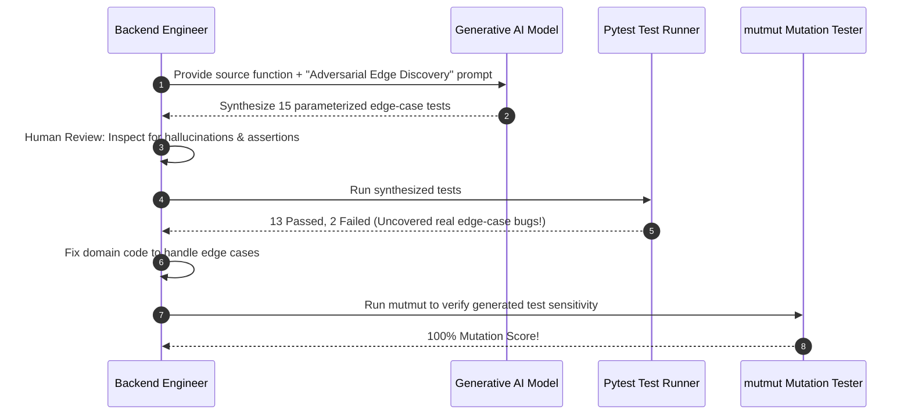

# AI-Assisted Test Case Generation in Python 🤖

> **Authoritative Sources & Literature:**
> - Google DeepMind & Research: *Effective Prompt Patterns for Automated Test Synthesis*
> - Paul Ammann & Jeff Offutt: *Introduction to Software Testing* (Combinatorial & Boundary Value Analysis)
> - Brian Okken: *Python Testing with pytest* (Chapter 5: Parametrization & Fixtures)
> - Gerard Meszaros: *xUnit Test Patterns: Refactoring Test Code* (Specification by Example Pattern)

---

## 1. Conceptual Definition & Core Mental Model

**AI-Assisted Test Case Generation** is the practice of leveraging Large Language Models (LLMs) to explore, synthesize, and augment test suites for backend software.

### The Human Cognitive Blind Spot
Human software engineers suffer from cognitive biases when writing tests:
1. **Confirmation Bias**: Developers write tests that prove their code works, subconsciously avoiding inputs that might reveal flaws.
2. **Fatigue & Combinatorial Exhaustion**: Writing out 40 permutations of boundary conditions across 5 input fields is tedious and mentally draining.

### The Mental Model: The LLM as an Adversarial Explorer
When properly guided with structured prompts and domain constraints, an LLM acts as an **Adversarial QA Partner**:
- It ingests your function signatures, Pydantic v2 models, and docstrings.
- It analyzes equivalence partitions and edge boundaries.
- It synthesizes realistic synthetic datasets (multinational postal codes, complex Unicode names, edge financial figures).
- It generates parameterized `@pytest.mark.parametrize` matrices that humans would take hours to construct.

```
   ┌─────────────────────────────────────────────────────────────┐
   │ Developer Input: Function Signature + Pydantic v2 Schema    │
   │ class OrderPayload(BaseModel):                              │
   │     country_code: str = Field(..., min_length=2, max_length=2)│
   │     amount: Decimal = Field(..., gt=0)                      │
   └──────────────────────────────┬──────────────────────────────┘
                                  │ Structured Prompt Pattern
                                  ▼
   ┌─────────────────────────────────────────────────────────────┐
   │ LLM Test Synthesizer (Adversarial Explorer)                 │
   │ Identifies boundaries:                                      │
   │ - Lowercase vs uppercase country codes ('us' vs 'US')       │
   │ - Punctuation, Unicode numbers, zero-width spaces           │
   │ - Extreme Decimal limits ($0.01, $0.001, $9999999999.99)    │
   └──────────────────────────────┬──────────────────────────────┘
                                  │ Synthesizes test suite
                                  ▼
   ┌─────────────────────────────────────────────────────────────┐
   │ Validated Pytest Matrix (Human-in-the-Loop Verified)        │
   │ @pytest.mark.parametrize("country,amount,expected_valid", [ │
   │     ("US", Decimal("10.00"), True),                         │
   │     ("uS", Decimal("10.00"), True),                         │
   │     ("12", Decimal("10.00"), False),                        │
   │     ("USA", Decimal("10.00"), False),                       │
   │     ("US", Decimal("0.00"), False),                         │
   │ ])                                                          │
   └─────────────────────────────────────────────────────────────┘
```

---

## 2. Why This Is Critical in Modern Python Backend Engineering

1. **Rapid Combinatorial Discovery**: Instantly synthesizes comprehensive Equivalence Partitioning (EP) and Boundary Value Analysis (BVA) matrices.
2. **Generating Realistic Synthetic Data**: Replaces placeholder strings (`"asdf"`, `"test1"`) with realistic international addresses, RFC-compliant emails, and valid JSON documents.
3. **Drafting Regression Tests from Production Incidents**: Ingests raw stack traces and error logs from Sentry/Datadog and drafts reproducing regression tests in seconds.

---

## 3. Internal Mechanics & Architectural Workflow



---

## 4. Standard Syntax, Signatures & Configuration

### The Three Premier Prompt Patterns for Test Synthesis

#### Pattern 1: The "Boundary & Equivalence Partition" Prompt
```text
SYSTEM: You are a Principal QA and Backend Architect specializing in Python and pytest.
TASK: Analyze the following Python function and its Pydantic models.
Generate an exhaustive @pytest.mark.parametrize test function covering:
1. Valid boundary inputs (minimum valid, maximum valid).
2. Invalid boundary inputs (just below min, just above max).
3. Type coercion edge cases (strings containing numbers, whitespace).
4. Unicode, null/None, and empty collections.
Do NOT mock internal behavior. Assert strictly on observable returns and raised exceptions.
```

#### Pattern 2: The "Adversarial Fuzzer" Prompt
```text
SYSTEM: You are a Security & Penetration Testing Specialist.
TASK: Review this FastAPI route handler.
Synthesize test cases designed to trigger:
- SQL injection / ORM escaping anomalies.
- Path traversal via path parameters.
- ReDoS (Regular Expression Denial of Service) in string validators.
- Large payload memory exhaustion.
Return ready-to-run pytest code using httpx.AsyncClient.
```

---

## 5. Execution Lifecycle & Teardown Protocol

The **Human-in-the-Loop (HITL) Verification Protocol**:
1. **Prompt & Generate**: Use structured prompts with explicit type signatures.
2. **Static Analysis & Linting**: Run `ruff` and `mypy` to verify that the LLM did not hallucinate non-existent attributes or import fake packages.
3. **Execute via Pytest**: Ensure tests run and pass against current code, or reveal legitimate bugs.
4. **Audit with Mutation Testing (`mutmut`)**: Confirm that generated assertions actually catch bugs and kill mutants.

---

## 6. Scopes, Isolation & System Boundaries

| Attribute | Human-Authored Tests | AI-Generated Tests |
| :--- | :--- | :--- |
| **Generation Speed** | Slow ($10 - 30\text{ minutes}$ per file) | **$< 30\text{ seconds}$** |
| **Edge-Case Diversity** | Moderate (Tied to author imagination) | **Highest (Combinatorial exploration)** |
| **Hallucination Risk** | Zero | **Moderate (Requires static verification)** |
| **Tautology Risk** | Low | **High (May write `assert True`)** |

---

## 7. Pytest Fixture & conftest Integration

```python
# tests/conftest.py
import pytest
from typing import Dict, Any

# Reusable fixture for injecting realistic AI-synthesized payloads
@pytest.fixture
def synthetic_customer_payloads() -> Dict[str, Any]:
    return {
        "valid_international": {
            "name": "José María Álvarez",
            "postal_code": "08001",
            "country": "ES"
        },
        "valid_japanese": {
            "name": "佐藤 健",
            "postal_code": "100-0001",
            "country": "JP"
        },
        "edge_hyphenated": {
            "name": "Jean-Luc Picard-Smith",
            "postal_code": "SW1A 1AA",
            "country": "GB"
        }
    }
```

---

## 8. Step-by-Step Practical Python 3.10+ Walkthrough

Let's use an AI prompt pattern to synthesize test cases for an international tax and shipping calculator.

### Step 1: The Function to be Tested
```python
# src/tax_calculator.py
from decimal import Decimal
from typing import Optional

def calculate_vat(
    net_amount: Decimal,
    country_code: str,
    has_valid_vat_id: bool = False
) -> Decimal:
    """
    Calculates VAT:
    - Standard EU rate: 20%.
    - If B2B with valid VAT ID in EU: Reverse charge applies (0% VAT).
    - Non-EU countries: 0% VAT.
    """
    EU_COUNTRIES = {"DE", "FR", "ES", "IT", "NL"}
    country_code = country_code.strip().upper()

    if net_amount < Decimal("0.00"):
        raise ValueError("Net amount cannot be negative")

    if country_code not in EU_COUNTRIES:
        return Decimal("0.00")

    if has_valid_vat_id:
        return Decimal("0.00")  # Reverse charge

    # Round to 2 decimal places using standard commercial rounding
    return (net_amount * Decimal("0.20")).quantize(Decimal("0.01"))
```

### Step 2: The Synthesized Parameterized Test Suite (AI-Generated & Human-Verified)
```python
# tests/test_tax_calculator_ai_synthesized.py
from decimal import Decimal
import pytest
from src.tax_calculator import calculate_vat

@pytest.mark.parametrize(
    "net_amount,country_code,has_vat_id,expected_vat",
    [
        # Standard EU B2C Scenarios
        (Decimal("100.00"), "DE", False, Decimal("20.00")),
        (Decimal("50.00"), "fr", False, Decimal("10.00")),   # Lowercase country code
        (Decimal("99.99"), " ES ", False, Decimal("20.00")),  # Whitespace handling
        
        # B2B Reverse Charge Scenarios
        (Decimal("100.00"), "DE", True, Decimal("0.00")),
        (Decimal("1000.00"), "IT", True, Decimal("0.00")),
        
        # Non-EU Scenarios (Export = 0% VAT)
        (Decimal("100.00"), "US", False, Decimal("0.00")),
        (Decimal("500.00"), "GB", False, Decimal("0.00")),
        (Decimal("250.00"), "CH", True, Decimal("0.00")),
        
        # Boundary Values
        (Decimal("0.00"), "DE", False, Decimal("0.00")),       # Zero net amount
        (Decimal("0.01"), "DE", False, Decimal("0.00")),       # Rounds down: 0.01 * 0.20 = 0.002 -> 0.00
        (Decimal("0.03"), "DE", False, Decimal("0.01")),       # Rounds up: 0.03 * 0.20 = 0.006 -> 0.01
    ],
    ids=[
        "de_b2c_standard",
        "fr_lowercase_country",
        "es_padded_whitespace",
        "de_b2b_reverse_charge",
        "it_b2b_reverse_charge",
        "us_export_zero_vat",
        "gb_non_eu_zero_vat",
        "ch_non_eu_with_vat_id",
        "zero_amount_boundary",
        "minimum_cents_round_down",
        "minimum_cents_round_up",
    ]
)
def test_calculate_vat_scenarios(
    net_amount: Decimal,
    country_code: str,
    has_vat_id: bool,
    expected_vat: Decimal
):
    assert calculate_vat(net_amount, country_code, has_vat_id) == expected_vat

def test_negative_net_amount_raises_value_error():
    """Negative amount exception testing."""
    with pytest.raises(ValueError, match="Net amount cannot be negative"):
        calculate_vat(Decimal("-0.01"), "DE")
```

---

## 9. Framework & Ecosystem Integration: Synthetic Data Generation with Pydantic

When testing complex APIs, LLMs can synthesize valid JSON fixtures that conform to complex nested Pydantic schemas:

```python
# tests/test_synthetic_order_fixtures.py
import pytest
from pydantic import BaseModel, EmailStr
from typing import List

class OrderItem(BaseModel):
    sku: str
    quantity: int

class OrderSubmission(BaseModel):
    customer_email: EmailStr
    items: List[OrderItem]

# AI-Synthesized realistic test fixture
SYNTHETIC_ORDERS = [
    {
        "customer_email": "ada.lovelace@historical-computing.ac.uk",
        "items": [{"sku": "ANALYTICAL-ENGINE-BRASS-GEAR", "quantity": 10}]
    },
    {
        "customer_email": "linus.torvalds@kernel.org",
        "items": [{"sku": "PENGUIN-PLUSH-TOY", "quantity": 2}, {"sku": "C-COMPILER-MANUAL", "quantity": 1}]
    }
]

@pytest.mark.parametrize("raw_payload", SYNTHETIC_ORDERS)
def test_synthetic_payloads_validate_successfully(raw_payload):
    order = OrderSubmission(**raw_payload)
    assert len(order.items) > 0
```

---

## 10. Real-World Enterprise Scenario: Generating Regression Tests from Sentry Traces

When a production crash occurs, feed the stack trace and inputs to an LLM:

```text
PROMPT:
Here is a Sentry stack trace from production:
IndexError: string index out of range in parse_phone_number(val="+")
Write a pytest test function that reproduces this exact failure and proves the fix.
```
Generated Test:
```python
def test_sentry_issue_1048_single_plus_phone_number():
    # Reproduces crash where string length was exactly 1 ("+")
    with pytest.raises(ValueError, match="Invalid phone number format"):
        parse_phone_number("+")
```

---

## 11. Anti-Patterns & Code Smells (Before vs After)

### Anti-Pattern 1: Committing AI-Generated Tests Without Review (Hallucination Trap)
```python
# ❌ BEFORE: Committing raw LLM output without review
# LLM wrote: assert client.execute_magic_query() == True (Method doesn't even exist!)

# ✅ AFTER: Mandatory Static Analysis Gate
# Run mypy, ruff, and pytest before committing any AI-synthesized test!
```

### Anti-Pattern 2: The Tautological Assertion (Zero Verification)
```python
# ❌ BEFORE: AI generates tautological test
def test_ai_tautology():
    user = create_user("alice")
    assert user is not None  # Shallow! Doesn't verify permissions, DB state, or fields!

# ✅ AFTER: Detailed state assertions
def test_ai_verified():
    user = create_user("alice")
    assert user.username == "alice"
    assert user.is_active is True
```

---

## 12. Best Practices & Production Guidelines

1. **Always Supply Type Hints in Prompts**: Give the LLM exact Python 3.10+ types (`Decimal`, `UUID`, Pydantic models).
2. **Demand Descriptive `ids=` in `@pytest.mark.parametrize`**: Ensures test reports output human-readable names (`de_b2c_standard`) instead of obscure tuple coordinates.
3. **Audit Generated Tests with `mutmut`**: If `mutmut` reveals that mutating the code under test doesn't fail the AI-generated test, the AI's assertions are too weak.
4. **Never Feed Sensitive Production Data into Cloud LLMs**: Redact real customer names, API keys, and PII before generating test fixtures.

---

## 13. Comprehensive Trade-Off Matrix

| Dimension | AI-Assisted Generation | Manual Human Authoring | Property-Based (`Hypothesis`) |
| :--- | :--- | :--- | :--- |
| **Speed to Draft** | **$< 1\text{ minute}$** | $15 - 45\text{ minutes}$ | $5 - 10\text{ minutes}$ |
| **Edge-Case Coverage** | High (Semantic boundaries) | Moderate (Human bias) | **Highest (Mathematical fuzzing)** |
| **Code Readability** | **High (Clear examples)** | High | Moderate (Generative abstractions) |
| **Hallucination Risk** | High (Requires verification) | **Zero** | Zero |

---

## 14. Diagnostic & Troubleshooting Playbook

### Issue 1: `AttributeError: module 'src.models' has no attribute 'CustomType'`
- **Root Cause**: The LLM hallucinated a non-existent class or imported a deprecated library.
- **Remediation**: Run `mypy tests/` to catch missing attributes before executing pytest.

### Issue 2: AI test passes, but production bugs persist
- **Root Cause**: The AI generated tests that matched existing flawed code assumptions.
- **Remediation**: Use Mutation Testing (`mutmut`) to audit assertion sensitivity.

---

## 15. Senior Staff Interview Questions & Answers

### Question 1: What are the primary failure modes of using LLMs to generate unit and integration tests, and how do you mitigate them?
**Answer**:
The three primary failure modes are:
1. **Hallucination of APIs and Libraries**: The LLM invents non-existent methods, parameters, or third-party packages.
   - *Mitigation*: Automated linting and type-checking pipelines (`ruff`, `mypy --strict`).
2. **Tautological & Shallow Assertions**: The LLM asserts trivial properties (`assert res is not None`, `assert True`) rather than verifying deep business invariants.
   - *Mitigation*: Mutation testing (`mutmut`). If mutants survive the AI test suite, the assertions are rejected as inadequate.
3. **Mirroring Implementation Bugs**: If you ask an LLM to "write tests for this code", it treats the code as ground truth. If the code has a subtle bug, the LLM writes an assertion that *verifies the buggy behavior*.
   - *Mitigation*: Feed the LLM the **requirements specification or user story**, rather than the raw implementation, asking it to write tests from requirements first.

### Question 2: How can engineering teams use LLMs to enhance Boundary Value Analysis (BVA) in complex backend applications?
**Answer**:
In complex domain models with multi-field constraints (e.g., mortgage interest rate calculations based on credit score, loan-to-value ratio, and employment status), human engineers struggle to calculate combinatorial boundaries.
LLMs excel at linguistic and numerical taxonomy:
1. When prompted with the domain validation rules, the LLM maps all inputs into 2-point and 3-point boundary sets (values exactly on the boundary, immediately below, and immediately above).
2. It outputs structured, parameterized pytest matrices complete with descriptive test IDs.
3. This compresses hours of manual test design into seconds while ensuring zero boundary gaps in mission-critical calculation engines.

---

## 16. Practical Hands-On Exercises & Challenges

### Exercise 1: Prompt Engineering for Regex Edge Cases
1. Take a regex validating international postal codes.
2. Prompt an LLM to generate 10 valid and 10 invalid edge cases (spaces, mixed-case, symbols).
3. Write a parameterized test executing the generated cases and verify 100% pass rate.

### Exercise 2: Auditing an AI-Generated Test with mutmut
1. Use an LLM to generate tests for an authorization function.
2. Run `mutmut` on the target function.
3. Identify which mutants survived and prompt the LLM specifically to kill the surviving mutants.

---

## 17. Key Takeaways & Summary

- **LLMs are powerful adversarial tools for discovering edge cases and boundary conditions**.
- **Always enforce Human-in-the-Loop verification**: Run `mypy`, `ruff`, and `pytest` on all generated tests.
- **Use the Boundary & Equivalence Partition prompt pattern** to generate robust parameterized matrices.
- **Audit AI-generated assertions with `mutmut`** to eliminate shallow, tautological tests.

---

## 18. Next Steps & Cross-References

- Next: [Testing AI-Generated Code](testing-ai-generated-code.md)
- [Property-Based Testing with Hypothesis](property-based-testing.md)
- [Mutation Testing with `mutmut`](mutation-testing.md)
- [Automated Test Case Review & Smell Detection](test-case-review.md)
- [Boundary Value Testing](../unit-testing/boundary-value-testing.md)
