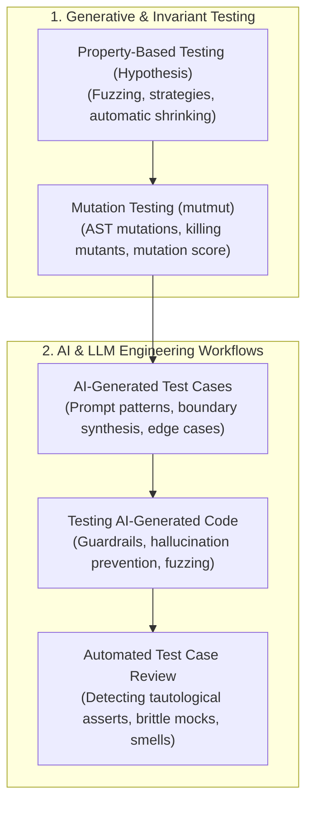

# AI-Assisted Testing, Property-Based & Mutation Testing 🤖

> **Authoritative Sources & Literature:**
> - David R. MacIver: *Hypothesis: Property-Based Testing for Python* (hypothesis.works)
> - Håkan Lofvander: *mutmut: Mutation Testing System for Python* (github.com/boxed/mutmut)
> - Paul Ammann & Jeff Offutt: *Introduction to Software Testing* (Mutation Testing & Test Adequacy, Cambridge University Press)
> - Brian Okken: *Python Testing with pytest* (Chapter 5: Parametrization & Hypothesis Integration)

---

## 📖 Module Overview

As software systems grow in complexity and Large Language Models (LLMs) accelerate code generation, traditional manual, static test writing is no longer sufficient. Relying solely on happy-path unit tests written by human assumptions leaves hidden edge cases, logic traps, and untested invariants in production code.

This module covers the modern automated testing frontier:
1. **Mutation Testing with `mutmut`**: Injecting intentional AST mutations (altering `>` to `>=`, changing `+` to `-`, replacing `True` with `False`) to calculate a true **Mutation Score**, proving whether your tests actually catch bugs or merely execute code blindly.
2. **Property-Based Testing with `Hypothesis`**: Shifting from example-based testing to generative testing. `Hypothesis` generates hundreds of randomized edge-case inputs, discovers counterexamples, and automatically "shrinks" failing inputs to the minimal reproducing example.
3. **AI-Assisted Test Synthesis & Review**: Leveraging Generative AI to discover boundary conditions, generate synthetic test datasets, review tests for smells, and build verification harnesses for LLM-generated code.

---

## 🗺️ Module Guides

### 1. [Property-Based Testing with Hypothesis](property-based-testing.md)
Move beyond static examples. Define general algebraic invariants with `@given()`, utilize built-in strategies (`st.integers()`, `st.text()`, `st.builds()`), and understand how Hypothesis automatically shrinks complex failing inputs to minimal examples.

### 2. [Mutation Testing with `mutmut`](mutation-testing.md)
Measure the true quality of your test suite. Alter Python AST syntax trees dynamically, verify whether your tests "kill" surviving mutants, and prevent Goodhart's Law from turning line coverage into a false sense of security.

### 3. [AI-Assisted Test Case Generation](ai-generated-test-cases.md)
Harness LLMs to discover non-obvious edge cases. Learn prompt engineering patterns for synthesizing boundary conditions, generating synthetic datasets, and generating complex test fixtures.

### 4. [Testing AI-Generated Code](testing-ai-generated-code.md)
Build bulletproof verification harnesses for code authored by AI assistants. Implement strict runtime guardrails, property-based verification, and static typing gates to detect hallucinations before deployment.

### 5. [Automated Test Case Review & Smell Detection](test-case-review.md)
Audit your test suites automatically. Detect tautological assertions (`assert True`), test pollution, over-mocking, and fragile temporal dependencies using static analysis and LLM reviews.

---

## 📊 Comparison Matrix: Test Verification Paradigms

| Paradigm | Input Source | What It Tests | Speed | Bug Discovery Potential |
| :--- | :--- | :--- | :--- | :--- |
| **Example-Based Testing** | Human-selected values (`5`, `"hello"`) | Expected happy paths & known edges | **$< 0.1\text{ms}$** | Low (Bound to developer imagination) |
| **Property-Based Testing** | Generative engine (`Hypothesis`) | Universal invariants across all inputs | $\approx 20 - 100\text{ms}$ | **Highest (Uncovers bizarre edge cases)** |
| **Mutation Testing** | Injected AST code faults (`mutmut`) | Test suite detection sensitivity | Minutes (Runs suite per mutant) | **Highest (Measures test quality)** |
| **AI-Assisted Synthesis** | LLM prompt exploration | Domain boundary scenarios | Fast (Offline generation) | High |

---

## ⏭️ Next Steps

Begin with **[Property-Based Testing with Hypothesis](property-based-testing.md)** to transition from static examples to generative invariant testing.
