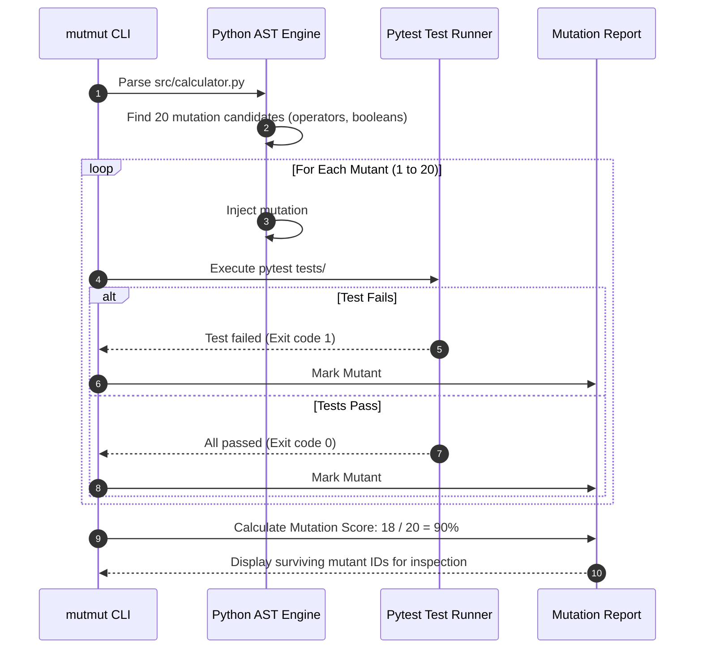

# Mutation Testing with mutmut in Python 🧬

> **Authoritative Sources & Literature:**
> - Håkan Lofvander: *mutmut: Python Mutation Testing System* (github.com/boxed/mutmut)
> - Paul Ammann & Jeff Offutt: *Introduction to Software Testing* (Chapter 5: Mutation Testing, Cambridge University Press)
> - Martin Fowler: *Test Coverage & Goodhart's Law in Testing* (martinfowler.com/bliki/TestCoverage.html)
> - Brian Okken: *Python Testing with pytest* (Chapter 7: Strategy & Architecture)

---

## 1. Conceptual Definition & Core Mental Model

In traditional software development, engineering teams measure test quality using **Line Coverage** (`pytest-cov`).

### The Illusion of 100% Code Coverage (Goodhart's Law)
Goodhart's Law states: *"When a measure becomes a target, it ceases to be a good measure."*
You can achieve **100% Line Coverage** with a test suite that **contains zero assertions**:
```python
def test_fake_coverage():
    calculate_interest(1000, 0.05, 10)  # Executes 100% of the code, asserts nothing!
```
Line coverage only tells you which lines were *executed*; it tells you **nothing about whether your tests actually check for correct behavior**.

### The Mental Model: Testing Your Tests by Injecting Faults
**Mutation Testing** tests the tests themselves. A mutation testing tool (**`mutmut`**):
1. Parses your Python source code into an Abstract Syntax Tree (AST).
2. Injects a tiny, deliberate defect (a **Mutant**):
   - Flips comparison operators: `if x > 0` becomes `if x >= 0`.
   - Inverts arithmetic: `a + b` becomes `a - b`.
   - Flips boolean literals: `True` becomes `False`.
   - Removes function calls or deletes statements.
3. It runs your test suite against the mutant:
   - **Killed Mutant**: A test fails. **(SUCCESS!)** Your test suite detected the bug!
   - **Survived Mutant**: All tests pass. **(FAILURE!)** Your test suite has a blind spot; the code was mutated and your tests didn't notice!

```
                  ┌──────────────────────────────────────────────┐
                  │           Python Source Code (AST)           │
                  │              if available > qty:             │
                  └──────────────────────┬───────────────────────┘
                                         │ mutmut injects fault
                                         ▼
                  ┌──────────────────────────────────────────────┐
                  │            Mutant AST Generated              │
                  │             if available >= qty:             │  <── MUTANT INJECTED!
                  └──────────────────────┬───────────────────────┘
                                         │ Run pytest suite
                                         ▼
                    ┌────────────────────┴────────────────────┐
                    │                                         │
               Did a Test Fail?                       Did All Tests Pass?
                    │                                         │
                    ▼                                         ▼
         [ MUTANT KILLED! 🎯 ]                     [ MUTANT SURVIVED! ⚠️ ]
       Your tests caught the bug!                 Test suite has a blind spot!
       Assertion is sensitive & strong.           Assertion was missing or weak!
```

---

## 2. Why This Is Critical in Modern Python Backend Engineering

1. **The True Measure of Test Sensitivity**: A high **Mutation Score** ($\frac{\text{Killed Mutants}}{\text{Total Mutants}} \times 100$) proves that assertions are rigorous and sensitive to code changes.
2. **Exposing Missing Boundary Value Assertions**: Catches off-by-one errors where changing `>` to `>=` or `<` to `<=` does not trigger any test failure.
3. **Eliminating Dead / Redundant Code**: If a mutant survives because the code path produces no measurable side-effect, that code is often useless or dead code.

---

## 3. Internal Mechanics & Architectural Workflow



---

## 4. Standard Syntax, Signatures & Configuration

### Prerequisites
```bash
pip install mutmut pytest
```

### Configuring `setup.cfg` or `pyproject.toml` for `mutmut`

```ini
# setup.cfg
[mutmut]
paths_to_mutate=src/
backup=False
runner=python -m pytest -x --assert=plain
tests_dir=tests/
```

### Core CLI Commands

```bash
# 1. Run mutation tests against target directory
mutmut run --paths-to-mutate=src/domain/

# 2. View summary results
mutmut results

# 3. Inspect the exact diff of a surviving mutant
mutmut show 3

# 4. Re-run only surviving mutants after adding tests
mutmut run --paths-to-mutate=src/domain/ --rerun-all
```

---

## 5. Execution Lifecycle & Teardown Protocol

Mutation testing runs in an iterative diagnostic loop:
1. **Initial Run**: Execute `mutmut run` on a critical module.
2. **Inspect Survivors**: Run `mutmut show <id>` to see which line was modified.
3. **Write Targeted Test**: Write an assertion specifically designed to catch that mutant.
4. **Verify Kill**: Re-run `mutmut run` and verify the mutant is now killed!

---

## 6. Scopes, Isolation & System Boundaries

| Metric | Measured By | Indicates | Vulnerable to Goodhart's Law? |
| :--- | :--- | :--- | :--- |
| **Line Coverage** | `pytest-cov` | Lines executed by test runner | **✅ Highly Vulnerable (Zero assert trap)** |
| **Branch Coverage** | `pytest-cov --cov-branch` | Control flow branches taken | ⚠️ Moderately Vulnerable |
| **Mutation Score** | `mutmut` | **Ability of tests to detect bugs** | **❌ Immune (Direct fault injection)** |

---

## 7. Pytest Fixture & conftest Integration

```python
# tests/conftest.py
# Note: When mutmut executes, it invokes pytest directly.
# Keeping pytest fast with in-memory fixtures is essential,
# because mutmut will run the test suite dozens or hundreds of times!
```

---

## 8. Step-by-Step Practical Python 3.10+ Walkthrough

Let's test an e-commerce discount calculator and demonstrate how `mutmut` catches a surviving mutant.

### Step 1: Implement the Pricing Module
```python
# src/pricing.py
def calculate_discount(total_cents: int, is_vip: bool) -> int:
    """
    Applies discounts:
    - Orders over 10,000 cents receive 10% discount.
    - VIP orders over 10,000 cents receive 20% discount.
    """
    if total_cents > 10000:
        if is_vip:
            return int(total_cents * 0.20)
        return int(total_cents * 0.10)
    return 0
```

### Step 2: Write a Shallow Test Suite (Achieves 100% Line Coverage!)
```python
# tests/test_pricing_shallow.py
from src.pricing import calculate_discount

def test_regular_customer_discount():
    # 20,000 cents is > 10,000
    assert calculate_discount(20000, False) == 2000

def test_vip_customer_discount():
    # 20,000 cents is > 10,000
    assert calculate_discount(20000, True) == 4000

def test_small_order_no_discount():
    # 5,000 cents is not > 10,000
    assert calculate_discount(5000, False) == 0
```
> [!NOTE]
> Running `pytest --cov=src.pricing` reports **100% Line Coverage**! Every branch was hit!

### Step 3: Run `mutmut` to Discover the Blind Spot
```bash
$ mutmut run --paths-to-mutate=src/pricing.py
```
Output:
```text
Legend for output:
🎉 Killed mutants. The goal is for everything to end up in this bucket.
⏰ Timeout. Test suite took too long to run.
🤔 Suspicious. Tests took a long time, but didn't timeout.
🙁 Survived. The mutant survived. Tests didn't catch the bug!

Killed: 4
Survived: 1   <── A MUTANT SURVIVED!
```

### Step 4: Inspect the Surviving Mutant
```bash
$ mutmut show 1
```
Output:
```diff
--- src/pricing.py
+++ src/pricing.py
@@ -5,3 +5,3 @@
-    if total_cents > 10000:
+    if total_cents >= 10000:
```
**Diagnosis**:
`mutmut` mutated `>` to `>=`.
Because our tests only tested `20000` and `5000`, **we never tested the exact boundary `10000`**!
If a developer changes `>` to `>=`, our "100% covered" test suite never notices!

### Step 5: Write the Boundary Test to Kill the Mutant
```python
# Add to tests/test_pricing_shallow.py:
def test_exact_boundary_10000_receives_no_discount():
    """Kills the surviving mutant: total_cents == 10000 must NOT receive discount!"""
    assert calculate_discount(10000, False) == 0
```

Now re-run `mutmut`:
```bash
$ mutmut run --paths-to-mutate=src/pricing.py
Killed: 5
Survived: 0   <── 100% MUTATION SCORE!
```

---

## 9. Framework & Ecosystem Integration: Testing Mutation Scores in CI

Running full mutation testing on an entire 50,000-line codebase in CI is too slow. Enterprise teams use **PR-Delta Mutation Testing**:
- Run `mutmut` only on files modified in the current Git pull request:

```bash
# In CI workflow (.github/workflows/mutation.yml):
CHANGED_FILES=$(git diff --name-only origin/main | grep 'src/.*\.py$' | tr '\n' ',')
if [ -n "$CHANGED_FILES" ]; then
  mutmut run --paths-to-mutate=${CHANGED_FILES%,}
  mutmut results
fi
```

---

## 10. Real-World Enterprise Scenario: Detecting Survived Mutants in Auth Guards

What happens if an authentication guard condition is mutated?

```python
# src/auth_guard.py
def is_authorized(user_role: str, is_active: bool) -> bool:
    return user_role in {"ADMIN", "SUPERADMIN"} and is_active

# Mutant injected:
# return user_role in {"ADMIN", "SUPERADMIN"} or is_active  (Changed 'and' to 'or'!)
```
If your test only tested active admins, the mutant **survives**! You must have a test for an **active non-admin** (`is_authorized("USER", True) == False`) to kill the mutant!

---

## 11. Anti-Patterns & Code Smells (Before vs After)

### Anti-Pattern 1: Trusting 100% Coverage Without Mutation Checks
```python
# ❌ BEFORE: Celebrating 100% line coverage while assertions are weak
# Leaves off-by-one errors and operator bugs undetected in production!

# ✅ AFTER: Running mutmut on critical financial, auth, and billing modules
# Ensures high mutation score (> 85%) on business core!
```

### Anti-Pattern 2: Running `mutmut` on Django/FastAPI Route Wiring
```python
# ❌ BEFORE: Mutating boilerplate route definitions (Takes hours, low ROI)
# ✅ AFTER: Scoping mutation testing strictly to pure domain logic & service layers
mutmut run --paths-to-mutate=src/domain/,src/services/
```

---

## 12. Best Practices & Production Guidelines

1. **Focus on Domain and Financial Calculations**: Run mutation testing on pricing, access control, and calculation engines where errors have catastrophic costs.
2. **Keep the Test Suite Blazingly Fast**: Since `mutmut` runs the test suite for *every single mutant*, a 2-second test suite will take 20 minutes for 600 mutants. Optimize tests to run in milliseconds using in-memory fakes.
3. **Target a Mutation Score of 80% to 90%**: 100% mutation score is often impractical due to equivalent mutants.
4. **Beware of Equivalent Mutants**: A mutant that changes code syntax without changing runtime behavior is an "Equivalent Mutant" (e.g. changing `x = x + 0`). These can be ignored using `# pragma: no mutate`.

---

## 13. Comprehensive Trade-Off Matrix

| Metric / Tool | Execution Speed | Measures Code Execution | Measures Assertion Quality |
| :--- | :--- | :--- | :--- |
| **Line Coverage (`pytest-cov`)** | **Seconds (Fastest)** | **✅ Yes (100% tracking)** | ❌ No (Zero assert problem) |
| **Mutation Testing (`mutmut`)** | Minutes (Slowest) | ✅ Yes | **✅ Highest (Proves assertions)** |
| **Property-Based (`Hypothesis`)** | Seconds | ✅ Yes | High (Generates edge inputs) |

---

## 14. Diagnostic & Troubleshooting Playbook

### Issue 1: `mutmut run hangs indefinitely`
- **Root Cause**: A mutant generated an infinite loop (e.g. changing `while i < 10` to `while i >= 0`).
- **Remediation**: `mutmut` has built-in timeout detection; ensure `timeout` is configured in `setup.cfg`.

### Issue 2: `mutmut reports 100% survived mutants`
- **Root Cause**: The test runner was misconfigured, causing pytest to exit immediately with error code 0.
- **Remediation**: Check `runner` command in `setup.cfg`: ensure `python -m pytest` exits with code 1 on test failure.

---

## 15. Senior Staff Interview Questions & Answers

### Question 1: What is the "Equivalent Mutant Problem" in mutation testing, and how should an engineering team handle it?
**Answer**:
An **Equivalent Mutant** is a mutant that is syntactically different from the original source code, but semantically and behaviorally identical.
For example:
```python
# Original:
for i in range(10):
    if i == 5:
        break

# Mutant:
for i in range(10):
    if i >= 5:  # Mutated == to >=
        break
```
Because the loop increments sequentially by 1, `i` will always hit `5` first. Changing `==` to `>=` produces the exact same execution outcome. No test can ever kill this mutant because the program's output never changes.
- **Handling Strategy**:
  1. Do not demand an unrealistic 100% mutation score in CI; set gates at 80% to 85%.
  2. Use `# pragma: no mutate` or `# pragma: no-mutation` comments to mark verified equivalent mutants so `mutmut` ignores them.

### Question 2: Why does Mutation Testing provide a more reliable measure of test suite quality than Statement or Branch Coverage?
**Answer**:
Statement and branch coverage are **passive metrics**: they simply record whether a line of code or branch instruction was executed by the Python C-API trace function during a test run. They do not evaluate whether the test contained assertions, whether those assertions were sensitive, or whether the test would fail if the underlying logic were broken.
Mutation Testing is an **active diagnostic experiment**:
By injecting real, deliberate syntax faults (reversing operators, deleting function calls), mutation testing proves that if a human developer introduces an off-by-one bug or inverted boolean logic into production, the test suite is mathematically proven to turn RED and halt the CI pipeline.

---

## 16. Practical Hands-On Exercises & Challenges

### Exercise 1: Killing an Off-by-One Mutant in Pagination
1. Write a pagination slice function `paginate(items, page, page_size)`.
2. Run `mutmut` and show the mutant changing `start = (page - 1) * page_size` to `start = (page + 1) * page_size`.
3. Write a test asserting on page 2 offset to kill the mutant.

### Exercise 2: Auditing an Auth Filter
1. Write an authorization helper checking `user.is_authenticated and not user.is_banned`.
2. Identify mutants generated by `mutmut` and write tests for banned users to kill surviving mutants.

---

## 17. Key Takeaways & Summary

- **Mutation testing tests your tests** by injecting deliberate AST faults.
- **Code coverage measures what lines ran; mutation score measures what bugs are caught**.
- **`mutmut show <id>` reveals the exact diff of surviving mutants**, showing you where boundary tests are missing.
- **Run mutation testing on core domain, pricing, and security logic** to establish unbreakable test suites.

---

## 18. Next Steps & Cross-References

- Next: [AI-Assisted Test Case Generation](ai-generated-test-cases.md)
- [Property-Based Testing with Hypothesis](property-based-testing.md)
- [Testing AI-Generated Code](testing-ai-generated-code.md)
- [Automated Test Case Review & Smell Detection](test-case-review.md)
- [Test Coverage Metrics & Analysis](../foundations/test-coverage.md)
