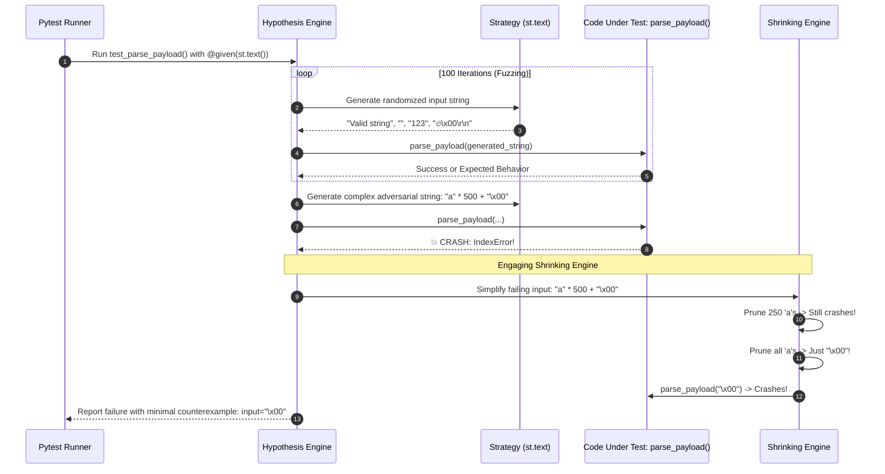

# Property-Based Testing with Hypothesis in Python 🧪

> **Authoritative Sources & Literature:**
> - David R. MacIver: *Hypothesis: A new approach to property-based testing* (hypothesis.works)
> - Claessen, Koen & Hughes, John: *QuickCheck: A Lightweight Tool for Random Testing of Haskell Programs* (ACM SIGPLAN)
> - Brian Okken: *Python Testing with pytest* (Chapter 5: Parametrization & Hypothesis Integration)
> - Gerard Meszaros: *xUnit Test Patterns: Refactoring Test Code* (Generated Test Pattern)

---

## 1. Conceptual Definition & Core Mental Model

In traditional **Example-Based Testing**, the developer manually picks two or three test inputs:
```python
def test_addition():
    assert add(2, 3) == 5  # Hand-picked example!
```
The fundamental flaw: **developers only test the inputs they can think of**. Subtle bugs lurk in inputs the developer *never imagined*: zero-width spaces, negative zero (`-0.0`), Unicode right-to-left marks, leap seconds, and integer overflow thresholds.

### The Mental Model: Testing Universal Invariants
**Property-Based Testing (PBT)** inverts this model:
1. You do not supply specific input values. Instead, you define **universal properties (invariants)** that must hold true for *any* valid input.
2. A generative engine (**Hypothesis**) generates hundreds of randomized, adversarial inputs (fuzzing).
3. If Hypothesis discovers an input that breaks your assertion, it engages its **Shrinking Engine**: it systematically simplifies the failure down to the **absolute minimal counterexample** (e.g. reducing a 1,000-character string failure to just `"\x00"`).

```
   ┌─────────────────────────────────────────────────────────────┐
   │                  Hypothesis Generative Engine               │
   │                                                             │
   │  Strategy: st.lists(st.integers())                          │
   │  - Generates: [], [0], [-1], [10928374], [None], ...        │
   └──────────────────────────────┬──────────────────────────────┘
                                  │ 1. Executes 100+ random variations
                                  ▼
   ┌─────────────────────────────────────────────────────────────┐
   │ Property Assertion:                                         │
   │ assert sort_list(lst) is sorted and len(result) == len(lst) │
   └──────────────────────────────┬──────────────────────────────┘
                                  │ 2. Bug Found on: [489, -12, 0, 9999, 489]!
                                  ▼
   ┌─────────────────────────────────────────────────────────────┐
   │ The Shrinking Engine                                        │
   │ Systematically reduces, prunes, and simplifies:             │
   │ [489, -12, 0, 9999, 489] ──► [489, -12, 489] ──► [1, -1, 1]│
   └──────────────────────────────┬──────────────────────────────┘
                                  │ 3. Reports minimal failure to engineer!
                                  ▼
   [ Minimal Counterexample: lst = [1, -1, 1] ]
```

---

## 2. Why This Is Critical in Modern Python Backend Engineering

1. **Uncovering Bizarre Edge Cases**: Automatically tests empty collections, extreme dates (`9999-12-31`), surrogate Unicode pairs, and boundary numbers without writing hundreds of manual parametrized cases.
2. **The Four Universal Invariant Patterns**:
   - **Round-Trip Invariant**: `deserialize(serialize(x)) == x` (JSON, encryption, compression).
   - **Invariance Under Mutation**: `len(sorted(x)) == len(x)` (sorting, filtering, transformations).
   - **Idempotency**: `f(f(x)) == f(x)` (database cleanups, formatting, deduplication).
   - **Test Oracle (Equivalence)**: Comparing a new high-speed C/Rust/async implementation against a slow, trusted reference implementation.
3. **Reproducibility with `@reproduce_failure`**: When Hypothesis finds a bug, it prints a reproduction key so the exact random seed can be re-run deterministically in CI.

---

## 3. Internal Mechanics & Architectural Workflow



---

## 4. Standard Syntax, Signatures & Configuration

### Prerequisites
```bash
pip install hypothesis pytest
```

### Core Hypothesis Strategies

```python
from hypothesis import given, strategies as st
from decimal import Decimal

# 1. Primitive Strategies
st.integers(min_value=0, max_value=1000)
st.floats(allow_nan=False, allow_infinity=False)
st.text(min_size=1, max_size=50)
st.booleans()

# 2. Domain & Network Strategies
st.emails()
st.uuids()
st.datetimes()
st.decimals(min_value=Decimal("0.00"), max_value=Decimal("99999.99"), places=2)

# 3. Collection Strategies
st.lists(st.integers(), min_size=0, max_size=100, unique=True)
st.dictionaries(keys=st.text(), values=st.integers())

# 4. Custom Object Building Strategy
from pydantic import BaseModel

class UserProfile(BaseModel):
    username: str
    age: int

user_strategy = st.builds(UserProfile, username=st.text(min_size=3), age=st.integers(18, 99))
```

---

## 5. Execution Lifecycle & Teardown Protocol

By default, Hypothesis runs **100 random examples** per test function:
- To adjust iterations: use `@settings(max_examples=500)`.
- If an assertion fails, Hypothesis intercepts the exception and begins binary-search shrinking.
- Once shrunk to the simplest possible input, it reraises the exception with the minimal reproducing arguments.

---

## 6. Scopes, Isolation & System Boundaries

| Testing Approach | Input Count | Edge Case Discovery | Shrinking Engine? |
| :--- | :--- | :--- | :--- |
| **Manual Parametrization (`@pytest.mark.parametrize`)** | $3 - 10$ inputs | Low (Developer assumptions) | ❌ No |
| **Random Fuzzing (`random.randint`)** | Arbitrary | Moderate | ❌ No (Output is a massive unreadable string) |
| **Hypothesis Property-Based** | **$100 - 1000$ inputs** | **Highest (Adversarial generation)** | **✅ Automatic binary shrinking** |

---

## 7. Pytest Fixture & conftest Integration

```python
# tests/conftest.py
import pytest
from hypothesis import settings, Verbosity, Phase

# Configure global Hypothesis profile for CI vs Local Development
settings.register_profile("ci", max_examples=250, deadline=None)
settings.register_profile("dev", max_examples=50, deadline=500)
settings.register_profile("debug", verbosity=Verbosity.verbose, phases=[Phase.generate, Phase.shrink])

# Load profile via environment variable
import os
settings.load_profile(os.environ.get("HYPOTHESIS_PROFILE", "dev"))
```

---

## 8. Step-by-Step Practical Python 3.10+ Walkthrough

Let's test four critical universal invariants using Hypothesis.

### Invariant 1: The Round-Trip Invariant (Serialization & Deserialization)
```python
# tests/test_pbt_roundtrip.py
from dataclasses import dataclass, asdict
from hypothesis import given, strategies as st
import json

@dataclass(frozen=True)
class CustomerRecord:
    name: str
    age: int
    is_active: bool

customer_strategy = st.builds(
    CustomerRecord,
    name=st.text(min_size=1, max_size=50),
    age=st.integers(0, 120),
    is_active=st.booleans()
)

@given(customer_strategy)
def test_json_serialization_roundtrip_invariant(customer: CustomerRecord):
    """
    PROPERTY: For ANY valid CustomerRecord,
    deserializing its JSON representation MUST equal the original record!
    """
    json_bytes = json.dumps(asdict(customer))
    restored_dict = json.loads(json_bytes)
    restored_customer = CustomerRecord(**restored_dict)

    assert restored_customer == customer
```

### Invariant 2: Idempotency (Applying a Operation Twice Yields Same State)
```python
# tests/test_pbt_idempotency.py
from hypothesis import given, strategies as st
import re

def slugify(text: str) -> str:
    """Transforms raw text into a URL slug."""
    text = text.lower()
    text = re.sub(r"[^\w\s-]", "", text)
    text = re.sub(r"[-\s]+", "-", text).strip("-")
    return text

@given(st.text())
def test_slugify_is_idempotent(raw_text: str):
    """
    PROPERTY: slugify(slugify(x)) == slugify(x)
    Running slugify a second time should never change the slug!
    """
    slug1 = slugify(raw_text)
    slug2 = slugify(slug1)

    assert slug1 == slug2
```

### Invariant 3: Test Oracle / Equivalence Invariant
```python
# tests/test_pbt_oracle.py
from hypothesis import given, strategies as st

def slow_reference_deduplicate(items: list[int]) -> list[int]:
    """Trusted, simple, but O(N^2) reference implementation."""
    out = []
    for item in items:
        if item not in out:
            out.append(item)
    return out

def fast_optimized_deduplicate(items: list[int]) -> list[int]:
    """High-speed O(N) implementation using dict keys."""
    return list(dict.fromkeys(items))

@given(st.lists(st.integers()))
def test_fast_deduplicate_matches_oracle_reference(items: list[int]):
    """
    PROPERTY: The fast optimized implementation MUST produce
    the exact same output as the trusted reference implementation!
    """
    assert fast_optimized_deduplicate(items) == slow_reference_deduplicate(items)
```

---

## 9. Framework & Ecosystem Integration: Testing Pydantic v2 Invariants

```python
# tests/test_pbt_pydantic.py
from decimal import Decimal
from pydantic import BaseModel, Field
from hypothesis import given, strategies as st

class InvoiceItem(BaseModel):
    unit_price: Decimal = Field(..., ge=Decimal("0.01"), le=Decimal("10000.00"))
    quantity: int = Field(..., ge=1, le=100)

    @property
    def total(self) -> Decimal:
        return self.unit_price * self.quantity

@given(
    price=st.decimals(min_value=Decimal("0.01"), max_value=Decimal("10000.00"), places=2),
    qty=st.integers(min_value=1, max_value=100)
)
def test_invoice_total_is_always_positive_and_monotonic(price: Decimal, qty: int):
    item = InvoiceItem(unit_price=price, quantity=qty)
    assert item.total > Decimal("0.00")
    assert item.total >= item.unit_price
```

---

## 10. Real-World Enterprise Scenario: Automatic Shrinking in Action

Suppose a developer writes a custom parser that accidentally crashes when a string contains a colon (`:`):

```python
def parse_token(text: str) -> str:
    if ":" in text:
        raise ValueError("Colons are forbidden in token format")
    return text.strip()

# Hypothesis test:
@given(st.text())
def test_tokens_are_valid(s: str):
    parse_token(s)
```
- During generation, Hypothesis might fail on: `"sd9f8723kln:238947kjnsf98"`.
- Instead of showing this confusing 30-character string, Hypothesis's **Shrinking Engine** systematically strips characters until it outputs:
  ```text
  Falsifying example: test_tokens_are_valid(
      s=':'
  )
  ```
The developer sees immediately that the single character `":"` is the root cause!

---

## 11. Anti-Patterns & Code Smells (Before vs After)

### Anti-Pattern 1: Re-implementing the Code in the Test Assertion
```python
# ❌ BEFORE: Tautological assertion (Test just copies the code)
@given(st.integers(), st.integers())
def test_tautology(a, b):
    assert calculate_tax(a, b) == a * 0.2 + b  # Useless! Replicates implementation!

# ✅ AFTER: Testing universal mathematical properties
@given(st.integers(min_value=0))
def test_tax_properties(income):
    tax = calculate_tax(income)
    assert tax >= 0                          # Non-negative
    assert tax < income                      # Tax is strictly less than income
```

### Anti-Pattern 2: Filtering Too Aggressively with `assume()`
```python
# ❌ BEFORE: Discarding 99% of generated inputs (Hypothesis gives up with Unsatisfiable)
@given(st.integers())
def test_bad_filter(n):
    assume(n % 1000 == 0)  # Throws away almost everything!

# ✅ AFTER: Custom targeted strategy
@given(st.integers().map(lambda n: n * 1000))
def test_good_generation(n):
    ...
```

---

## 12. Best Practices & Production Guidelines

1. **Test Properties, Not Calculations**: Assert on boundary invariants (non-negativity, length preservation, ordering, idempotency).
2. **Use Built-in Strategies Over `filter`**: Use `st.integers(min_value=0)` rather than generating all integers and filtering with `assume(n >= 0)`.
3. **Set `deadline=None` for Slow Operations**: If testing database queries or complex cryptographic hashing, disable the 200ms per-test execution deadline: `@settings(deadline=None)`.
4. **Save Failure Seeds in Version Control**: If Hypothesis discovers a critical bug, record the `@reproduce_failure` decorator into a regression test file.

---

## 13. Comprehensive Trade-Off Matrix

| Feature | Property-Based (`Hypothesis`) | Static Parametrize (`@pytest.mark.parametrize`) |
| :--- | :--- | :--- |
| **Input Coverage** | **Thousands of combinations** | $3 - 5$ manual examples |
| **Bug Discovery** | **Discovers unknown edge cases** | Only tests expected cases |
| **Execution Speed** | $\approx 20 - 100\text{ms}$ (Runs 100 times) | **$< 1\text{ms}$** |
| **Debugging Complexity** | Shrunk to minimal example | Instant (Predetermined values) |

---

## 14. Diagnostic & Troubleshooting Playbook

### Issue 1: `Hypothesis.errors.Unsatisfiable: Unable to satisfy assumptions of a test`
- **Root Cause**: Too many inputs were rejected by `assume(...)`.
- **Remediation**: Adjust the generator strategy (`min_value`, `pattern`) rather than filtering with `assume()`.

### Issue 2: `Hypothesis.errors.DeadlineExceeded: Test took 230ms, which exceeds deadline of 200ms`
- **Root Cause**: The test performed slow I/O or heavy computation.
- **Remediation**: Add `@settings(deadline=None)` or increase deadline: `@settings(deadline=1000)`.

---

## 15. Senior Staff Interview Questions & Answers

### Question 1: How does Hypothesis's "Shrinking Engine" work under the hood?
**Answer**:
When Hypothesis identifies a failing input (e.g. an array of 500 integers that crashes a sorting algorithm), it does not immediately report it to the user. Instead, it begins **Search-Guided Shrinking**:
1. **Length Reduction**: It performs a binary search to remove chunks of elements (trying 250 elements, then 125 elements) while checking if the smaller list still reproduces the crash.
2. **Value Simplification**: Once the list length cannot be reduced further, it shrinks individual values toward zero (e.g., changing $49823 \to 0$ or $1$, or replacing exotic Unicode with ASCII).
3. **Deterministic Canonical Ordering**: Shrinking operates through a normalized byte-stream representation, ensuring that shrinking is 100% deterministic.
The final result is the **canonical minimal counterexample** (e.g. `[1, 0]`), allowing the developer to identify the root cause in seconds without sifting through noise.

### Question 2: What are the four primary invariant patterns used in Property-Based Testing?
**Answer**:
1. **Round-Trip (Inverse Functions)**: Applying a transformation and its inverse returns the original input: $\text{decode}(\text{encode}(x)) == x$. Used for serializers, parsers, codecs, and database mappers.
2. **Invariance Under Transformation**: Certain operations must preserve specific properties while changing others. For example, sorting a list mutates element positions, but strictly preserves list length ($\text{len}(\text{sort}(L)) == \text{len}(L)$) and element set equality.
3. **Idempotence**: Applying an operation twice produces the exact same result as applying it once: $f(f(x)) == f(x)$. Used for database upserts, data cleaners, slug generation, and formatting tools.
4. **Test Oracle (Equivalence)**: Verifying that a new, optimized, parallel, or async implementation produces the exact same output as a trusted, simple, or legacy reference implementation: $f_{\text{new}}(x) == f_{\text{legacy}}(x)$.

---

## 16. Practical Hands-On Exercises & Challenges

### Exercise 1: Property Testing a Currency Exchange Converter
1. Define a currency converter that takes `Decimal` amounts.
2. Write a property test verifying that converting USD $\to$ EUR $\to$ USD preserves the original value within a 1-cent rounding tolerance.

### Exercise 2: Fuzzing a Date Interval Overlap Algorithm
1. Define `DateRange(start: date, end: date)`.
2. Write a property test verifying that if Range A overlaps Range B, then Range B must also overlap Range A (Symmetry Invariant).

---

## 17. Key Takeaways & Summary

- **Hypothesis replaces manual guesswork with generative testing**, testing hundreds of adversarial inputs automatically.
- **The Automatic Shrinking Engine** simplifies complex failing inputs down to minimal counterexamples.
- **Focus on the 4 core invariants**: Round-trip, Invariance, Idempotence, and Test Oracles.
- **Integrates natively with pytest**, Pydantic v2, and Dataclasses.

---

## 18. Next Steps & Cross-References

- Next: [Mutation Testing with `mutmut`](mutation-testing.md)
- [AI-Assisted Test Case Generation](ai-generated-test-cases.md)
- [Testing AI-Generated Code](testing-ai-generated-code.md)
- [Edge Case Testing Strategies](../unit-testing/edge-case-testing.md)
- [Boundary Value Testing](../unit-testing/boundary-value-testing.md)
