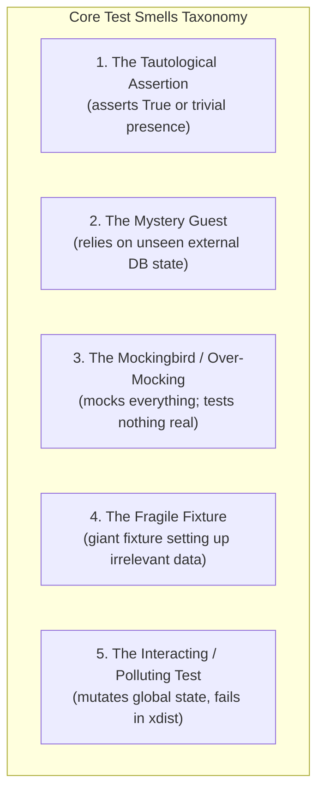

# Automated Test Case Review & Smell Detection in Python 🕵️

> **Authoritative Sources & Literature:**
> - Gerard Meszaros: *xUnit Test Patterns: Refactoring Test Code* (Part I: The Test Smells, Addison-Wesley)
> - Martin Fowler: *Test Smell Taxonomy & Flaky Test Management* (martinfowler.com)
> - Astral: *Ruff flake8-pytest-style (PT) Rules Documentation* (docs.astral.sh/ruff/rules/#flake8-pytest-style-pt)
> - Brian Okken: *Python Testing with pytest* (Chapter 7: Strategy & Architecture)

---

## 1. Conceptual Definition & Core Mental Model

Just as production code accumulates design smells (God classes, long methods, tight coupling), **test code accumulates Test Smells**.

### The Danger of Rotten Test Suites
When tests rot with bad practices:
1. **False Confidence**: Tests pass 100% of the time because assertions are weak, shallow, or completely absent.
2. **High Maintenance Friction**: A tiny refactor in business logic breaks 80 unrelated tests because they were tightly coupled to implementation details.
3. **Flakiness & Non-Determinism**: Tests pass when run individually, but fail intermittently in CI or when run in parallel with `pytest-xdist`.

### The Mental Model: Automated Test Code Auditing
An effective engineering organization treats test code as a **first-class production citizen**. We deploy automated linters (`ruff PT`), mutation analysis (`mutmut`), and structured LLM review prompts to automatically detect and eliminate test smells during code review.

```
                      Incoming Git Pull Request
                                 │
                                 ▼
         ┌───────────────────────────────────────────────┐
         │     Ruff Linter: flake8-pytest-style (PT)     │
         │ - Detects unparameterized repetitive tests    │
         │ - Rejects redundant yield statements          │
         │ - Enforces strict pytest marker registrations │
         └───────┬───────────────────────────────┬───────┘
                 │ Failed                        │ Passed
                 ▼                               ▼
       [ Reject: Fix Syntax ]      ┌───────────────────────────────┐
                                   │   Automated Test Smell Audit  │
                                   │  - Tautological Assertions?   │
                                   │  - Over-Mocking?              │
                                   │  - Mystery Guest Fixtures?    │
                                   └───────┬───────────────┬───────┘
                                           │ Found         │ Clean
                                           ▼               ▼
                               [ Request Refactor ]    [ Approved ]
```

---

## 2. Why This Is Critical in Modern Python Backend Engineering

1. **Eliminating Tautological & Shallow Tests**: Prevents tests that assert trivial properties (`assert res is not None`, `assert True`) without validating business calculations.
2. **Preventing Over-Mocking Fragility**: Identifies tests that mock internal private functions, ensuring tests remain refactoring-proof.
3. **Guaranteeing Test Isolation**: Detects global state mutations, missing database rollbacks, and order-dependent test pollution before merging to `main`.

---

## 3. The Gerard Meszaros Test Smell Taxonomy (Python Edition)



---

## 4. Standard Syntax, Signatures & Configuration

### Enabling `flake8-pytest-style` in `pyproject.toml`

```toml
[tool.ruff.lint]
select = [
    "PT", # flake8-pytest-style: Comprehensive pytest smell checks
]

[tool.ruff.lint.flake8-pytest-style]
fixture-parentheses = false      # Enforce @pytest.fixture without redundant ()
parametrize-names-type = "csv"   # Enforce @pytest.mark.parametrize("a,b", ...)
raises-require-match-for = [     # Force pytest.raises to specify regex match=
    "ValueError",
    "KeyError",
    "RuntimeError"
]
```

---

## 5. Execution Lifecycle & Teardown Protocol

Automated test audits run in the pre-commit and CI verification pipeline:
1. **Pre-Commit**: Run `ruff check --select PT tests/`.
2. **CI Pipeline**: Run `pytest --strict-markers --strict-config` to catch unregistered markers and invalid configurations.
3. **Pull Request Review**: Automated LLM reviewer scans test diffs for behavioral smells and shallow assertions.

---

## 6. Scopes, Isolation & System Boundaries

| Test Smell | Symptom in Code | Impact on Team | Automated Detection Tool |
| :--- | :--- | :--- | :--- |
| **The Tautological Assertion** | `assert res is not None`, `assert len(x) > 0` | Silent bugs in production | `mutmut` / LLM Review |
| **The Mystery Guest** | Queries pre-existing DB rows without local setup | Broken tests when DB seeds change | Static analysis / code review |
| **The Mockingbird** | `@patch` used on 5+ collaborators per test | Refactoring breaks tests constantly | Ruff / AST inspection |
| **Missing `match=` on `raises`** | `with pytest.raises(ValueError):` | Catches wrong exception | `ruff PT011` |

---

## 7. Pytest Fixture & conftest Integration

```python
# tests/conftest.py
# Best practice: Keep fixtures small, focused, and cohesive.
# Avoid "God Fixtures" that set up databases, users, products, and mocks all at once!
```

---

## 8. Step-by-Step Practical Python 3.10+ Walkthrough

Let's examine the 5 classic test smells and refactor them into production-grade tests.

### Smell 1: The Tautological Assertion (Shallow Verification)
```python
# ❌ SMELL: Asserts almost nothing! If the function returns a corrupted user with wrong role, test passes!
def test_create_user_smell(client):
    response = client.post("/users", json={"username": "alice", "role": "admin"})
    assert response.status_code == 201
    assert response.json() is not None  # TAUTOLOGY! Any dict passes!

# ✅ REFACTORED: Deep, explicit state verification
def test_create_user_clean(client):
    response = client.post("/users", json={"username": "alice", "role": "admin"})
    assert response.status_code == 201
    data = response.json()
    assert data["username"] == "alice"
    assert data["role"] == "admin"
    assert "id" in data
```

### Smell 2: The Mystery Guest (Hidden Unseen Dependencies)
```python
# ❌ SMELL: Where did customer #42 come from? How much balance did they have?
# The reader cannot understand this test without inspecting external SQL seed scripts!
def test_deduct_balance_smell(account_service):
    account_service.deduct_balance(customer_id=42, amount=100)
    assert account_service.get_balance(customer_id=42) == 400

# ✅ REFACTORED: Completely self-contained narrative (Arrange-Act-Assert)
def test_deduct_balance_clean(account_service):
    # Setup state explicitly in the test body
    customer = account_service.create_customer(initial_balance=500)
    
    account_service.deduct_balance(customer.id, amount=100)
    
    assert account_service.get_balance(customer.id) == 400
```

### Smell 3: The Mockingbird (Over-Mocking Internal Implementation)
```python
# ❌ SMELL: 15 lines of mock wiring! Tests internal function calls rather than behavior!
def test_send_invoice_smell(mocker):
    mock_pdf = mocker.patch("src.services.generate_pdf")
    mock_s3 = mocker.patch("src.services.boto3_client")
    mock_mail = mocker.patch("src.services.sendgrid_client")
    
    send_invoice("inv_101")
    
    # Brittle: breaks if we switch from S3 to Google Cloud Storage!
    mock_s3.upload_file.assert_called_once()
    mock_mail.send.assert_called_once()

# ✅ AFTER: Using In-Memory Fakes via Hexagonal Ports
def test_send_invoice_clean():
    fake_storage = FakeDocumentStorage()
    fake_mailer = FakeMailer()
    
    send_invoice("inv_101", storage=fake_storage, mailer=fake_mailer)
    
    # Tests observable domain outcomes, not private library mechanics!
    assert "inv_101" in fake_storage.stored_files
    assert len(fake_mailer.sent_emails) == 1
```

### Smell 4: The Fragile Fixture (The God Fixture)
```python
# ❌ SMELL: Giant fixture creating a database, 10 users, 50 orders, and 2 warehouses
@pytest.fixture
def enterprise_world():
    # 80 lines of setup... Any change here breaks 100 unrelated tests!
    ...

# ✅ REFACTORED: Granular, composable factory fixtures
@pytest.fixture
def make_order():
    def _create(sku="CHAIR", qty=1):
        return Order(sku=sku, qty=qty)
    return _create
```

### Smell 5: Missing `match=` on `pytest.raises` (Ruff `PT011`)
```python
# ❌ SMELL: Catches ANY ValueError, including an unexpected one from inside a library!
def test_error_smell():
    with pytest.raises(ValueError):
        parse_amount("invalid")

# ✅ REFACTORED: Strict regex match enforcement
def test_error_clean():
    with pytest.raises(ValueError, match="Amount must be a positive decimal"):
        parse_amount("invalid")
```

---

## 9. Framework & Ecosystem Integration: LLM Automated Test Reviewer

Prompt pattern for conducting automated code reviews of test pull requests:

```text
PROMPT:
You are a Principal Test Architect. Review the following pytest test diff.
Flag any occurrences of the following test smells:
1. Tautological or shallow assertions (e.g. assert x is not None).
2. The Mystery Guest (implicit unseeded database IDs).
3. Over-mocking (mocking internal domain entities rather than external infrastructure).
4. Missing match= parameter on pytest.raises().
5. Test pollution (mutating global state without post-yield teardown).
Provide concrete refactoring recommendations for each smell detected.
```

---

## 10. Real-World Enterprise Scenario: Detecting Test Pollution in Parallel Runs

A test mutates an environment variable or class attribute without restoring it, breaking subsequent tests when executed with `pytest-xdist`:

```python
# ❌ POLLUTING TEST: Leaves ENVIRONMENT="staging" in os.environ!
def test_staging_behavior():
    os.environ["ENVIRONMENT"] = "staging"  # POLLUTION!

# ✅ CLEAN TEST: Uses pytest monkeypatch fixture (Guaranteed LIFO restoration!)
def test_staging_behavior_clean(monkeypatch):
    monkeypatch.setenv("ENVIRONMENT", "staging")
    # Automatically reverted when test finishes!
```

---

## 11. Anti-Patterns & Code Smells (Before vs After)

### Anti-Pattern 1: Ignoring Ruff `PT` Linter Warnings
```bash
# ❌ BEFORE: Disabling test linting rules because "it's just test code"
# Leads to unmaintainable, rotting test suites!

# ✅ AFTER: Treating test code with identical severity as production code
ruff check --select PT tests/ # Zero tolerance for test code smells!
```

---

## 12. Best Practices & Production Guidelines

1. **Enforce Ruff `PT` Rules in CI**: Automatically block PRs with fixture naming violations, missing `match=` regexes, or redundant parametrization.
2. **Eliminate Mystery Guests**: Every test must clearly show where its input data originated.
3. **Prefer Fakes over Deep Mocks**: Use Ports and Adapters with in-memory test doubles to prevent the "Mockingbird" smell.
4. **Always Specify `match=` on `pytest.raises`**: Protects against catching unrelated exceptions with the same exception class name.

---

## 13. Comprehensive Trade-Off Matrix

| Test Quality Dimension | Smelly Test Suite | Clean Refactored Suite |
| :--- | :--- | :--- |
| **Refactoring Resilience** | ❌ Breaks on internal method renames | **Immune (Tests observable behavior)** |
| **Readability for New Engineers** | ❌ Mystery Guests require DB archaeology | **Self-contained narratives** |
| **Parallel Execution Safety** | ❌ Crashes with `pytest -n 4` | **100% Deterministic in `pytest-xdist`** |

---

## 14. Diagnostic & Troubleshooting Playbook

### Issue 1: `Ruff PT011: pytest.raises(ValueError) is too broad, set the match parameter`
- **Root Cause**: The test checked for `ValueError` without specifying the expected error message.
- **Remediation**: Add `match="Expected error string"` to `pytest.raises()`.

### Issue 2: Tests pass individually (`pytest test_a.py`), but fail in the full suite (`pytest tests/`)
- **Root Cause**: **Test Pollution**. A previous test mutated global state (e.g. `os.environ`, `sys.path`, `app.dependency_overrides`, database table) without cleaning up in teardown.
- **Remediation**: Use `pytest --random-order` to isolate the polluting test, and replace raw mutations with `monkeypatch` or post-yield fixtures.

---

## 15. Senior Staff Interview Questions & Answers

### Question 1: What is the "Mystery Guest" test smell, and why is it dangerous in enterprise codebases?
**Answer**:
The **Mystery Guest** occurs when a test relies on external, pre-existing database state that is neither created nor visible within the test function itself.
For example, a test executes:
```python
def test_calculate_discount():
    assert get_discount(user_id=105) == 20
```
- **Why it is dangerous**:
  1. The test cannot be understood in isolation. A reader has no idea why user #105 receives a 20% discount (Are they a VIP? Did they spend \$500? Are they from Germany?).
  2. If another test modifies user #105 or a migration script alters default seeds, this test breaks without any code change to the discounting service.
  3. It violates the "Self-Contained Narrative" principle of clean tests.
- **Remediation**: The test must explicitly construct its own setup state using a factory or helper (`user = UserFactory(vip=True)`), making the cause-and-effect relationship completely transparent.

### Question 2: What is "Over-Mocking" (The Mockingbird Smell), and how does it prevent safe refactoring?
**Answer**:
Over-mocking occurs when a test mocks out every collaborator, class, and private method using `unittest.mock.patch` until the test is only verifying that specific lines of Python code were invoked with specific internal arguments:
```python
mock_helper.assert_called_once_with(x, y)
```
- **How it prevents safe refactoring**:
  The purpose of a test suite is to provide a safety net while refactoring.
  If an engineer improves internal algorithms, combines two private methods into one, or optimizes data structures, **the observable behavior of the feature remains 100% correct**.
  However, all over-mocked tests immediately turn RED because their internal mock call expectations were violated!
  Developers learn that refactoring causes painful test breakage, so they stop refactoring, allowing architecture to decay.
- **Remediation**: Test observable public behavior via the Service Layer or Hexagonal Ports, using in-memory Fakes rather than mocking internal methods.

---

## 16. Practical Hands-On Exercises & Challenges

### Exercise 1: Auditing Tests with Ruff `PT`
1. Configure `pyproject.toml` with `select = ["PT"]`.
2. Run `ruff check tests/` on an existing test suite.
3. Fix all violations (fixtures missing scope, broad `pytest.raises`, redundant parentheses).

### Exercise 2: Refactoring a Polluting Test
1. Identify a test that modifies a class attribute `User.DEFAULT_ROLE = "SUPERUSER"`.
2. Refactor it to use `monkeypatch.setattr(User, "DEFAULT_ROLE", "SUPERUSER")` and verify clean restoration.

---

## 17. Key Takeaways & Summary

- **Test code requires the same architectural rigor as production code**.
- **Use `ruff PT` to enforce strict pytest style rules automatically** in CI.
- **Eliminate Tautological Assertions and Mystery Guests** to build trustworthy, readable tests.
- **Avoid Over-Mocking**: Test observable behavior through Hexagonal Ports and in-memory Fakes.

---

## 18. Next Steps & Cross-References

- Next: [CI/CD & DevOps Overview](../ci-cd-and-devops/index.md)
- [Mutation Testing with `mutmut`](mutation-testing.md)
- [Property-Based Testing with Hypothesis](property-based-testing.md)
- [AI-Assisted Test Case Generation](ai-generated-test-cases.md)
- [Testing AI-Generated Code](testing-ai-generated-code.md)
