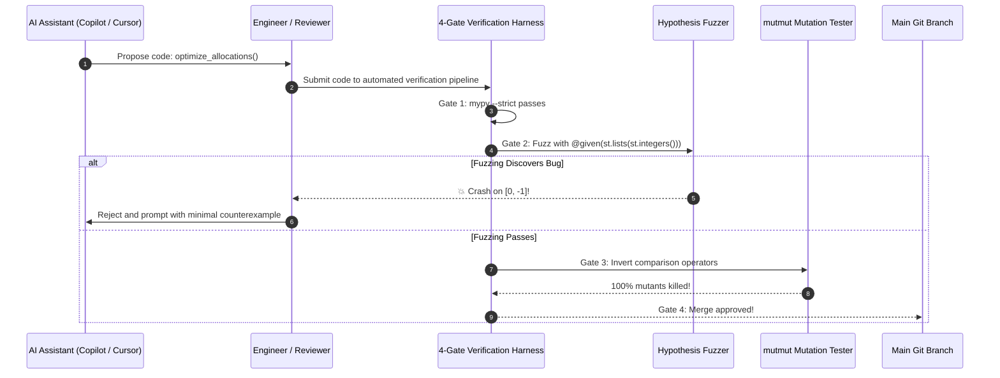

# Testing AI-Generated Code in Python 🛡️

> **Authoritative Sources & Literature:**
> - Google DeepMind & Research: *Verification, Synthesis, and Validation of LLM Code*
> - OWASP: *Top 10 for Large Language Model Applications (LLM06: Excessive Agency & Unsafe Output Handling)*
> - Paul Ammann & Jeff Offutt: *Introduction to Software Testing* (Fault-Failure Model)
> - Brian Okken: *Python Testing with pytest* (Chapter 7: Strategy & Architecture)

---

## 1. Conceptual Definition & Core Mental Model

With the proliferation of AI coding assistants (GitHub Copilot, Cursor, Gemini Code Assist, Claude), software engineering velocity has accelerated dramatically. However, **AI-generated code introduces unique, subtle categories of technical debt**:
- **Plausible Hallucinations**: Code that looks syntactically elegant and passes basic manual smoke tests, but harbors catastrophic algorithmic flaws on non-trivial inputs.
- **Silent Security Blind Spots**: AI models frequently omit multi-tenant `tenant_id` filters, use insecure randomness (`random` instead of `secrets`), or generate catastrophic Regular Expression Denial of Service (ReDoS) patterns.
- **Surface-Level Type Compliance**: Code that satisfies Python's type checker while violating fundamental runtime invariants.

### The Verification Mandate: Higher Rigor for AI Code
Code written by AI assistants must be subjected to **strictly higher verification rigor** than human-authored code. A human developer brings mental models of historical production failures; an AI model predicts statistically probable tokens.

```
       [ AI Assistant Generates Code ]
                     │
                     ▼ Gate 1: Static Analysis
   ┌─────────────────────────────────────────────────────────────┐
   │ Strict Static Typing & Linting (mypy --strict, ruff)        │
   │ Rejects untyped variables, missing returns, deprecated APIs │
   └─────────────────────────────┬───────────────────────────────┘
                                 │ Passed
                                 ▼ Gate 2: Property-Based Fuzzing
   ┌─────────────────────────────────────────────────────────────┐
   │ Generative Invariant Fuzzing (Hypothesis)                   │
   │ Attacks code with 500+ randomized adversarial inputs        │
   └─────────────────────────────┬───────────────────────────────┘
                                 │ Passed
                                 ▼ Gate 3: Mutation Audit
   ┌─────────────────────────────────────────────────────────────┐
   │ Mutation Testing (mutmut)                                   │
   │ Injects faults to prove accompanying tests kill mutants     │
   └─────────────────────────────┬───────────────────────────────┘
                                 │ Passed
                                 ▼ Gate 4: Security & Tenancy
   ┌─────────────────────────────────────────────────────────────┐
   │ Security & Multi-Tenant Barriers                            │
   │ Verifies SQL injection resistance & tenant_id enforcement   │
   └─────────────────────────────┬───────────────────────────────┘
                                 │
                                 ▼
              [ Verified Safe for Production Merge! ]
```

---

## 2. Why This Is Critical in Modern Python Backend Engineering

1. **Catching Hallucinated Math & Rounding Errors**: AI models frequently use standard `float` for currency calculations or misinterpret edge-case date arithmetic (leap years, daylight saving time).
2. **Preventing Algorithmic Complexity Bombs ($O(N^2)$ Traps)**: An AI assistant may generate nested loops that function instantly for 10 items, but freeze the CPU when processing 10,000 items in production.
3. **Automated Guardrails Against Unsafe Assumptions**: Fuzzing and mutation testing provide an automated, mathematically sound safety net that allows teams to leverage AI speed without compromising production stability.

---

## 3. Internal Mechanics & Architectural Workflow



---

## 4. Standard Syntax, Signatures & Configuration

### The Automated 4-Gate Test Configuration

```ini
# pyproject.toml
[tool.mypy]
strict = true
disallow_untyped_defs = true
disallow_any_generics = true
warn_unreachable = true

[tool.ruff]
select = ["E", "F", "B", "S", "PT"] # Includes flake8-bugbear (B), flake8-pytest-style (PT), bandit security (S)
```

---

## 5. Execution Lifecycle & Teardown Protocol

Testing AI-generated code follows a **Zero-Trust Lifecycle**:
1. **Assume Code is Defective**: Treat all generated code as an untrusted submission from a junior contributor.
2. **Execute Static Analysis First**: Abort before running tests if types or security lints fail.
3. **Fuzz Invariants**: Run `Hypothesis` with high example counts (`max_examples=500`).
4. **Audit with `mutmut`**: Ensure tests fail when the AI code is deliberately mutated.

---

## 6. Scopes, Isolation & System Boundaries

| Verification Gate | Tool | Target Vulnerability |
| :--- | :--- | :--- |
| **Gate 1: Static Typing** | `mypy --strict` | Type confusion, missing None checks |
| **Gate 2: Security Linting** | `ruff (flake8-bandit)` | Hardcoded secrets, `eval()`, unsafe `pickle` |
| **Gate 3: Property Fuzzing** | `Hypothesis` | Algorithmic edge cases, integer overflow, index errors |
| **Gate 4: Mutation Audit** | `mutmut` | Tautological assertions, shallow tests |

---

## 7. Pytest Fixture & conftest Integration

```python
# tests/conftest.py
import pytest
from hypothesis import settings

# Enforce strict fuzzing profiles for verifying AI code
settings.register_profile("ai_verification", max_examples=500, deadline=None)
```

---

## 8. Step-by-Step Practical Python 3.10+ Walkthrough

Let's examine a real-world scenario where an AI assistant generated an algorithm with a subtle boundary defect, and how our verification harness caught and fixed it.

### Step 1: The AI-Generated Code (Looks Elegant, But Broken!)
An AI assistant was asked to write an algorithm to find the **Longest Common Subsequence (LCS)**:
```python
# src/ai_algorithms.py
def find_longest_subsequence(seq1: list[int], seq2: list[int]) -> list[int]:
    """AI-Generated implementation: claims to return longest common subsequence."""
    if not seq1 or not seq2:
        return []

    # AI hallucinated a greedy approach instead of dynamic programming!
    result = []
    start_idx = 0
    for item in seq1:
        if item in seq2[start_idx:]:
            result.append(item)
            start_idx = seq2.index(item, start_idx) + 1
    return result
```

### Step 2: The Shallow Human Test (Passes Easily!)
```python
def test_shallow_example():
    # Happy path: AI code passes!
    assert find_longest_subsequence([1, 2, 3], [1, 2, 3]) == [1, 2, 3]
    assert find_longest_subsequence([1, 2, 3], [2, 3, 4]) == [2, 3]
```

### Step 3: Gate 2 Catches the Flaw via Property-Based Fuzzing
We test the universal mathematical property: *A common subsequence must be present in both sequences in order, and its length must match a reference oracle*.

```python
# tests/test_verify_ai_algorithm.py
from hypothesis import given, strategies as st
from src.ai_algorithms import find_longest_subsequence

def is_subsequence(sub: list[int], full: list[int]) -> bool:
    it = iter(full)
    return all(x in it for x in sub)

@given(st.lists(st.integers(0, 10)), st.lists(st.integers(0, 10)))
def test_lcs_properties(seq1: list[int], seq2: list[int]):
    lcs = find_longest_subsequence(seq1, seq2)

    # Invariant 1: Result MUST be a valid subsequence of seq1
    assert is_subsequence(lcs, seq1)

    # Invariant 2: Result MUST be a valid subsequence of seq2
    assert is_subsequence(lcs, seq2)

    # Invariant 3: Length cannot exceed smaller list
    assert len(lcs) <= min(len(seq1), len(seq2))
```
- Hypothesis immediately identifies the flaw on: `seq1 = [1, 2, 1]`, `seq2 = [2, 1]`!
- The greedy AI algorithm picked `[1]` (length 1) because it matched `1` first, missing the optimal subsequence `[2, 1]` (length 2)!
- **The verification harness prevented a broken greedy algorithm from entering production!**

---

## 9. Framework & Ecosystem Integration: Security Auditing with Bandit

Integrating automated security scanning for AI-generated code:

```bash
# In CI pipeline:
ruff check --select S src/ # Scans for bandit security vulnerabilities
```
Common vulnerabilities flagged in AI code:
- `S105`: Hardcoded password string assigned to variable.
- `S311`: Standard pseudo-random generators (`random.randint`) used for security tokens instead of `secrets.token_hex`.
- `S608`: Raw SQL string formatted with f-strings (`f"SELECT * FROM users WHERE id = {user_id}"`).

---

## 10. Real-World Enterprise Scenario: Guarding Against Multi-Tenant Leaks

AI assistants frequently write database queries that omit tenant filters:

```python
# ❌ AI Generated this query:
def get_user_documents(user_id: str, db: Session):
    return db.query(Document).filter(Document.user_id == user_id).all()
    # BUG: What if User A belongs to Tenant A, but requests Document created by User A in Tenant B?
```

### The Multi-Tenant Guardrail Test
```python
# tests/test_tenancy_guardrail.py
def test_ai_query_enforces_tenant_isolation(db_session):
    # Seed two identical user IDs in different tenants
    doc_alpha = Document(id="d1", user_id="user_1", tenant_id="tenant_alpha")
    doc_beta = Document(id="d2", user_id="user_1", tenant_id="tenant_beta")
    db_session.add_all([doc_alpha, doc_beta])
    db_session.commit()

    # Query with tenant isolation
    results = get_user_documents_secure(user_id="user_1", tenant_id="tenant_alpha", db=db_session)

    assert len(results) == 1
    assert results[0].tenant_id == "tenant_alpha"
```

---

## 11. Anti-Patterns & Code Smells (Before vs After)

### Anti-Pattern 1: Accepting Code Because "It Passed the Tests the AI Wrote"
```python
# ❌ BEFORE: Asking the AI to write the code AND write the tests
# The AI writes flawed code and writes tests that confirm its flawed assumptions!

# ✅ AFTER: Independent Verification Harness
# Attack the AI code using Property-Based Testing (Hypothesis) and Mutation Testing (mutmut)!
```

### Anti-Pattern 2: Skipping Static Type Checking on AI Code
```python
# ❌ BEFORE: Merging code with missing type hints (Hides implicit None returns)
# ✅ AFTER: mypy --strict enforcement
```

---

## 12. Best Practices & Production Guidelines

1. **Never Let AI Write Both the Code and the Acceptance Criteria**: Define the test invariants independently of the AI model.
2. **Enforce `mypy --strict` on All Generated Code**: Guarantees type safety and forces explicit handling of `Optional[T]` types.
3. **Fuzz with Hypothesis**: Subject all AI algorithms, parsers, and transformers to 500+ iterations of generative property testing.
4. **Audit for Security Vulnerabilities with `ruff check --select S`**: Automatically detects unsafe deserializations, SQL formatting, and weak random number generators.

---

## 13. Comprehensive Trade-Off Matrix

| Verification Level | Speed | Protection Against Hallucinations | Effort |
| :--- | :--- | :--- | :--- |
| **Static Types (`mypy`)** | **Instant ($< 1\text{s}$)** | Moderate (Catches interface bugs) | Minimal |
| **Property Fuzzing (`Hypothesis`)** | Fast ($5 - 15\text{s}$) | **Highest (Catches algorithmic bugs)** | Moderate |
| **Mutation Testing (`mutmut`)** | Moderate ($1 - 3\text{m}$)| **Highest (Catches assertion gaps)** | Moderate |
| **Manual Peer Code Review** | Slow ($15 - 30\text{m}$)| High (Catches architectural debt) | High |

---

## 14. Diagnostic & Troubleshooting Playbook

### Issue 1: AI code causes high CPU utilization ($O(N^2)$ algorithmic explosion)
- **Root Cause**: The AI used naive list lookups inside loops (`if x in my_list`) instead of hash sets.
- **Remediation**: Add performance benchmark assertions with `pytest-benchmark`.

### Issue 2: `SecurityWarning: Use of insecure random generator`
- **Root Cause**: The AI imported `random` to generate session tokens.
- **Remediation**: Replace `import random` with `import secrets`.

---

## 15. Senior Staff Interview Questions & Answers

### Question 1: Why does code generated by Large Language Models require higher testing rigor than code authored by human software engineers?
**Answer**:
Human software engineers author code based on **causal reasoning, past operational failures, and holistic domain context**. When humans write code, they mentally simulate production edge cases (network timeouts, concurrency, database locking).
Large Language Models author code based on **statistical token prediction**. While they produce syntactically plausible, clean-looking code:
1. They have no concept of production execution: they cannot "feel" latency or foresee race conditions.
2. They exhibit confirmation bias: if prompted with a flawed premise, they generate code that smoothly implements the flaw.
3. They frequently omit non-functional requirements (rate limiting, logging, auditing, tenant boundaries).
Therefore, engineering teams must implement rigorous, automated **verification harnesses (Static Typing, Property Fuzzing, Mutation Testing)** to validate that AI-accelerated code meets enterprise safety standards.

### Question 2: How can an engineering organization integrate automated guardrails to prevent AI coding assistants from introducing security vulnerabilities?
**Answer**:
Organizations enforce automated guardrails across four layers of the CI/CD pipeline:
1. **Pre-Commit Static Security Linters**: Run `ruff --select S` (flake8-bandit) on pre-commit hooks to block commits containing SQL string concatenations, insecure random numbers, or hardcoded API keys.
2. **Strict Compiler-Grade Typing**: Enforce `mypy --strict`. AI assistants often write code that implicitly returns `None`, leading to runtime `AttributeError` crashes in production.
3. **Property-Based Invariant Fuzzing**: Automatically run `Hypothesis` on new utility and calculation modules to discover boundary crashes before code review.
4. **Mandatory Human Code Review**: AI-generated PRs must be clearly flagged and reviewed by human engineers who verify business logic and architectural boundaries.

---

## 16. Practical Hands-On Exercises & Challenges

### Exercise 1: Fuzzing an AI-Generated Markdown Parser
1. Have an AI generate a custom function that strips HTML tags from markdown strings.
2. Write a `Hypothesis` test fuzzing it with `st.text()`.
3. Identify crashing inputs (e.g. unclosed tags like `<div`, malformed entities) and fix the parser.

### Exercise 2: Auditing AI-Generated SQL Queries
1. Review an AI-generated query function.
2. Write an integration test injecting SQL metacharacters (`' OR 1=1 --`) to prove the query uses parameterized binding rather than string formatting.

---

## 17. Key Takeaways & Summary

- **AI-generated code requires strictly higher testing rigor** than human code due to plausible hallucinations and missing edge checks.
- **Enforce the 4-Gate Verification Harness**: Static Types $\to$ Property Fuzzing $\to$ Mutation Testing $\to$ Security Linters.
- **Use `Hypothesis` to attack AI algorithms** with hundreds of adversarial inputs to expose greedy or naive logic traps.
- **Never allow AI to write both the code and the acceptance criteria without human review**.

---

## 18. Next Steps & Cross-References

- Next: [Automated Test Case Review & Smell Detection](test-case-review.md)
- [Property-Based Testing with Hypothesis](property-based-testing.md)
- [Mutation Testing with `mutmut`](mutation-testing.md)
- [AI-Assisted Test Case Generation](ai-generated-test-cases.md)
- [Edge Case Testing Strategies](../unit-testing/edge-case-testing.md)
