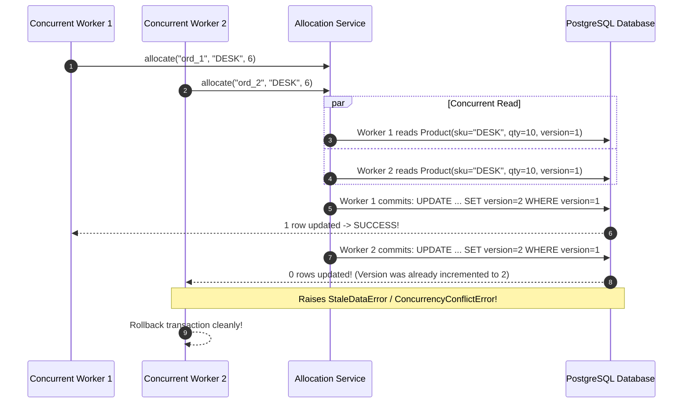

# Aggregate Invariants & Concurrency Testing in Python 🛡️

> **Authoritative Sources & Literature:**
> - Harry Percival & Bob Gregory: *Architecture Patterns with Python* (Chapter 7: Aggregates and Consistency Boundaries, O'Reilly)
> - Eric Evans: *Domain-Driven Design: Tackling Complexity in the Heart of Software* (Aggregates Pattern)
> - Martin Fowler: *Optimistic Offline Lock Pattern* (martinfowler.com/eaaCatalog/optimisticOfflineLock.html)
> - Gerard Meszaros: *xUnit Test Patterns: Refactoring Test Code* (Concurrency Test Pattern)

---

## 1. Conceptual Definition & Core Mental Model

In Domain-Driven Design (DDD), an **Aggregate** is a cluster of associated domain objects (Entities and Value Objects) that we treat as a **single unit for data change**.

### The Consistency Boundary & Aggregate Root
- **The Consistency Boundary**: An imaginary boundary around an aggregate ensuring that all internal invariants (business rules that must *always* be true) are consistent at the end of every transaction.
- **The Aggregate Root**: The single, designated entity that acts as the **exclusive gatekeeper** for the aggregate. External code is strictly forbidden from directly modifying child entities; all modifications must go through methods on the Aggregate Root.

### The Concurrency Problem: The Over-Allocation Race Condition
Consider an inventory system with 10 chairs left in stock:
1. Transaction A reads available stock: 10 chairs.
2. Transaction B reads available stock: 10 chairs.
3. Transaction A allocates 7 chairs and commits (Stock left: 3).
4. Transaction B allocates 7 chairs and commits (Stock left: $-4$!).
**Over-allocation occurs because neither transaction knew the other was mutating the same aggregate simultaneously!**

### The Solution: Optimistic Concurrency Control (OCC)
We attach a `version_number` to the Aggregate Root:
- Every time an aggregate commits changes, the database updates the version:
  ```sql
  UPDATE products
  SET available_qty = :qty, version_number = version_number + 1
  WHERE sku = :sku AND version_number = :current_version
  ```
- If Transaction B tries to commit with an outdated `version_number`, PostgreSQL finds 0 matching rows and raises a concurrency exception!

```
      Transaction 1 (User A)                         Transaction 2 (User B)
                │                                               │
    1. Read Product (v=1, qty=10)                   2. Read Product (v=1, qty=10)
                │                                               │
    3. Allocate 7 chairs (qty=3)                    4. Allocate 7 chairs (qty=3)
                │                                               │
    5. COMMIT: UPDATE ... WHERE v=1                 6. COMMIT: UPDATE ... WHERE v=1
       (SUCCESS! version becomes 2)                             │
                                                    [ CONFLICT DETECTED! ]
                                                    Row version is already 2!
                                                    Raises ConcurrencyError!
                                                    (Rolls back cleanly!)
```

---

## 2. Why This Is Critical in Modern Python Backend Engineering

1. **Preventing Financial & Inventory Losses**: Eliminates race conditions where concurrent API requests double-spend balances, over-allocate stock, or corrupt relational hierarchies.
2. **High-Performance Lock-Free Architecture**: Optimistic locking avoids pessimistic row locks (`SELECT FOR UPDATE`), keeping database throughput maximum when collisions are rare.
3. **Rigorous Concurrency Testing**: Proves that your application gracefully intercepts concurrent conflicts, raises domain exceptions, and handles retries without data corruption.

---

## 3. Internal Mechanics & Architectural Workflow



---

## 4. Standard Syntax, Signatures & Configuration

### The Domain Aggregate Root with Version Tracking

```python
from typing import List, Set
from src.domain.model import OrderLine, Batch

class Product:
    def __init__(self, sku: str, batches: List[Batch], version_number: int = 0) -> None:
        self.sku = sku
        self.batches = batches
        self.version_number = version_number  # Optimistic concurrency sentinel!

    def allocate(self, line: OrderLine) -> str:
        # Enforce consistency invariant across ALL batches
        for batch in sorted(self.batches):
            if batch.can_allocate(line):
                batch.allocate(line)
                self.version_number += 1  # Increment version on mutation
                return batch.ref
        raise ValueError(f"Out of stock for SKU {self.sku}")
```

---

## 5. Execution Lifecycle & Teardown Protocol

Testing concurrency involves two testing phases:
1. **Low-Gear Invariant Tests**: Pure unit tests verifying that child entities cannot be mutated into an invalid state.
2. **High-Concurrency Multi-Threaded Tests**: Spawning parallel Python threads or async tasks to execute simultaneous transactions against a real PostgreSQL database, asserting that exactly one succeeds and the other raises a concurrency conflict.

---

## 6. Scopes, Isolation & System Boundaries

| Concurrency Strategy | Mechanism | DB Lock Acquired? | Contention Behavior |
| :--- | :--- | :--- | :--- |
| **Optimistic Concurrency (OCC)** | `version_number` check | ❌ None | Conflict raises exception; retry |
| **Pessimistic Concurrency** | `SELECT FOR UPDATE` | ✅ Row lock | Other transactions block & wait |
| **Serializable Isolation** | PostgreSQL SSI | ❌ None | DB engine detects rw-conflicts |

---

## 7. Pytest Fixture & conftest Integration

```python
# tests/conftest.py
import pytest
from sqlalchemy.orm import sessionmaker
from src.adapters.unit_of_work import SqlAlchemyUnitOfWork

@pytest.fixture
def uow_factory(db_session_factory: sessionmaker):
    """Factory yielding a fresh SqlAlchemyUnitOfWork for concurrent thread execution."""
    def _create():
        return SqlAlchemyUnitOfWork(session_factory=db_session_factory)
    return _create
```

---

## 8. Step-by-Step Practical Python 3.10+ Walkthrough

Let's test an e-commerce Product aggregate under concurrent load to prove that over-allocation is prevented.

### Step 1: Configure SQLAlchemy Optimistic Version Mapping
```python
# src/adapters/orm.py
from sqlalchemy import Table, Column, Integer, String, MetaData
from sqlalchemy.orm import registry
from src.domain.model import Product

metadata = MetaData()
mapper_registry = registry()

products_table = Table(
    "products",
    metadata,
    Column("sku", String(50), primary_key=True),
    Column("version_number", Integer, nullable=False, server_default="0"),
)

def start_mappers():
    mapper_registry.map_imperatively(
        Product,
        products_table,
        version_id_col=products_table.c.version_number  # Native SQLAlchemy OCC support!
    )
```

### Step 2: Write the Concurrent Stress Test
```python
# tests/test_concurrent_allocations.py
import pytest
import threading
import time
from sqlalchemy.orm.exc import StaleDataError
from src.domain.model import Product, Batch
from src.service_layer import services

def test_concurrent_allocations_are_intercepted_by_version_check(uow_factory):
    # 1. Seed product with exactly 10 units in stock
    uow = uow_factory()
    with uow:
        product = Product(sku="STOOL-01", batches=[Batch("b1", "STOOL-01", 10)], version_number=1)
        uow.products.add(product)
        uow.commit()

    # Shared results tracking across threads
    results = []
    exceptions = []

    def try_allocate(order_id: str, qty: int):
        thread_uow = uow_factory()
        try:
            # Add slight artificial delay to force overlapping read/write window
            time.sleep(0.01)
            batch_ref = services.allocate(order_id, "STOOL-01", qty, thread_uow)
            results.append((order_id, batch_ref))
        except Exception as exc:
            exceptions.append(exc)

    # 2. Spawn two simultaneous threads attempting to allocate 7 units each (Total 14 > 10!)
    t1 = threading.Thread(target=try_allocate, args=("order-A", 7))
    t2 = threading.Thread(target=try_allocate, args=("order-B", 7))

    t1.start()
    t2.start()
    t1.join()
    t2.join()

    # 3. VERIFY OCC BEHAVIOR:
    # Exactly ONE thread must succeed
    assert len(results) == 1, f"Over-allocation occurred! Both orders allocated: {results}"
    
    # Exactly ONE thread must fail with a concurrency error or out-of-stock
    assert len(exceptions) == 1
    assert any(isinstance(e, (StaleDataError, ValueError)) for e in exceptions)

    # 4. Verify database state: Available quantity must be 3 (NEVER negative!)
    verify_uow = uow_factory()
    with verify_uow:
        saved_product = verify_uow.products.get("STOOL-01")
        assert saved_product.batches[0].available_quantity == 3
```

---

## 9. Framework & Ecosystem Integration: Concurrency Retries in the Service Layer

When a `StaleDataError` or concurrency conflict occurs, the service layer can catch it and **automatically retry** the operation up to 3 times:

```python
# src/service_layer/services.py
from tenacity import retry, stop_after_attempt, retry_if_exception_type
from sqlalchemy.orm.exc import StaleDataError

@retry(
    stop=stop_after_attempt(3),
    retry=retry_if_exception_type(StaleDataError),
    reraise=True
)
def allocate_with_retry(order_id: str, sku: str, qty: int, uow):
    return allocate(order_id, sku, qty, uow)
```

---

## 10. Real-World Enterprise Scenario: Unit Testing Invariant Protection

Notice that before ever running multi-threaded tests, pure domain unit tests verify the invariant:

```python
# tests/test_aggregate_invariants.py
from src.domain.model import Product, Batch, OrderLine
import pytest

def test_aggregate_enforces_maximum_quantity_invariant():
    product = Product("CHAIR", batches=[Batch("b1", "CHAIR", 5)])
    line = OrderLine("o1", "CHAIR", 10)

    with pytest.raises(ValueError, match="Out of stock"):
        product.allocate(line)

    # Verify version was NOT incremented on failure
    assert product.version_number == 0
```

---

## 11. Anti-Patterns & Code Smells (Before vs After)

### Anti-Pattern 1: Mutating Child Entities Directly Outside the Aggregate
```python
# ❌ BEFORE: Direct mutation of child batch (Bypasses product invariants!)
batch = uow.batches.get("b1")
batch.allocate(line)  # Product aggregate never knew! Version not incremented!

# ✅ AFTER: All operations route through the Aggregate Root
product = uow.products.get("SKU")
product.allocate(line)  # Invariants enforced; version tracked!
```

### Anti-Pattern 2: Blindly Trusting Database Triggers for Concurrency
```python
# ❌ BEFORE: Relying on database triggers (Untestable in pure Python memory)
# ✅ AFTER: Domain-level versioning combined with SQLAlchemy version_id_col
```

---

## 12. Best Practices & Production Guidelines

1. **Modify Only One Aggregate per Transaction**: A single transaction should mutate exactly one Aggregate Root to keep transaction windows ultra-short.
2. **Use Native SQLAlchemy `version_id_col`**: Maps version columns automatically without handwriting `UPDATE ... WHERE version = :v` SQL.
3. **Always Test with True Multi-Threading against PostgreSQL**: SQLite does not reliably simulate concurrent write lock collisions.
4. **Implement Automatic Retries on OCC Conflicts**: Transient version conflicts should be retried automatically before returning errors to users.

---

## 13. Comprehensive Trade-Off Matrix

| Strategy | Speed | Scale | Race Condition Safe? | Implementation Effort |
| :--- | :--- | :--- | :--- | :--- |
| **Optimistic Locking (OCC)** | **Ultra Fast (Zero lock wait)** | **High (Minimal contention)** | **✅ 100% Safe (StaleDataError)** | Moderate |
| **Pessimistic Locking (`FOR UPDATE`)** | Slower (Wait queues) | Lower (Deadlock risk) | ✅ 100% Safe (Serial execution) | Low |
| **No Locking (Naive)** | Fast | High | ❌ Vulnerable to race conditions | Zero |

---

## 14. Diagnostic & Troubleshooting Playbook

### Issue 1: `StaleDataError: UPDATE statement on table 'products' expected to update 1 row(s); 0 were matched`
- **Root Cause**: Another transaction committed a change to this product between your read and your commit.
- **Remediation**: Catch `StaleDataError` and retry the use case with fresh data.

### Issue 2: Concurrency test hangs indefinitely
- **Root Cause**: Using pessimistic locks (`SELECT FOR UPDATE`) across threads without proper timeouts, causing deadlocks.
- **Remediation**: Use Optimistic Concurrency Control (`version_id_col`).

---

## 15. Senior Staff Interview Questions & Answers

### Question 1: What is the relationship between an Aggregate Root and a Database Transaction boundary?
**Answer**:
In Domain-Driven Design, the rule of thumb is: **One Transaction = One Aggregate**.
An Aggregate Root defines a consistency boundary: all invariants within that boundary must be strictly consistent before and after each transaction.
If a business operation attempts to modify multiple Aggregates within the same transaction:
1. It increases lock contention and transaction durations, dramatically increasing the probability of deadlocks and concurrency collisions.
2. It indicates that the aggregate boundaries were modeled incorrectly (the two aggregates are likely part of a single larger aggregate, or the secondary mutation should be decoupled into an asynchronous **Domain Event**).
By enforcing "One Aggregate per Transaction", transactions execute in $< 2\text{ms}$, version checks remain atomic, and downstream side effects are coordinated via the Message Bus.

### Question 2: How does Optimistic Concurrency Control (OCC) differ from Pessimistic Locking, and when should you choose each?
**Answer**:
1. **Optimistic Concurrency Control (OCC)**:
   - Assumes that conflicts are **rare**.
   - Does not lock rows on read. Instead, it checks a `version_number` on write (`UPDATE ... WHERE version = current_version`).
   - If a collision occurs, the transaction fails with `StaleDataError` and the application retries.
   - **Best for**: Web APIs with high read-to-write ratios, microservices, and distributed systems where keeping database row locks open is unacceptable.
2. **Pessimistic Locking (`SELECT FOR UPDATE`)**:
   - Assumes conflicts are **frequent**.
   - Locks the database row immediately upon read, forcing all other transactions targeting that row to block and wait until the first commits or rolls back.
   - **Best for**: High-contention financial systems or ticket flash sales where retrying optimistic conflicts repeatedly would cause thrashing and resource exhaustion.

---

## 16. Practical Hands-On Exercises & Challenges

### Exercise 1: Simulating Double-Spend Prevention
1. Create a `Wallet` aggregate with `balance_cents` and `version_number`.
2. Write a concurrent test firing two withdrawal requests of \$80 each from a \$100 wallet.
3. Assert that one succeeds, one fails, and final balance is \$20.

### Exercise 2: Implementing Automatic Concurrency Retries
1. Wrap the allocation service with a 3-attempt retry loop on `StaleDataError`.
2. Write a test proving that a concurrent conflict retries and successfully allocates against the updated stock.

---

## 17. Key Takeaways & Summary

- **Aggregates define consistency boundaries** around clusters of domain objects.
- **The Aggregate Root is the sole gatekeeper** for state changes and invariant enforcement.
- **Optimistic Concurrency Control (`version_number`) prevents over-allocation race conditions** without lock contention.
- **Test concurrency with real multi-threaded execution against PostgreSQL** to verify that race conditions are reliably intercepted.

---

## 18. Next Steps & Cross-References

- Next: [End-to-End (E2E) Testing Overview](../e2e-testing/index.md)
- [The Service Layer Pattern](service-layer.md)
- [The Unit of Work (UoW) Pattern](unit-of-work.md)
- [Pure Domain Model Testing](domain-model-testing.md)
- [Production-Parity PostgreSQL Testing](../integration-testing/postgresql-testing.md)
