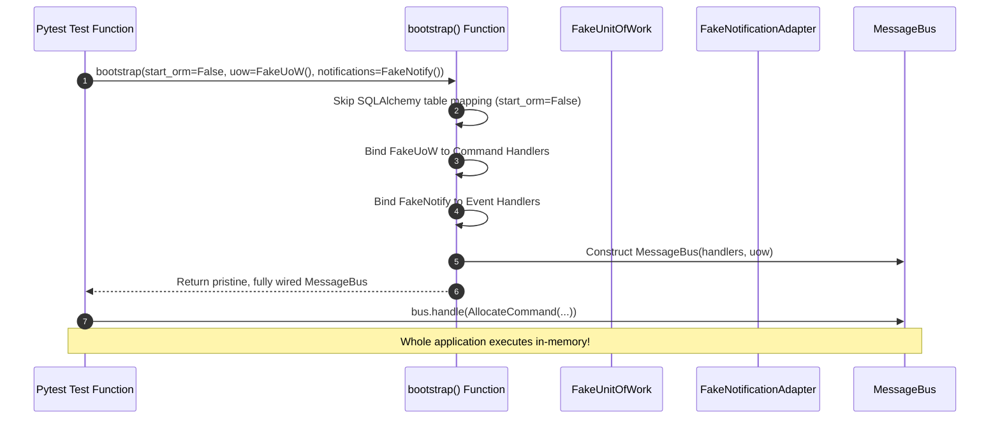

# Dependency Injection & Bootstrapping in Python 💉

> **Authoritative Sources & Literature:**
> - Harry Percival & Bob Gregory: *Architecture Patterns with Python* (Chapter 13: Dependency Injection (and Bootstrapping), O'Reilly)
> - Mark Seemann & Steven van Deursen: *Dependency Injection Principles, Practices, and Patterns* (Manning)
> - Martin Fowler: *Inversion of Control Containers and the Dependency Injection Pattern* (martinfowler.com)
> - Gerard Meszaros: *xUnit Test Patterns: Refactoring Test Code* (Configurable Test Double Pattern)

---

## 1. Conceptual Definition & Core Mental Model

In clean enterprise Python architectures, **Dependency Injection (DI)** is the practice of providing an object with its collaborators rather than having the object construct or import them directly.

### The Composition Root Pattern
Where should dependencies be wired together?
If dependencies are instantiated haphazardly throughout service modules or route handlers, the application suffers from hidden coupling and global state.
The solution is a **Composition Root** (implemented in Cosmic Python as a **`bootstrap()`** function):
- **A Single Assembly Plant**: A single location at the entry point of the application where all concrete adapters, repositories, and message handlers are wired together.
- **Production Mode**: `bootstrap()` wires real PostgreSQL engines, real Redis clients, and real email dispatchers.
- **Test Mode**: `bootstrap(start_orm=False, uow=FakeUnitOfWork(), ...)` wires in-memory test doubles in $< 0.1\text{ms}$ without modifying a single line of application source code!

```
                  ┌──────────────────────────────────────────────┐
                  │            bootstrap(...) Function           │
                  │              (Composition Root)              │
                  └──────────────────────┬───────────────────────┘
                                         │
                    ┌────────────────────┴────────────────────┐
                    │                                         │
       Production Invocation:                    Testing Invocation:
       bootstrap()                               bootstrap(uow=FakeUnitOfWork(),
       - Real SqlAlchemyUnitOfWork                         notifications=FakeNotifier())
       - Real SendGrid / Kafka                   - In-memory FakeUnitOfWork
       - Maps real DB tables                     - Zero database / Zero network
                    │                                         │
                    ▼                                         ▼
   ┌─────────────────────────────────┐       ┌─────────────────────────────────┐
   │ Fully Wired Production App      │       │ Fully Wired In-Memory Test App  │
   │ (FastAPI / Gunicorn / Uvicorn)  │       │ (Runs in < 0.1ms in Pytest)     │
   └─────────────────────────────────┘       └─────────────────────────────────┘
```

---

## 2. Why This Is Critical in Modern Python Backend Engineering

1. **Elimination of `unittest.mock.patch`**: Monkeypatching mutates global Python namespaces and breaks silently when paths change. The `bootstrap()` function makes dependency substitution explicit, typesafe, and compiler-verified.
2. **Explicit System Graph**: Every dependency required by the system is visible in the arguments of the `bootstrap()` function; there are zero hidden global singletons.
3. **Instant Test Suite Assembly**: End-to-end service tests instantiate a fully configured, isolated application kernel in microseconds.

---

## 3. Internal Mechanics & Architectural Workflow



---

## 4. Standard Syntax, Signatures & Configuration

### The Production Bootstrap Function

```python
import inspect
from typing import Callable, Dict, Type, List
from src.adapters import orm, notifications
from src.adapters.unit_of_work import AbstractUnitOfWork, SqlAlchemyUnitOfWork
from src.service_layer import handlers, messagebus
from src.domain import commands, events

def bootstrap(
    start_orm: bool = True,
    uow: AbstractUnitOfWork = None,
    notifications_adapter: notifications.AbstractNotifications = None,
    publish: Callable = None,
) -> messagebus.MessageBus:
    # 1. Start ORM Mappers if needed
    if start_orm:
        orm.start_mappers()

    # 2. Assign Default Production Adapters
    if uow is None:
        uow = SqlAlchemyUnitOfWork()
    if notifications_adapter is None:
        notifications_adapter = notifications.EmailNotifications()
    if publish is None:
        publish = notifications.RedisPublisher()

    # 3. Inject Dependencies into Handlers
    dependencies = {"uow": uow, "notifications": notifications_adapter, "publish": publish}
    injected_event_handlers = {
        event_type: [inject_dependencies(handler, dependencies) for handler in handler_list]
        for event_type, handler_list in handlers.EVENT_HANDLERS.items()
    }
    injected_command_handlers = {
        command_type: inject_dependencies(handler, dependencies)
        for command_type, handler in handlers.COMMAND_HANDLERS.items()
    }

    # 4. Return Assembled MessageBus
    return messagebus.MessageBus(
        uow=uow,
        event_handlers=injected_event_handlers,
        command_handlers=injected_command_handlers,
    )

def inject_dependencies(handler: Callable, dependencies: Dict[str, Any]) -> Callable:
    params = inspect.signature(handler).parameters
    handler_deps = {name: dep for name, dep in dependencies.items() if name in params}
    return lambda message: handler(message, **handler_deps)
```

---

## 5. Execution Lifecycle & Teardown Protocol

Testing the composition root:
1. **Creation**: Invoke `bootstrap(...)` inside a pytest fixture, passing test doubles.
2. **Execution**: Pass commands into the returned `MessageBus`.
3. **Teardown**: None required for in-memory fakes; state is discarded on garbage collection.

---

## 6. Scopes, Isolation & System Boundaries

| Environment | ORM Started? | UoW Injected | Notification Adapter | Setup Latency |
| :--- | :--- | :--- | :--- | :--- |
| **Production** | ✅ Yes (`start_mappers()`) | `SqlAlchemyUnitOfWork` | Real SendGrid / SMTP | $\approx 100\text{ms}$ |
| **Integration Test** | ✅ Yes | `SqlAlchemyUnitOfWork` (SAVEPOINT) | `FakeNotifications` | $\approx 2 - 5\text{ms}$ |
| **Unit Test** | ❌ No | **`FakeUnitOfWork`** | **`FakeNotifications`** | **$< 0.05\text{ms}$** |

---

## 7. Pytest Fixture & conftest Integration

```python
# tests/conftest.py
import pytest
from src.bootstrap import bootstrap
from src.service_layer.unit_of_work import FakeUnitOfWork
from tests.fakes import FakeNotifications

@pytest.fixture
def fake_bus():
    """Bootstraps a complete in-memory application with fake adapters."""
    bus = bootstrap(
        start_orm=False,
        uow=FakeUnitOfWork(),
        notifications_adapter=FakeNotifications(),
        publish=lambda *args: None
    )
    return bus
```

---

## 8. Step-by-Step Practical Python 3.10+ Walkthrough

Let's test an application wired completely via `bootstrap()`.

### Step 1: Define Fakes for Bootstrapping
```python
# tests/fakes.py
from typing import List, Dict
from src.adapters.notifications import AbstractNotifications

class FakeNotifications(AbstractNotifications):
    def __init__(self):
        self.sent: List[Dict[str, str]] = []

    def send(self, destination: str, message: str) -> None:
        self.sent.append({"to": destination, "message": message})
```

### Step 2: Write Tests Using the Bootstrapped Application
```python
# tests/test_bootstrap.py
import pytest
from src.bootstrap import bootstrap
from src.domain import commands
from src.service_layer.unit_of_work import FakeUnitOfWork
from tests.fakes import FakeNotifications

def test_bootstrapped_app_executes_end_to_end_use_case():
    fake_uow = FakeUnitOfWork()
    fake_notifications = FakeNotifications()

    # 1. Assemble application via bootstrap
    bus = bootstrap(
        start_orm=False,
        uow=fake_uow,
        notifications_adapter=fake_notifications
    )

    # 2. Create batch via command
    bus.handle(commands.CreateBatch(ref="batch-001", sku="CHAIR", qty=10))
    assert fake_uow.committed is True

    # 3. Allocate line via command
    bus.handle(commands.Allocate(order_id="order-1", sku="CHAIR", qty=10))

    # 4. Verify batch was allocated AND out of stock notification dispatched!
    assert fake_uow.products.get("CHAIR").available_qty == 0
    assert len(fake_notifications.sent) == 1
    assert "CHAIR" in fake_notifications.sent[0]["message"]
```

---

## 9. Framework & Ecosystem Integration: Bootstrapping in FastAPI

FastAPI routes simply retrieve the bootstrapped `MessageBus` via a dependency:

```python
# src/entrypoints/fastapi_app.py
from fastapi import FastAPI, Depends
from src.bootstrap import bootstrap
from src.service_layer.messagebus import MessageBus
from src.domain import commands

app = FastAPI()
# Global production bus assembled once at startup
app_bus = bootstrap()

def get_bus() -> MessageBus:
    return app_bus

@app.post("/allocate")
def allocate_endpoint(cmd: commands.Allocate, bus: MessageBus = Depends(get_bus)):
    bus.handle(cmd)
    return {"status": "success"}

# In tests: override get_bus with fake_bus!
def test_fastapi_with_bootstrapped_fake(fake_bus):
    app.dependency_overrides[get_bus] = lambda: fake_bus
    ...
```

---

## 10. Real-World Enterprise Scenario: Testing the Bootstrap Function Itself

Testing that `bootstrap()` accurately injects default adapters when overrides are omitted:

```python
# tests/test_bootstrap_integrity.py
from src.bootstrap import bootstrap
from src.adapters.unit_of_work import SqlAlchemyUnitOfWork
from src.adapters.notifications import EmailNotifications

def test_bootstrap_defaults_to_production_adapters(mocker):
    # Mock database connection to prevent live network calls during config test
    mocker.patch("src.adapters.orm.start_mappers")
    mocker.patch("src.adapters.unit_of_work.SqlAlchemyUnitOfWork.__init__", return_value=None)
    mocker.patch("src.adapters.notifications.EmailNotifications.__init__", return_value=None)

    bus = bootstrap(start_orm=False)

    assert isinstance(bus.uow, SqlAlchemyUnitOfWork)
```

---

## 11. Anti-Patterns & Code Smells (Before vs After)

### Anti-Pattern 1: Heavy Dependency Injection Frameworks in Python
```python
# ❌ BEFORE: Over-engineered XML/Annotation DI containers (Spring-style in Python)
container = DependencyContainer()
container.bind(IRepository).to(SqlAlchemyRepository).in_singleton_scope()

# ✅ AFTER: Simple, explicit Python bootstrap function
bus = bootstrap(uow=FakeUnitOfWork())
```

### Anti-Pattern 2: Scattering Instantiations Across Files
```python
# ❌ BEFORE: Instantiating real DB sessions in 10 different route files
# ✅ AFTER: Centralized in bootstrap()
```

---

## 12. Best Practices & Production Guidelines

1. **Keep `bootstrap()` Explicit**: Use explicit keyword arguments with sensible production defaults.
2. **Use Inspection for Dependency Injection**: Inspect handler signatures (`inspect.signature`) to auto-inject matching dependencies.
3. **Disable ORM Mappers in Unit Tests**: Pass `start_orm=False` in unit tests to save startup overhead.
4. **Make `bootstrap()` the Sole Composition Root**: Prohibit code from instantiating production database engines or API clients outside of `bootstrap()`.

---

## 13. Comprehensive Trade-Off Matrix

| Strategy | Speed | Type Safety | Boilerplate | Flexibility |
| :--- | :--- | :--- | :--- | :--- |
| **`bootstrap()` Function** | **$< 0.05\text{ms}$** | **Highest (Standard Python)** | **Minimal** | **Highest** |
| **Heavy DI Container (e.g. `injector`)** | Slow ($2 - 5\text{ms}$) | Moderate | High | Moderate |
| **`unittest.mock.patch`** | Moderate | ❌ None (String paths) | Low | Low |

---

## 14. Diagnostic & Troubleshooting Playbook

### Issue 1: `TypeError: handler() missing 1 required positional argument: 'uow'`
- **Root Cause**: `inject_dependencies` failed to match the parameter name.
- **Remediation**: Ensure the parameter name on the handler matches the key in the `dependencies` dictionary.

### Issue 2: `ArgumentError: Class already has a primary mapper defined`
- **Root Cause**: `orm.start_mappers()` was called more than once during test session.
- **Remediation**: Guard with `if not orm.mappers_started: start_mappers()`.

---

## 15. Senior Staff Interview Questions & Answers

### Question 1: What is a "Composition Root", and why should an application have only one?
**Answer**:
A **Composition Root** is the unique location in an application where the entire dependency graph is composed and wired together.
If an application has multiple composition roots (e.g. individual classes instantiating their own collaborators or routes creating sessions), dependencies become scattered and untrackable.
Having **exactly one composition root** (`bootstrap()`):
1. **Centralizes Configuration**: Swapping an adapter (e.g. changing email providers or swapping to a mock for tests) requires modifying exactly one function.
2. **Enforces Architectural Boundaries**: Ensures that the Domain and Service layers remain pure consumers of abstractions, while infrastructure wiring is confined strictly to the application entry point.

### Question 2: Why is a procedural `bootstrap()` function preferred over heavy Dependency Injection frameworks (like `dependency-injector` or `injector`) in modern Python?
**Answer**:
Python is a dynamic, expressive language with first-class functions and closures. In languages like Java or C#, heavy DI containers are necessary to circumvent static type rigidity and instantiate objects via reflection.
In Python:
1. A simple function taking optional keyword arguments (`bootstrap(uow=None, notifications=None)`) accomplishes 100% of the goals of a DI container in under 30 lines of readable code.
2. Heavy DI frameworks introduce proprietary DSLs, custom decorators, metaclass magic, and significant startup performance penalties.
3. Plain Python functions are trivially understood, debugged with standard PDB breakpoints, and fully verified by static type checkers (`mypy`/`pyright`).

---

## 16. Practical Hands-On Exercises & Challenges

### Exercise 1: Adding a Metrics Reporter to `bootstrap()`
1. Add an abstract `MetricsRecorder` protocol to `bootstrap()`.
2. Implement `FakeMetricsRecorder` tracking emitted metric names.
3. Write a test proving that executing a command records a latency metric.

### Exercise 2: Testing Circular Dependency Prevention
1. Verify that `bootstrap()` cleanly resolves circular dependencies between event publishers and command handlers using closures.

---

## 17. Key Takeaways & Summary

- **`bootstrap()` is the Composition Root** where the entire application dependency graph is wired.
- **Eliminates brittle monkeypatching**, allowing in-memory fakes to be passed cleanly.
- **Pass `start_orm=False` in unit tests** for sub-millisecond test execution.
- **FastAPI and Flask routes become simple adapters** that call into the bootstrapped `MessageBus`.

---

## 18. Next Steps & Cross-References

- Next: [Aggregate Invariants & Concurrency Testing](aggregate-invariants.md)
- [The Service Layer Pattern](service-layer.md)
- [The Unit of Work (UoW) Pattern](unit-of-work.md)
- [The Repository Pattern](repository-pattern.md)
- [Ports and Adapters (Hexagonal Architecture)](ports-and-adapters.md)
