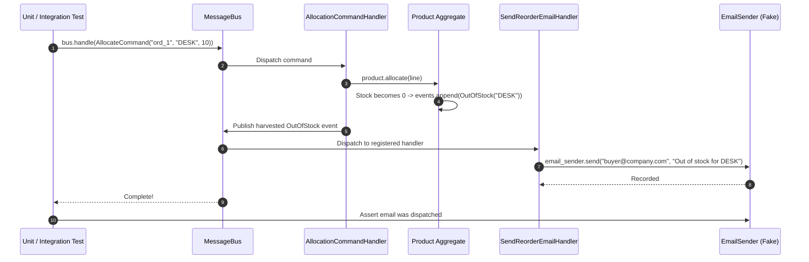

# Domain Events & Message Bus Testing in Python 📨

> **Authoritative Sources & Literature:**
> - Harry Percival & Bob Gregory: *Architecture Patterns with Python* (Chapter 8: Events and the Message Bus & Chapter 9: Going to Town on the Message Bus, O'Reilly)
> - Martin Fowler: *Domain Event Pattern* (martinfowler.com/eaaDev/DomainEvent.html)
> - Eric Evans: *Domain-Driven Design: Tackling Complexity in the Heart of Software* (Domain Events)
> - Gerard Meszaros: *xUnit Test Patterns: Refactoring Test Code* (Event-Driven Test Patterns)

---

## 1. Conceptual Definition & Core Mental Model

In complex distributed architectures, an operation often triggers secondary side effects:
- Allocating an order that depletes stock $\to$ must email purchasing to reorder.
- A user changes their email address $\to$ must send confirmation links and audit logs.
- An invoice is paid $\to$ must unlock features and alert accounting.

### The Problem: Coupling Side Effects to Transactions
If the primary service function directly calls notification services inside the main database transaction:
1. **Network Latency & Failure Coupling**: A slow email server stalls the customer's checkout, or an email failure rolls back the entire successful order allocation!
2. **Violating Single Responsibility**: The allocation use case becomes cluttered with email formatting and SMS dispatching logic.

### The Mental Model: Event-Driven Choreography
1. **Aggregates Record Events**: The domain model records that something occurred by appending a **Domain Event** (an immutable dataclass) to an internal list: `product.events.append(OutOfStock(sku="DESK-01"))`.
2. **Unit of Work Collects Events**: When the UoW commits, it harvests all recorded events from all `seen` entities.
3. **The Message Bus Dispatches**: A lightweight **Message Bus** routes each event to one or more registered **Event Handlers**.

```
   [ Customer Allocates Order ]
                │
                ▼
   ┌─────────────────────────────────────────┐
   │ Product Aggregate (Domain Model)        │
   │ 1. Allocates order line                 │
   │ 2. Available qty reaches 0              │
   │ 3. self.events.append(OutOfStock(sku))  │
   └────────────────────┬────────────────────┘
                        │
                        ▼
   ┌─────────────────────────────────────────┐
   │ Unit of Work (Transaction Commits)      │
   │ - Harvests all events from entities     │
   │ - Hands events to Message Bus           │
   └────────────────────┬────────────────────┘
                        │
                        ▼
   ┌─────────────────────────────────────────┐
   │ Message Bus                             │
   │ Maps OutOfStock -> [send_email, alert]  │
   └──────────┬───────────────────┬──────────┘
              │                   │
              ▼                   ▼
   [ send_reorder_email ]   [ audit_stock_event ]
   (Independent Handler)    (Independent Handler)
```

---

## 2. Why This Is Critical in Modern Python Backend Engineering

1. **Transaction Isolation**: Side effects run *after* the core database transaction commits. An email timeout will never roll back an already-completed database record.
2. **Trivially Testable Events**: You can test that a business rule occurred simply by asserting `OutOfStock(...) in product.events` in $< 0.01\text{ms}$!
3. **Extensibility Without Code Modification (Open/Closed Principle)**: Adding a new reaction to an event requires writing a new handler function and registering it with the Message Bus; existing code remains untouched.

---

## 3. Internal Mechanics & Architectural Workflow



---

## 4. Standard Syntax, Signatures & Configuration

### 1. Defining Domain Events (`@dataclass(frozen=True)`)

```python
from dataclasses import dataclass
from typing import Optional

class Event:
    """Base class for all domain events."""
    pass

@dataclass(frozen=True)
class OutOfStock(Event):
    sku: str

@dataclass(frozen=True)
class OrderAllocated(Event):
    order_id: str
    sku: str
    batch_ref: str
```

### 2. The Message Bus Implementation

```python
from typing import Dict, Type, List, Callable, Any
from src.domain.events import Event

class MessageBus:
    def __init__(
        self,
        event_handlers: Dict[Type[Event], List[Callable[..., Any]]],
        uow: Any
    ) -> None:
        self.event_handlers = event_handlers
        self.uow = uow
        self.queue: List[Event] = []

    def handle(self, event: Event) -> None:
        self.queue.append(event)
        while self.queue:
            ev = self.queue.pop(0)
            for handler in self.event_handlers.get(type(ev), []):
                handler(ev, uow=self.uow)
```

---

## 5. Execution Lifecycle & Teardown Protocol

Testing Event-Driven systems involves three testing levels:
1. **Domain Unit Test**: Assert Aggregate records event on state change.
2. **Handler Unit Test**: Call handler directly with event and fake collaborators.
3. **Message Bus Integration Test**: Publish event to bus and assert all registered handlers execute.

---

## 6. Scopes, Isolation & System Boundaries

| Event Level | Scope | Dispatch Mechanism | Failure Blast Radius |
| :--- | :--- | :--- | :--- |
| **In-Memory Domain Event** | Single process / request | `MessageBus.handle()` | Handled per handler; does not fail prior transactions |
| **Out-of-Process Integration Event** | Distributed microservices | Kafka / RabbitMQ | Independent consumers |

---

## 7. Pytest Fixture & conftest Integration

```python
# tests/conftest.py
import pytest
from src.service_layer.unit_of_work import FakeUnitOfWork
from src.service_layer.messagebus import MessageBus
from src.domain.events import OutOfStock

@pytest.fixture
def fake_email_log():
    return []

@pytest.fixture
def test_message_bus(fake_email_log) -> MessageBus:
    """Configures an in-memory MessageBus with fake handler targets."""
    def fake_send_email_handler(event: OutOfStock, uow):
        fake_email_log.append(event.sku)

    uow = FakeUnitOfWork()
    bus = MessageBus(
        event_handlers={OutOfStock: [fake_send_email_handler]},
        uow=uow
    )
    return bus
```

---

## 8. Step-by-Step Practical Python 3.10+ Walkthrough

Let's test an inventory allocation system that fires an `OutOfStock` event when available inventory reaches zero.

### Step 1: Implement the Domain Aggregate with Event Recording
```python
# src/domain/model.py
from dataclasses import dataclass
from typing import List, Set
from src.domain.events import Event, OutOfStock

@dataclass(frozen=True)
class OrderLine:
    order_id: str
    sku: str
    qty: int

class Product:
    def __init__(self, sku: str, available_qty: int) -> None:
        self.sku = sku
        self.available_qty = available_qty
        self.events: List[Event] = []  # Internal domain event queue!

    def allocate(self, line: OrderLine) -> str:
        if self.available_qty < line.qty:
            raise ValueError(f"Out of stock for SKU {self.sku}")
        
        self.available_qty -= line.qty
        
        # If stock is depleted, record domain event!
        if self.available_qty == 0:
            self.events.append(OutOfStock(sku=self.sku))
            
        return f"ALLOCATED-{self.sku}"
```

### Step 2: Implement Event Handlers
```python
# src/service_layer/handlers.py
from src.domain.events import OutOfStock
from src.service_layer.unit_of_work import AbstractUnitOfWork

class EmailSender:
    def send(self, recipient: str, message: str) -> None:
        raise NotImplementedError

def send_out_of_stock_notification(
    event: OutOfStock,
    email_sender: EmailSender
) -> None:
    email_sender.send(
        recipient="purchasing@company.com",
        message=f"Stock depleted for SKU: {event.sku}. Please reorder."
    )
```

### Step 3: Write Tests for Aggregate Event Recording & Handler Execution
```python
# tests/test_domain_events.py
import pytest
from src.domain.model import Product, OrderLine
from src.domain.events import OutOfStock
from src.service_layer.handlers import send_out_of_stock_notification

class FakeEmailSender:
    def __init__(self):
        self.sent_messages: list[tuple[str, str]] = []

    def send(self, recipient: str, message: str) -> None:
        self.sent_messages.append((recipient, message))

def test_product_records_out_of_stock_event_when_depleted():
    """Level 1: Pure domain unit test asserting event was recorded."""
    product = Product(sku="CHAIR-RED", available_qty=5)
    line = OrderLine(order_id="o1", sku="CHAIR-RED", qty=5)

    product.allocate(line)

    assert product.available_qty == 0
    # Assert event was recorded!
    assert len(product.events) == 1
    assert product.events[0] == OutOfStock(sku="CHAIR-RED")

def test_product_does_not_record_event_if_stock_remains():
    product = Product(sku="CHAIR-RED", available_qty=10)
    line = OrderLine(order_id="o1", sku="CHAIR-RED", qty=5)

    product.allocate(line)

    assert product.available_qty == 5
    assert len(product.events) == 0

def test_send_out_of_stock_notification_handler():
    """Level 2: Unit test for the event handler in isolation."""
    fake_sender = FakeEmailSender()
    event = OutOfStock(sku="MONITOR-4K")

    send_out_of_stock_notification(event, email_sender=fake_sender)

    assert len(fake_sender.sent_messages) == 1
    recipient, msg = fake_sender.sent_messages[0]
    assert recipient == "purchasing@company.com"
    assert "MONITOR-4K" in msg
```

---

## 9. Framework & Ecosystem Integration: Message Bus End-to-End Test

```python
# tests/test_messagebus_integration.py
def test_message_bus_routes_event_to_handler():
    """Level 3: Testing full message bus event dispatching."""
    fake_sender = FakeEmailSender()
    
    def bound_handler(event: OutOfStock, uow):
        send_out_of_stock_notification(event, email_sender=fake_sender)

    from src.service_layer.messagebus import MessageBus
    from src.service_layer.unit_of_work import FakeUnitOfWork

    bus = MessageBus(
        event_handlers={OutOfStock: [bound_handler]},
        uow=FakeUnitOfWork()
    )

    # Dispatch event into bus
    bus.handle(OutOfStock(sku="DESK-OAK"))

    assert len(fake_sender.sent_messages) == 1
    assert "DESK-OAK" in fake_sender.sent_messages[0][1]
```

---

## 10. Real-World Enterprise Scenario: Error Resilience in Event Handlers

In enterprise systems, if one event handler crashes, the Message Bus should log the failure and continue dispatching remaining handlers without breaking the application:

```python
# tests/test_handler_resilience.py
import logging
from src.service_layer.messagebus import MessageBus
from src.service_layer.unit_of_work import FakeUnitOfWork
from src.domain.events import OutOfStock

def test_failing_handler_does_not_abort_subsequent_handlers(caplog):
    executed = []

    def failing_handler(ev, uow):
        raise RuntimeError("SMTP server unreachable")

    def successful_handler(ev, uow):
        executed.append(ev.sku)

    class ResilientMessageBus(MessageBus):
        def handle(self, event):
            self.queue.append(event)
            while self.queue:
                ev = self.queue.pop(0)
                for handler in self.event_handlers.get(type(ev), []):
                    try:
                        handler(ev, uow=self.uow)
                    except Exception as exc:
                        logging.error(f"Error handling event {ev}: {exc}")

    bus = ResilientMessageBus(
        event_handlers={OutOfStock: [failing_handler, successful_handler]},
        uow=FakeUnitOfWork()
    )

    # Dispatch event
    bus.handle(OutOfStock("RESILIENT-SKU"))

    # Assert second handler still executed!
    assert executed == ["RESILIENT-SKU"]
    assert "SMTP server unreachable" in caplog.text
```

---

## 11. Anti-Patterns & Code Smells (Before vs After)

### Anti-Pattern 1: Sending Emails Directly from Domain Aggregates
```python
# ❌ BEFORE: Domain model imports email client (Violates pure domain rule)
class Product:
    def allocate(self, line):
        if self.qty == 0:
            sendgrid_client.send_email(...)  # Untestable, impure!

# ✅ AFTER: Domain records event; MessageBus orchestrates handler
class Product:
    def allocate(self, line):
        if self.qty == 0:
            self.events.append(OutOfStock(self.sku))  # Pure, synchronous, instant!
```

### Anti-Pattern 2: Handlers Mutating the Main Transaction
```python
# ❌ BEFORE: Event handler modifies entities on the same uncommitted transaction
# ✅ AFTER: Handlers operate on their own UoW or external adapter
```

---

## 12. Best Practices & Production Guidelines

1. **Use Immutable Dataclasses for Events**: Define events with `@dataclass(frozen=True)`.
2. **Name Events in the Past Tense**: Domain events describe things that have *already occurred* (`OrderCreated`, `PaymentReceived`, `OutOfStock`).
3. **Test Event Recording in Domain Unit Tests**: Verify that business conditions append the exact expected event.
4. **Isolate Handlers with Fakes**: Test event handlers independently by passing test doubles (`FakeEmailSender`, `FakeUoW`).

---

## 13. Comprehensive Trade-Off Matrix

| Design Pattern | Execution Speed | Coupling | Testability |
| :--- | :--- | :--- | :--- |
| **Domain Events + Message Bus** | **$< 0.05\text{ms}$** | **Completely Decoupled** | **Highest (Isolated handlers)** |
| **Direct Inline Method Calls** | $< 0.05\text{ms}$ | High Coupling | Low (Hard to isolate) |
| **External Kafka / RabbitMQ** | $\approx 20 - 50\text{ms}$ | Fully Distributed | Requires Testcontainers |

---

## 14. Diagnostic & Troubleshooting Playbook

### Issue 1: `KeyError: <class 'OutOfStock'>` in MessageBus
- **Root Cause**: The event was fired, but was not registered in the `event_handlers` dictionary.
- **Remediation**: Use `self.event_handlers.get(type(ev), [])` to safely handle unregistered events.

### Issue 2: Events fired twice
- **Root Cause**: The aggregate's `events` list was not cleared after harvest.
- **Remediation**: Clear `self.events.clear()` after the UoW consumes them.

---

## 15. Senior Staff Interview Questions & Answers

### Question 1: What is the architectural difference between a Command and an Event in event-driven architectures?
**Answer**:
1. **Command**:
   - Expressed in the **imperative mood** (`AllocateOrder`, `CreateCustomer`, `ChangePassword`).
   - Represents an **intent** or request for an action to happen.
   - Sent to a **single, specific handler**.
   - Can **fail or be rejected** by business validation rules.
2. **Event**:
   - Expressed in the **past tense** (`OrderAllocated`, `CustomerCreated`, `OutOfStock`).
   - Represents a **fact**—something that has already occurred and cannot be altered.
   - Dispatched to **zero, one, or many handlers** (Pub/Sub).
   - Handlers cannot reject or prevent the event; they can only react to it.

### Question 2: Why should Domain Aggregates record events internally rather than publishing directly to an external message broker?
**Answer**:
Publishing directly to an external message broker (e.g. RabbitMQ or Kafka) inside a domain entity creates the **Dual-Write Problem**:
If the domain entity publishes to Kafka, but the database transaction subsequently fails to commit (due to a conflict or constraint error), the external world acts on an event that never legitimately occurred in the database!
By having the Aggregate record events in memory (`self.events.append(...)`):
1. The domain entity remains a pure, in-memory object with zero external network dependencies.
2. Events are only harvested and published *after* the Unit of Work successfully commits the database transaction.
3. If the transaction rolls back, all recorded events are discarded, guaranteeing consistency.

---

## 16. Practical Hands-On Exercises & Challenges

### Exercise 1: Build a Cascading Event Chain
1. Create an `OrderPlaced` event.
2. Handler 1 deducts customer loyalty points.
3. If points fall below 0, emit `AccountNegative` event, which triggers Handler 2 (send warning SMS).
4. Write a test asserting that both events fire in sequence.

### Exercise 2: Implementing Event Deduplication
1. Add a unique `event_id` to `Event`.
2. Implement deduplication in `MessageBus` so identical event IDs are processed only once.

---

## 17. Key Takeaways & Summary

- **Domain Events record historical business facts** (`OutOfStock`, `OrderCreated`).
- **Aggregates record events in memory**, preventing the Dual-Write Problem.
- **The Message Bus decouples primary transactions from secondary side effects** (emails, audit logs).
- **Enables modular, microsecond unit testing** for both event emission and handler execution.

---

## 18. Next Steps & Cross-References

- Next: [CQRS (Command Query Responsibility Segregation)](cqrs-testing.md)
- [The Service Layer Pattern](service-layer.md)
- [The Unit of Work (UoW) Pattern](unit-of-work.md)
- [Pure Domain Model Testing](domain-model-testing.md)
- [Ports and Adapters (Hexagonal Architecture)](ports-and-adapters.md)
