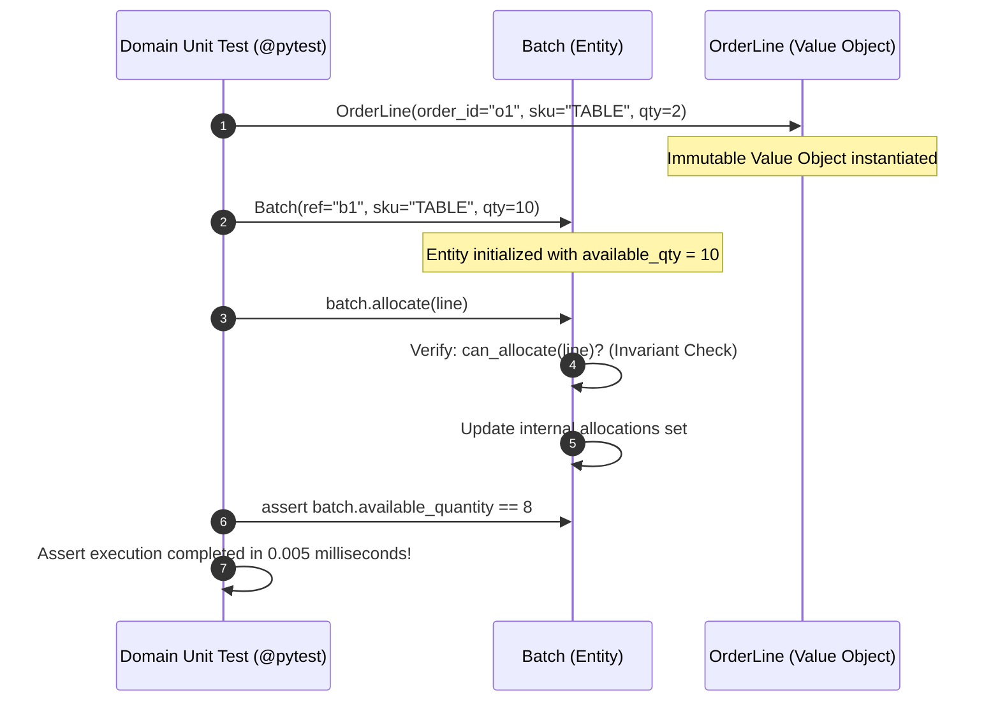

# Pure Domain Model Testing in Python 🧠

> **Authoritative Sources & Literature:**
> - Harry Percival & Bob Gregory: *Architecture Patterns with Python* (Chapter 1: Domain Modeling, O'Reilly)
> - Eric Evans: *Domain-Driven Design: Tackling Complexity in the Heart of Software* (Chapters 5 & 6: Entities, Value Objects)
> - Martin Fowler: *Anemic Domain Model vs Rich Domain Model* (martinfowler.com)
> - Gerard Meszaros: *xUnit Test Patterns: Refactoring Test Code* (Unit Test Patterns)

---

## 1. Conceptual Definition & Core Mental Model

In Domain-Driven Design (DDD), the **Domain Model** is the intellectual core of your application. It encapsulates the core business rules, calculations, invariants, and terminology (the *Ubiquitous Language*) of your business problem.

### The Pure Domain Rule: Zero External Dependencies
A **pure domain model** has strictly **zero dependencies** on external technology:
- No database imports (`import sqlalchemy`, `from peewee import ...`).
- No web framework imports (`import fastapi`, `from flask import ...`).
- No I/O libraries (`import httpx`, `import boto3`).
- Only Python standard library primitives: `dataclasses`, `enum`, `decimal`, `datetime`, `typing`.

### The Mental Model: Entities vs. Value Objects
Domain models are categorized into two fundamental building blocks:
1. **Value Objects**: Defined purely by their attributes. Immutable. If two Value Objects have identical values, they are equal. In Python, implemented via `@dataclass(frozen=True)`. Examples: `Money(cents=500, currency="USD")`, `Address(...)`, `OrderLine(...)`.
2. **Entities**: Defined by their **persistent identity** that endures across time and state changes. Two entities with different attributes but the same identity (e.g. `order_id` or `sku`) are the exact same entity! Implemented with explicit `__eq__` and `__hash__` on identity attributes. Examples: `Order`, `Batch`, `Customer`.

```
                  ┌──────────────────────────────────────────────┐
                  │              Pure Domain Model               │
                  └──────────────────────┬───────────────────────┘
                                         │
                    ┌────────────────────┴────────────────────┐
                    │                                         │
                    ▼                                         ▼
   ┌─────────────────────────────────┐       ┌─────────────────────────────────┐
   │         Value Objects           │       │            Entities             │
   │  - @dataclass(frozen=True)      │       │  - Persistent Unique Identity   │
   │  - Attribute-based equality     │       │  - Identity-based equality      │
   │  - Immutable                    │       │  - Mutable state & invariants   │
   │  - Example: Money, Quantity     │       │  - Example: Batch, Order, User  │
   └─────────────────────────────────┘       └─────────────────────────────────┘
                    │                                         │
                    └────────────────────┬────────────────────┘
                                         │
                                         ▼
                     [ Executes in < 0.01ms in Memory! ]
```

---

## 2. Why This Is Critical in Modern Python Backend Engineering

1. **Sub-Millisecond Execution**: Without databases, networks, or process overhead, **1,000 pure domain tests run in $< 50\text{ milliseconds}$**!
2. **Elimination of the Anemic Domain Model Anti-Pattern**: Business rules live inside the domain entities rather than sprawling across service layers or database triggers.
3. **Painless Refactoring & TDD**: You can test complex financial calculations, allocation algorithms, and state machines with immediate, instantaneous feedback.

---

## 3. Internal Mechanics & Architectural Workflow



---

## 4. Standard Syntax, Signatures & Configuration

### 1. Value Object Implementation (`@dataclass(frozen=True)`)

```python
from dataclasses import dataclass
from decimal import Decimal

@dataclass(frozen=True)
class Money:
    amount: Decimal
    currency: str

    def __post_init__(self):
        if self.amount < Decimal("0.00"):
            raise ValueError("Money amount cannot be negative")

    def __add__(self, other: "Money") -> "Money":
        if self.currency != other.currency:
            raise ValueError(f"Cannot add {self.currency} to {other.currency}")
        return Money(self.amount + other.amount, self.currency)
```

### 2. Entity Implementation (`__eq__` and `__hash__` based on identity)

```python
class Batch:
    def __init__(self, ref: str, sku: str, qty: int) -> None:
        self.ref = ref
        self.sku = sku
        self._initial_qty = qty
        self._allocations: set[OrderLine] = set()

    # Identity equality: two batches with the same 'ref' are identical!
    def __eq__(self, other: object) -> bool:
        if not isinstance(other, Batch):
            return False
        return self.ref == other.ref

    def __hash__(self) -> int:
        return hash(self.ref)
```

---

## 5. Execution Lifecycle & Teardown Protocol

Pure domain model tests have **zero setup and zero teardown overhead**:
- No fixtures required.
- No database cleaning.
- Tests instantiate domain objects directly, invoke methods, and assert state.

---

## 6. Scopes, Isolation & System Boundaries

| Construct | Identity Definition | Mutability | Equality Basis |
| :--- | :--- | :--- | :--- |
| **Value Object** | None (Defined by attributes) | **Immutable (`frozen=True`)** | All field values match |
| **Entity** | **Explicit ID (`ref`, `id`, `uuid`)** | **Mutable** | Identical `id` (regardless of other fields) |
| **Aggregate Root** | Entity acting as gatekeeper | Mutable | Aggregate Root ID |

---

## 7. Pytest Fixture & conftest Integration

```python
# tests/conftest.py
import pytest
from decimal import Decimal
from src.domain.model import Money, Batch

@pytest.fixture
def sample_batch() -> Batch:
    """Provides a fresh batch entity with standard stock."""
    return Batch(ref="batch-alpha", sku="CHAIR-001", qty=20)

@pytest.fixture
def hundred_usd() -> Money:
    return Money(amount=Decimal("100.00"), currency="USD")
```

---

## 8. Step-by-Step Practical Python 3.10+ Walkthrough

Let's test an e-commerce order allocation domain model with value objects, entities, and business invariants.

### Step 1: Define the Pure Domain Classes
```python
# src/domain/model.py
from dataclasses import dataclass
from typing import Set, Optional
from datetime import date

@dataclass(frozen=True)
class OrderLine:
    order_id: str
    sku: str
    qty: int

class Batch:
    def __init__(self, ref: str, sku: str, qty: int, eta: Optional[date] = None) -> None:
        self.ref = ref
        self.sku = sku
        self.eta = eta
        self._initial_qty = qty
        self._allocations: Set[OrderLine] = set()

    def allocate(self, line: OrderLine) -> None:
        if self.can_allocate(line):
            self._allocations.add(line)

    def deallocate(self, line: OrderLine) -> None:
        if line in self._allocations:
            self._allocations.remove(line)

    def can_allocate(self, line: OrderLine) -> bool:
        return self.sku == line.sku and self.available_quantity >= line.qty

    @property
    def allocated_quantity(self) -> int:
        return sum(line.qty for line in self._allocations)

    @property
    def available_quantity(self) -> int:
        return self._initial_qty - self.allocated_quantity

    # Sorting batches: batches in stock (eta=None) come before batches with future ETAs
    def __gt__(self, other: "Batch") -> bool:
        if self.eta is None:
            return False
        if other.eta is None:
            return True
        return self.eta > other.eta

    def __eq__(self, other: object) -> bool:
        if not isinstance(other, Batch):
            return False
        return self.ref == other.ref

    def __hash__(self) -> int:
        return hash(self.ref)
```

### Step 2: Write Exhaustive Domain Unit Tests
```python
# tests/test_domain_batches.py
from datetime import date, timedelta
import pytest
from src.domain.model import Batch, OrderLine

def test_allocating_to_a_batch_reduces_the_available_quantity():
    batch = Batch("batch-001", "SMALL-TABLE", qty=20, eta=date.today())
    line = OrderLine("order-ref", "SMALL-TABLE", 2)

    batch.allocate(line)

    assert batch.available_quantity == 18

def test_can_allocate_if_available_greater_than_required():
    large_batch = Batch("b1", "ELEGANT-LAMP", 20)
    small_line = OrderLine("o1", "ELEGANT-LAMP", 2)
    assert large_batch.can_allocate(small_line) is True

def test_cannot_allocate_if_available_smaller_than_required():
    small_batch = Batch("b1", "ELEGANT-LAMP", 2)
    large_line = OrderLine("o1", "ELEGANT-LAMP", 20)
    assert small_batch.can_allocate(large_line) is False

def test_can_allocate_if_available_equal_to_required():
    batch = Batch("b1", "ELEGANT-LAMP", 2)
    line = OrderLine("o1", "ELEGANT-LAMP", 2)
    assert batch.can_allocate(line) is True

def test_cannot_allocate_if_skus_do_not_match():
    batch = Batch("b1", "UNCOMFORTABLE-CHAIR", 100)
    different_sku_line = OrderLine("o1", "EXPENSIVE-TOASTER", 10)
    assert batch.can_allocate(different_sku_line) is False

def test_allocation_is_idempotent():
    batch = Batch("b1", "ANGULAR-DESK", 20)
    line = OrderLine("o1", "ANGULAR-DESK", 2)

    batch.allocate(line)
    batch.allocate(line)  # Allocate identical line second time

    assert batch.available_quantity == 18  # Not 16!

def test_deallocate_frees_allocated_quantity():
    batch = Batch("b1", "EXPENSIVE-FOOTSTOOL", 20)
    line = OrderLine("o1", "EXPENSIVE-FOOTSTOOL", 2)

    batch.allocate(line)
    assert batch.available_quantity == 18

    batch.deallocate(line)
    assert batch.available_quantity == 20

def test_batches_in_stock_are_preferred_to_future_batches():
    in_stock_batch = Batch("in-stock", "RETRO-CLOCK", 100, eta=None)
    future_batch = Batch("future", "RETRO-CLOCK", 100, eta=date.today() + timedelta(days=7))

    # Assert in_stock_batch precedes future_batch in sorting
    assert sorted([future_batch, in_stock_batch]) == [in_stock_batch, future_batch]
```

---

## 9. Framework & Ecosystem Integration: Testing Value Object Immutability

Testing that value objects cannot be mutated at runtime:

```python
# tests/test_value_objects.py
import pytest
from dataclasses import FrozenInstanceError
from src.domain.model import OrderLine

def test_order_line_equality_by_value():
    line1 = OrderLine("order-123", "RED-CHAIR", 5)
    line2 = OrderLine("order-123", "RED-CHAIR", 5)
    assert line1 == line2  # Identical attributes = Equal!

def test_order_line_immutability():
    line = OrderLine("order-123", "RED-CHAIR", 5)
    with pytest.raises(FrozenInstanceError):
        line.qty = 10  # Attempted mutation raises FrozenInstanceError!
```

---

## 10. Real-World Enterprise Scenario: Precision Decimal Currency Calculations

Never use floating-point numbers (`float`) for monetary operations. Always use `Decimal` and verify zero-rounding errors:

```python
# tests/test_currency_math.py
from decimal import Decimal
import pytest
from src.domain.model import Money

def test_money_addition():
    m1 = Money(Decimal("10.50"), "USD")
    m2 = Money(Decimal("20.25"), "USD")
    assert (m1 + m2) == Money(Decimal("30.75"), "USD")

def test_money_currency_mismatch_raises_error():
    m_usd = Money(Decimal("10.00"), "USD")
    m_eur = Money(Decimal("10.00"), "EUR")
    with pytest.raises(ValueError, match="Cannot add USD to EUR"):
        _ = m_usd + m_eur
```

---

## 11. Anti-Patterns & Code Smells (Before vs After)

### Anti-Pattern 1: The Anemic Domain Model (Logic Trapped in Services)
```python
# ❌ BEFORE: Anemic entity with no behavior; service performs all math manually
class Batch:
    def __init__(self, qty):
        self.available_qty = qty

def allocate_service(batch, line):
    # Business logic leaked outside entity!
    if batch.available_qty >= line.qty:
        batch.available_qty -= line.qty

# ✅ AFTER: Rich Domain Model (Behavior encapsulated inside entity)
class Batch:
    def allocate(self, line: OrderLine) -> None:
        if not self.can_allocate(line):
            raise OutOfStockError(...)
        self._allocations.add(line)
```

### Anti-Pattern 2: Importing Frameworks or ORMs in Domain Models
```python
# ❌ BEFORE: Contaminating domain with ORM/FastAPI
from sqlalchemy import Column, Integer, String
from fastapi import HTTPException

class Order(Base):  # Coupled to database!
    ...

# ✅ AFTER: Pure, framework-agnostic Python classes
class Order:
    ...  # 100% clean, standard Python!
```

---

## 12. Best Practices & Production Guidelines

1. **Keep Domain Models Free of Framework Imports**: Zero imports from SQLAlchemy, Flask, FastAPI, or Celery.
2. **Use `@dataclass(frozen=True)` for Value Objects**: Enforces immutability and provides structural equality out of the box.
3. **Implement Identity Equality on Entities**: Define explicit `__eq__` and `__hash__` using the unique entity identifier.
4. **Enforce Invariants in Methods**: Mutative methods should validate domain rules before updating state.

---

## 13. Comprehensive Trade-Off Matrix

| Dimension | Pure Domain Unit Tests | Service Layer Tests | End-to-End Tests |
| :--- | :--- | :--- | :--- |
| **Execution Speed** | **$< 0.01\text{ms}$ (Fastest)** | $< 0.1\text{ms}$ | $\approx 20 - 50\text{ms}$ |
| **Dependencies** | **Zero (Pure Python)** | `FakeUnitOfWork` | Real Database & API |
| **Refactoring Drag** | High (Tied to method names) | **Lowest (Tied to use cases)** | Low |
| **Diagnostic Precision** | **Exact domain calculation line** | Use case level | HTTP status code |

---

## 14. Diagnostic & Troubleshooting Playbook

### Issue 1: `TypeError: unhashable type: 'Batch'` when adding to sets
- **Root Cause**: The class defined custom `__eq__` without defining `__hash__`. In Python, overriding `__eq__` automatically sets `__hash__ = None`.
- **Remediation**: Implement `def __hash__(self): return hash(self.ref)`.

### Issue 2: `ValueError: Cannot add USD to EUR`
- **Root Cause**: Business invariant prevented cross-currency operations.
- **Remediation**: Use an explicit currency exchange service before performing addition.

---

## 15. Senior Staff Interview Questions & Answers

### Question 1: What is the fundamental difference between an Entity and a Value Object in Domain-Driven Design, and how does this affect testing?
**Answer**:
1. **Value Objects**:
   - Defined entirely by the values of its attributes. It has no conceptual identity.
   - Immutable (`@dataclass(frozen=True)`).
   - If two Value Objects share the same attributes, they are interchangeable and structurally equal (`Money(10, 'USD') == Money(10, 'USD')`).
   - **Testing Impact**: Value objects are trivially easy to test. You test construction invariants (preventing negative values), mathematical operators (`__add__`), and immutability.
2. **Entities**:
   - Defined by a persistent, continuous identity (`id`, `uuid`, `ref`) that remains identical even as other attributes change over time.
   - Mutable.
   - Two entities with different names or timestamps are the exact same entity if their identities match.
   - **Testing Impact**: Entity tests verify lifecycle transitions, state machines, and business invariant protection (e.g. preventing over-allocation).

### Question 2: Why should pure domain models never import SQLAlchemy or define database schema columns?
**Answer**:
When domain models inherit from `declarative_base()` and define `db.Column()`:
1. **Persistence Mechanics Pollute Business Logic**: Database concerns (nullability, foreign keys, index cascades, relationship join strategies) leak into domain thinking.
2. **Session Attachment Traps**: Entities become attached to SQLAlchemy session lifecycles. Calling an attribute outside of an active database transaction triggers `DetachedInstanceError`.
3. **Slow Tests**: Even simple unit tests require initializing the SQLAlchemy mapper registry or configuring mock sessions.
By keeping the Domain Model purely in Python and using **SQLAlchemy's Classical Mapping (`registry.map_imperatively`)** or explicit repository mappers, the domain remains 100% testable in microseconds.

---

## 16. Practical Hands-On Exercises & Challenges

### Exercise 1: Build an Account State Machine
1. Create a `BankAccount` entity with states: `PENDING`, `ACTIVE`, `FROZEN`, `CLOSED`.
2. Implement `deposit()` and `withdraw()` with invariants (cannot withdraw from FROZEN, cannot deposit to CLOSED).
3. Write domain unit tests verifying every permitted and forbidden state transition.

### Exercise 2: Implementing a Value Object with Normalization
1. Implement an `EmailAddress` value object that lowercases and strips whitespace in `__post_init__`.
2. Write tests asserting that `EmailAddress("  Ada@Test.COM ") == EmailAddress("ada@test.com")`.

---

## 17. Key Takeaways & Summary

- **Pure domain models contain zero external framework or database imports**.
- **Value Objects are immutable and compared by value** (`@dataclass(frozen=True)`).
- **Entities are compared by persistent identity** (`ref`, `id`).
- **Domain unit tests execute in microseconds ($< 0.01\text{ms}$)**, providing instant feedback during TDD.

---

## 18. Next Steps & Cross-References

- Next: [Ports and Adapters (Hexagonal Architecture)](ports-and-adapters.md)
- [The Service Layer Pattern](service-layer.md)
- [The Repository Pattern](repository-pattern.md)
- [The Unit of Work (UoW) Pattern](unit-of-work.md)
- [Business Logic & Invariant Testing](../unit-testing/business-logic-testing.md)
