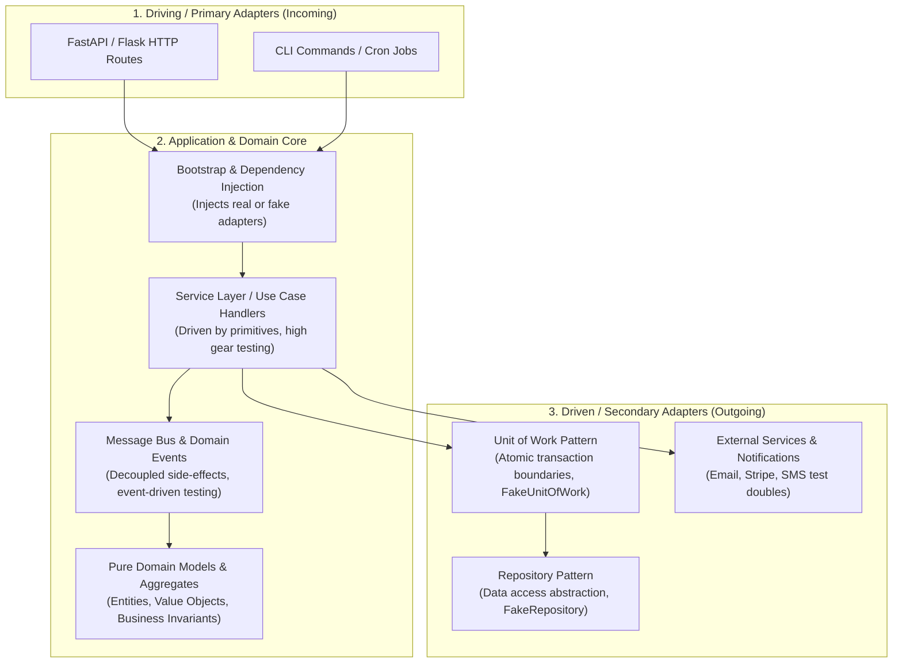

# Architecture Patterns & Testing in Python (Cosmic Python) 🏛️

> **Authoritative Sources & Literature:**
> - Harry Percival & Bob Gregory: *Architecture Patterns with Python* (O'Reilly, "Cosmic Python" - cosmicpython.com)
> - Eric Evans: *Domain-Driven Design: Tackling Complexity in the Heart of Software* (Addison-Wesley)
> - Alistair Cockburn: *Hexagonal Architecture (Ports and Adapters)* (alistair.cockburn.us)
> - Martin Fowler: *Patterns of Enterprise Application Architecture* (martinfowler.com)
> - Gerard Meszaros: *xUnit Test Patterns: Refactoring Test Code*

---

## 📖 Module Overview

Testing is not merely an activity performed after code is written—**testing is the ultimate architectural diagnostic tool**. When code is painful, slow, or brittle to test, it is a direct signal of architectural coupling.

Based on Harry Percival & Bob Gregory's seminal work *Architecture Patterns with Python* (Cosmic Python), this module demonstrates how Domain-Driven Design (DDD), Hexagonal Architecture (Ports and Adapters), and Event-Driven systems enable **blazingly fast, ultra-reliable test suites**.

By inverting dependencies, separating business logic into pure domain models, and orchestrating use cases through a lightweight Service Layer and Message Bus:
- 90% of your tests run in microseconds in memory without databases or networks.
- Infrastructure dependencies (SQLAlchemy, Redis, Celery, Stripe) are pushed to the edges (adapters).
- Swapping real infrastructure for fast in-memory fakes (`FakeRepository`, `FakeUnitOfWork`) requires zero monkeypatching.

---

## 🗺️ Module Guides

### 1. [The Repository Pattern](repository-pattern.md)
Decouple domain entities from persistence mechanics. Implement `AbstractRepository`, test real database implementations against `SqlAlchemyRepository`, and build in-memory `FakeRepository` doubles that run in microseconds.

### 2. [The Unit of Work (UoW) Pattern](unit-of-work.md)
Enforce atomic consistency boundaries. Implement `AbstractUnitOfWork` using Python context managers (`__enter__`, `__exit__`), verify transaction commits and rollbacks, and construct `FakeUnitOfWork` for tests.

### 3. [The Service Layer Pattern](service-layer.md)
Cosmic Python's "High Gear" testing strategy. Drive business use cases through plain Python primitives (strings, ints, dicts), decoupling services from web frameworks and ORMs.

### 4. [Pure Domain Model Testing](domain-model-testing.md)
Write lightning-fast unit tests for pure domain models without database, framework, or third-party dependencies. Test Entities, immutable Value Objects (`@dataclass(frozen=True)`), and business rules.

### 5. [Ports and Adapters (Hexagonal Architecture)](ports-and-adapters.md)
Organize backends into Driving (Primary) and Driven (Secondary) ports. Test domain logic independently of HTTP frameworks, CLI wrappers, or external message queues.

### 6. [Domain Events & Message Bus Testing](domain-events-and-message-bus-testing.md)
Decouple complex workflows into event-driven handlers. Test domain event recording on Aggregates, message bus event dispatching, and asynchronous side-effect isolation.

### 7. [CQRS (Command Query Responsibility Segregation)](cqrs-testing.md)
Separate write operations from read views. Test Command Handlers modifying domain models via UoW, and test high-performance Read Model queries executing raw, optimized SQL.

### 8. [Dependency Injection & Bootstrapping](dependency-injection.md)
Assemble applications cleanly using a `bootstrap()` function. Inject fake repositories and message buses during testing without monkeypatching or global state mutation.

### 9. [Aggregate Invariants & Concurrency Testing](aggregate-invariants.md)
Protect consistency boundaries. Test optimistic locking version checks (`version_number`), prevent concurrent over-allocation bugs, and assert race condition resilience.

---

## 📊 The "High Gear vs. Low Gear" Testing Matrix

| Testing Mode | Test Target | Collaborators Used | Execution Speed | Refactoring Safety |
| :--- | :--- | :--- | :--- | :--- |
| **Low Gear (Domain Unit)** | Pure Domain Models | Pure in-memory Python objects | **$< 0.05\text{ms}$** | High (Domain invariant check) |
| **High Gear (Service Layer)** | Use Case Handlers | `FakeRepository` + `FakeUoW` | **$< 0.2\text{ms}$** | **Highest (Immune to internal refactors)** |
| **Adapter Integration** | `SqlAlchemyRepository` | Ephemeral PostgreSQL (SAVEPOINT) | $\approx 1 - 2\text{ms}$ | Verifies SQL mapping & queries |
| **End-to-End (E2E)** | Web API / HTTP | Real Database + Real Containers | $\approx 20 - 50\text{ms}$ | Full stack sanity check |

---

## ⏭️ Next Steps

Begin with **[The Repository Pattern](repository-pattern.md)** to establish clean data-access abstractions for your domain entities.
