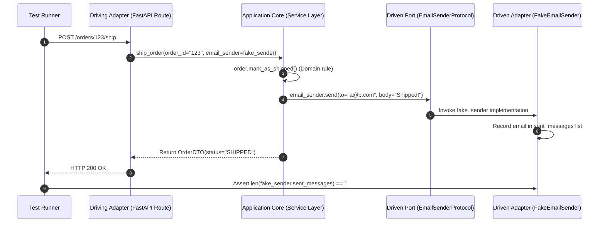

# Ports and Adapters (Hexagonal Architecture) in Python 🔌

> **Authoritative Sources & Literature:**
> - Alistair Cockburn: *Hexagonal Architecture (Ports and Adapters)* (alistair.cockburn.us)
> - Harry Percival & Bob Gregory: *Architecture Patterns with Python* (Chapter 3: Coupling and Abstractions, O'Reilly)
> - Robert C. Martin: *Clean Architecture: A Craftsman's Guide to Software Structure* (Prentice Hall)
> - Gerard Meszaros: *xUnit Test Patterns: Refactoring Test Code* (Test Double Patterns)

---

## 1. Conceptual Definition & Core Mental Model

**Hexagonal Architecture**, conceived by Alistair Cockburn and also known as the **Ports and Adapters Pattern**, divides a software system into two fundamental parts:
1. **The Application Core**: Contains the pure Domain Model and the Service Layer use cases. It embodies all business rules and has **zero knowledge** of databases, web frameworks, or third-party APIs.
2. **The Outside World (The Infrastructure)**: Databases, user interfaces, message brokers, HTTP routers, email gateways, file systems.

### The Mental Model: Ports vs. Adapters
- **A Port** is an **interface or protocol** defined *inside* the application core. It specifies a contract for communication between the core and the outside world.
- **An Adapter** is a **concrete implementation** that translates between the port interface and external technology.

```
                    DRIVING / PRIMARY ADAPTERS (INCOMING)
         ┌────────────────────────────────────────────────────────┐
         │  FastAPI Controller  │  CLI Command  │  Celery Worker  │
         └───────────────────────────────┬────────────────────────┘
                                         │ Calls Driving Port (Use Case)
                                         ▼
   ┌────────────────────────────────────────────────────────────────────────┐
   │                         THE APPLICATION CORE                           │
   │                                                                        │
   │   [ Service Layer Use Cases ] ──► [ Pure Domain Entities & Invariants ]│
   │                 │                                                      │
   │                 ▼                                                      │
   │   [ Driven Ports (Protocols) ]                                         │
   │   - AbstractRepository                                                 │
   │   - EmailSenderProtocol                                                │
   │   - PaymentGatewayProtocol                                             │
   └─────────────────────────────────────┬──────────────────────────────────┘
                                         │ Implements Driven Port
                                         ▼
         ┌────────────────────────────────────────────────────────┐
         │  SqlAlchemy / PG     │   SendGrid / SMTP   │   Stripe  │
         └────────────────────────────────────────────────────────┘
                    DRIVEN / SECONDARY ADAPTERS (OUTGOING)
```

---

## 2. Why This Is Critical in Modern Python Backend Engineering

1. **Driving / Primary vs. Driven / Secondary Distinction**:
   - **Driving (Primary) Ports**: The outside world calls into the application core (e.g. HTTP routes, CLI scripts).
   - **Driven (Secondary) Ports**: The application core calls out to external infrastructure (e.g. databases, email providers).
2. **Symmetric Testing Architecture**: In automated tests, you can plug in **Test Adapters** (`FakeEmailSender`, `FakeRepository`) without changing a single line of application core logic.
3. **Infrastructure Decoupling**: You can migrate from SendGrid to AWS SES, or from PostgreSQL to DynamoDB simply by writing a new adapter that fulfills the port contract.

---

## 3. Internal Mechanics & Architectural Workflow



---

## 4. Standard Syntax, Signatures & Configuration

### Defining Driven Ports with `typing.Protocol` (Python 3.10+)

```python
from typing import Protocol, runtime_checkable

@runtime_checkable
class EmailSenderProtocol(Protocol):
    """Driven Port: Defined inside the application core."""
    def send_email(self, to_address: str, subject: str, body: str) -> None:
        ...

@runtime_checkable
class SmsSenderProtocol(Protocol):
    """Driven Port for mobile notifications."""
    def send_sms(self, phone_number: str, message: str) -> bool:
        ...
```

---

## 5. Execution Lifecycle & Teardown Protocol

Testing Hexagonal Architecture requires isolating the three layers:
1. **Application Core Tests**: Test domain models and services using in-memory fake adapters ($< 0.1\text{ms}$).
2. **Driven Adapter Tests**: Test real infrastructure adapters (SQLAlchemy, SendGrid, Stripe) against real infrastructure or containerized mocks.
3. **Driving Adapter Tests**: Test HTTP endpoints and CLI wrappers using in-memory test clients.

---

## 6. Scopes, Isolation & System Boundaries

| Architectural Boundary | Defined In | Implemented By | Test Strategy |
| :--- | :--- | :--- | :--- |
| **Driving Port** | Service Layer (`use_cases.py`) | Application Core | Direct function calls with primitive arguments |
| **Driving Adapter** | Infrastructure (`routes/api.py`) | FastAPI / Flask / Click | `httpx.AsyncClient` / `app.test_client()` |
| **Driven Port** | Application Core (`ports.py`) | Protocol / ABC | Substituted by Fake in unit tests |
| **Driven Adapter** | Infrastructure (`adapters/`) | SQLAlchemy / SendGrid | Contract Tests / Testcontainers |

---

## 7. Pytest Fixture & conftest Integration

```python
# tests/conftest.py
import pytest
from typing import List, Dict
from src.core.ports import EmailSenderProtocol

class FakeEmailSender(EmailSenderProtocol):
    """Test Adapter implementing the EmailSenderProtocol driven port."""
    def __init__(self) -> None:
        self.sent_emails: List[Dict[str, str]] = []

    def send_email(self, to_address: str, subject: str, body: str) -> None:
        self.sent_emails.append({"to": to_address, "subject": subject, "body": body})

@pytest.fixture
def fake_email_sender() -> FakeEmailSender:
    return FakeEmailSender()
```

---

## 8. Step-by-Step Practical Python 3.10+ Walkthrough

Let's build a notification workflow using Hexagonal Architecture:
1. Define the Driven Port (`NotificationPort`).
2. Implement the Production Driven Adapter (Twilio/SendGrid).
3. Implement the Test Driven Adapter (`FakeNotificationAdapter`).
4. Implement the Driving Adapter (FastAPI endpoint).

### Step 1: Define the Port and Domain Service (Core)
```python
# src/core/ports.py
from typing import Protocol

class NotificationPort(Protocol):
    def notify(self, recipient: str, message: str) -> bool:
        ...

# src/core/services.py
from src.core.ports import NotificationPort

def process_fraud_alert(user_id: str, email: str, severity: str, notifier: NotificationPort) -> str:
    # Pure application logic
    if severity == "HIGH":
        alert_msg = f"CRITICAL: Fraud detected on account {user_id}!"
        success = notifier.notify(email, alert_msg)
        if not success:
            raise RuntimeError("Notification delivery failed")
        return "ALERT_DISPATCHED"
    return "ALERT_IGNORED"
```

### Step 2: Implement the Test Adapter (Fake)
```python
# tests/adapters/test_adapters.py
class FakeNotificationAdapter:
    def __init__(self, should_succeed: bool = True):
        self.should_succeed = should_succeed
        self.notifications: list[tuple[str, str]] = []

    def notify(self, recipient: str, message: str) -> bool:
        if not self.should_succeed:
            return False
        self.notifications.append((recipient, message))
        return True
```

### Step 3: Implement the Production Adapter (Real External HTTP)
```python
# src/infrastructure/sendgrid_adapter.py
import httpx
from src.core.ports import NotificationPort

class SendGridNotificationAdapter(NotificationPort):
    def __init__(self, api_key: str, client: httpx.Client):
        self._api_key = api_key
        self._client = client

    def notify(self, recipient: str, message: str) -> bool:
        resp = self._client.post(
            "https://api.sendgrid.com/v3/mail/send",
            headers={"Authorization": f"Bearer {self._api_key}"},
            json={"to": recipient, "content": message}
        )
        return resp.status_code == 202
```

### Step 4: Write Core Unit Tests with the Fake Adapter
```python
# tests/test_fraud_service.py
import pytest
from src.core.services import process_fraud_alert
from tests.adapters.test_adapters import FakeNotificationAdapter

def test_high_severity_fraud_dispatches_notification():
    fake_notifier = FakeNotificationAdapter(should_succeed=True)

    result = process_fraud_alert(
        user_id="usr_101",
        email="security@company.com",
        severity="HIGH",
        notifier=fake_notifier
    )

    assert result == "ALERT_DISPATCHED"
    assert len(fake_notifier.notifications) == 1
    recipient, msg = fake_notifier.notifications[0]
    assert recipient == "security@company.com"
    assert "CRITICAL: Fraud detected" in msg

def test_low_severity_fraud_ignores_notification():
    fake_notifier = FakeNotificationAdapter()

    result = process_fraud_alert(
        user_id="usr_102",
        email="security@company.com",
        severity="LOW",
        notifier=fake_notifier
    )

    assert result == "ALERT_IGNORED"
    assert len(fake_notifier.notifications) == 0
```

---

## 9. Framework & Ecosystem Integration: Testing Driving Adapters

Testing the FastAPI Driving Adapter with dependency injection:

```python
# src/infrastructure/fastapi_routes.py
from fastapi import APIRouter, Depends, HTTPException
from pydantic import BaseModel
from src.core.services import process_fraud_alert
from src.core.ports import NotificationPort

router = APIRouter()

class FraudPayload(BaseModel):
    user_id: str
    email: str
    severity: str

def get_notifier() -> NotificationPort:
    # Production dependency
    raise NotImplementedError

@router.post("/alerts/fraud")
def fraud_endpoint(payload: FraudPayload, notifier: NotificationPort = Depends(get_notifier)):
    try:
        status = process_fraud_alert(payload.user_id, payload.email, payload.severity, notifier)
        return {"status": status}
    except RuntimeError as exc:
        raise HTTPException(status_code=502, detail=str(exc))
```

### Testing the Route with Dependency Overrides
```python
# tests/test_fraud_api_driving_adapter.py
import pytest
from httpx import AsyncClient, ASGITransport
from fastapi import FastAPI
from src.infrastructure.fastapi_routes import router, get_notifier
from tests.adapters.test_adapters import FakeNotificationAdapter

app = FastAPI()
app.include_router(router)

@pytest.mark.asyncio
async def test_driving_adapter_returns_200():
    fake_notifier = FakeNotificationAdapter()
    app.dependency_overrides[get_notifier] = lambda: fake_notifier

    transport = ASGITransport(app=app)
    async with AsyncClient(transport=transport, base_url="http://test") as client:
        payload = {"user_id": "usr_99", "email": "admin@test.com", "severity": "HIGH"}
        resp = await client.post("/alerts/fraud", json=payload)

        assert resp.status_code == 200
        assert resp.json()["status"] == "ALERT_DISPATCHED"
        assert len(fake_notifier.notifications) == 1

    app.dependency_overrides.clear()
```

---

## 10. Real-World Enterprise Scenario: Adapter Contract Testing

Just as Repositories require contract tests, external Driven Adapters must be verified against their interface:

```python
# tests/test_notification_adapter_contract.py
import pytest
from src.core.ports import NotificationPort
from tests.adapters.test_adapters import FakeNotificationAdapter

def test_fake_adapter_satisfies_protocol():
    fake = FakeNotificationAdapter()
    # isinstance check works because NotificationPort is marked with @runtime_checkable!
    assert isinstance(fake, NotificationPort)
```

---

## 11. Anti-Patterns & Code Smells (Before vs After)

### Anti-Pattern 1: Importing Concrete Adapters Inside the Core
```python
# ❌ BEFORE: Core directly imports SendGrid adapter (Violates Hexagonal Architecture)
# src/core/services.py
from src.infrastructure.sendgrid_adapter import SendGridNotificationAdapter

def alert(user):
    adapter = SendGridNotificationAdapter(...)  # Direct coupling!

# ✅ AFTER: Core defines port; adapter is injected
# src/core/services.py
def alert(user, notifier: NotificationPort):
    notifier.notify(...)  # Pure abstraction!
```

### Anti-Pattern 2: Domain Logic Leaked into Driving Adapters
```python
# ❌ BEFORE: FastAPI route contains business calculation and discount math
# ✅ AFTER: FastAPI route merely converts JSON to primitives and invokes use case
```

---

## 12. Best Practices & Production Guidelines

1. **Mark Ports with `@runtime_checkable`**: Allows `isinstance(adapter, Port)` checks in tests.
2. **Keep Ports Cohesive (Interface Segregation)**: Rather than one gigantic `InfrastructurePort`, create focused ports (`EmailPort`, `SmsPort`, `RepositoryPort`).
3. **Never Allow Driven Adapters to Define Core Types**: Ports and data transfer objects must be owned by the Application Core.
4. **Use Fake Adapters for Unit Tests, Real Adapters for Contract Tests**: Guarantees speed in unit tests and fidelity in integration tests.

---

## 13. Comprehensive Trade-Off Matrix

| Architectural Layer | Execution Speed | Maintenance Overhead | Refactoring Freedom |
| :--- | :--- | :--- | :--- |
| **Application Core (with Fakes)** | **$< 0.05\text{ms}$ (Instant)** | Low | **Maximum (Immune to tech changes)** |
| **Driven Adapters (Integration)** | $\approx 2 - 10\text{ms}$ | Moderate | High |
| **Monolithic Direct Coupling** | Slow ($50 - 200\text{ms}$) | High (Fragile mocks) | Very Low (Cascading breakage) |

---

## 14. Diagnostic & Troubleshooting Playbook

### Issue 1: `TypeError: Can't instantiate abstract class`
- **Root Cause**: A concrete adapter failed to implement one or more methods declared on the Port interface.
- **Remediation**: Check the Port definition and ensure all abstract methods are implemented.

### Issue 2: `Protocol` method signature mismatch
- **Root Cause**: The adapter's method parameters did not match the types declared in the `Protocol`.
- **Remediation**: Align argument types using `mypy` or `pyright`.

---

## 15. Senior Staff Interview Questions & Answers

### Question 1: What is the primary difference between Driving (Primary) and Driven (Secondary) Ports in Hexagonal Architecture?
**Answer**:
1. **Driving (Primary) Ports**:
   - Represent **incoming entry points** into the application.
   - The outside world calls *into* the core (e.g. an HTTP client sends a POST request to FastAPI, a cron job executes a CLI command, or a Kafka consumer triggers a worker).
   - In Python, Driving Ports are typically implemented as public use case functions in the Service Layer.
2. **Driven (Secondary) Ports**:
   - Represent **outgoing interactions** from the application to external services.
   - The application core calls *out* to the infrastructure (e.g. saving an entity via a repository, dispatching an email via SendGrid, charging a credit card via Stripe).
   - In Python, Driven Ports are defined as abstract protocols or ABCs (`typing.Protocol`) inside the core. Concrete adapters (SQLAlchemy, Boto3, HTTPX) implement these ports.

### Question 2: How does Hexagonal Architecture revolutionize backend testing strategies?
**Answer**:
Hexagonal Architecture transforms testing by creating clear, natural isolation seams:
1. **The Core is 100% Testable in Memory**: Because all external interactions happen through Driven Ports, the entire application core can be tested using fast in-memory fakes (`FakeRepository`, `FakeEmailSender`) running in microseconds.
2. **Zero Fragile Monkeypatching**: Instead of using `@patch("my_app.services.sendgrid.Client")`, you pass test doubles directly into the core, preserving type safety.
3. **Isolated Adapter Testing**: Driven adapters are tested independently against real infrastructure (Testcontainers) via contract tests, verifying SQL and network logic in isolation.
4. **Independent Delivery**: The core can be completely implemented and verified before the final database or UI framework is even chosen.

---

## 16. Practical Hands-On Exercises & Challenges

### Exercise 1: Build a Payment Gateway Port and Adapters
1. Define a `PaymentGatewayPort` with `charge(user_id: str, amount_cents: int) -> str`.
2. Build `FakePaymentGateway` recording charges and supporting simulated card declines.
3. Write a service test asserting that failed charges return an error and do not mutate orders.

### Exercise 2: Runtime Protocol Validation
1. Use `@runtime_checkable` on `StoragePort`.
2. Write a test asserting that an incomplete class missing one method returns `isinstance(adapter, StoragePort) == False`.

---

## 17. Key Takeaways & Summary

- **Hexagonal Architecture strictly separates the Application Core from external technology**.
- **Driving Ports receive incoming requests** (FastAPI, CLI).
- **Driven Ports define outgoing contracts** (Repositories, Email, Payment).
- **In-memory test adapters enable microsecond core test suites** without external dependencies.

---

## 18. Next Steps & Cross-References

- Next: [Domain Events & Message Bus Testing](domain-events-and-message-bus-testing.md)
- [The Service Layer Pattern](service-layer.md)
- [The Repository Pattern](repository-pattern.md)
- [The Unit of Work (UoW) Pattern](unit-of-work.md)
- [Dependency Injection & Bootstrapping](dependency-injection.md)
