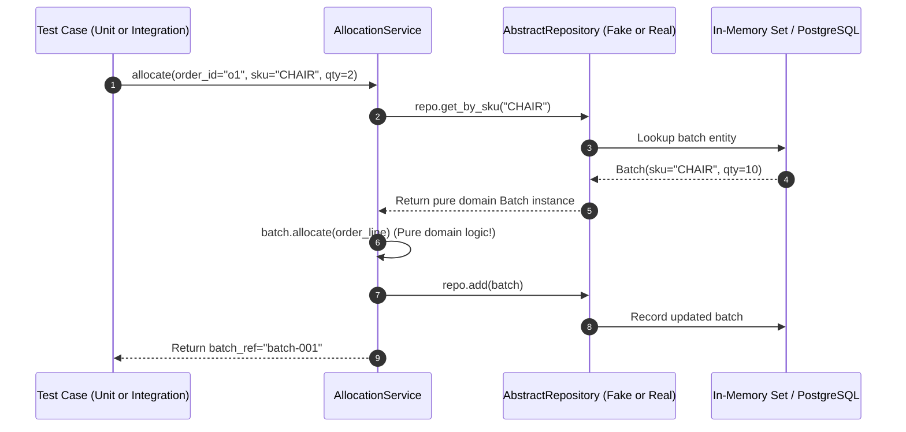
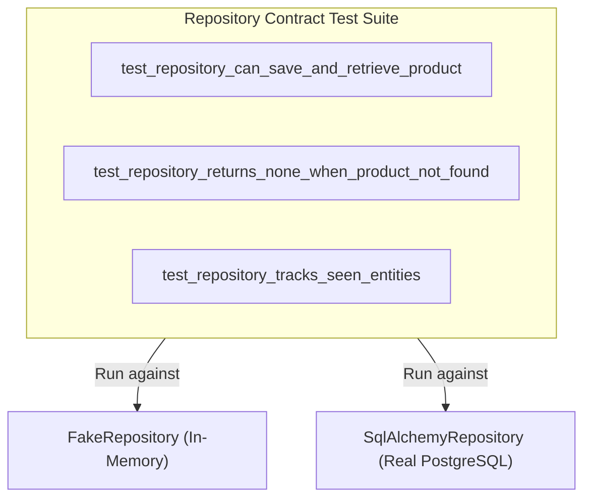

# The Repository Pattern & Storage Decoupling in Python 🗃️

> **Authoritative Sources & Literature:**
> - Harry Percival & Bob Gregory: *Architecture Patterns with Python* (Chapter 2: Repository Pattern, O'Reilly)
> - Martin Fowler: *Patterns of Enterprise Application Architecture* (Repository Pattern, martinfowler.com)
> - Eric Evans: *Domain-Driven Design* (Chapter 6: The Life Cycle of a Domain Object: Repositories)
> - Gerard Meszaros: *xUnit Test Patterns: Refactoring Test Code* (Fake Object Pattern)

---

## 1. Conceptual Definition & Core Mental Model

The **Repository Pattern** is an architectural abstraction that sits between the domain model and the database. It mediates between the domain and data mapping layers, acting like an **in-memory collection of domain objects**.

### The Problem: ORM Leaks Across the Codebase
When application services interact directly with an ORM (e.g. `session.query(Order).filter_by(id=123).first()`):
1. **Tight Coupling**: Database querying syntax spreads throughout your business logic.
2. **Testing Agony**: Testing services requires mocking complex ORM query chains (`mock_session.query.return_value.filter.return_value.first.return_value = ...`) or spinning up slow database instances for simple unit tests.
3. **Domain Pollution**: ORM concerns (foreign keys, lazy loading flags, cascade options) contaminate domain concepts.

### The Mental Model: The In-Memory Collection Illusion
The Repository pattern provides a simple, collection-like interface:
- `repo.add(entity)`: Adds a domain entity to the collection.
- `repo.get(reference)`: Retrieves an entity by its unique identifier.
- `repo.list()`: Returns all entities matching a domain filter.

By programming against an abstract interface (`AbstractRepository`), the service layer has zero awareness of SQL, tables, or ORMs. In unit tests, we substitute a blazing-fast **`FakeRepository`** backed by a standard Python `set` or `dict`!

```
                    ┌───────────────────────────────┐
                    │         Service Layer         │
                    └───────────────┬───────────────┘
                                    │
                                    ▼ (Calls: repo.get(id), repo.add(entity))
                    ┌───────────────────────────────┐
                    │      AbstractRepository       │
                    └───────────────┬───────────────┘
                                    │
                 ┌──────────────────┴──────────────────┐
                 │                                     │
                 ▼                                     ▼
   ┌───────────────────────────┐         ┌───────────────────────────┐
   │   SqlAlchemyRepository    │         │      FakeRepository       │
   │   (Production Adapter)    │         │       (Test Double)       │
   │ - Emits real SQL via      │         │ - In-memory Python set    │
   │   SQLAlchemy 2.0 select() │         │ - Microsecond execution   │
   │ - Connects to PostgreSQL  │         │ - Zero DB dependencies    │
   └───────────────────────────┘         └───────────────────────────┘
```

---

## 2. Why This Is Critical in Modern Python Backend Engineering

1. **Microsecond Unit Testing**: Business logic services can be tested with `FakeRepository` in $< 0.1\text{ms}$ without booting Docker containers or starting database connections.
2. **True Dependency Inversion (DIP)**: High-level business policies do not depend on low-level database details; both depend on abstractions (`AbstractRepository`).
3. **Pluggable Persistence**: You can swap from PostgreSQL to DynamoDB, MongoDB, or an external API by writing a new adapter without touching a single line of business logic.

---

## 3. Internal Mechanics & Architectural Workflow



---

## 4. Standard Syntax, Signatures & Configuration

### The Abstract Repository Interface (`abc.ABC`)

```python
import abc
from typing import Optional, List, Set
from src.domain.model import Product

class AbstractRepository(abc.ABC):
    def __init__(self) -> None:
        self.seen: Set[Product] = set()  # Tracked entities for Unit of Work

    def add(self, product: Product) -> None:
        self._add(product)
        self.seen.add(product)

    def get(self, sku: str) -> Optional[Product]:
        product = self._get(sku)
        if product:
            self.seen.add(product)
        return product

    @abc.abstractmethod
    def _add(self, product: Product) -> None:
        raise NotImplementedError

    @abc.abstractmethod
    def _get(self, sku: str) -> Optional[Product]:
        raise NotImplementedError
```

---

## 5. Execution Lifecycle & Teardown Protocol

### The Contract Testing Strategy for Repositories
How do you guarantee that `FakeRepository` behaves **identically** to `SqlAlchemyRepository`?
- **The Repository Contract Test Pattern**: Write a single, generic test suite that runs against **both** implementations. If the contract test passes for both, you can trust `FakeRepository` completely in service layer unit tests!



---

## 6. Scopes, Isolation & System Boundaries

| Repository Type | Storage Medium | Execution Speed | Primary Testing Target |
| :--- | :--- | :--- | :--- |
| **`FakeRepository`** | In-memory `dict` or `set` | **$< 0.05\text{ms}$** | Service Layer, Domain Model, Use Cases |
| **`SqlAlchemyRepository`** | Real PostgreSQL via `AsyncSession` | $\approx 1 - 2\text{ms}$ | Adapter Integration, SQL Mapping |
| **`CachedRepository`** | Redis + PostgreSQL | $\approx 2 - 5\text{ms}$ | Cache invalidation, TTL testing |

---

## 7. Pytest Fixture & conftest Integration

```python
# tests/conftest.py
import pytest
from typing import Generator
from sqlalchemy.orm import Session
from src.adapters.repository import SqlAlchemyRepository, FakeRepository
from src.domain.model import Product

@pytest.fixture
def fake_repo() -> FakeRepository:
    """In-memory fake repository pre-seeded with empty storage."""
    return FakeRepository(initial_products=[])

@pytest.fixture
def sql_repo(db_session: Session) -> SqlAlchemyRepository:
    """Production SQLAlchemy repository bound to transactional SAVEPOINT session."""
    return SqlAlchemyRepository(session=db_session)
```

---

## 8. Step-by-Step Practical Python 3.10+ Walkthrough

Let's implement the domain model, the abstract repository, the in-memory fake, and the production SQLAlchemy adapter.

### Step 1: Define the Pure Domain Model
```python
# src/domain/model.py
from dataclasses import dataclass, field
from typing import List, Optional

@dataclass
class OrderLine:
    order_id: str
    sku: str
    qty: int

class Product:
    def __init__(self, sku: str, available_qty: int) -> None:
        self.sku = sku
        self.available_qty = available_qty

    def allocate(self, line: OrderLine) -> str:
        if self.available_qty < line.qty:
            raise ValueError(f"Out of stock for SKU {self.sku}")
        self.available_qty -= line.qty
        return f"ALLOCATED-{self.sku}"

    def __eq__(self, other: object) -> bool:
        if not isinstance(other, Product):
            return False
        return self.sku == other.sku

    def __hash__(self) -> int:
        return hash(self.sku)
```

### Step 2: Implement the In-Memory `FakeRepository`
```python
# src/adapters/repository.py
from typing import Optional, Set, List
from src.domain.model import Product
from src.adapters.base import AbstractRepository

class FakeRepository(AbstractRepository):
    def __init__(self, initial_products: Optional[List[Product]] = None) -> None:
        super().__init__()
        self._products: Set[Product] = set(initial_products or [])

    def _add(self, product: Product) -> None:
        self._products.add(product)

    def _get(self, sku: str) -> Optional[Product]:
        for product in self._products:
            if product.sku == sku:
                return product
        return None

    def list(self) -> List[Product]:
        return list(self._products)
```

### Step 3: Implement the Production `SqlAlchemyRepository`
```python
# src/adapters/sqlalchemy_repository.py
from typing import Optional, List
from sqlalchemy.orm import Session
from sqlalchemy import select
from src.domain.model import Product
from src.adapters.base import AbstractRepository

class SqlAlchemyRepository(AbstractRepository):
    def __init__(self, session: Session) -> None:
        super().__init__()
        self.session = session

    def _add(self, product: Product) -> None:
        self.session.add(product)

    def _get(self, sku: str) -> Optional[Product]:
        stmt = select(Product).where(Product.sku == sku)
        return self.session.execute(stmt).scalar_one_or_none()

    def list(self) -> List[Product]:
        stmt = select(Product)
        return list(self.session.execute(stmt).scalars().all())
```

---

## 9. Framework & Ecosystem Integration: Writing the Contract Test

We write a generic contract test suite and parameterize it over both implementations:

```python
# tests/test_repository_contract.py
import pytest
from src.domain.model import Product
from src.adapters.repository import FakeRepository
from src.adapters.sqlalchemy_repository import SqlAlchemyRepository

@pytest.fixture(params=["fake", "sqlalchemy"])
def repo(request, db_session):
    """
    Contract Test Fixture:
    Yields FakeRepository on run 1, and SqlAlchemyRepository on run 2!
    """
    if request.param == "fake":
        return FakeRepository()
    elif request.param == "sqlalchemy":
        return SqlAlchemyRepository(session=db_session)

def test_repository_can_save_and_retrieve_a_product(repo):
    product = Product(sku="GENERIC-DESK", available_qty=25)
    
    # Add
    repo.add(product)
    
    # Retrieve
    retrieved = repo.get("GENERIC-DESK")
    assert retrieved is not None
    assert retrieved.sku == "GENERIC-DESK"
    assert retrieved.available_qty == 25
    assert product in repo.seen

def test_repository_returns_none_for_missing_sku(repo):
    assert repo.get("NONEXISTENT-SKU") is None
```

---

## 10. Real-World Enterprise Scenario: Service Layer Testing with Fakes

Notice how clean the service layer test becomes when powered by `FakeRepository`:

```python
# src/service_layer/services.py
from src.adapters.base import AbstractRepository
from src.domain.model import OrderLine

def allocate_order_line(order_id: str, sku: str, qty: int, repo: AbstractRepository) -> str:
    product = repo.get(sku)
    if product is None:
        raise ValueError(f"Invalid SKU: {sku}")
    
    line = OrderLine(order_id=order_id, sku=sku, qty=qty)
    batch_ref = product.allocate(line)
    repo.add(product)
    return batch_ref

# Fast unit test executing in 0.05ms:
def test_allocate_order_line_success():
    # Setup in-memory state in 1 line
    repo = FakeRepository([Product(sku="LAMP-001", available_qty=10)])

    # Execute service
    result = allocate_order_line("ord_1", "LAMP-001", 3, repo)

    assert result == "ALLOCATED-LAMP-001"
    assert repo.get("LAMP-001").available_qty == 7
```

---

## 11. Anti-Patterns & Code Smells (Before vs After)

### Anti-Pattern 1: Mocking ORM Query Chains
```python
# ❌ BEFORE: Fragile mock chains (Breaks whenever query syntax changes)
def test_service_with_mocks(mocker):
    mock_session = mocker.Mock()
    mock_session.query.return_value.filter.return_value.first.return_value = FakeProduct()
    # 20 lines of brittle mock wiring!

# ✅ AFTER: Clean in-memory FakeRepository
def test_service_with_fake():
    repo = FakeRepository([Product("CHAIR", 10)])
    allocate_order_line("o1", "CHAIR", 2, repo)
    assert repo.get("CHAIR").available_qty == 8
```

### Anti-Pattern 2: Letting ORM Entities Leak into APIs
```python
# ❌ BEFORE: Repository returns raw database rows with active sessions
# If called outside a session, causes DetachedInstanceError!

# ✅ AFTER: Repository returns pure domain models
# Independent of database session lifecycles!
```

---

## 12. Best Practices & Production Guidelines

1. **Keep the Repository Interface Narrow**: Include only collection-oriented methods (`add`, `get`, `list`, `delete`). Do not turn repositories into generic query builders.
2. **Use Contract Tests**: Run the identical test suite against both `FakeRepository` and `SqlAlchemyRepository` to prevent behavioral drift.
3. **Track Seen Entities**: Include a `self.seen: Set[Entity]` attribute to enable seamless integration with the Unit of Work pattern.
4. **Return Pure Domain Objects**: Ensure repository implementations map database tables directly to pure domain dataclasses or entities.

---

## 13. Comprehensive Trade-Off Matrix

| Strategy | Speed per Test | Isolation Fidelity | Refactoring Resilience |
| :--- | :--- | :--- | :--- |
| **`FakeRepository`** | **$< 0.05\text{ms}$ (Instant)** | **High (In-memory collection)** | **Highest (Contract bound)** |
| **`SqlAlchemyRepository` (Postgres)** | $\approx 1 - 2\text{ms}$ | **100% Real Database** | High |
| **`unittest.mock.MagicMock`** | $< 0.1\text{ms}$ | Low (Fake assumptions) | Very Low (Brittle mocks) |

---

## 14. Diagnostic & Troubleshooting Playbook

### Issue 1: `AttributeError: 'FakeRepository' object has no attribute 'commit'`
- **Root Cause**: The developer attempted to put transaction control (`commit()`) inside the Repository.
- **Remediation**: Repositories only manage collection access (`add`/`get`). Transaction boundaries belong strictly to the **Unit of Work** pattern.

### Issue 2: Behavior divergence between Fake and Real Repositories
- **Root Cause**: `FakeRepository` mutated objects in memory, while `SqlAlchemyRepository` required explicit session flushing.
- **Remediation**: Run the shared Contract Test suite (`test_repository_contract.py`) against both.

---

## 15. Senior Staff Interview Questions & Answers

### Question 1: How does the Repository Pattern fulfill the Dependency Inversion Principle (DIP) in Domain-Driven Design?
**Answer**:
The Dependency Inversion Principle states that:
1. High-level modules (business domain models and use case services) should not depend on low-level modules (SQLAlchemy, PostgreSQL, databases). Both should depend on abstractions.
2. Abstractions should not depend on details; details should depend on abstractions.
Without the Repository pattern, the Service Layer directly imports and invokes the ORM (`from sqlalchemy.orm import Session`), making core business logic a client of the database infrastructure.
With the Repository pattern:
- The domain defines the abstraction (`AbstractRepository`).
- The Service Layer depends *only* on `AbstractRepository`.
- The infrastructure layer implements `SqlAlchemyRepository` as an adapter of `AbstractRepository`.
The dependency arrow is completely inverted: the database depends on the domain's interface, allowing the database to be replaced or faked without touching the domain.

### Question 2: Why shouldn't a Repository have a `.commit()` method?
**Answer**:
A Repository represents an in-memory collection of things (like a Python `set` or `list`). Standard Python collections do not have a `.commit()` method.
More importantly, a single business transaction often mutates **multiple aggregates across multiple repositories** (e.g., updating an `Order` in `OrderRepository` and adjusting an account balance in `CustomerRepository`).
If repositories handled their own commits:
1. It would be impossible to coordinate atomic multi-repository operations (a commit in Repo 1 would succeed, while a failure in Repo 2 would leave the database corrupted).
2. It violates the Single Responsibility Principle: the Repository manages collection data access, whereas the **Unit of Work** pattern manages atomic transaction lifecycles.

---

## 16. Practical Hands-On Exercises & Challenges

### Exercise 1: Build a `delete()` Method Contract Test
1. Add `def delete(self, sku: str) -> None` to `AbstractRepository`.
2. Implement it in both `FakeRepository` and `SqlAlchemyRepository`.
3. Add a contract test proving that deleting a product removes it from subsequent `get()` and `list()` calls.

### Exercise 2: Implementing a Filtering Repository
1. Add `def list_out_of_stock(self) -> List[Product]` to the repository.
2. Implement the in-memory list comprehension in `FakeRepository` and the SQLAlchemy `where(Product.available_qty == 0)` query in `SqlAlchemyRepository`.
3. Verify contract parity.

---

## 17. Key Takeaways & Summary

- **The Repository Pattern provides a collection-like illusion** for domain persistence (`add`, `get`, `list`).
- **`FakeRepository` executes in microseconds**, eliminating database dependencies from service layer unit tests.
- **Use Repository Contract Tests** to ensure in-memory fakes and production SQLAlchemy adapters share 100% behavioral parity.
- **Repositories do not commit transactions**; they leave transaction boundaries to the Unit of Work.

---

## 18. Next Steps & Cross-References

- Next: [The Unit of Work (UoW) Pattern](unit-of-work.md)
- [The Service Layer Pattern](service-layer.md)
- [Pure Domain Model Testing](domain-model-testing.md)
- [Ports and Adapters (Hexagonal Architecture)](ports-and-adapters.md)
- [Transaction Rollback Sandboxing (`SAVEPOINT`)](../integration-testing/transaction-and-rollback.md)
