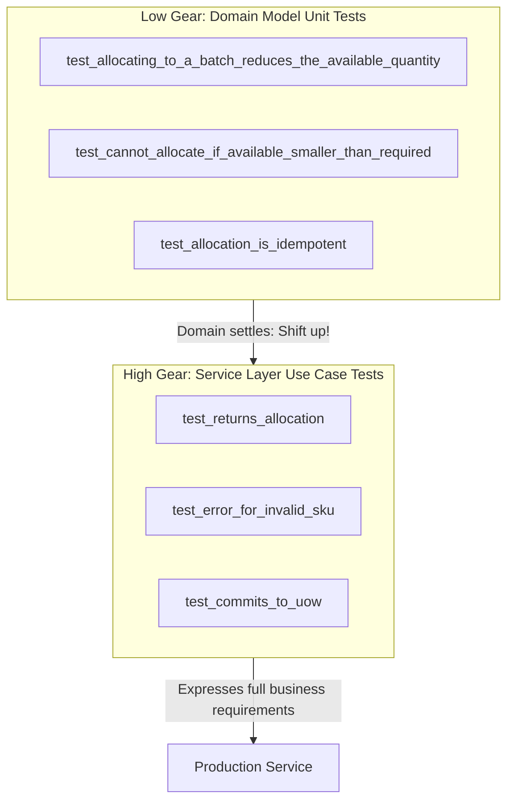

# The Service Layer & High-Gear Testing in Python ⚙️

> **Authoritative Sources & Literature:**
> - Harry Percival & Bob Gregory: *Architecture Patterns with Python* (Chapter 4: Service Layer & Chapter 5: TDD in High Gear and Low Gear, O'Reilly)
> - Martin Fowler: *Service Layer Pattern* (Patterns of Enterprise Application Architecture, martinfowler.com)
> - Alistair Cockburn: *Hexagonal Architecture (Application Core)* (alistair.cockburn.us)
> - Gerard Meszaros: *xUnit Test Patterns: Refactoring Test Code* (Use Case Test Pattern)

---

## 1. Conceptual Definition & Core Mental Model

In clean architecture, the **Service Layer** (also known as the **Use Case Layer** or **Application Service Layer**) defines the boundary of the application and orchestrates the execution of business workflows.

### The Problem: Logic Trapped in Web Frameworks
In naive backend applications, use case logic lives inside web controllers or route handlers:
```python
# ❌ Anti-pattern: Business logic trapped inside FastAPI / Flask route
@app.post("/allocate")
def allocate_endpoint(data: dict, db: Session = Depends(get_db)):
    # HTTP parsing, DB querying, domain logic, emails, and commits all tangled together!
```
When logic is trapped in routes:
1. You cannot reuse the logic from a CLI, background queue (Celery), or WebSocket handler.
2. Testing business workflows requires running full HTTP requests and spinning up web clients.
3. Refactoring becomes dangerous and expensive.

### The Mental Model: The Primitive-Driven Orchestrator
The Service Layer decouples business workflows from both the web framework and the database. A service function accepts **plain Python primitives** (strings, integers, dates, dataclasses) and coordinates:
1. Loading entities from the repository via the Unit of Work.
2. Invoking pure domain model methods to enforce business invariants.
3. Committing the transaction atomically.
4. Returning primitive identifiers or outcome objects.

```
                  ┌───────────────────────────────┐
                  │   FastAPI / Flask / CLI / Celery│ (Primary Adapters)
                  └───────────────┬───────────────┘
                                  │ (Translates HTTP to primitives: str, int)
                                  ▼
   ┌─────────────────────────────────────────────────────────────┐
   │                  The Service Layer Function                 │
   │  def allocate(order_id: str, sku: str, qty: int, uow):     │
   │      with uow:                                              │
   │          product = uow.products.get(sku)                    │
   │          batch_ref = product.allocate(line)                 │
   │          uow.commit()                                       │
   │          return batch_ref                                   │
   └──────────────────────────────┬──────────────────────────────┘
                                  │
                 ┌────────────────┴────────────────┐
                 ▼                                 ▼
   ┌───────────────────────────┐     ┌───────────────────────────┐
   │    Pure Domain Models     │     │      Unit of Work         │
   │ (Product, Batch, Line)    │     │ (FakeUnitOfWork in tests) │
   └───────────────────────────┘     └───────────────────────────┘
```

---

## 2. Why This Is Critical in Modern Python Backend Engineering

1. **The Cosmic Python "High Gear" Strategy**: Once a feature is stabilized, writing tests against the Service Layer ("High Gear") tests entire use cases in $< 0.1\text{ms}$ while giving you freedom to completely refactor internal domain models without breaking tests!
2. **Framework Agnostic Architecture**: You can migrate from Flask to FastAPI, or run services inside AWS Lambda or Celery workers without altering use case code.
3. **Zero Mocking Overhead**: Because services take an `AbstractUnitOfWork`, tests pass `FakeUnitOfWork` directly without monkeypatching or mocking.

---

## 3. Internal Mechanics: High Gear vs. Low Gear Testing



### The Gear Shift Rule:
- **Low Gear (Domain Tests)**: When designing complex business rules, start in "Low Gear" by testing domain models directly. Low-gear tests provide fast feedback on domain algebra.
- **High Gear (Service Tests)**: Once the domain model takes shape, shift to "High Gear" by testing the Service Layer. High-gear tests are **refactoring-proof**: you can split an entity or merge value objects, and your high-gear tests continue to pass because they only test the *use case inputs and outputs*!

---

## 4. Standard Syntax, Signatures & Configuration

### Service Layer Function Signature

```python
from typing import Optional
from src.service_layer.unit_of_work import AbstractUnitOfWork

class InvalidSkuError(Exception):
    pass

class OutOfStockError(Exception):
    pass

def allocate(
    order_id: str,
    sku: str,
    qty: int,
    uow: AbstractUnitOfWork
) -> str:
    """
    Orchestrates the allocation use case.
    Accepts primitives (str, int) and the Unit of Work.
    """
    with uow:
        product = uow.products.get(sku)
        if product is None:
            raise InvalidSkuError(f"Invalid SKU: {sku}")
        
        batch_ref = product.allocate(order_id, qty)
        uow.commit()
        return batch_ref
```

---

## 5. Execution Lifecycle & Teardown Protocol

Testing the Service Layer follows the standard Arrange-Act-Assert lifecycle with in-memory fakes:
1. **Arrange**: Instantiate `FakeUnitOfWork` and seed initial domain entities.
2. **Act**: Call the service function with primitive arguments.
3. **Assert**: Verify returned primitive values, verify `uow.committed is True`, and inspect updated state in `uow.products`.

---

## 6. Scopes, Isolation & System Boundaries

| Gear | Layer Tested | Collaborators | Speed | Refactoring Resilience |
| :--- | :--- | :--- | :--- | :--- |
| **Low Gear** | Domain Entities | Pure in-memory objects | **$< 0.02\text{ms}$** | Low (Bound to model shape) |
| **High Gear** | **Service Layer** | **`FakeUnitOfWork`** | **$< 0.05\text{ms}$** | **Highest (Contract bound)** |
| **Full Gear** | HTTP API Routes | TestClient / ASGITransport | $\approx 1 - 2\text{ms}$ | High |

---

## 7. Pytest Fixture & conftest Integration

```python
# tests/conftest.py
import pytest
from src.service_layer.unit_of_work import FakeUnitOfWork
from src.domain.model import Product

@pytest.fixture
def uow_with_stock() -> FakeUnitOfWork:
    """Pre-seeded FakeUnitOfWork fixture for high-gear service testing."""
    uow = FakeUnitOfWork()
    uow.products.add(Product(sku="DESK-01", available_qty=10))
    uow.products.add(Product(sku="LAMP-01", available_qty=5))
    return uow
```

---

## 8. Step-by-Step Practical Python 3.10+ Walkthrough

Let's test an e-commerce inventory allocation service using Cosmic Python's High Gear approach.

### Step 1: Implement the Pure Domain Model
```python
# src/domain/model.py
from dataclasses import dataclass
from typing import Set

@dataclass(frozen=True)
class OrderLine:
    order_id: str
    sku: str
    qty: int

class Batch:
    def __init__(self, ref: str, sku: str, qty: int) -> None:
        self.ref = ref
        self.sku = sku
        self._initial_qty = qty
        self._allocations: Set[OrderLine] = set()

    def allocate(self, line: OrderLine) -> None:
        if self.can_allocate(line):
            self._allocations.add(line)

    def can_allocate(self, line: OrderLine) -> bool:
        return self.sku == line.sku and self.available_quantity >= line.qty

    @property
    def allocated_quantity(self) -> int:
        return sum(line.qty for line in self._allocations)

    @property
    def available_quantity(self) -> int:
        return self._initial_qty - self.allocated_quantity

class Product:
    def __init__(self, sku: str, batches: list[Batch]) -> None:
        self.sku = sku
        self.batches = batches

    def allocate(self, line: OrderLine) -> str:
        for batch in sorted(self.batches, key=lambda b: b.available_quantity):
            if batch.can_allocate(line):
                batch.allocate(line)
                return batch.ref
        raise ValueError(f"Out of stock for SKU {self.sku}")
```

### Step 2: Implement the Service Layer
```python
# src/service_layer/services.py
from src.domain.model import OrderLine, Batch, Product
from src.service_layer.unit_of_work import AbstractUnitOfWork

def add_batch(ref: str, sku: str, qty: int, uow: AbstractUnitOfWork) -> None:
    with uow:
        product = uow.products.get(sku)
        if product is None:
            product = Product(sku, batches=[])
            uow.products.add(product)
        product.batches.append(Batch(ref, sku, qty))
        uow.commit()

def allocate(order_id: str, sku: str, qty: int, uow: AbstractUnitOfWork) -> str:
    line = OrderLine(order_id, sku, qty)
    with uow:
        product = uow.products.get(sku)
        if product is None:
            raise ValueError(f"Invalid SKU: {sku}")
        batch_ref = product.allocate(line)
        uow.commit()
        return batch_ref
```

### Step 3: Write High-Gear Service Layer Tests
```python
# tests/test_services_high_gear.py
import pytest
from src.service_layer.unit_of_work import FakeUnitOfWork
from src.service_layer.services import add_batch, allocate

def test_add_batch_for_existing_product():
    uow = FakeUnitOfWork()
    add_batch("b1", "TABLE-01", 100, uow)
    add_batch("b2", "TABLE-01", 99, uow)

    assert uow.committed is True
    product = uow.products.get("TABLE-01")
    assert len(product.batches) == 2

def test_allocate_returns_allocation():
    uow = FakeUnitOfWork()
    add_batch("batch1", "COMPACT-DESK", 100, uow)

    result = allocate("o1", "COMPACT-DESK", 10, uow)
    assert result == "batch1"
    assert uow.committed is True

def test_allocate_errors_for_invalid_sku():
    uow = FakeUnitOfWork()
    add_batch("b1", "AREALSKU", 100, uow)

    with pytest.raises(ValueError, match="Invalid SKU"):
        allocate("o1", "NONEXISTENT", 10, uow)

def test_allocate_errors_for_out_of_stock():
    uow = FakeUnitOfWork()
    add_batch("b1", "SMALL-CHAIR", 5, uow)

    with pytest.raises(ValueError, match="Out of stock"):
        allocate("o1", "SMALL-CHAIR", 10, uow)
```

---

## 9. Framework & Ecosystem Integration: Slim FastAPI Routes

When the Service Layer handles business orchestration, FastAPI routes become **one-line pass-through adapters**:

```python
# src/routes/allocation_api.py
from fastapi import APIRouter, Depends, HTTPException, status
from pydantic import BaseModel
from src.service_layer import services
from src.service_layer.unit_of_work import AbstractUnitOfWork
from src.dependencies import get_uow

router = APIRouter(prefix="/api/v1")

class AllocationRequest(BaseModel):
    order_id: str
    sku: str
    qty: int

@router.post("/allocate", status_code=status.HTTP_201_CREATED)
def allocate_endpoint(
    payload: AllocationRequest,
    uow: AbstractUnitOfWork = Depends(get_uow)
):
    try:
        # Route handler simply delegates to the service layer!
        batch_ref = services.allocate(
            order_id=payload.order_id,
            sku=payload.sku,
            qty=payload.qty,
            uow=uow
        )
        return {"batch_ref": batch_ref}
    except ValueError as exc:
        raise HTTPException(status_code=400, detail=str(exc))
```

---

## 10. Real-World Enterprise Scenario: Refactoring the Domain Without Breaking Tests

Suppose we decide to refactor `Product.batches` from a Python list into a priority queue or custom domain tree.
- Because our **High Gear tests** in Section 8 only interact with `services.add_batch()` and `services.allocate()`, **every single high gear test passes without modifying a single line of test code**!
- If we had only written low-gear tests directly against `Product.batches`, our tests would have broken, creating high refactoring drag.

---

## 11. Anti-Patterns & Code Smells (Before vs After)

### Anti-Pattern 1: Passing Web Framework Request Objects to Services
```python
# ❌ BEFORE: Coupling service to FastAPI / Starlette Request (Cannot run in Celery/CLI!)
def create_order(request: fastapi.Request, uow):
    data = request.json()

# ✅ AFTER: Primitive inputs
def create_order(order_id: str, items: list[dict], uow: AbstractUnitOfWork):
    # Pure Python, 100% reusable anywhere!
```

### Anti-Pattern 2: Returning ORM Entities from Services
```python
# ❌ BEFORE: Returning ORM models (Causes DetachedInstanceError outside session)
def get_order(order_id: str, uow) -> SqlAlchemyOrder:
    return uow.orders.get(order_id)

# ✅ AFTER: Returning plain domain primitives or dataclasses
def get_order(order_id: str, uow) -> OrderDTO:
    order = uow.orders.get(order_id)
    return OrderDTO(id=order.id, status=order.status)
```

---

## 12. Best Practices & Production Guidelines

1. **Drive Services with Primitives**: Pass `str`, `int`, `datetime`, and simple dataclasses into service functions.
2. **Shift to High Gear Once Domain Stabilizes**: Write service layer tests to create refactoring-resilient regression safety nets.
3. **Keep Route Handlers Lean**: Routes should only validate HTTP request schemas, call the service layer, and serialize the response.
4. **Always Pass `AbstractUnitOfWork`**: Ensure services depend strictly on the UoW abstraction to permit effortless in-memory faking.

---

## 13. Comprehensive Trade-Off Matrix

| Testing Mode | Test Speed | Protection Against Breakage | Refactoring Friction |
| :--- | :--- | :--- | :--- |
| **High Gear (Service Layer)** | **$< 0.05\text{ms}$** | **High (Full use case covered)** | **Lowest (Immune to internal changes)** |
| **Low Gear (Domain Models)** | $< 0.02\text{ms}$ | High (Edge case algebra) | Moderate (Tied to domain classes) |
| **End-to-End API Routes** | $\approx 10 - 30\text{ms}$ | Highest | Moderate (HTTP and schema checks) |

---

## 14. Diagnostic & Troubleshooting Playbook

### Issue 1: `TypeError: unhashable type: 'dict'` in Service Layer
- **Root Cause**: A service function passed mutable dictionaries to domain objects expecting immutable value objects.
- **Remediation**: Use `@dataclass(frozen=True)` for domain value objects.

### Issue 2: Service tests pass, but production database fails
- **Root Cause**: The repository mapping or foreign key constraint had a syntax error that `FakeRepository` did not catch.
- **Remediation**: Ensure Repository Contract Tests (`test_repository_contract.py`) run against both `FakeRepository` and `SqlAlchemyRepository`.

---

## 15. Senior Staff Interview Questions & Answers

### Question 1: What is the architectural difference between Domain Services and Application Services (the Service Layer)?
**Answer**:
1. **Application Services (The Service Layer)**:
   - Orchestrates use cases and business workflows.
   - Knows about the outside world through abstractions: opens the `UnitOfWork`, invokes repositories, coordinates domain models, and triggers external notifications (email, message bus).
   - Contains **zero core business calculations or domain rules**; it purely orchestrates collaborators.
2. **Domain Services**:
   - Resides *inside* the Domain Model.
   - Represents pure business logic that does not naturally belong to a single entity or aggregate (e.g., calculating currency exchange rates or reconciling multi-account transfers).
   - Knows nothing about databases, units of work, or HTTP frameworks.

### Question 2: Why does Cosmic Python advocate testing primarily in "High Gear" (Service Layer) rather than low-gear domain model unit tests?
**Answer**:
Low-gear domain tests verify the exact private structure and methods of domain entities. While valuable during early exploratory TDD, they introduce **extreme refactoring friction**:
If you decide to rename a domain method, merge two entities, or change internal collection types, dozens of domain tests break simultaneously, even though the application's external behavior did not change!
High-gear service tests test the **complete use case from the outside** using primitive inputs (`allocate("order1", "SKU", 5, uow)`).
Because high-gear tests only verify the public contract of the use case, the developer can completely refactor, redesign, or replace the internal domain models with zero test breakage, achieving true refactoring freedom.

---

## 16. Practical Hands-On Exercises & Challenges

### Exercise 1: Build a Cancellation Use Case in High Gear
1. Write a service function `deallocate(order_id: str, sku: str, qty: int, uow: AbstractUnitOfWork) -> None`.
2. Write a high-gear test proving that deallocating an order increases the batch's available quantity and commits the UoW.

### Exercise 2: Testing Idempotency in the Service Layer
1. Write a service function `change_batch_quantity(batch_ref: str, new_qty: int, uow)`.
2. Write a test asserting that calling `change_batch_quantity` twice with the same arguments produces the identical state and commits safely.

---

## 17. Key Takeaways & Summary

- **The Service Layer orchestrates business workflows** using primitive inputs and outputs.
- **High-Gear testing targets the Service Layer with `FakeUnitOfWork`**, providing microsecond execution ($< 0.05\text{ms}$).
- **High-gear tests are refactoring-proof**: internal domain models can be rewritten without breaking use case assertions.
- **Keeps web frameworks (FastAPI/Flask) completely decoupled** from domain business logic.

---

## 18. Next Steps & Cross-References

- Next: [Pure Domain Model Testing](domain-model-testing.md)
- [The Repository Pattern](repository-pattern.md)
- [The Unit of Work (UoW) Pattern](unit-of-work.md)
- [Ports and Adapters (Hexagonal Architecture)](ports-and-adapters.md)
- [Domain Events & Message Bus Testing](domain-events-and-message-bus-testing.md)
