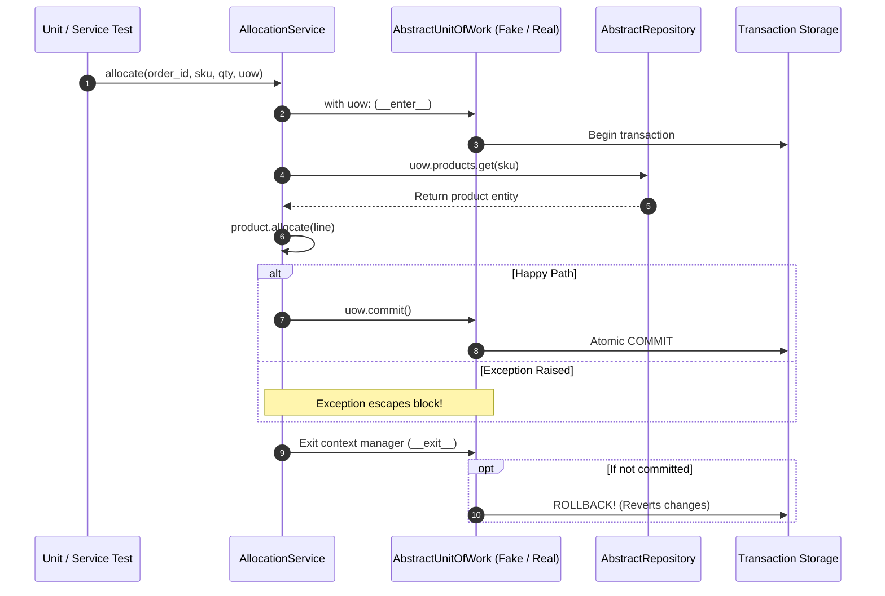

# The Unit of Work (UoW) Pattern in Python 🔄

> **Authoritative Sources & Literature:**
> - Harry Percival & Bob Gregory: *Architecture Patterns with Python* (Chapter 6: Unit of Work Pattern, O'Reilly)
> - Martin Fowler: *Patterns of Enterprise Application Architecture* (Unit of Work Pattern, martinfowler.com)
> - Gerard Meszaros: *xUnit Test Patterns: Refactoring Test Code* (Database Sandbox & Fake Object Patterns)
> - Mike Bayer: *SQLAlchemy Session & Transaction Coordination* (docs.sqlalchemy.org)

---

## 1. Conceptual Definition & Core Mental Model

The **Unit of Work (UoW)** pattern is the architectural companion to the Repository Pattern. While Repositories provide the abstraction of an in-memory collection, the Unit of Work provides the abstraction of an **atomic transaction**.

### The Problem: Multi-Repository Inconsistency
In complex business use cases, an operation involves multiple repositories:
1. Update customer credit in `CustomerRepository`.
2. Deduct inventory in `ProductRepository`.
3. Create invoice in `InvoiceRepository`.

If each repository managed its own database connection or commit, a network failure or exception midway through execution would leave the database corrupted (credit deducted, but no invoice created!).

### The Mental Model: Python Context Manager as Transaction Boundary
In Python, the Unit of Work is elegantly implemented as a **Context Manager** (`__enter__` and `__exit__`):
- `__enter__`: Initializes database sessions and instantiates bound repositories (`uow.products`, `uow.customers`).
- `uow.commit()`: Explicitly commits all modifications across all repositories in a single atomic transaction.
- `__exit__`: **Rolls back by default**. If the code block exits without calling `uow.commit()` (or if an unhandled exception is raised), all uncommitted changes are rolled back automatically.

```
                  ┌──────────────────────────────────────────────┐
                  │                 with uow:                    │
                  │  (Enters context: transaction begins)        │
                  └──────────────────────┬───────────────────────┘
                                         │
                                         ▼
                  ┌──────────────────────────────────────────────┐
                  │  product = uow.products.get(sku)             │
                  │  product.allocate(line)                      │
                  │  uow.commit()  <── Explicit atomic commit    │
                  └──────────────────────┬───────────────────────┘
                                         │
                    ┌────────────────────┴────────────────────┐
                    │                                         │
            Commit Succeeded?                      Exception Raised / No Commit?
                    │                                         │
                    ▼                                         ▼
   [ Transaction Committed to Disk ]              [ Automatic Rollback! ]
   (State permanently persisted)                  (Zero partial state leaked!)
```

---

## 2. Why This Is Critical in Modern Python Backend Engineering

1. **Guaranteed Atomic Consistency**: Enforces that either all operations across all repositories succeed together, or the entire operation is rolled back, preventing orphaned records.
2. **Deterministic Rollback-by-Default**: Eliminates accidental data leaks in tests. If an assertion or service step fails, the context manager automatically rolls back without polluting test state.
3. **Decoupled Service Layer Testing via `FakeUnitOfWork`**: Tests run entirely in-memory using `FakeUnitOfWork` in microseconds, without needing a live database connection pool.

---

## 3. Internal Mechanics & Architectural Workflow



---

## 4. Standard Syntax, Signatures & Configuration

### The Abstract Unit of Work Interface

```python
import abc
from src.adapters.base import AbstractRepository

class AbstractUnitOfWork(abc.ABC):
    products: AbstractRepository  # Repository attached to UoW

    def __enter__(self) -> "AbstractUnitOfWork":
        return self

    def __exit__(self, exc_type, exc_val, exc_tb) -> None:
        if exc_type is not None:
            self.rollback()
        else:
            self.rollback()  # Rollback by default if commit() wasn't explicitly called!

    @abc.abstractmethod
    def commit(self) -> None:
        raise NotImplementedError

    @abc.abstractmethod
    def rollback(self) -> None:
        raise NotImplementedError
```

---

## 5. Execution Lifecycle & Teardown Protocol

### Implementing `FakeUnitOfWork` for Ultra-Fast Testing
`FakeUnitOfWork` wraps `FakeRepository` and tracks whether `commit()` was executed:

```python
from src.adapters.repository import FakeRepository
from src.service_layer.unit_of_work import AbstractUnitOfWork

class FakeUnitOfWork(AbstractUnitOfWork):
    def __init__(self) -> None:
        self.products = FakeRepository([])
        self.committed = False

    def commit(self) -> None:
        self.committed = True

    def rollback(self) -> None:
        # Reverts in-memory state or tracks rollback
        pass
```

---

## 6. Scopes, Isolation & System Boundaries

| UoW Implementation | Transaction Boundary | Execution Speed | Primary Use Case |
| :--- | :--- | :--- | :--- |
| **`FakeUnitOfWork`** | In-memory boolean flag (`committed = True`) | **$< 0.05\text{ms}$** | Service Layer unit tests, Use Case testing |
| **`SqlAlchemyUnitOfWork`** | Real PostgreSQL `session.commit()` | $\approx 1 - 2\text{ms}$ | End-to-end integration, DB transaction testing |
| **`TwoPhaseUnitOfWork`** | Distributed XA / Saga coordinator | $\approx 20 - 50\text{ms}$ | Multi-service distributed consistency |

---

## 7. Pytest Fixture & conftest Integration

```python
# tests/conftest.py
import pytest
from sqlalchemy.orm import sessionmaker
from src.service_layer.unit_of_work import SqlAlchemyUnitOfWork, FakeUnitOfWork

@pytest.fixture
def fake_uow() -> FakeUnitOfWork:
    """In-memory Unit of Work test double."""
    return FakeUnitOfWork()

@pytest.fixture
def sql_uow(db_session_factory: sessionmaker) -> SqlAlchemyUnitOfWork:
    """Production SQLAlchemy Unit of Work bound to test session factory."""
    return SqlAlchemyUnitOfWork(session_factory=db_session_factory)
```

---

## 8. Step-by-Step Practical Python 3.10+ Walkthrough

Let's implement the production `SqlAlchemyUnitOfWork`, the in-memory `FakeUnitOfWork`, and write comprehensive tests for both success and rollback scenarios.

### Step 1: Implement the Production `SqlAlchemyUnitOfWork`
```python
# src/adapters/unit_of_work.py
from sqlalchemy.orm import sessionmaker, Session
from src.adapters.sqlalchemy_repository import SqlAlchemyRepository
from src.service_layer.unit_of_work import AbstractUnitOfWork

class SqlAlchemyUnitOfWork(AbstractUnitOfWork):
    def __init__(self, session_factory: sessionmaker) -> None:
        self.session_factory = session_factory

    def __enter__(self) -> "SqlAlchemyUnitOfWork":
        self.session: Session = self.session_factory()
        self.products = SqlAlchemyRepository(self.session)
        return super().__enter__()

    def __exit__(self, exc_type, exc_val, exc_tb) -> None:
        super().__exit__(exc_type, exc_val, exc_tb)
        self.session.close()

    def commit(self) -> None:
        self.session.commit()

    def rollback(self) -> None:
        self.session.rollback()
```

### Step 2: Implement the Service Layer Using the UoW
```python
# src/service_layer/services.py
from src.service_layer.unit_of_work import AbstractUnitOfWork
from src.domain.model import OrderLine

def allocate(order_id: str, sku: str, qty: int, uow: AbstractUnitOfWork) -> str:
    line = OrderLine(order_id=order_id, sku=sku, qty=qty)
    with uow:
        product = uow.products.get(sku)
        if product is None:
            raise ValueError(f"Invalid SKU: {sku}")
        
        batch_ref = product.allocate(line)
        uow.commit()  # Atomic commit!
        return batch_ref
```

### Step 3: Write Fast Unit Tests with `FakeUnitOfWork`
```python
# tests/test_services_with_uow.py
import pytest
from src.domain.model import Product
from src.service_layer.unit_of_work import FakeUnitOfWork
from src.service_layer.services import allocate

def test_allocate_commits_when_successful():
    uow = FakeUnitOfWork()
    uow.products.add(Product(sku="DESK-001", available_qty=10))

    batch_ref = allocate("o1", "DESK-001", 2, uow)

    assert batch_ref == "ALLOCATED-DESK-001"
    # Assert transaction was committed!
    assert uow.committed is True
    # Assert domain state was modified
    assert uow.products.get("DESK-001").available_qty == 8

def test_allocate_rolls_back_when_sku_invalid():
    uow = FakeUnitOfWork()

    with pytest.raises(ValueError, match="Invalid SKU"):
        allocate("o1", "NONEXISTENT", 2, uow)

    # Assert commit was NEVER called!
    assert uow.committed is False
```

---

## 9. Framework & Ecosystem Integration: Testing Atomicity & Rollbacks

Now let's test `SqlAlchemyUnitOfWork` against real PostgreSQL to prove that an unhandled exception **rolls back database state**:

```python
# tests/test_uow_integration.py
import pytest
from sqlalchemy import text
from src.adapters.unit_of_work import SqlAlchemyUnitOfWork
from src.domain.model import Product

def test_uow_rolls_back_uncommitted_work_by_default(db_session_factory):
    uow = SqlAlchemyUnitOfWork(db_session_factory)

    # 1. Enter UoW, add product, but DO NOT call uow.commit()!
    with uow:
        uow.products.add(Product(sku="ROLLBACK-SKU", available_qty=50))
        # Deliberately omit uow.commit()

    # 2. Open fresh session and verify product was NOT persisted to DB!
    new_session = db_session_factory()
    result = new_session.execute(text("SELECT count(*) FROM products WHERE sku='ROLLBACK-SKU'")).scalar()
    new_session.close()

    assert result == 0  # Proves rollback-by-default worked!

def test_uow_rolls_back_on_exception(db_session_factory):
    uow = SqlAlchemyUnitOfWork(db_session_factory)

    class CustomBusinessFailure(Exception):
        pass

    with pytest.raises(CustomBusinessFailure):
        with uow:
            uow.products.add(Product(sku="CRASH-SKU", available_qty=100))
            raise CustomBusinessFailure("Simulated crash midway through transaction!")

    # Verify nothing was written to PostgreSQL
    new_session = db_session_factory()
    result = new_session.execute(text("SELECT count(*) FROM products WHERE sku='CRASH-SKU'")).scalar()
    new_session.close()

    assert result == 0  # 100% atomic rollback!
```

---

## 10. Real-World Enterprise Scenario: Multi-Repository UoW

In enterprise architectures, the UoW manages multiple repositories simultaneously:

```python
class EnterpriseUnitOfWork(AbstractUnitOfWork):
    products: AbstractProductRepository
    customers: AbstractCustomerRepository
    invoices: AbstractInvoiceRepository

# Testing multi-aggregate transaction atomicity:
def test_order_creation_updates_both_customer_and_product(fake_enterprise_uow):
    with fake_enterprise_uow:
        customer = fake_enterprise_uow.customers.get("cust_1")
        product = fake_enterprise_uow.products.get("prod_1")
        
        customer.charge(amount=100)
        product.deduct_stock(quantity=1)
        
        fake_enterprise_uow.commit()

    assert fake_enterprise_uow.committed is True
```

---

## 11. Anti-Patterns & Code Smells (Before vs After)

### Anti-Pattern 1: Committing Directly Inside View Functions or Services
```python
# ❌ BEFORE: Direct ORM session manipulation (Cannot be faked in unit tests!)
def allocate_order(sku, qty):
    session = db.session()
    product = session.query(Product).get(sku)
    product.allocate(qty)
    session.commit()  # Hard-wired to database!

# ✅ AFTER: Context-managed Unit of Work
def allocate_order(sku, qty, uow: AbstractUnitOfWork):
    with uow:
        product = uow.products.get(sku)
        product.allocate(qty)
        uow.commit()  # Pluggable: real DB or FakeUnitOfWork!
```

### Anti-Pattern 2: Forgetting Rollback by Default in `__exit__`
```python
# ❌ BEFORE: Committing automatically in __exit__ if no exception (DANGEROUS!)
def __exit__(self, exc_type, *args):
    if exc_type is None:
        self.commit()  # Accidental commits happen if code forgets to raise!

# ✅ AFTER: Explicit commit only; rollback by default
def __exit__(self, exc_type, *args):
    self.rollback()  # Safe! Only explicit uow.commit() persists data!
```

---

## 12. Best Practices & Production Guidelines

1. **Always Roll Back by Default in `__exit__`**: Only explicit calls to `uow.commit()` should finalize state.
2. **Access Repositories Solely Through the UoW**: Write `uow.products.get(...)` rather than passing repositories separately.
3. **Keep Use Cases Inside the `with uow:` Block**: Avoid splitting a single business operation across multiple independent UoW contexts.
4. **Use `FakeUnitOfWork` for 95% of Service Layer Tests**: Reserve `SqlAlchemyUnitOfWork` tests strictly for verifying real transaction and database rollback behavior.

---

## 13. Comprehensive Trade-Off Matrix

| Strategy | Speed per Test | Transaction Fidelity | Refactoring Resilience |
| :--- | :--- | :--- | :--- |
| **`FakeUnitOfWork`** | **$< 0.05\text{ms}$ (Instant)** | In-memory flag tracking | **Highest (Zero DB coupling)** |
| **`SqlAlchemyUnitOfWork`** | $\approx 1 - 2\text{ms}$ | **Full ACID Transactions** | High |
| **Direct `session.commit()`** | $\approx 5 - 10\text{ms}$ | High | Very Low (Cannot be faked) |

---

## 14. Diagnostic & Troubleshooting Playbook

### Issue 1: `AssertionError: uow.committed is False`
- **Root Cause**: The service function finished execution without reaching `uow.commit()`, or an early return bypassed it.
- **Remediation**: Check branch logic to ensure `uow.commit()` is called at the end of the happy path.

### Issue 2: `InvalidRequestError: Can't operate on closed transaction inside with uow`
- **Root Cause**: Code called `session.close()` inside the block while the context manager was still active.
- **Remediation**: Let `__exit__` handle session closure.

---

## 15. Senior Staff Interview Questions & Answers

### Question 1: How does the Unit of Work pattern maintain the Single Responsibility Principle (SRP) when paired with the Repository Pattern?
**Answer**:
The Repository pattern's single responsibility is to act as an abstraction over an **in-memory collection of domain entities** (`add`, `get`, `list`). It should have no concept of database connections, transactions, or persistence lifecycles.
The Unit of Work pattern's single responsibility is to manage the **lifecycle of an atomic transaction** (opening sessions, tracking modified objects, and executing atomic `commit` or `rollback`).
By pairing them:
1. The UoW instantiates and owns the repositories (`uow.products`, `uow.orders`).
2. The Service Layer mutates multiple repositories within a single UoW context block (`with uow:`).
3. A single `uow.commit()` flushes and commits all changes across all repositories simultaneously.
This clean separation prevents repositories from leaking transaction logic and keeps domain code free from database mechanics.

### Question 2: Why is the "Rollback-by-Default" design in `__exit__` critical for both production resilience and automated testing?
**Answer**:
In transaction management, the safest default state in the event of an unexpected exit is **abort / rollback**:
1. **Production Resilience**: If an unhandled exception, syntax error, or early return statement occurs inside the use case, the code exits the `with` block without reaching `uow.commit()`. The `__exit__` method executes `self.rollback()`, guaranteeing that partially completed writes are never committed to the database.
2. **Automated Testing**: If an assertion fails midway through a test function, the test runner aborts execution. If the UoW committed by default, partial test data would linger in the database. Rolling back by default guarantees pristine isolation for subsequent tests.

---

## 16. Practical Hands-On Exercises & Challenges

### Exercise 1: Multi-Aggregate Transfer with UoW
1. Create a `BankTransferService` with `uow.accounts`.
2. Write a test asserting that if deducting from Account A succeeds, but crediting Account B raises an exception, Account A's balance remains unchanged.

### Exercise 2: Building an Event-Publishing UoW
1. Extend `AbstractUnitOfWork` to collect domain events from tracked entities during `commit()`.
2. Write a test proving that committing the UoW publishes recorded events to an event queue.

---

## 17. Key Takeaways & Summary

- **The Unit of Work provides atomic transaction boundaries** across multiple repositories.
- **Python context managers (`__enter__` and `__exit__`)** provide the ideal syntax for transaction scoping.
- **Always roll back by default**: Only explicit `uow.commit()` calls should persist changes.
- **`FakeUnitOfWork` enables microsecond service layer testing** without touching database infrastructure.

---

## 18. Next Steps & Cross-References

- Next: [The Service Layer Pattern](service-layer.md)
- [The Repository Pattern](repository-pattern.md)
- [Pure Domain Model Testing](domain-model-testing.md)
- [Domain Events & Message Bus Testing](domain-events-and-message-bus-testing.md)
- [Transaction Rollback Sandboxing (`SAVEPOINT`)](../integration-testing/transaction-and-rollback.md)
