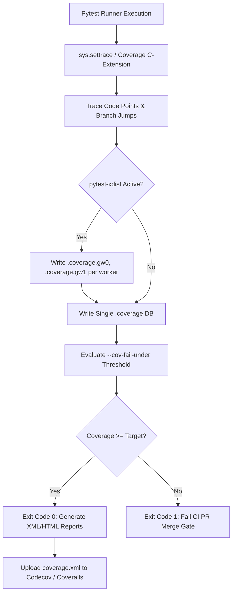

# Code Coverage Reporting, Branch Analysis & PR Merge Gates

> *"Test coverage is a useful tool for finding untested parts of a codebase. Test coverage is of little use as a numerical statement of how good your tests are."*
> — **Martin Fowler**, *Test Coverage*

---

## 1. Conceptual Mental Model & Theoretical Foundations

Code coverage measures the degree to which source code is executed when a particular test suite runs. However, naive line coverage (statement coverage) can create a dangerous illusion of safety: executing a line containing a compound boolean conditional does not mean every branch or edge condition was evaluated.

```
Statement vs. Branch Coverage Mental Model:

Function:
def process_order(is_vip: bool, amount: float) -> str:
    if is_vip or amount > 100.0:    <── Branch 1 (True) vs Branch 2 (False)
        return "Priority"           <── Statement 1
    return "Standard"               <── Statement 2

Test Case 1: process_order(True, 50.0) -> "Priority"
- Statement Coverage: 50% (Line 3 executed, Line 4 missed)
- Branch Coverage: 25% (Only evaluated VIP=True; amount>100 condition never exercised)
```

### Coverage Metrics Spectrum:
1. **Statement Coverage ($C_0$)**: Measures the percentage of executable statements reached. It completely ignores untaken conditional branches.
2. **Branch Coverage ($C_1$)**: Measures whether each decision point (boolean expressions, `if/else`, loops, pattern matching) was evaluated to both `True` and `False`.
3. **Path Coverage**: Measures every possible execution path through a routine ($O(2^N)$ complexity). Generally computationally intractable for non-trivial systems.
4. **Mutation Score**: Validates whether test assertions actually catch deliberate synthetic faults injected into the AST (see [Mutation Testing](../ai-assisted-testing/mutation-testing.md)).

---

## 2. Why This is Critical for Production Systems

1. **Dead Code & Regression Detection**: Highlights legacy or abandoned code branches that are no longer accessible or tested.
2. **Continuous Quality Ratchet (PR Merge Gates)**: Enforcing strict coverage minimums (e.g., `--cov-fail-under=85`) prevents quality degradation in high-velocity teams.
3. **Branch Hole Visibility**: Uncovers uncovered error-handling branches (`except DatabaseConnectionError:`) that fail catastrophically in production during rare network outages.

---

## 3. Internal Mechanics & Architectural Workflow



`coverage.py` hooks into CPython's execution engine via the low-level C API (`sys.settrace()` or Python 3.12+ `sys.monitoring`). Whenever Python executes a bytecode instruction:
- The tracing hook logs line numbers and line-to-line transitions (arcs).
- Under `pytest-xdist`, each worker process writes its own raw SQLite coverage file (`.coverage.<hostname>.<pid>`).
- At the end of the test run, `pytest-cov` executes an automatic `coverage combine` step to merge worker database files into a single unified `.coverage` database.

---

## 4. Exact Syntax, Function Signatures & Python Standards

### Modern Configuration in `pyproject.toml`

Production systems should consolidate coverage settings inside `pyproject.toml` rather than using legacy `.coveragerc` files:

```toml
[tool.pytest.ini_options]
minversion = "7.0"
addopts = [
    "--cov=app",
    "--cov-branch",
    "--cov-report=term-missing:skip-covered",
    "--cov-report=html:reports/coverage-html",
    "--cov-report=xml:reports/coverage.xml",
    "--cov-fail-under=85"
]

[tool.coverage.run]
branch = true
source = ["app"]
parallel = true
concurrency = ["thread", "multiprocessing"]
omit = [
    "app/migrations/*",
    "app/config.py",
    "*/__init__.py"
]

[tool.coverage.report]
show_missing = true
skip_covered = true
fail_under = 85.0
exclude_lines = [
    # Standard pragma exclusion
    "pragma: no cover",
    # Do not complain about defensive assertions
    "raise AssertionError",
    "raise NotImplementedError",
    # Exclude abstract methods
    "@abc.abstractmethod",
    # Exclude type checking conditionals
    "if TYPE_CHECKING:",
    # Exclude debug __repr__ implementations
    "def __repr__",
    # Non-executable script entry points
    'if __name__ == "__main__":'
]
```

---

## 5. Lifecycle, Teardown & Resource Management

### Multi-Process Coverage Combination in CI

When executing tests across parallel containers or distributed GitHub Actions matrix jobs, coverage reports must be collected and combined before evaluating coverage gates:

```bash
# In Step 1: Run Unit Tests with unique coverage data file
COVERAGE_FILE=.coverage.unit pytest tests/unit --cov=app

# In Step 2: Run Integration Tests with unique coverage data file
COVERAGE_FILE=.coverage.integration pytest tests/integration --cov=app

# In Step 3: Combine coverage SQLite databases
coverage combine .coverage.unit .coverage.integration

# In Step 4: Generate reports and enforce gate
coverage report --fail-under=85
coverage xml -o reports/coverage.xml
coverage html -d reports/coverage-html
```

---

## 6. Scopes, Isolation & Boundary Enforcement

### Excluding Untestable Infrastructure Code

Some code sections should be explicitly excluded from coverage enforcement to prevent developers from writing low-value "vanity tests":

```python
from typing import TYPE_CHECKING

if TYPE_CHECKING:  # pragma: no cover
    # Only imported during static analysis; excluded from coverage
    from app.services.payment_gateway import PaymentGatewayClient


class AbstractRepository:
    def get_by_id(self, item_id: str):
        # Defensive base implementation
        raise NotImplementedError  # pragma: no cover
```

---

## 7. Pytest Fixture & Configuration Integration (`conftest.py`)

```python
# tests/conftest.py
import pytest
from coverage import Coverage


@pytest.fixture(scope="session", autouse=True)
def verify_coverage_tracing():
    """Verify that coverage tracing is active during CI test execution."""
    import os
    if os.getenv("CI") == "true":
        # Ensure coverage tracer is actively attached
        import sys
        tracer = sys.gettrace()
        assert tracer is not None, "FATAL: Coverage tracer is not active in CI run!"
    yield
```

---

## 8. Step-by-Step Practical Implementation Walkthrough

Let us build an authorization module and analyze branch coverage.

### 1. The Core Module (`app/auth.py`)

```python
from dataclasses import dataclass
from enum import Enum


class Role(str, Enum):
    ADMIN = "admin"
    EDITOR = "editor"
    VIEWER = "viewer"


@dataclass(frozen=True)
class User:
    id: str
    role: Role
    is_active: bool
    is_suspended: bool = False


def can_publish_article(user: User) -> bool:
    """Evaluate publishing authorization based on role and status."""
    if not user.is_active or user.is_suspended:
        return False

    if user.role in {Role.ADMIN, Role.EDITOR}:
        return True

    return False
```

### 2. Incomplete Test Suite (High Statement Coverage, Poor Branch Coverage)

```python
# tests/unit/test_auth_incomplete.py
from app.auth import User, Role, can_publish_article

def test_admin_can_publish():
    user = User(id="u1", role=Role.ADMIN, is_active=True)
    assert can_publish_article(user) is True

def test_viewer_cannot_publish():
    user = User(id="u2", role=Role.VIEWER, is_active=True)
    assert can_publish_article(user) is False
```

Running coverage with branch analysis:
```bash
pytest tests/unit/test_auth_incomplete.py --cov=app/auth --cov-branch --cov-report=term-missing
```

Output highlights the missing branch:
```
Name          Stmts   Miss Branch BrPart  Cover   Missing
---------------------------------------------------------
app/auth.py      15      0      6      2    90%   22->23 (user.is_suspended True branch never tested)
```

### 3. Complete Test Suite (100% Branch Coverage)

```python
# tests/unit/test_auth_complete.py
import pytest
from app.auth import User, Role, can_publish_article


@pytest.mark.parametrize(
    "role,is_active,is_suspended,expected",
    [
        (Role.ADMIN, True, False, True),
        (Role.EDITOR, True, False, True),
        (Role.VIEWER, True, False, False),
        (Role.ADMIN, False, False, False),  # inactive admin
        (Role.ADMIN, True, True, False),    # suspended admin
    ],
)
def test_can_publish_article_all_branches(
    role: Role, is_active: bool, is_suspended: bool, expected: bool
):
    user = User(id="u_test", role=role, is_active=is_active, is_suspended=is_suspended)
    assert can_publish_article(user) is expected
```

---

## 9. Framework & Ecosystem Integration

### GitHub Actions PR Merge Gate Workflow

Enforce a hard CI failure if any PR drops overall coverage below 85%:

```yaml
# .github/workflows/coverage.yml
name: Coverage Quality Gate

on:
  pull_request:
    branches: [main]

jobs:
  test-coverage:
    runs-on: ubuntu-latest
    steps:
      - uses: actions/checkout@v4

      - name: Set up Python
        uses: actions/setup-python@v5
        with:
          python-version: "3.11"
          cache: "pip"

      - name: Install Dependencies
        run: pip install -r requirements-test.txt

      - name: Run Tests with Branch Coverage
        run: |
          pytest --cov=app \
                 --cov-branch \
                 --cov-report=xml:reports/coverage.xml \
                 --cov-report=term \
                 --cov-fail-under=85

      - name: Upload Coverage to Codecov
        uses: codecov/codecov-action@v4
        with:
          file: reports/coverage.xml
          fail_ci_if_error: true
          token: ${{ secrets.CODECOV_TOKEN }}
```

---

## 10. Real-World Enterprise Scenario

### The Problem
A financial payments gateway maintained 92% statement coverage. Despite this, a catastrophic bug occurred in production: an unhandled currency rounding branch caused foreign-exchange transactions in Japanese Yen (`JPY`) to execute with floating-point truncation.

### Root Cause Analysis
Statement coverage was satisfied because a single test verified `USD` transactions. The branch conditional `if currency.is_zero_decimal:` had never been traversed in the `True` state.

### The Engineering Solution
1. Mandated `--cov-branch` across all CI pipelines.
2. Enabled `--cov-fail-under=90`.
3. Added property-based tests with Hypothesis to explore currency edge-cases.

---

## 11. Anti-Patterns & Common Traps

### Anti-Pattern 1: The "Vanity Test" (Assert-Free Execution)

#### Before (Artificially High Coverage, Zero Verification)
```python
def test_generate_invoice():
    # Executes code to bump coverage, but makes no assertions!
    generate_monthly_invoice(customer_id="cust_123")
```

#### After (Strict Behavioral Verification)
```python
def test_generate_invoice():
    invoice = generate_monthly_invoice(customer_id="cust_123")
    assert invoice.total_amount > Decimal("0.00")
    assert invoice.status == InvoiceStatus.PENDING
```

### Anti-Pattern 2: Overusing `pragma: no cover`

#### Before (Hiding Complex Logic)
```python
def calculate_tax(amount: Decimal) -> Decimal:  # pragma: no cover
    # Bypassing coverage on critical logic because it's hard to test
    return amount * Decimal("0.18")
```

#### After (Clean, Documented Unit Test)
```python
def calculate_tax(amount: Decimal) -> Decimal:
    return amount * Decimal("0.18")

def test_calculate_tax():
    assert calculate_tax(Decimal("100.00")) == Decimal("18.00")
```

---

## 12. Best Practices & Production Guidelines

1. **Always Measure Branch Coverage**: Never run `coverage` without `branch = true`. Statement coverage allows untested conditional paths to slip into production.
2. **Set Realistic Thresholds (80%–88%)**: Demanding 100% coverage leads to test fatigue, fragile mock tests, and developers writing boilerplate tests for trivial getters.
3. **Fail Fast in CI**: Add `--cov-fail-under` directly to pytest CLI options so builds fail immediately without waiting for external SaaS uploaders.
4. **Publish HTML Reports as CI Artifacts**: Use GitHub Actions `actions/upload-artifact` to archive `reports/coverage-html` so developers can inspect missing lines directly.

---

## 13. Edge Cases, Race Conditions & Failure Modes

| Edge Case | Failure Mode | Mitigation Strategy |
| :--- | :--- | :--- |
| **Multiprocessing Workers** | Child processes terminate before dumping coverage stats | Configure `concurrency = ["multiprocessing"]` and run `coverage combine`. |
| **Dynamic `eval()` Code** | Code evaluated dynamically cannot be mapped to source lines | Pre-compile or avoid dynamic execution in production logic. |
| **C-Extension Code** | Cython or C-extensions not tracked by CPython tracer | Use Cython compiler directive `linetrace=True`. |

---

## 14. Performance, Overhead & Scalability Considerations

- **Tracing Overhead**: Running `coverage.py` with full branch tracing increases test execution time by $20\%\text{--}40\%$.
- **Mitigation**: Do not run branch coverage on every local file-save loop. Reserve full branch coverage for local pre-push hooks and CI pull-request validation pipelines.

---

## 15. Architectural Trade-Off Analysis

| Strategy | Speed | Depth of Safety | Maintenance Cost |
| :--- | :--- | :--- | :--- |
| **Line Coverage Only** | High ($+5\%$ overhead) | Low (Misses branch bugs) | Low |
| **Line + Branch Coverage** | Medium ($+25\%$ overhead) | High (Catches conditional traps) | Moderate |
| **Mutation Testing (mutmut)** | Slow ($10\text{x}\text{--}50\text{x}$ overhead) | Highest (Validates assertion quality) | High (Requires compute cluster) |

---

## 16. Diagnostic & Debugging Playbook

### Symptom: Coverage Report Shows 0% or Ignores Code
1. Verify package installation: Ensure code under test is imported from the local development directory, not a pre-installed wheel in `site-packages`.
2. Check `source` directive in `pyproject.toml`: Ensure `source = ["app"]` points to the exact importable package directory.

### Symptom: `CoverageWarning: No data was collected`
1. Check if tests were executed in a subprocess without Python coverage sitecustomize initialization.
2. Ensure `parallel = true` is set when running under `pytest-xdist`.

---

## 17. Senior/Staff Engineer Interview Q&A

### Q1: What is the fundamental limitation of 100% code coverage?
> **Answer**: 100% code coverage merely proves that every line of code was executed at least once during test execution. It does **not** prove that:
> 1. The code is correct according to business specifications.
> 2. Assertions verified the outcomes (assert-free tests achieve 100% coverage).
> 3. The system handles unexpected runtime states, race conditions, or network timeouts.
> Quality architecture requires combining branch coverage with mutation testing, property-based fuzzing, and contract testing.

### Q2: How does `coverage.py` handle branch coverage under the hood?
> **Answer**: `coverage.py` utilizes AST analysis during collection to construct a Control Flow Graph (CFG) for each function, identifying all permissible branch arcs (transitions from line $A$ to line $B$). During execution, the C-tracing hook logs every actual transition $(A, B)$ taken. Branch coverage is calculated as:
> $$\text{Branch Coverage} = \frac{\text{Actual Arcs Taken}}{\text{Total Possible Arcs}} \times 100\%$$

---

## 18. Hands-On Verification Exercises & Self-Study Lab

### Exercise 1: Eliminate Branch Coverage Gaps
Given a payment gateway dispatcher with 3 nested conditionals:
1. Run coverage with `--cov-branch`.
2. Identify untaken arcs in the terminal report.
3. Write parameterized tests that reach 100% branch coverage.

### Exercise 2: Configure a Multi-Worker CI Gate
1. Set up a sample repository with `pytest-xdist` (`-n 2`).
2. Configure `pyproject.toml` to automatically combine worker coverage.
3. Verify that the command `pytest -n 2 --cov=app --cov-fail-under=90` exits with status `1` when coverage drops below 90%.

---

## Summary & Cross-References

- Explore parallel test execution in [Parallel Test Execution with pytest-xdist](parallel-testing.md).
- Implement continuous testing workflows in [Continuous Testing & Watchers](continuous-testing.md).
- Learn how mutation testing exposes assertion weaknesses in [Mutation Testing](../ai-assisted-testing/mutation-testing.md).
