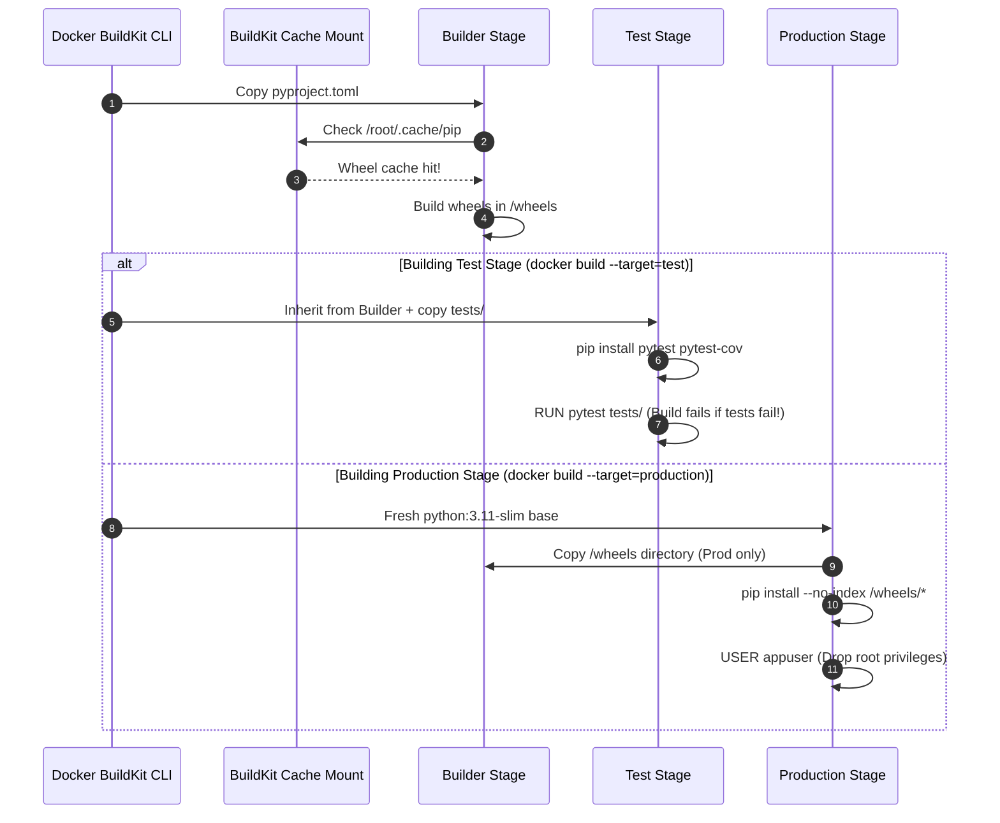

# Docker Multi-Stage Testing Builds for Python 🐳

> **Authoritative Sources & Literature:**
> - Docker Documentation: *Multi-Stage Builds & Best Practices for Python* (docs.docker.com/build/building/multi-stage/)
> - Jez Humble & David Farley: *Continuous Delivery* (Chapter 11: Managing Infrastructure and Environments)
> - NIST Special Publication 800-190: *Application Container Security Guide* (Non-Root User Enforcement)
> - Brian Okken: *Python Testing with pytest* (Chapter 7: Strategy & Architecture)

---

## 1. Conceptual Definition & Core Mental Model

In production engineering, containerizing a Python backend application requires balancing two conflicting requirements:
1. **The Testing Requirement**: The test runner needs development dependencies (`pytest`, `pytest-cov`, `pytest-mock`, `httpx`, compilers for C-extensions) and access to test files and fixtures.
2. **The Production Requirement**: The production container must be **as small and secure as possible**, containing zero test files, zero test frameworks, and minimal attack surface.

### The Solution: Multi-Stage Docker Builds
A **Multi-Stage Dockerfile** uses multiple `FROM` instructions within a single file. Each stage can inherit from a previous stage or start fresh, copying only the necessary artifacts from prior stages:
- **`base`**: Minimal Python runtime and non-root user setup.
- **`builder`**: Compiles C-extensions and builds Python wheels into a cache.
- **`test`**: Extends `builder`, installs test tools, copies test files, and executes `pytest`.
- **`production`**: Copies only the pre-compiled production wheels and application code from `builder`, discarding all test dependencies!

```
                    ┌──────────────────────────────────────────────┐
                    │            Stage 1: Base Runtime             │
                    │        (python:3.11-slim, non-root user)     │
                    └──────────────────────┬───────────────────────┘
                                           │
                                           ▼
                    ┌──────────────────────────────────────────────┐
                    │            Stage 2: Wheel Builder            │
                    │    (Compiles C-extensions, installs uv/pip)  │
                    └──────────────┬───────────────────────────────┘
                                   │
                    ┌──────────────┴──────────────────────────────┐
                    │                                             │
                    ▼ Target: --target=test                       ▼ Target: --target=production
   ┌─────────────────────────────────┐           ┌─────────────────────────────────┐
   │         Stage 3: Test           │           │       Stage 4: Production       │
   │  - Installs pytest, coverage    │           │  - Copies ONLY prod wheels      │
   │  - Copies tests/ directory      │           │  - Zero test dependencies       │
   │  - Executes: pytest tests/      │           │  - Image size: ~85MB (Minimal)  │
   └─────────────────────────────────┘           └─────────────────────────────────┘
```

---

## 2. Why This Is Critical in Modern Python Backend Engineering

1. **Defending Against Supply-Chain Attacks**: Test dependencies (`pytest`, `faker`, `mock`) frequently contain vulnerabilities that should never be present in a public production container image.
2. **Layer Caching Optimization**: By copying `pyproject.toml` and installing wheels *before* copying application source code, code changes do not trigger slow 3-minute dependency re-downloads.
3. **Catching Permission Bugs in CI**: Running tests as a non-root user (`appuser` with UID 10001) catches filesystem permission and socket binding bugs before deploying to locked-down Kubernetes clusters.

---

## 3. Internal Mechanics & Architectural Workflow



---

## 4. Standard Syntax, Signatures & Configuration

### Production-Grade Multi-Stage `Dockerfile`

```dockerfile
# syntax=docker/dockerfile:1.4

# ==============================================================================
# STAGE 1: Base Runtime
# ==============================================================================
FROM python:3.11-slim as base

ENV PYTHONUNBUFFERED=1 \
    PYTHONDONTWRITEBYTECODE=1 \
    PIP_NO_CACHE_DIR=off \
    PIP_DISABLE_PIP_VERSION_CHECK=on

# Create low-privilege non-root service user
RUN groupadd -g 10001 appgroup && \
    useradd -u 10001 -g appgroup -s /bin/bash -m appuser

WORKDIR /app

# ==============================================================================
# STAGE 2: Builder (Dependencies & Compilers)
# ==============================================================================
FROM base as builder

RUN apt-get update && apt-get install -y --no-install-recommends \
    build-essential \
    libpq-dev \
    curl && \
    rm -rf /var/lib/apt/lists/*

COPY pyproject.toml ./

# Install uv for 10x faster dependency compilation
RUN pip install uv

# Build production wheels into /wheels
RUN --mount=type=cache,target=/root/.cache/uv \
    uv pip compile pyproject.toml -o requirements.txt && \
    uv pip wheel -r requirements.txt --wheel-dir=/wheels

# ==============================================================================
# STAGE 3: Test Runner (Runs in CI)
# ==============================================================================
FROM builder as test

# Copy test requirements & install testing tools
COPY pyproject.toml ./
RUN --mount=type=cache,target=/root/.cache/uv \
    uv pip compile --extra test pyproject.toml -o test-requirements.txt && \
    uv pip install -r test-requirements.txt

COPY . .

# Switch to non-root user to verify permissions during test execution
USER appuser

# Execute pytest as part of container build
ENTRYPOINT ["pytest"]
CMD ["tests/", "-v", "--cov=src"]

# ==============================================================================
# STAGE 4: Production Final Runtime
# ==============================================================================
FROM base as production

# Install runtime PostgreSQL client library only (No gcc/build-essential!)
RUN apt-get update && apt-get install -y --no-install-recommends \
    libpq5 && \
    rm -rf /var/lib/apt/lists/*

# Copy pre-compiled wheels from builder stage
COPY --from=builder /wheels /wheels
RUN pip install --no-index --find-links=/wheels /wheels/* && rm -rf /wheels

# Copy application source code
COPY --chown=appuser:appgroup src/ ./src/

USER appuser

EXPOSE 8000
CMD ["uvicorn", "src.main:app", "--host", "0.0.0.0", "--port", "8000"]
```

---

## 5. Execution Lifecycle & Teardown Protocol

### How to Build and Run Tests via Docker
```bash
# 1. Build the test image and run tests inside container:
docker build --target=test -t my-app:test .

# 2. Run the test container in CI:
docker run --rm my-app:test

# 3. Build only the minimal production image (Skips test stage entirely!):
docker build --target=production -t my-app:prod .
```

---

## 6. Scopes, Isolation & System Boundaries

| Stage | Target Image Size | Root Permissions? | Contains Test Files? | Contains Compilers (`gcc`)? |
| :--- | :--- | :--- | :--- | :--- |
| **`builder`** | $\approx 450\text{MB}$ | Yes | No | Yes |
| **`test`** | $\approx 350\text{MB}$ | **No (`appuser`)** | **Yes (`tests/`)** | Yes |
| **`production`** | **$\approx 85\text{MB}$ (Minimal)** | **No (`appuser`)** | **❌ No** | **❌ No** |

---

## 7. Pytest Fixture & conftest Integration

```python
# tests/conftest.py
import pytest
import os

@pytest.fixture(scope="session", autouse=True)
def verify_non_root_execution():
    """Asserts that tests are executing under non-root UID to catch permission traps."""
    # Under Linux container, appuser has UID 10001
    current_uid = os.getuid() if hasattr(os, "getuid") else None
    if current_uid is not None:
        assert current_uid != 0, "SECURITY CRITICAL: Tests are executing as root (UID 0)!"
```

---

## 8. Step-by-Step Practical Python 3.10+ Walkthrough

Let's test an application file caching utility to verify that it respects non-root directory permissions inside a container.

### Step 1: The File Storage Service
```python
# src/file_storage.py
import os
from pathlib import Path

class LocalFileStorage:
    def __init__(self, storage_dir: str = "/tmp/app_storage"):
        self.storage_dir = Path(storage_dir)
        self.storage_dir.mkdir(parents=True, exist_ok=True)

    def write_file(self, filename: str, content: bytes) -> Path:
        target_path = self.storage_dir / filename
        target_path.write_bytes(content)
        return target_path
```

### Step 2: The Test Catching Permission Issues
```python
# tests/test_storage_permissions.py
import pytest
import os
from pathlib import Path
from src.file_storage import LocalFileStorage

def test_file_storage_writes_successfully_as_appuser(tmp_path):
    # Using tmp_path ensures clean permissions for appuser
    storage = LocalFileStorage(storage_dir=str(tmp_path / "files"))
    path = storage.write_file("document.pdf", b"test pdf content")

    assert path.exists()
    assert path.read_bytes() == b"test pdf content"

def test_cannot_write_to_root_protected_directory():
    # If code attempts to write to /etc or /var/root as appuser, it MUST fail!
    with pytest.raises(PermissionError):
        storage = LocalFileStorage(storage_dir="/root/forbidden")
        storage.write_file("hacked.txt", b"evil")
```

---

## 9. Framework & Ecosystem Integration: BuildKit Cache Mounts

In modern Docker BuildKit (`DOCKER_BUILDKIT=1`), using cache mounts preserves downloaded pip/uv wheels across builds without storing them in image layers:

```dockerfile
# Cache mount preserves wheels in host cache between image builds!
RUN --mount=type=cache,target=/root/.cache/uv \
    uv pip install -r requirements.txt
```
If a developer edits one Python file, `docker build` takes **1.2 seconds** because the entire dependency installation stage is retrieved from the BuildKit cache!

---

## 10. Real-World Enterprise Scenario: Exporting Test Coverage Artifacts from Docker

How do you get test coverage reports and XML test results *out* of a Docker build into your CI runner?

```bash
# In CI script:
# Build test stage with BuildKit --output to extract coverage files:
docker build --target=test --output type=local,dest=test-results/ .
```
This runs the tests inside the container and copies `coverage.xml` and HTML test reports directly into `test-results/` on the CI host!

---

## 11. Anti-Patterns & Code Smells (Before vs After)

### Anti-Pattern 1: Shipping Test Dependencies to Production
```dockerfile
# ❌ BEFORE: Single stage Dockerfile (Production image contains pytest, mock, coverage)
FROM python:3.11
COPY . .
RUN pip install -r requirements-dev.txt # 500MB image with security vulnerabilities!

# ✅ AFTER: Multi-stage build separating test and production
FROM builder as test
...
FROM base as production
# Production image is 85MB with zero dev dependencies!
```

### Anti-Pattern 2: Running Containers as `root`
```dockerfile
# ❌ BEFORE: Defaulting to root user (Vulnerable to container breakout exploits)
CMD ["uvicorn", "main:app"]

# ✅ AFTER: Non-root user enforcement
USER appuser
CMD ["uvicorn", "main:app"]
```

---

## 12. Best Practices & Production Guidelines

1. **Copy Dependency Files Before Source Code**: Ensures dependency caching layers are not invalidated by daily code changes.
2. **Always Use `python:X.Y-slim`**: Avoid heavy standard images (`python:3.11` is $\approx 1\text{GB}$; `python:3.11-slim` is $\approx 120\text{MB}$).
3. **Run Tests as Non-Root**: Guarantees that code does not rely on root filesystem permissions.
4. **Use BuildKit `--mount=type=cache`**: Accelerates dependency resolution by 80% across repeated CI runs.

---

## 13. Comprehensive Trade-Off Matrix

| Image Strategy | Image Size | Security Attack Surface | Build Speed (with Cache) |
| :--- | :--- | :--- | :--- |
| **Multi-Stage (Base/Test/Prod)** | **$\approx 85\text{MB}$ (Minimal)** | **Lowest (Zero dev packages)** | **$< 5\text{ seconds}$** |
| **Single-Stage (Monolithic)** | $\approx 550\text{MB}$ | High (Contains compilers/test tools) | Slow |
| **Alpine Linux Base** | $\approx 60\text{MB}$ | Low | ⚠️ Slower builds (musl vs glibc wheels) |

---

## 14. Diagnostic & Troubleshooting Playbook

### Issue 1: `PermissionError: [Errno 13] Permission denied` during container test
- **Root Cause**: The application attempted to write files to `/app` or `/var/log` where ownership was root (`chown root:root`).
- **Remediation**: Use `COPY --chown=appuser:appgroup` or write temporary files to `/tmp`.

### Issue 2: Docker rebuilds dependencies on every code edit
- **Root Cause**: `COPY . .` was placed *before* `RUN pip install`.
- **Remediation**: Copy `pyproject.toml` first, install dependencies, and copy source code last.

---

## 15. Senior Staff Interview Questions & Answers

### Question 1: Why should production Python Docker images never be based on the image stage that executed `pytest`?
**Answer**:
1. **Security Attack Surface**: The test stage contains testing tools (`pytest`, `mock`, `hypothesis`), debuggers (`pdb`, `ipdb`), profiling tools, and C-compilers (`gcc`, `make`). If a remote code execution (RCE) vulnerability is exploited in production, attackers can leverage installed compilers and debuggers to craft arbitrary payloads.
2. **Container Bloat**: A test-laden image is typically $400 - 800\text{MB}$, resulting in slow container registry downloads, sluggish Kubernetes auto-scaling events, and high cloud bandwidth billing.
3. **Principle of Least Privilege**: Production images should only contain the bare minimum executable artifacts required to run the web server under a non-root user.

### Question 2: Why can `python:3.11-alpine` sometimes result in slower Docker builds and runtime performance than `python:3.11-slim`?
**Answer**:
While Alpine images have tiny base footprints ($\approx 5\text{MB}$ OS), Alpine uses **musl libc** instead of the standard GNU C Library (**glibc**).
Most scientific and high-performance Python wheels on PyPI (such as `pydantic-core`, `cryptography`, `numpy`, `asyncpg`) provide pre-compiled binary wheels for `manylinux` (glibc).
When installing these packages on Alpine:
1. Pip cannot use the pre-compiled `manylinux` binary wheels.
2. It must compile every C/Rust extension from source code inside the Docker build, requiring `gcc`, `cargo`, and development headers, blowing up build times from seconds to 10 minutes.
3. In many high-concurrency memory allocation scenarios, musl's memory allocator is slower than glibc.
Therefore, `python:3.11-slim` (Debian-based glibc) provides faster builds, binary wheel support, and superior production stability.

---

## 16. Practical Hands-On Exercises & Challenges

### Exercise 1: BuildKit Cache Mount Optimization
1. Configure a Dockerfile with `RUN --mount=type=cache,target=/root/.cache/pip pip install -r pyproject.toml`.
2. Measure build time on first run vs second run with code modifications.

### Exercise 2: Non-Root User Verification
1. Add an automated test asserting that `os.getuid() != 0`.
2. Run tests inside the Docker container and verify they pass cleanly under `appuser`.

---

## 17. Key Takeaways & Summary

- **Multi-stage Docker builds cleanly separate testing from production images**.
- **Run tests under a non-root user (`appuser`)** to prevent permission traps in Kubernetes.
- **Leverage BuildKit cache mounts and layer ordering** to achieve sub-second rebuild times.
- **Production images should be minimal ($\approx 85\text{MB}$)** with zero test tools or compilers.

---

## 18. Next Steps & Cross-References

- Next: [GitHub Actions CI/CD Pipeline](github-actions.md)
- [Parallel Test Execution with `pytest-xdist`](parallel-testing.md)
- [Coverage Reporting & Quality Gates (`pytest-cov`)](coverage-reporting.md)
- [Test Environment Management & Orchestration](../e2e-testing/test-environment-management.md)
- [Continuous Testing & Feedback Loops](continuous-testing.md)
