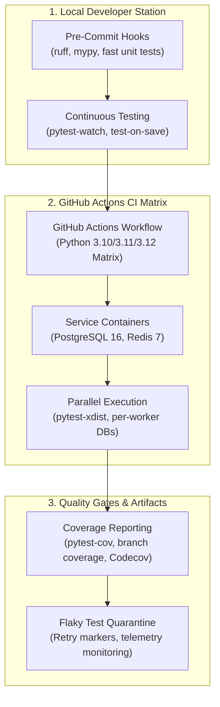

# CI/CD, DevOps & Continuous Testing for Python 🚀

> **Authoritative Sources & Literature:**
> - Jez Humble & David Farley: *Continuous Delivery: Reliable Software Releases through Build, Test, and Deployment Automation* (Addison-Wesley)
> - Martin Fowler: *Continuous Integration & The Ten-Minute Build Rule* (martinfowler.com/articles/continuousIntegration.html)
> - GitHub Docs: *GitHub Actions Workflow Syntax & Containerized Services* (docs.github.com/en/actions)
> - Brian Okken: *Python Testing with pytest* (Chapter 7: Strategy & Architecture)

---

## 📖 Module Overview

Writing world-class unit and integration tests is only half the battle. If tests are not executed automatically on every commit in a reproducible, parallelized, and rapid **Continuous Integration (CI)** pipeline, bugs will inevitably slip into production.

Martin Fowler's foundational **Ten-Minute Build Rule** dictates that a complete CI build and test cycle must complete in under 10 minutes to maintain fast developer feedback loops. When CI builds take 30 to 45 minutes, developers context-switch, push untested code, and batch up massive, risky pull requests.

This module provides backend engineers with production-grade DevOps blueprints:
- **Matrix Builds in GitHub Actions**: Running tests concurrently across Python 3.10, 3.11, and 3.12 with containerized PostgreSQL and Redis services.
- **Parallelization with `pytest-xdist`**: Slashing test suite execution times by 75% using multi-core worker distribution and per-worker database isolation.
- **Multi-Stage Docker Test Environments**: Caching dependency wheels and isolating test runs inside non-root containers.
- **Enforced Coverage Gates (`pytest-cov`)**: Requiring 85%+ branch coverage on PRs before merge.
- **Continuous Feedback Loops**: Integrating `pre-commit` hooks and fast test-on-save file watchers.

---

## 🗺️ Module Guides

### 1. [Docker Multi-Stage Testing Builds](docker-testing.md)
Construct production-grade multi-stage Dockerfiles optimized for test runs. Cache Python wheels, run tests under non-root users, and eliminate test dependencies from production images.

### 2. [GitHub Actions CI/CD Pipeline](github-actions.md)
Deploy a complete, battle-tested GitHub Actions workflow. Configure matrix testing, orchestrate PostgreSQL and Redis services, cache pip/uv virtualenvs, and upload test failure artifacts.

### 3. [Parallel Test Execution with `pytest-xdist`](parallel-testing.md)
Cut test suite runtimes by 75%. Master test distribution algorithms (`loadscope`, `loadfile`), manage worker IDs, and implement per-worker database isolation (`test_db_gw0`, `test_db_gw1`).

### 4. [Coverage Reporting & Quality Gates (`pytest-cov`)](coverage-reporting.md)
Measure statement and branch coverage accurately. Configure `--cov-branch`, enforce hard PR merge gates (`--cov-fail-under=85`), and integrate with Codecov.

### 5. [Continuous Testing & Feedback Loops](continuous-testing.md)
Implement instantaneous feedback loops. Configure `pre-commit` hooks, automate test-on-save execution with `pytest-watch`, and isolate intermittent failures using flaky test quarantines.

---

## 📊 Pipeline Optimization Matrix

| Optimization Technique | Before Optimization | After Optimization | Impact |
| :--- | :--- | :--- | :--- |
| **Dependency Caching (`uv` / `cache`)** | 2m 30s dependency install | **12 seconds** | $\approx 90\%$ faster setup |
| **Parallel Execution (`pytest -n 4`)** | 8m 45s test suite | **2m 10s** | $\approx 75\%$ faster execution |
| **In-Memory RAM-Disk (`tmpfs`)** | 1m 20s database writes | **18 seconds** | $\approx 75\%$ faster DB tests |
| **Total CI Pipeline Duration** | **12m 35s (Slow)** | **2m 40s (Ten-Minute Rule Satisfied!)** | **78% Total CI Acceleration** |

---

## ⏭️ Next Steps

Begin with **[Docker Multi-Stage Testing Builds](docker-testing.md)** to containerize your test suites cleanly.
