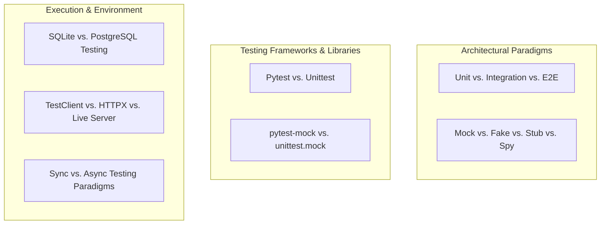

# Architectural Comparisons & Decision Matrices

> *"There are no solutions in software architecture; there are only trade-offs. The mark of a senior engineer is knowing precisely when an approach shines, when it breaks down, and what price you pay for every abstraction."*

---

## Executive Overview

In Python backend engineering and quality architecture, technical decisions are frequently framed as dogmatic binary debates: *Should we use Mocks or Fakes? Should we test against in-memory SQLite or real PostgreSQL in Docker? Should we use Pytest or Unittest? Is Starlette TestClient sufficient, or must we run HTTP over real TCP sockets with HTTPX?*

The **Architectural Comparisons** module moves beyond dogmatism to provide objective, empirically backed decision matrices, side-by-side code comparisons, benchmarking data, and decision trees for the most critical technical choices in Python backend testing.

---

## The Comparison Guides

---

## Comparison Matrix Index

| Comparison Guide | Core Dilemma | Primary Trade-Offs Evaluated | Key Verdict / Rule of Thumb |
| :--- | :--- | :--- | :--- |
| **[Unit vs. Integration vs. E2E](unit-vs-integration-vs-e2e.md)** | Where should testing investment be concentrated? | Execution Speed vs. Production Fidelity vs. Refactoring Cost | Follow the Honeycomb or Testing Pyramid: heavy Unit/Service layers, targeted integration savepoints, minimal smoke E2E. |
| **[Pytest vs. Unittest](pytest-vs-unittest.md)** | Builtin standard library xUnit vs. modern idiomatic ecosystem | Boilerplate vs. Dependency Injection vs. Parametrization | Adopt Pytest universally for all modern Python projects; wrap legacy unittest suites via pytest discovery. |
| **[Mock vs. Fake vs. Stub](mock-vs-fake-vs-stub.md)** | Interaction verification vs. state verification | Test Coupling vs. Implementation Effort vs. Refactoring Safety | Prefer Fakes for business aggregates & repositories; use Mocks/Stubs strictly at external I/O boundaries. |
| **[TestClient vs. HTTPX vs. Live Server](testclient-vs-httpx-vs-live.md)** | ASGI direct dispatch vs. real TCP socket transport | Speed vs. Lifespan Events vs. Real Concurrency Fidelity | Use ASGI AsyncClient for 95% of API tests; use ephemeral Live Server only for browser automation and reverse-proxy tests. |
| **[SQLite vs. PostgreSQL Testing](sqlite-vs-postgresql-testing.md)** | In-memory speed vs. dialect accuracy & features | Sub-millisecond runs vs. JSONB, concurrency, constraints | Use PostgreSQL with savepoint rollbacks; never use SQLite when depending on PostgreSQL-specific types or locking. |
| **[Sync vs. Async Testing](sync-vs-async-testing.md)** | Synchronous runners vs. event-loop harnesses | Simplicity vs. Real event loop scheduling & task cancellation | Test async services using native async fixtures and `pytest-asyncio` with explicit loop scoping. |
| **[pytest-mock vs. unittest.mock](pytest-mock-vs-unittest-mock.md)** | Fixture-based `mocker` vs. manual `@patch` decorators | Parameter pollution & unpatch leaks vs. Standard library purity | Standardize on `pytest-mock` (`mocker` fixture) to eliminate decorator ordering bugs and guarantee teardown unpatching. |

---

## How to Use These Comparison Guides

1. **Architecture RFCs**: When drafting team proposals or testing strategies, reference the trade-off matrices and decision trees.
2. **Refactoring Legacy Suites**: When migrating from `unittest` to `pytest` or removing fragile mocks in favor of domain fakes, follow the before/after refactoring guides.
3. **Staff Interview Preparation**: Review the Senior/Staff Engineer Q&A sections in each guide for high-level architectural insights.
