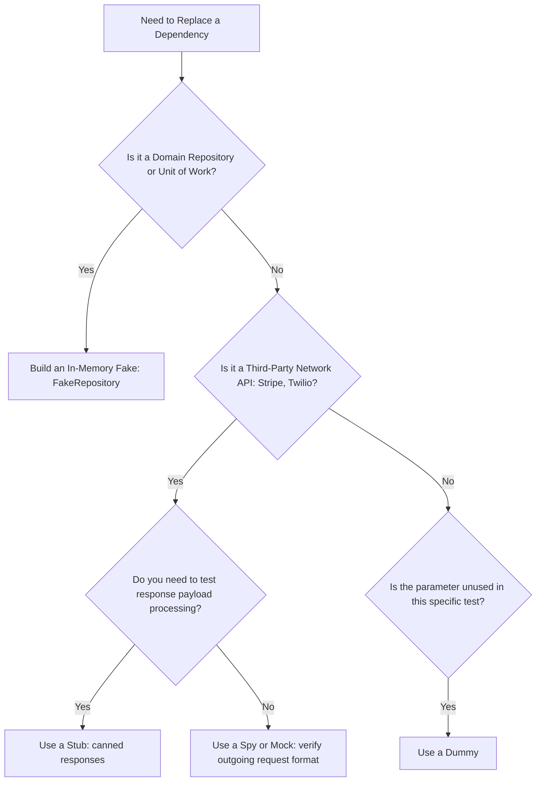

# Test Doubles: Mocks vs. Fakes vs. Stubs vs. Spies vs. Dummies

> *"Mocks verify interactions; Fakes verify state. When you test using Mocks, your tests are coupled to how the code is implemented. When you test using Fakes, your tests are coupled only to what the code achieves."*
> — **Harry Percival & Bob Gregory**, *Architecture Patterns with Python*

---

## 1. Conceptual Mental Model & Theoretical Foundations

In Gerard Meszaros' seminal work *xUnit Test Patterns*, any object that stands in for a real production dependency during a test is formally classified as a **Test Double**. Unfortunately, the Python community routinely uses the word "mock" as an umbrella term for all test doubles, obscuring critical architectural distinctions.

```
                            ┌───────────────────────────────────┐
                            │            TEST DOUBLE            │
                            │ (Generic Replacement for Real I/O)│
                            └─────────────────┬─────────────────┘
                                              │
         ┌───────────────┬────────────────────┼───────────────────┬───────────────┐
         ▼               ▼                    ▼                   ▼               ▼
    ┌─────────┐    ┌───────────┐        ┌───────────┐       ┌───────────┐   ┌───────────┐
    │  DUMMY  │    │   STUB    │        │    SPY    │       │   MOCK    │   │   FAKE    │
    │ (Unused)│    │(Canned In)│        │(Record Out│       │ (Behavior │   │ (Working  │
    │         │    │           │        │  & Calls) │       │ Contract) │   │ In-Memory)│
    └─────────┘    └───────────┘        └───────────┘       └───────────┘   └───────────┘
```

### The Taxonomy of Test Doubles (Meszaros & Fowler):
1. **Dummy**: Objects passed into function calls solely to satisfy type signatures or parameter requirements. They are never inspected, invoked, or asserted upon.
2. **Stub**: Provides hardcoded, canned responses to queries made during the test. A stub has zero logic and does not verify how many times it was called.
3. **Spy**: A wrapper or stub that passively records telemetry about how it was invoked (call counts, passed arguments, return values) for later assertion.
4. **Mock**: Pre-programmed with strict behavioral expectations. It defines the exact sequence of method calls and arguments it *must* receive. If an unexpected method is called, the mock fails the test.
5. **Fake**: A fully functional, working implementation of an interface that takes shortcuts that make it unsuitable for production (e.g., an in-memory dictionary acting as a repository or an in-memory SQLite database).

---

## 2. Comprehensive Architectural Comparison Matrix

| Test Double | Primary Purpose | Verification Style | Coupled to Implementation? | Maintenance Cost |
| :--- | :--- | :--- | :--- | :--- |
| **Dummy** | Satisfy signatures | None (Never called) | No | Zero |
| **Stub** | Feed data into test | State verification | Low | Very Low |
| **Spy** | Inspect outgoing calls | Behavioral verification | Moderate | Moderate |
| **Mock** | Enforce exact protocol | Strict interaction verification | **High** (Breaks on refactoring) | High |
| **Fake** | Real working substitute | State & outcome verification | **Zero** (Refactoring-resilient) | Low once created |

---

## 3. Side-by-Side Implementation Comparison

Let us examine the exact same interface—a `NotificationSender` and `UserRepository`—implemented across all five test doubles.

### The Domain Interface Under Test

```python
from typing import Optional, Protocol
from dataclasses import dataclass


@dataclass(frozen=True)
class User:
    id: str
    email: str
    is_active: bool


class UserRepository(Protocol):
    def get_by_id(self, user_id: str) -> Optional[User]: ...
    def save(self, user: User) -> None: ...


class NotificationSender(Protocol):
    def send(self, email: str, message: str) -> bool: ...
```

---

### 1. The Dummy (Satisfying Parameter Signatures)

```python
class DummyNotificationSender:
    """Never called; exists solely to satisfy the constructor signature."""
    def send(self, email: str, message: str) -> bool:
        raise NotImplementedError("Dummy should never be called!")


def test_user_creation_does_not_trigger_notification():
    # We only care about user registration, not notifications
    dummy_notifier = DummyNotificationSender()
    service = RegistrationService(notifier=dummy_notifier)
    user = service.prepare_draft("test@example.com")
    assert user.email == "test@example.com"
```

---

### 2. The Stub (Canned Answers to Inquiries)

```python
class StubUserRepository:
    """Always returns a pre-configured active user regardless of input."""
    def get_by_id(self, user_id: str) -> Optional[User]:
        return User(id=user_id, email="vip@domain.com", is_active=True)

    def save(self, user: User) -> None:
        pass  # Stubs ignore commands


def test_premium_discount_applied_to_active_user():
    stub_repo = StubUserRepository()
    service = BillingService(repo=stub_repo)
    discount = service.calculate_discount("user_123")
    assert discount == 0.20
```

---

### 3. The Spy (Recording Call History)

```python
class SpyNotificationSender:
    """Records outgoing notifications for later assertion."""
    def __init__(self) -> None:
        self.sent_messages: list[tuple[str, str]] = []

    def send(self, email: str, message: str) -> bool:
        self.sent_messages.append((email, message))
        return True


def test_welcome_email_sent_to_registered_user():
    spy_notifier = SpyNotificationSender()
    service = OnboardingService(notifier=spy_notifier)
    service.complete_onboarding("alex@domain.com")

    # Inspect recorded telemetry
    assert len(spy_notifier.sent_messages) == 1
    assert spy_notifier.sent_messages[0] == ("alex@domain.com", "Welcome aboard!")
```

---

### 4. The Mock (Strict Behavioral Contract)

```python
from unittest.mock import Mock


def test_order_completion_triggers_exact_notification_mock():
    # Mock pre-programmed with strict expectation
    mock_notifier = Mock(spec=NotificationSender)
    mock_notifier.send.return_value = True

    service = OrderService(notifier=mock_notifier)
    service.mark_order_paid(order_id="ORD-101", customer_email="buyer@test.com")

    # Strict interaction verification: fails if called with wrong arguments
    mock_notifier.send.assert_called_once_with("buyer@test.com", "Order ORD-101 has been paid.")
```

---

### 5. The Fake (Working In-Memory Implementation)

```python
from typing import Dict, Optional


class FakeUserRepository:
    """Fully functioning in-memory repository backed by a dictionary."""
    def __init__(self) -> None:
        self._users: Dict[str, User] = {}

    def get_by_id(self, user_id: str) -> Optional[User]:
        return self._users.get(user_id)

    def save(self, user: User) -> None:
        self._users[user.id] = user


def test_user_activation_lifecycle():
    fake_repo = FakeUserRepository()
    fake_repo.save(User(id="u1", email="u1@test.com", is_active=False))

    service = UserService(repo=fake_repo)
    service.activate_user("u1")

    # Pure state verification: inspect the fake's internal state
    updated_user = fake_repo.get_by_id("u1")
    assert updated_user is not None
    assert updated_user.is_active is True
```

---

## 4. The Classicist (Detroit) vs. Mockist (London) Debate

```
Classicist School (Detroit / State-Based):
- Favors Real Code & Fakes
- Verifies system state (What is the final data in the DB/Fake?)
- Tests survive extensive internal refactoring
- Championed by Martin Fowler, Kent Beck, "Cosmic Python"

Mockist School (London / Interaction-Based):
- Favors Mocks for every collaborator
- Verifies messages and method invocations (Did A call B.method()?)
- Fast to write; pinpoints exact call sequences
- Extreme fragility: refactoring method names or signatures breaks all tests
```

---

## 5. Architectural Decision Tree: Choosing the Right Test Double



---

## 6. Senior/Staff Engineer Interview Q&A

### Q1: Why does Architecture Patterns with Python ("Cosmic Python") strongly advocate for Fakes over Mocks in Service Layer tests?
> **Answer**: Mocks perform **interaction testing**: they assert that specific methods were called on specific objects with specific arguments. This tightly couples the test suite to the internal implementation details of the service layer. If you refactor a service method to batch queries, rename a repository helper, or change an internal loop, all mock assertions fail—even though the end behavior and business outcomes are 100% correct.
> **Fakes perform state verification**. An in-memory `FakeRepository` implements the repository protocol using a native Python dictionary. You test the service layer in "High Gear" by asserting on the inputs and outputs of the domain model and fake state. You can completely rewrite the service layer's internal algorithms, and every test remains green as long as the business contract is preserved.

---

## Summary & Cross-References

- Learn how to implement Fake Unit of Work in [Repository Pattern Testing](../architecture-and-testing/repository-pattern.md).
- Master pytest's mocking fixture in [pytest-mock vs. unittest.mock](pytest-mock-vs-unittest-mock.md).
- Explore state-based service testing in [Service Layer Testing](../unit-testing/service-layer-testing.md).
