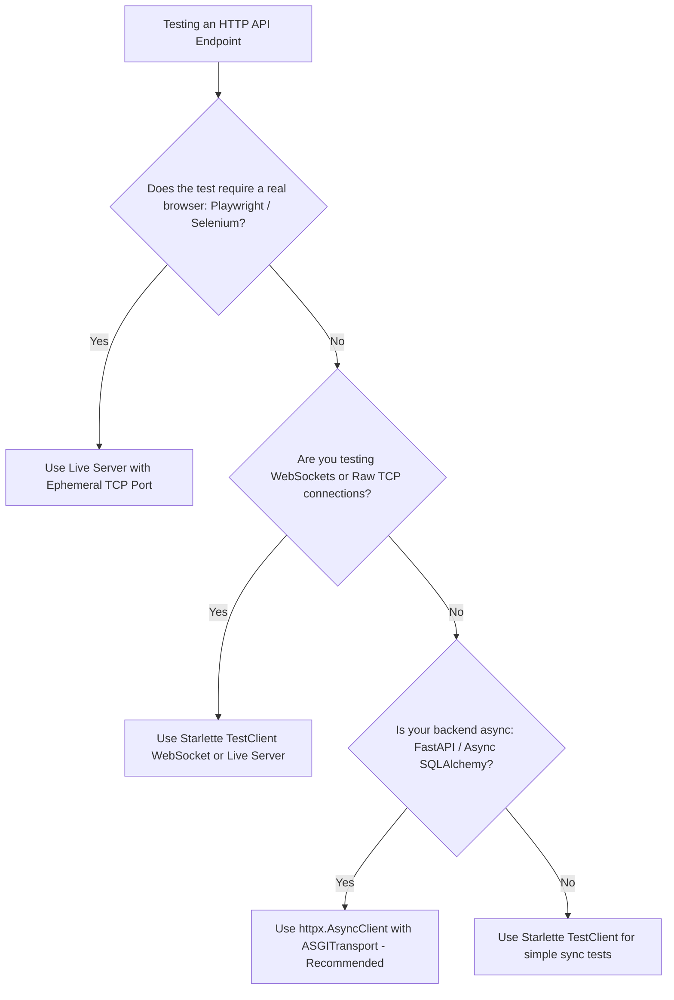

# TestClient vs. HTTPX AsyncClient vs. Live Server

> *"How you send HTTP requests in tests determines what kinds of bugs you can catch. In-memory ASGI dispatch gives you blinding speed; real TCP live servers give you network reality. Using the wrong one either slows your CI to a crawl or blinds you to concurrency deadlocks."*

---

## 1. Conceptual Mental Model & Theoretical Foundations

In modern ASGI web frameworks (FastAPI, Starlette, Litestar), testing HTTP endpoints can be performed across three distinct architectural transport mechanisms:

```
1. Starlette TestClient (Synchronous In-Memory ASGI Bridge):
[ Test Runner (Sync) ] ──> Requests Adapter ──> Portal ──> ASGI App In-Memory
(Runs on a separate worker thread using an event loop portal)

2. HTTPX AsyncClient with ASGITransport (Native In-Memory Async):
[ Test Runner (Async Coroutine) ] ──> ASGITransport ──> ASGI App In-Memory
(Direct coroutine execution in the same event loop; Zero network sockets)

3. Live Server (Real OS TCP Sockets):
[ HTTPX / Playwright ] ──> Kernel TCP Socket (Loopback) ──> Uvicorn Server Process
(True OS network stack, real TCP handshakes, TLS, and thread/process boundaries)
```

---

## 2. Comprehensive Architectural Comparison Matrix

| Dimension | Starlette `TestClient` | `httpx.AsyncClient` (`ASGITransport`) | Live Server (Uvicorn over TCP) |
| :--- | :--- | :--- | :--- |
| **Transport Medium** | In-memory via `anyio` portal | In-memory direct ASGI coroutines | Real OS loopback TCP socket (`127.0.0.1`) |
| **Test Signature** | Synchronous (`def test_...`) | Asynchronous (`async def test_...`) | Either Sync or Async |
| **Execution Speed** | $\approx 2\text{ms}\text{--}5\text{ms}$ per request | $\approx 0.5\text{ms}\text{--}2\text{ms}$ per request | $\approx 20\text{ms}\text{--}60\text{ms}$ per request |
| **Event Loop Threading** | Spawns separate thread for event loop | Uses test runner's native event loop | Dedicated server thread/process |
| **Lifespan Support** | Supported via context manager | Supported (`async with AsyncClient(...)`) | Fully executed during server boot |
| **WebSocket Testing** | Native support via context manager | Limited (Requires separate websockets client) | Full native WebSocket over TCP |
| **Streaming Responses / SSE** | Iterative generator | Async generator stream (`ac.stream()`) | Real-time byte chunk streaming |
| **Browser Integration** | Incompatible (In-memory only) | Incompatible | **Fully Compatible (Playwright/Selenium)** |
| **Concurrency Deadlocks** | Prone to event loop deadlocks | Native async concurrency safe | Immune to event loop thread lockups |

---

## 3. Side-by-Side Implementation Comparison

### The FastAPI Application Under Test

```python
from contextlib import asynccontextmanager
from fastapi import FastAPI
import asyncio

# Lifespan state
state = {"db_ready": False}


@asynccontextmanager
async def lifespan(app: FastAPI):
    state["db_ready"] = True
    yield
    state["db_ready"] = False


app = FastAPI(lifespan=lifespan)


@app.get("/status")
async def get_status():
    await asyncio.sleep(0.01)  # Async non-blocking work
    return {"ready": state["db_ready"]}
```

---

### Approach 1: Starlette `TestClient` (Synchronous)

```python
from fastapi.testclient import TestClient
from app.main import app


def test_status_endpoint_testclient():
    # Context manager triggers ASGI lifespan startup/shutdown
    with TestClient(app) as client:
        response = client.get("/status")
        assert response.status_code == 200
        assert response.json() == {"ready": True}
```
- **Pros**: Simple, synchronous syntax; no need for `pytest-asyncio`.
- **Cons**: Can mask async concurrency bugs; runs the app in a background thread via `anyio.from_thread.run()`, which can cause deadlocks if a test fixture attempts to share loop resources.

---

### Approach 2: `httpx.AsyncClient` with `ASGITransport` (Native Async)

```python
import pytest
from httpx import ASGITransport, AsyncClient
from app.main import app


@pytest.mark.asyncio
async def test_status_endpoint_httpx():
    # Direct ASGI in-memory transport
    transport = ASGITransport(app=app)
    async with AsyncClient(transport=transport, base_url="http://test") as ac:
        response = await ac.get("/status")
        assert response.status_code == 200
        assert response.json() == {"ready": True}
```
- **Pros**: Blazing fast, native coroutine integration, perfect for testing async dependency overrides and concurrent `asyncio.gather()` requests.
- **Cons**: Requires `pytest-asyncio` configuration.

---

### Approach 3: Live Server over Real TCP Socket

```python
import socket
import threading
import time
import pytest
import uvicorn
import httpx
from app.main import app


def get_ephemeral_port() -> int:
    with socket.socket(socket.AF_INET, socket.SOCK_STREAM) as s:
        s.bind(("", 0))
        return s.getsockname()[1]


@pytest.fixture(scope="module")
def live_server_url():
    port = get_ephemeral_port()
    config = uvicorn.Config(app=app, host="127.0.0.1", port=port, log_level="warning")
    server = uvicorn.Server(config)
    thread = threading.Thread(target=server.run, daemon=True)
    thread.start()

    while not server.started:
        time.sleep(0.02)

    yield f"http://127.0.0.1:{port}"

    server.should_exit = True
    thread.join(timeout=2.0)


def test_status_endpoint_live_server(live_server_url: str):
    response = httpx.get(f"{live_server_url}/status")
    assert response.status_code == 200
    assert response.json() == {"ready": True}
```
- **Pros**: 100% production fidelity; tests real network buffers, reverse proxies, and enables browser test runners (Playwright).
- **Cons**: 10x slower execution; requires port management to prevent collisions under `pytest-xdist`.

---

## 4. Architectural Decision Tree: Choosing the HTTP Client



---

## 5. Senior/Staff Engineer Interview Q&A

### Q1: Why can Starlette's `TestClient` trigger unexpected deadlocks when testing async endpoints that interact with async database drivers?
> **Answer**: Starlette's `TestClient` is synchronous. Under the hood, it uses AnyIO's blocking portal (`anyio.from_thread.run()`) to run the ASGI application on a separate event loop inside a worker thread. 
> If your test fixture creates an async database connection (e.g. `asyncpg` or Async SQLAlchemy) on the *main thread's* event loop, and the endpoint in the *worker thread's* event loop tries to await queries on that same connection, Python's event loop will raise `RuntimeError: Task got Future attached to a different loop` or deadlock completely. 
> Using `httpx.AsyncClient` with `ASGITransport` eliminates this issue because both the test fixture and the FastAPI endpoint execute on the **exact same event loop in the same thread**.

---

## Summary & Cross-References

- Learn async endpoint testing in [FastAPI Async Endpoint Testing](../fastapi-testing/async-endpoint-testing.md).
- Master dependency overrides in [FastAPI Dependency Overrides](../fastapi-testing/dependency-overrides.md).
- Explore browser-based testing in [Playwright API Testing](../e2e-testing/playwright-api-testing.md).
