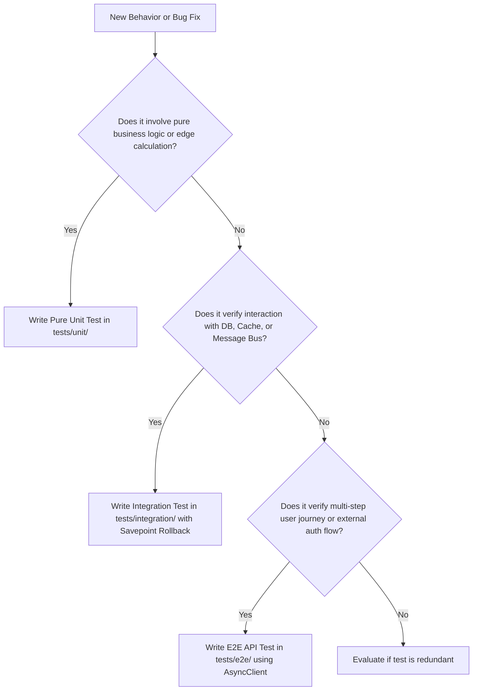

# Unit vs. Integration vs. End-to-End (E2E) Testing

> *"Unit tests tell you if your code does what you wrote. Integration tests tell you if your components understand each other. End-to-end tests tell you if your system actually delivers customer value. Conflating them is the fastest path to an unmaintainable test suite."*

---

## 1. Conceptual Mental Model & Theoretical Foundations

Software testing exists along a spectrum of **Scope**, **Speed**, and **Fidelity**. Understanding the distinct boundaries between Unit, Integration, and End-to-End (E2E) testing allows engineering organizations to construct an optimal testing portfolio rather than relying blindly on a single test level.

```
       ▲  End-to-End (E2E) Tests     [High Fidelity, Slow Execution, High Flakiness]
      ╱ ╲   Scope: Full HTTP Network, Real Browser/Client, Live Services
     ╱   ╲
    ╱     ╲  Integration Tests       [Medium Fidelity, Moderate Speed, Database Containers]
   ╱       ╲   Scope: Service Layer + PostgreSQL + Redis + Message Brokers
  ╱         ╲
 ╱           ╲  Unit Tests           [Pure Isolation, Sub-millisecond Speed, Zero Flakiness]
╱─────────────╲   Scope: Domain Invariants, Pure Functions, In-Memory Fakes
```

### The Three Testing Models in Software Architecture:
1. **The Classic Testing Pyramid (Mike Cohn)**: Emphasizes a massive base of fast unit tests, a smaller tier of integration tests, and a razor-thin layer of E2E smoke tests.
2. **The Testing Trophy (Kent C. Dodds)**: Popular in web ecosystems; emphasizes integration testing as the highest-ROI layer because it tests components interacting together without full browser overhead.
3. **The Testing Honeycomb (Spotify / Microservices)**: Replaces the pyramid in distributed architectures, placing the widest emphasis on **Service-Layer Integration Tests** (testing business logic against fake ports and bounded context adapters).

---

## 2. Deep Dimension Comparison Matrix

| Architectural Dimension | Unit Testing | Integration Testing | End-to-End (E2E) Testing |
| :--- | :--- | :--- | :--- |
| **Execution Speed** | $\approx 0.05\text{ms}\text{--}1\text{ms}$ per test | $\approx 10\text{ms}\text{--}100\text{ms}$ per test | $\approx 500\text{ms}\text{--}15,000\text{ms}$ per test |
| **System Boundary** | Single function, class, or domain aggregate | Service Layer + DB / Cache / Message Queue | Entire distributed stack + Real Network/Browser |
| **I/O Dependency** | Pure in-memory (No network, disk, or DB) | Containerized DB (PostgreSQL) or Docker infra | Live running staging/prod-like cluster |
| **Test Doubles** | Extensive use of Fakes / Stubs | Real DB connections (Savepoint rollback) | Zero doubles (or wiremock external third-parties) |
| **Root Cause Localization** | Exact line of code in traceback | Component or SQL query boundary | Opaque (Could be network, DNS, DB, or UI) |
| **Refactoring Resilience** | High for domain tests; Low if over-mocked | High (Tests use case contracts) | Highest (Tests user outcomes) |
| **CI Execution Time** | $< 10$ seconds for 5,000 tests | $1\text{--}3$ minutes for 1,000 tests | $15\text{--}45$ minutes for 200 tests |
| **False-Positive / Flake Rate** | Nearly $0\%$ | Low ($< 0.5\%$ with proper savepoints) | High ($5\%\text{--}25\%$ due to network/browser races) |

---

## 3. Side-by-Side Implementation Comparison

Let us examine the exact same feature—**Applying a Promotional Discount to an Order**—implemented and tested across all three levels.

### The Business Logic Under Test

```python
from dataclasses import dataclass
from decimal import Decimal


@dataclass(frozen=True)
class DiscountRule:
    code: str
    discount_percent: Decimal
    is_active: bool


def calculate_discounted_total(subtotal: Decimal, rule: DiscountRule) -> Decimal:
    """Pure domain function calculating discount."""
    if not rule.is_active:
        return subtotal
    discount_amount = (subtotal * rule.discount_percent) / Decimal("100.0")
    return max(Decimal("0.00"), subtotal - discount_amount)
```

---

### Level 1: Unit Test (Pure Domain Logic)

```python
# tests/unit/test_discount_unit.py
from decimal import Decimal
from app.domain.pricing import DiscountRule, calculate_discounted_total


def test_active_discount_rule_applies_correctly():
    rule = DiscountRule(code="SUMMER20", discount_percent=Decimal("20.0"), is_active=True)
    total = calculate_discounted_total(subtotal=Decimal("100.00"), rule=rule)
    assert total == Decimal("80.00")


def test_inactive_discount_rule_is_ignored():
    rule = DiscountRule(code="EXPIRED", discount_percent=Decimal("50.0"), is_active=False)
    total = calculate_discounted_total(subtotal=Decimal("100.00"), rule=rule)
    assert total == Decimal("100.00")
```
- **Execution Speed**: $0.0002$ seconds.
- **Dependencies**: None.

---

### Level 2: Integration Test (Service Layer + PostgreSQL Savepoint)

```python
# tests/integration/test_discount_integration.py
from decimal import Decimal
import pytest
from sqlalchemy import select
from app.adapters.orm import DiscountModel
from app.service_layer.checkout import apply_discount_code


def test_service_applies_discount_and_persists_to_database(db_session):
    # Seed persistent discount in database
    db_session.add(
        DiscountModel(code="SAVE10", discount_percent=Decimal("10.0"), is_active=True)
    )
    db_session.flush()

    # Invoke service layer orchestrating DB lookup and business logic
    final_total = apply_discount_code(
        session=db_session,
        order_id="ord_123",
        subtotal=Decimal("50.00"),
        code="SAVE10",
    )

    assert final_total == Decimal("45.00")
```
- **Execution Speed**: $0.015$ seconds.
- **Dependencies**: Real relational database transaction (rolled back after test).

---

### Level 3: End-to-End (E2E) Test (HTTP API / ASGI Client)

```python
# tests/e2e/test_discount_e2e.py
import pytest
from httpx import AsyncClient


@pytest.mark.asyncio
async def test_e2e_checkout_with_discount_code(client: AsyncClient):
    # 1. Create discount code via Admin API
    admin_res = await client.post(
        "/api/v1/admin/discounts",
        json={"code": "VIP50", "discount_percent": "50.0", "is_active": True},
    )
    assert admin_res.status_code == 201

    # 2. Checkout order via Customer API
    checkout_res = await client.post(
        "/api/v1/orders/checkout",
        json={"subtotal": "200.00", "discount_code": "VIP50"},
    )
    assert checkout_res.status_code == 200
    assert checkout_res.json()["final_total"] == "100.00"
```
- **Execution Speed**: $0.085$ seconds.
- **Dependencies**: Entire ASGI middleware pipeline, authentication, routing, JSON serialization, and database persistence.

---

## 4. Architectural Decision Tree: Where Should a New Test Live?



---

## 5. Anti-Patterns & Common Traps

### Anti-Pattern 1: The "Ice Cream Cone" (Inverted Pyramid)
Writing 500 slow, flaky E2E tests and almost zero unit tests. CI takes 45 minutes; developers stop running tests locally; builds fail constantly due to minor UI changes.

### Anti-Pattern 2: The "Mockingbird" Unit Test
A unit test that mocks 7 layers of dependencies to test a single line of orchestration code:
```python
# Fragile, tautological unit test: tests implementation details, not behavior!
mock_repo.get_user.assert_called_once_with(123)
mock_mailer.send_email.assert_called_once_with("test@test.com")
```
*Fix*: Test the service layer using in-memory fakes or move to a lightweight integration test.

---

## 6. Senior/Staff Engineer Interview Q&A

### Q1: In modern microservice architectures, why do many engineering organizations favor the "Testing Honeycomb" over the traditional "Testing Pyramid"?
> **Answer**: In monolithic applications with complex localized domain logic, the Testing Pyramid is optimal because most business rules can be verified via pure unit tests. However, in microservices, individual services are often thin orchestration layers whose primary responsibility is coordinating between databases, message buses, and external APIs. 
> Writing extensive unit tests with heavy mocks in a microservice often produces fragile "mockingbird" tests that test nothing more than mock configuration. The **Testing Honeycomb** places the widest layer at **Service Integration Testing**, testing the service against real database containers and in-memory contract fakes. This provides the highest return on investment while catching real serialization, query, and concurrency bugs.

---

## Summary & Cross-References

- Explore Unit Testing methodologies in [Unit Testing Module](../unit-testing/index.md).
- Master Database Integration testing in [Database Testing](../integration-testing/database-testing.md).
- Learn End-to-End browser and API testing in [Playwright API Testing](../e2e-testing/playwright-api-testing.md).
