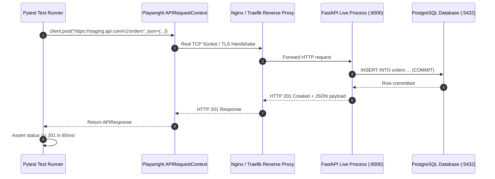

# API vs. Browser End-to-End (E2E) Testing ⚖️

> **Authoritative Sources & Literature:**
> - Martin Fowler: *The Practical Test Pyramid & Broad-Stack Tests* (martinfowler.com)
> - Microsoft Playwright Team: *API Testing with Playwright* (playwright.dev/python/docs/api-testing)
> - Kent C. Dodds: *Write tests. Not too many. Mostly integration.* (kentcdodds.com)
> - Gerard Meszaros: *xUnit Test Patterns: Refactoring Test Code* (Test Flakiness & Non-Deterministic Tests)

---

## 1. Conceptual Definition & Core Mental Model

When designing an **End-to-End (E2E) Testing Strategy** for modern web platforms, backend and QA engineers face a pivotal architectural choice:
1. **Browser-Driven E2E Tests**: Drives a full headless browser (Chromium, Firefox, WebKit) via tools like Playwright or Selenium, clicking buttons, filling input fields, and evaluating JavaScript DOM mutations.
2. **API-Driven E2E Tests**: Interacts with the backend via pure HTTP/REST/GraphQL network requests over real TCP sockets to a live staging environment or Docker cluster.

### The Problem: The Flaky Browser Ice Cream Cone
Historically, teams suffered from the "Software Testing Ice Cream Cone" anti-pattern:
- Thousands of slow, fragile browser UI tests.
- High flakiness caused by CSS animations, frontend hydration delays, and DOM race conditions.
- Test suites running for 45 minutes to 2 hours in CI, blocking deployments and creating "test suite fatigue" where developers ignore red builds.

### The Mental Model: The 90/10 E2E Split
Modern engineering organizations split E2E testing into two complementary tiers:
- **10% Browser E2E**: Reserved strictly for the 5 to 10 most critical core conversion funnels (e.g., User Signs Up via UI $\to$ Enters Credit Card in Stripe iframe $\to$ Reaches Welcome Screen).
- **90% API-Driven E2E**: Every other multi-step business workflow (bulk data exports, account setting changes, inventory allocations, webhook relays) is executed entirely via HTTP requests over the network!

```
                  ┌──────────────────────────────────────────────┐
                  │           E2E Testing Distribution           │
                  └──────────────────────┬───────────────────────┘
                                         │
                    ┌────────────────────┴────────────────────┐
                    │ 10%                                     │ 90%
                    ▼                                         ▼
   ┌─────────────────────────────────┐       ┌─────────────────────────────────┐
   │       Browser-Driven E2E        │       │         API-Driven E2E          │
   │  (Playwright Chromium Browser)  │       │     (Playwright API / HTTPX)    │
   │  - 5-10 Critical Funnels        │       │  - 100+ Complete User Journeys  │
   │  - Tests UI & JavaScript DOM    │       │  - Zero DOM flakiness           │
   │  - Execution: 3-8s per test     │       │  - Execution: 50-150ms per test │
   └─────────────────────────────────┘       └─────────────────────────────────┘
```

---

## 2. Why This Is Critical in Modern Python Backend Engineering

1. **Massive CI Speed Acceleration**: Running 100 browser tests takes **10 minutes**. Running the same 100 business journeys via API requests takes **12 seconds**.
2. **Zero DOM Flakiness**: API tests deal exclusively with HTTP status codes and deterministic JSON payloads. They never fail due to CSS transitions, modal overlays, or font rendering shifts.
3. **True Black-Box Environment Verification**: Unlike in-process integration tests (`ASGITransport`), API-driven E2E tests send real packets over real TCP ports to live Uvicorn/Gunicorn processes, testing real reverse proxies (Nginx/Traefik), TLS, and network routing.

---

## 3. Internal Mechanics & Architectural Workflow



---

## 4. Standard Syntax, Signatures & Configuration

### Prerequisites
```bash
pip install playwright pytest pytest-asyncio httpx
playwright install --with-deps
```

### Playwright APIRequestContext vs. Browser Page

```python
# 1. API-Driven E2E (Fast, Headless, Zero Browser Overhead)
from playwright.sync_api import sync_playwright

with sync_playwright() as p:
    # Creates pure HTTP request context (No browser window launched!)
    api_client = p.request.new_context(base_url="http://localhost:8000")
    response = api_client.post("/api/v1/users", data={"name": "Alice"})
    assert response.status == 201
    assert response.json()["name"] == "Alice"

# 2. Browser-Driven E2E (Launches full Chromium browser engine)
with sync_playwright() as p:
    browser = p.chromium.launch(headless=True)
    page = browser.new_page()
    page.goto("http://localhost:8000/register")
    page.fill('input[name="username"]', "Alice")
    page.click('button[type="submit"]')
    page.wait_for_selector(".welcome-message")
    browser.close()
```

---

## 5. Execution Lifecycle & Teardown Protocol

To maintain high speed in E2E suites:
1. **Environment Initialization**: Pre-boot the application stack (via Docker Compose) before the pytest session starts.
2. **Execution**: Use session-scoped `APIRequestContext` instances to reuse TCP connection pools and SSL sessions.
3. **Teardown**: Tear down test accounts and resources via API `DELETE` calls or automated post-session database container pruning.

---

## 6. Scopes, Isolation & System Boundaries

| Dimension | Browser E2E (`page`) | API E2E (`request`) | Integration (`ASGITransport`) |
| :--- | :--- | :--- | :--- |
| **Execution Medium** | Chromium / Firefox DOM | Pure HTTP Sockets | In-Memory ASGI Coroutine |
| **Speed per Test** | $\approx 2 - 8\text{ seconds}$ | **$\approx 50 - 200\text{ms}$** | $\approx 1 - 2\text{ms}$ |
| **Network Socket Used** | Real OS TCP Sockets | **Real OS TCP Sockets** | ❌ None |
| **Reverse Proxy Tested?** | ✅ Yes (Nginx / Cloudflare) | **✅ Yes** | ❌ None |
| **Frontend UI Tested?** | ✅ Yes | ❌ No | ❌ None |

---

## 7. Pytest Fixture & conftest Integration

```python
# tests/e2e/conftest.py
import pytest
import os
from playwright.sync_api import sync_playwright, APIRequestContext
from typing import Generator

BASE_URL = os.environ.get("E2E_BASE_URL", "http://127.0.0.1:8000")

@pytest.fixture(scope="session")
def api_context() -> Generator[APIRequestContext, None, None]:
    """
    Session-scoped Playwright API request context.
    Communicates over real TCP sockets to the running backend service.
    """
    with sync_playwright() as p:
        request_context = p.request.new_context(
            base_url=BASE_URL,
            extra_http_headers={"X-Test-Runner": "Playwright-E2E"}
        )
        yield request_context
        request_context.dispose()
```

---

## 8. Step-by-Step Practical Python 3.10+ Walkthrough

Let's test an end-to-end customer purchasing workflow via API requests:
1. Register user.
2. Authenticate to obtain token.
3. Create purchase order.
4. Verify order status.

```python
# tests/e2e/test_purchasing_workflow_api.py
import pytest
from playwright.sync_api import APIRequestContext

def test_full_purchasing_lifecycle_via_api(api_context: APIRequestContext):
    unique_email = "ada_e2e_purchaser@enterprise.com"

    # Step 1: User Registration
    reg_resp = api_context.post(
        "/api/v1/auth/register",
        data={"email": unique_email, "password": "SecurePassword123!"}
    )
    assert reg_resp.status == 201
    user_id = reg_resp.json()["id"]

    # Step 2: User Login
    login_resp = api_context.post(
        "/api/v1/auth/token",
        form={"username": unique_email, "password": "SecurePassword123!"}
    )
    assert login_resp.status == 200
    access_token = login_resp.json()["access_token"]

    # Step 3: Create Order using Authenticated Context
    order_headers = {"Authorization": f"Bearer {access_token}"}
    order_resp = api_context.post(
        "/api/v1/orders",
        headers=order_headers,
        data={"item_sku": "ERGONOMIC-CHAIR", "quantity": 1}
    )
    assert order_resp.status == 201
    order_id = order_resp.json()["order_id"]

    # Step 4: Verify Order Persistence & State
    get_order_resp = api_context.get(
        f"/api/v1/orders/{order_id}",
        headers=order_headers
    )
    assert get_order_resp.status == 200
    order_data = get_order_resp.json()
    assert order_data["status"] == "CONFIRMED"
    assert order_data["item_sku"] == "ERGONOMIC-CHAIR"
```

---

## 9. Framework & Ecosystem Integration: Preserving Storage State in Playwright

Playwright allows capturing session cookies and local storage tokens into a JSON file, so subsequent API and browser tests can skip the login step entirely:

```python
# tests/e2e/test_auth_state.py
from playwright.sync_api import sync_playwright

def test_save_and_reuse_auth_state(tmp_path):
    auth_state_path = tmp_path / "auth_state.json"

    with sync_playwright() as p:
        # 1. Login once and dump storage state
        api = p.request.new_context(base_url="http://localhost:8000")
        api.post("/api/v1/login", form={"username": "admin", "password": "pwd"})
        api.storage_state(path=str(auth_state_path))

        # 2. Reuse state in subsequent API contexts without logging in again!
        authenticated_api = p.request.new_context(
            base_url="http://localhost:8000",
            storage_state=str(auth_state_path)
        )
        resp = authenticated_api.get("/api/v1/admin/dashboard")
        assert resp.status == 200
```

---

## 10. Real-World Enterprise Scenario: Hybrid E2E Testing

In enterprise applications, the optimal pattern is **Hybrid Testing**:
- Use the **API** to perform the heavy setup (register account, create orders, set user permissions) in $100\text{ms}$.
- Use the **Browser** only for the final assertion (e.g. asserting the user sees the generated order on their screen).

```python
# tests/e2e/test_hybrid_checkout.py
def test_hybrid_order_view(api_context, page):
    # Fast Setup via API (< 100ms)
    token = get_admin_token(api_context)
    order_id = create_test_order_via_api(api_context, token)

    # Final Verification via Browser UI
    page.goto(f"http://localhost:8000/orders/{order_id}")
    page.wait_for_selector(".order-summary")
    assert page.inner_text(".order-status") == "CONFIRMED"
```

---

## 11. Anti-Patterns & Code Smells (Before vs After)

### Anti-Pattern 1: Logging in Through the UI for Every Test
```python
# ❌ BEFORE: Typing username and password in browser form on 200 tests (Wastes 15 minutes!)
page.goto("/login")
page.fill("#email", "user@test.com")
page.fill("#password", "secret")
page.click("#login-button")

# ✅ AFTER: Fast API login + storage_state injection
# Logs in via API in 50ms and sets session cookies directly!
```

### Anti-Pattern 2: Arbitrary `sleep()` to Fix Flaky Browser Tests
```python
# ❌ BEFORE: time.sleep(5) to wait for UI rendering (Flaky and slow!)
# ✅ AFTER: Playwright auto-waiting assertions
page.locator(".confirmation-box").wait_for(state="visible")
```

---

## 12. Best Practices & Production Guidelines

1. **Follow the 90/10 Rule**: Execute 90% of user workflows via APIs, and 10% via real browsers.
2. **Use API Setups for Browser Tests**: Never use the UI to set up test prerequisites; use API calls or database seeds.
3. **Isolate Test Data with Unique Prefixes**: Use UUIDs in test emails (`test_user_<uuid>@company.com`) to prevent collisions during parallel runs.
4. **Assert on Both HTTP Status and JSON Schemas**: Ensure API responses return both expected HTTP codes and valid schema structures.

---

## 13. Comprehensive Trade-Off Matrix

| Dimension | Browser E2E (UI) | API-Driven E2E | In-Process Integration |
| :--- | :--- | :--- | :--- |
| **Speed** | $\approx 2 - 8\text{s}$ | **$\approx 50 - 200\text{ms}$** | $\approx 1 - 2\text{ms}$ |
| **Flakiness** | Moderate to High | **Near Zero** | Zero |
| **Cost in CI** | High (CPU/Memory intensive) | **Minimal** | Minimal |
| **Full Stack Confidence** | **Highest (UI + Backend)** | **High (Complete Backend Stack)** | Moderate (Backend Core) |

---

## 14. Diagnostic & Troubleshooting Playbook

### Issue 1: `TargetClosedError: Target page, context or browser has been closed`
- **Root Cause**: An unhandled exception crashed the browser process, or the Playwright context was disposed prematurely.
- **Remediation**: Wrap browser fixtures in proper try/finally blocks and check system RAM on CI runners.

### Issue 2: `AssertionError: response.status == 502 Bad Gateway`
- **Root Cause**: The backend application container was not ready or crashed on startup behind the reverse proxy.
- **Remediation**: Implement a health check polling fixture that waits for `GET /health` to return 200 before launching the test suite.

---

## 15. Senior Staff Interview Questions & Answers

### Question 1: Why should an engineering team avoid using the browser UI to set up test state for E2E tests?
**Answer**:
Setting up test state through the browser UI (e.g., clicking through a 5-step registration wizard, confirming emails, and filling out multi-page address forms) introduces:
1. **Compounding Flakiness**: Every UI interaction increases the chance of an unexpected modal, hydration delay, or selector miss. If a test tests feature X, but fails because step 2 of registration glitched, you get a false positive failure.
2. **Extreme Slowness**: UI interactions take seconds per screen.
3. **Tight Coupling**: Any change to intermediate UI screens breaks dozens of unrelated downstream tests.
**The Senior Staff Solution**:
Use direct API requests or database seeders to prepare the state instantly ($< 100\text{ms}$), and launch the browser **only for the specific final interaction under test**.

### Question 2: In what scenarios is API-Driven E2E testing insufficient, necessitating a real browser engine?
**Answer**:
API-driven E2E tests cannot verify:
1. **Client-Side JavaScript Logic**: Client-side form validation, React state management, and custom DOM logic.
2. **Third-Party iFrames & Cross-Origin Security**: Third-party checkout widgets (e.g., Stripe Elements, PayPal iframe buttons) where credit card numbers are handled entirely inside external sandboxed iframes.
3. **Visual Regressions & Responsive Layouts**: CSS layout rendering, mobile viewport responsiveness, and z-index modal obscurities.
4. **Browser-Specific Features**: LocalStorage, Service Workers, WebRTC, and browser history navigation.

---

## 16. Practical Hands-On Exercises & Challenges

### Exercise 1: Build a Pure API E2E Password Reset Test
1. Send a request to `/api/v1/forgot-password`.
2. Extract the reset token from an in-memory test email sink.
3. Submit `/api/v1/reset-password` with the token.
4. Verify user can authenticate with the new password.

### Exercise 2: Implementing Storage State Reuse
1. Write a session fixture that checks if `auth_state.json` exists.
2. If missing, login via API and write it; if present, reuse it across 10 test functions.

---

## 17. Key Takeaways & Summary

- **API-driven E2E tests deliver 95% of full-stack confidence at 5% of the time and cost**.
- **Reserve browser automation strictly for the top 10% critical conversion funnels**.
- **Never use the UI to set up test state**: use direct API calls or database fixtures.
- **Playwright's `APIRequestContext`** provides high-speed, headless HTTP execution over real TCP sockets with built-in storage state reuse.

---

## 18. Next Steps & Cross-References

- Next: [Playwright for Backend API Testing](playwright-api-testing.md)
- [User Workflow & Journey Testing](user-workflows.md)
- [Database Verification in E2E Tests](database-verification.md)
- [Test Environment Management & Orchestration](test-environment-management.md)
- [API Integration Testing](../integration-testing/api-integration-testing.md)
