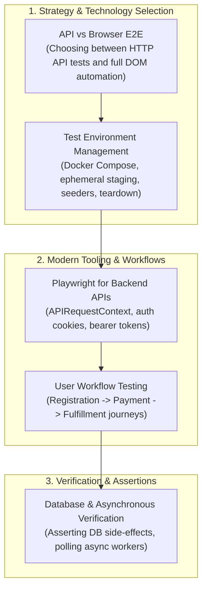

# End-to-End (E2E) Backend Testing in Python 🌐

> **Authoritative Sources & Literature:**
> - Martin Fowler: *Broad-Stack Tests & User Journey Tests* (martinfowler.com)
> - Microsoft Playwright Team: *Playwright API Testing & Browser Automation* (playwright.dev/python/)
> - Gerard Meszaros: *xUnit Test Patterns: Refactoring Test Code* (End-to-End Testing & Shared Fixtures)
> - Brian Okken: *Python Testing with pytest* (Chapter 7: Strategy & Architecture)

---

## 📖 Module Overview

At the peak of the testing pyramid sits **End-to-End (E2E) Testing**. While unit tests prove that pure business logic works in isolation, and integration tests verify persistence boundaries, E2E tests verify that the **entire application stack works as a cohesive whole**.

An E2E test runs from the perspective of an external user or client:
- Requests traverse real network sockets (HTTP/HTTPS, WebSockets).
- Applications run in real runtime environments (Docker containers, staging servers).
- Databases execute real migrations, transactions, and background worker queues (Celery, Redis).
- Complete user journeys are executed from start to finish.

This module provides backend engineers with an enterprise-grade blueprint for orchestrating resilient, high-speed E2E test suites using Playwright, ephemeral staging environments, and database verification harnesses.

---

## 🗺️ Module Guides

### 1. [API vs. Browser E2E Testing](api-vs-browser-e2e.md)
Understand when to execute E2E tests via pure HTTP API requests versus full headless browser automation. Learn why testing 90% of your E2E flows via APIs cuts execution time from minutes to seconds.

### 2. [Playwright for Backend API Testing](playwright-api-testing.md)
Master Playwright's `APIRequestContext`. Learn how to make high-speed headless HTTP calls, preserve authenticated storage states (`storage_state`), and test multipart uploads without browser overhead.

### 3. [User Workflow & Journey Testing](user-workflows.md)
Model and execute multi-step user workflows: User Registration $\to$ Email Verification $\to$ Token Login $\to$ Order Creation $\to$ Payment Processing $\to$ Order Fulfillment.

### 4. [Database Verification in E2E Tests](database-verification.md)
Go beyond HTTP status codes. Inspect database tables, Redis caches, and outbox tables after E2E operations to prove that persistence state matches external representations.

### 5. [Test Environment Management & Orchestration](test-environment-management.md)
Manage ephemeral environments using Docker Compose. Automate database seeding, secrets injection, migration execution, and zero-residual cleanup.

---

## 📊 Comparison Matrix: E2E Testing Dimensions

| Feature | Browser-Driven E2E (Playwright Web) | API-Driven E2E (Playwright API / HTTPX) | Integration Test (SAVEPOINT) |
| :--- | :--- | :--- | :--- |
| **Execution Speed** | $\approx 2 - 5\text{s}$ per test | **$\approx 50 - 200\text{ms}$ per test** | $\approx 1 - 2\text{ms}$ per test |
| **Flakiness Risk** | Moderate (DOM rendering, CSS) | **Near Zero (Deterministic JSON)** | Zero |
| **Network Socket Used** | Real HTTP / TCP Socket | **Real HTTP / TCP Socket** | In-memory ASGI / Loopback |
| **UI Components Tested** | ✅ Full React / Vue DOM | ❌ Backend APIs only | ❌ None |
| **Database Parity** | 100% Real Database | **100% Real Database** | Real PostgreSQL (SAVEPOINT) |

---

## ⏭️ Next Steps

Begin with **[API vs. Browser E2E Testing](api-vs-browser-e2e.md)** to establish clear architectural boundaries for your end-to-end testing strategy.
