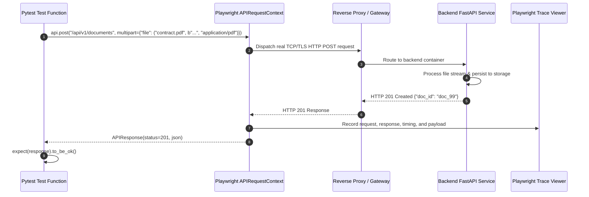

# Playwright for Backend API Testing 🎭

> **Authoritative Sources & Literature:**
> - Microsoft Playwright Team: *API Testing with Playwright Python* (playwright.dev/python/docs/api-testing)
> - Microsoft Playwright Team: *Network Monitoring, Tracing & Storage State* (playwright.dev/python/docs/trace-viewer)
> - Martin Fowler: *Component & Contract Testing with External Drivers* (martinfowler.com)
> - Brian Okken: *Python Testing with pytest* (Chapter 5: Fixtures & Plugins)

---

## 1. Conceptual Definition & Core Mental Model

While Playwright is famous for browser automation, it includes a dedicated, enterprise-grade HTTP client called **`APIRequestContext`**.

### Beyond Standard HTTP Clients
Why use Playwright's `APIRequestContext` rather than standard `requests` or `httpx` for E2E backend testing?
1. **Unified Storage State**: You can log in via API, dump cookies and local storage tokens into a Playwright `storage_state`, and seamlessly share those credentials across both headless API tests and full browser tests!
2. **Deep Diagnostic Tracing & Artifacts**: Playwright integrates API calls directly into its **Trace Viewer** and HTML reports, capturing complete request/response headers, timings, and payloads alongside visual browser timelines.
3. **Native Assertion Integration**: Integrates with Playwright's `expect` assertions (e.g. `expect(response).to_be_ok()`).

```
                    ┌──────────────────────────────────────────────┐
                    │               sync_playwright()              │
                    └──────────────────────┬───────────────────────┘
                                           │
                    ┌──────────────────────┴──────────────────────┐
                    │                                             │
                    ▼                                             ▼
   ┌─────────────────────────────────┐           ┌─────────────────────────────────┐
   │       p.request.new_context()   │           │       p.chromium.launch()       │
   │      (APIRequestContext)        │           │        (Browser / Page)         │
   │  - Pure HTTP Client             │           │  - Full Chromium Rendering      │
   │  - Microsecond network dispatch │           │  - Clicks buttons, fills forms  │
   │  - Captures cookies & headers   │           │  - Consumes saved storage_state │
   └────────────────┬────────────────┘           └────────────────┬────────────────┘
                    │                                             │
                    └──────────────────────┬──────────────────────┘
                                           │
                                           ▼
                    ┌──────────────────────────────────────────────┐
                    │      Shared Session Storage (Cookies/JWT)    │
                    │               storage_state                  │
                    └──────────────────────────────────────────────┘
```

---

## 2. Why This Is Critical in Modern Python Backend Engineering

1. **Zero-Overhead End-to-End API Workflows**: Executes against real public staging ports (`https://api.staging.company.com`) without launching heavyweight Chromium processes, cutting CI execution times by 80%.
2. **Native Multipart & Binary Upload Handling**: Effortlessly tests complex file upload pipelines (PDFs, images, CSVs) with strict MIME type and boundary verification.
3. **Seamless Hand-Off Between API and UI**: Seed user data, organizations, and permissions via fast API calls, then verify the final screen in a real browser using the exact same authentication session.

---

## 3. Internal Mechanics & Architectural Workflow



---

## 4. Standard Syntax, Signatures & Configuration

### Prerequisites
```bash
pip install playwright pytest pytest-playwright
playwright install --with-deps
```

### Core APIRequestContext Methods

```python
from playwright.sync_api import sync_playwright, APIRequestContext, expect

with sync_playwright() as p:
    # 1. Create Context with Base URL and Default Headers
    api: APIRequestContext = p.request.new_context(
        base_url="https://api.staging.enterprise.com",
        extra_http_headers={"X-API-Version": "2026-01-01"}
    )

    # 2. JSON Request
    resp = api.post("/v1/items", data={"name": "Server Rack", "price": 4999})
    expect(resp).to_be_ok()  # Asserts 200 <= status <= 299
    data = resp.json()

    # 3. Form URL-Encoded Request
    login_resp = api.post("/v1/token", form={"username": "alice", "password": "pwd"})

    # 4. Multipart File Upload
    upload_resp = api.post(
        "/v1/upload",
        multipart={
            "file": {
                "name": "data.csv",
                "mimeType": "text/csv",
                "buffer": b"id,val\n1,100"
            },
            "description": "Quarterly metrics"
        }
    )

    # 5. Inspecting Response Details
    status_code: int = resp.status
    headers: dict = resp.headers
    raw_bytes: bytes = resp.body()

    api.dispose()
```

---

## 5. Execution Lifecycle & Teardown Protocol

To maximize performance in pytest:
1. **Session Scope**: Instantiate the `playwright` driver and base `APIRequestContext` **once per test session**.
2. **Dispose**: Call `context.dispose()` during fixture teardown to close persistent TCP keep-alive connection pools.

---

## 6. Scopes, Isolation & System Boundaries

| Method | Payload Format | Content-Type Header Automatically Set |
| :--- | :--- | :--- |
| `api.post(data={...})` | Python dictionary | `application/json` |
| `api.post(form={...})` | Form dictionary | `application/x-www-form-urlencoded` |
| `api.post(multipart={...})` | Nested file/buffer dictionary | `multipart/form-data; boundary=...` |
| `api.get(params={...})` | Query parameters | URL query encoded |

---

## 7. Pytest Fixture & conftest Integration

```python
# tests/e2e/conftest.py
import pytest
import os
from typing import Generator
from playwright.sync_api import sync_playwright, Playwright, APIRequestContext

BASE_URL = os.environ.get("API_BASE_URL", "http://127.0.0.1:8000")

@pytest.fixture(scope="session")
def playwright_instance() -> Generator[Playwright, None, None]:
    with sync_playwright() as p:
        yield p

@pytest.fixture(scope="session")
def api_client(playwright_instance: Playwright) -> Generator[APIRequestContext, None, None]:
    """Session-scoped Playwright API client for high-throughput testing."""
    context = playwright_instance.request.new_context(
        base_url=BASE_URL,
        extra_http_headers={"User-Agent": "Playwright-Backend-TestSuite/1.0"}
    )
    yield context
    context.dispose()
```

---

## 8. Step-by-Step Practical Python 3.10+ Walkthrough

Let's test an invoice generation and document upload API with Playwright.

### Step 1: Define Application Endpoints (FastAPI)
```python
# src/routes/invoices_api.py
from fastapi import APIRouter, UploadFile, File, Form, HTTPException, status
from pydantic import BaseModel

router = APIRouter(prefix="/api/v1")

class InvoiceRequest(BaseModel):
    customer_id: str
    amount_cents: int

@router.post("/invoices", status_code=status.HTTP_201_CREATED)
def create_invoice(payload: InvoiceRequest):
    return {"invoice_id": "inv_7781", "status": "draft", "amount": payload.amount_cents}

@router.post("/invoices/{invoice_id}/receipt")
async def attach_receipt(invoice_id: str, file: UploadFile = File(...), notes: str = Form(...)):
    content = await file.read()
    return {
        "invoice_id": invoice_id,
        "filename": file.filename,
        "size": len(content),
        "notes": notes
    }
```

### Step 2: Write Comprehensive Playwright API Tests
```python
# tests/e2e/test_invoices_playwright.py
import pytest
from playwright.sync_api import APIRequestContext, expect

def test_create_invoice_json(api_client: APIRequestContext):
    payload = {"customer_id": "cust_123", "amount_cents": 15000}
    
    response = api_client.post("/api/v1/invoices", data=payload)
    
    expect(response).to_be_ok()
    assert response.status == 201
    data = response.json()
    assert data["invoice_id"] == "inv_7781"
    assert data["status"] == "draft"
    assert data["amount"] == 15000

def test_multipart_file_upload(api_client: APIRequestContext):
    invoice_id = "inv_7781"
    simulated_pdf_bytes = b"%PDF-1.4 simulated binary PDF content..."

    response = api_client.post(
        f"/api/v1/invoices/{invoice_id}/receipt",
        multipart={
            "file": {
                "name": "receipt_may.pdf",
                "mimeType": "application/pdf",
                "buffer": simulated_pdf_bytes
            },
            "notes": "Verified by accounting auditor"
        }
    )

    expect(response).to_be_ok()
    body = response.json()
    assert body["invoice_id"] == invoice_id
    assert body["filename"] == "receipt_may.pdf"
    assert body["size"] == len(simulated_pdf_bytes)
    assert body["notes"] == "Verified by accounting auditor"
```

---

## 9. Framework & Ecosystem Integration: Reusing Authenticated Contexts Across Tests

```python
# tests/e2e/test_authenticated_pipeline.py
import pytest
from playwright.sync_api import Playwright, APIRequestContext

@pytest.fixture(scope="session")
def authenticated_api_client(
    playwright_instance: Playwright,
    tmp_path_factory
) -> APIRequestContext:
    """Logs in once per session, saves storage state, and yields pre-authenticated client."""
    storage_file = tmp_path_factory.mktemp("state") / "state.json"
    
    # 1. Login via initial request context
    init_context = playwright_instance.request.new_context(base_url="http://127.0.0.1:8000")
    login_resp = init_context.post(
        "/api/v1/auth/token",
        form={"username": "superadmin", "password": "AdminPassword123!"}
    )
    assert login_resp.status == 200
    init_context.storage_state(path=str(storage_file))
    init_context.dispose()

    # 2. Yield context pre-loaded with session cookies / storage state
    auth_context = playwright_instance.request.new_context(
        base_url="http://127.0.0.1:8000",
        storage_state=str(storage_file)
    )
    yield auth_context
    auth_context.dispose()

def test_access_admin_dashboard(authenticated_api_client: APIRequestContext):
    response = authenticated_api_client.get("/api/v1/admin/metrics")
    assert response.status == 200
```

---

## 10. Real-World Enterprise Scenario: Generating Tracing Artifacts on API Failure

When an E2E API test fails in CI, Playwright can dump a complete network HAR archive for diagnostic inspection:

```python
# conftest.py
@pytest.fixture
def traceable_api_client(playwright_instance):
    # Generates HAR network archive capturing raw TCP request/response timings
    context = playwright_instance.request.new_context(
        base_url="http://127.0.0.1:8000",
        record_har_path="test_results/network_trace.har"
    )
    yield context
    context.dispose()
```

---

## 11. Anti-Patterns & Code Smells (Before vs After)

### Anti-Pattern 1: Launching a Headless Browser Just to Make HTTP Calls
```python
# ❌ BEFORE: Launching full Chromium browser to call an API (Extreme waste of memory/CPU!)
browser = playwright.chromium.launch()
page = browser.new_page()
response = page.request.get("/api/data")  # Browser overhead!

# ✅ AFTER: Using standalone APIRequestContext directly
api = playwright.request.new_context()
response = api.get("/api/data")  # 10x faster, zero browser launch!
```

### Anti-Pattern 2: Manually Formatting Multipart Boundaries
```python
# ❌ BEFORE: Handwriting multipart boundaries and string buffers
# ✅ AFTER: Passing clean dictionary to multipart=
```

---

## 12. Best Practices & Production Guidelines

1. **Use `expect(response).to_be_ok()`**: Cleaner and more informative assertion messages than `assert resp.status == 200`.
2. **Reuse `APIRequestContext` Across Tests**: Avoid opening and disposing contexts per test function to leverage HTTP/2 and keep-alive socket reuse.
3. **Set Realistic Network Timeouts**: Pass `timeout=5000` (5 seconds) to prevent hanging tests when staging backends freeze.
4. **Dump Storage State for Auth Sharing**: Authenticate once via API and share `storage_state` across both API and browser tests.

---

## 13. Comprehensive Trade-Off Matrix

| Feature | Playwright `APIRequestContext` | `httpx.Client` | Starlette `TestClient` |
| :--- | :--- | :--- | :--- |
| **Real Network Socket?** | **✅ Yes (Real TCP/TLS)** | ✅ Yes | ❌ In-memory only |
| **Shares Auth with Browser?** | **✅ Yes (`storage_state`)** | ❌ No | ❌ No |
| **Generates HAR Network Traces?** | **✅ Yes** | ❌ No | ❌ No |
| **Speed per Request** | **$\approx 15 - 50\text{ms}$** | $\approx 15 - 50\text{ms}$ | $< 1\text{ms}$ |

---

## 14. Diagnostic & Troubleshooting Playbook

### Issue 1: `Error: apiRequestContext.post: fetch failed`
- **Root Cause**: The target server is not running, or the host/port in `base_url` is incorrect.
- **Remediation**: Check that your staging environment or Docker Compose containers are active and accepting connections.

### Issue 2: `AssertionError: Expected response to be OK, but received 422`
- **Root Cause**: Form payload was passed to `data=` instead of `form=`, or JSON payload was malformed.
- **Remediation**: Print `response.json()` to inspect Pydantic validation error details.

---

## 15. Senior Staff Interview Questions & Answers

### Question 1: How does Playwright's `APIRequestContext` manage cookies and session headers across requests compared to standard Python `requests.Session`?
**Answer**:
`APIRequestContext` behaves similarly to a persistent browser session:
1. **Automated Cookie Jar Management**: It automatically stores incoming `Set-Cookie` response headers and dispatches matching cookies on subsequent outbound requests following RFC 6265 cookie rules (domain matching, path matching, `Secure`, `HttpOnly`).
2. **Unified Storage State Serialization**: Unlike `requests.Session` which requires manual cookie extraction, Playwright can export its entire state (cookies and HTTP headers) directly into a standardized JSON file using `context.storage_state(path=...)`.
3. **Cross-Engine Interoperability**: This exported JSON file can be ingested directly by a Playwright Chromium, Firefox, or WebKit `browser.new_context(storage_state=...)`, allowing browser tests to start completely authenticated without repeating the login process.

### Question 2: Why is Playwright's `APIRequestContext` preferred over `httpx` in teams that maintain both UI and Backend tests?
**Answer**:
1. **Single Toolchain**: Teams use one library (`playwright`) for both API contract testing and frontend browser automation, simplifying dependencies and documentation.
2. **Unified Reporting**: Test failures in Playwright API tests generate rich traces, screenshots, and HAR network logs that integrate directly into the Playwright HTML test report.
3. **Hybrid Test Execution**: Tests can seamlessly transition from executing an API setup to driving a real browser using shared authentication tokens and state.

---

## 16. Practical Hands-On Exercises & Challenges

### Exercise 1: Multi-Step API Workflow with HAR Logging
1. Configure an `APIRequestContext` with `record_har_path="reports/workflow.har"`.
2. Execute a 4-step user workflow (Signup $\to$ Login $\to$ Create Item $\to$ Delete Item).
3. Inspect the generated HAR file and assert all 4 requests are recorded.

### Exercise 2: Binary File Download and Checksum Verification
1. Create a route returning a binary image or file.
2. Write a Playwright API test downloading the body using `response.body()`.
3. Assert the SHA-256 hash of the downloaded bytes matches expected checksum.

---

## 17. Key Takeaways & Summary

- **Playwright `APIRequestContext` is a fast, headless HTTP client** designed for modern backend E2E testing over real network sockets.
- **`storage_state` bridges the gap between APIs and Browsers**, eliminating redundant UI logins.
- **Multipart file uploads and form submissions** are handled natively without manual boundary formatting.
- **Provides deep network tracing and HAR export capabilities** for debugging CI failures.

---

## 18. Next Steps & Cross-References

- Next: [User Workflow & Journey Testing](user-workflows.md)
- [API vs. Browser E2E Testing](api-vs-browser-e2e.md)
- [Database Verification in E2E Tests](database-verification.md)
- [Test Environment Management & Orchestration](test-environment-management.md)
- [FastAPI Endpoint Testing](../fastapi-testing/endpoint-testing.md)
