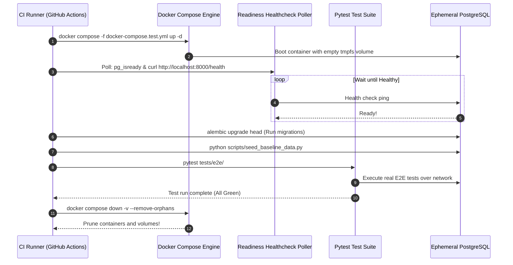

# Test Environment Management & Orchestration 🏗️

> **Authoritative Sources & Literature:**
> - Martin Fowler: *Ephemeral Environments & Test Environments Strategy* (martinfowler.com)
> - Docker Documentation: *Compose in CI & Automated Testing Environments* (docs.docker.com/compose/)
> - Gerard Meszaros: *xUnit Test Patterns: Refactoring Test Code* (Fresh Fixture & Teardown Strategies)
> - Brian Okken: *Python Testing with pytest* (Chapter 7: Strategy & Architecture)

---

## 1. Conceptual Definition & Core Mental Model

An **End-to-End (E2E) Test Suite** is only as reliable as the environment it runs against. If tests execute against a poorly managed environment, the suite suffers from cascading false failures.

### The Shared Staging Trap
Historically, development teams ran E2E tests against a **Shared Staging Server** (`https://staging.company.com`):
1. **Developer Collisions**: Developer A's test deletes an organization while Developer B's test is running a checkout within that exact organization.
2. **Schema Drift**: Staging runs an outdated database migration or untested feature branch.
3. **Dirty Residual State**: Millions of orphaned test rows accumulate, degrading database performance and causing non-deterministic timeouts.

### The Mental Model: Ephemeral, Just-in-Time Environments
Modern backend engineering uses **Ephemeral Environments**:
- A complete, isolated replica of the production stack is booted on-demand in Docker containers for the duration of the test run.
- Migrations run from scratch against pristine volumes.
- Tests execute in total isolation.
- When the suite completes (or fails), the entire environment is destroyed and pruned with zero lingering state.

```
       [ CI Pipeline / Local Run Begins ]
                       │
                       ▼ 1. docker compose -f docker-compose.test.yml up -d
   ┌─────────────────────────────────────────────────────────────┐
   │            Ephemeral Containerized Environment              │
   │                                                             │
   │  ┌───────────────────────┐       ┌───────────────────────┐  │
   │  │ FastAPI App Container │       │ PostgreSQL Container  │  │
   │  │ (Port :8000)          │       │ (Port :5432)          │  │
   │  └───────────┬───────────┘       └───────────┬───────────┘  │
   │              │                               │              │
   │  ┌───────────┴───────────┐       ┌───────────┴───────────┐  │
   │  │ Redis Container       │       │ MailHog (Email Mock)  │  │
   │  │ (Port :6379)          │       │ (Port :8025)          │  │
   │  └───────────────────────┘       └───────────────────────┘  │
   └───────────────────────────┬─────────────────────────────────┘
                               │ 2. Healthcheck Readiness Polling
                               ▼
   ┌─────────────────────────────────────────────────────────────┐
   │ 3. Execute Pytest E2E Suite (Playwright API / HTTPX)        │
   └───────────────────────────┬─────────────────────────────────┘
                               │ 4. docker compose down -v
                               ▼
       [ Environment Destroyed & Pruned (Zero Dirty State!) ]
```

---

## 2. Why This Is Critical in Modern Python Backend Engineering

1. **Absolute Reproducibility Across Machines**: A test that passes on a developer's MacBook is guaranteed to pass in GitHub Actions, eliminating the "works on my machine" syndrome.
2. **Multi-Job Parallel CI Isolation**: Using dynamic project names (`COMPOSE_PROJECT_NAME`), multiple CI runners can execute on the same host agent without container name or network collisions.
3. **Safe Chaos & Failure Testing**: You can forcefully kill containers, drop network connections, or restart database services mid-test without impacting other developers.

---

## 3. Internal Mechanics & Architectural Workflow



---

## 4. Standard Syntax, Signatures & Configuration

### `docker-compose.test.yml` Specification

```yaml
version: "3.8"

services:
  test-db:
    image: postgres:16-alpine
    environment:
      POSTGRES_USER: test_user
      POSTGRES_PASSWORD: test_password
      POSTGRES_DB: enterprise_test_db
    ports:
      - "5432:5432"
    tmpfs:
      - /var/lib/postgresql/data # Mount in RAM for maximum I/O speed!
    healthcheck:
      test: ["CMD-SHELL", "pg_isready -U test_user -d enterprise_test_db"]
      interval: 2s
      timeout: 3s
      retries: 10

  test-redis:
    image: redis:7-alpine
    ports:
      - "6379:6379"
    healthcheck:
      test: ["CMD", "redis-cli", "ping"]
      interval: 2s
      timeout: 2s
      retries: 5

  test-mailhog:
    image: mailhog/mailhog:v1.0.1
    ports:
      - "1025:1025" # SMTP port
      - "8025:8025" # Web / HTTP API port
```

---

## 5. Execution Lifecycle & Teardown Protocol

The **4-Stage Orchestration Lifecycle**:
1. **Provision**: Launch containers with isolated network namespaces.
2. **Readiness Verification**: Poll health check endpoints until all services report ready.
3. **Execution**: Run database schema migrations (`alembic upgrade head`), seed reference baseline constants, and execute tests.
4. **Teardown**: On success or failure, capture failure logs (`docker compose logs > ci_failure.log`) and execute `docker compose down -v --remove-orphans`.

---

## 6. Scopes, Isolation & System Boundaries

| Environment Layer | Lifecycle | Storage Medium | Collision Risk |
| :--- | :--- | :--- | :--- |
| **Shared Staging** | Persistent (Months/Years) | Persistent Cloud EBS | ❌ Extremely High |
| **Ephemeral Testcontainer**| Pytest Session Scoped | Ephemeral Docker Volume | Zero |
| **Docker Compose CI** | Per CI Job / PR | In-Memory RAM (`tmpfs`) | Zero (Isolated Project Names) |

---

## 7. Pytest Fixture & conftest Integration

Here is the automated healthcheck readiness fixture in `tests/e2e/conftest.py`:

```python
# tests/e2e/conftest.py
import pytest
import time
import httpx
from typing import Generator

HEALTH_CHECK_URL = "http://127.0.0.1:8000/health"

@pytest.fixture(scope="session", autouse=True)
def wait_for_environment_readiness() -> None:
    """
    Session-scoped readiness probe.
    Blocks test execution until all services in the test environment are 100% healthy.
    """
    max_retries = 30
    delay_seconds = 1.0

    print("\n[E2E Setup] Probing test environment readiness...")
    with httpx.Client(timeout=2.0) as client:
        for attempt in range(max_retries):
            try:
                response = client.get(HEALTH_CHECK_URL)
                if response.status_code == 200:
                    print(f"[E2E Setup] Environment healthy after {attempt * delay_seconds:.1f}s.")
                    return
            except httpx.NetworkError:
                pass
            time.sleep(delay_seconds)

    pytest.exit("CRITICAL: Test environment failed to become ready within 30s! Aborting test run.")
```

---

## 8. Step-by-Step Practical Python 3.10+ Walkthrough

Let's automate environment management using a Python orchestration script for CI pipelines.

### Step 1: Write the Orchestration Runner Script
```python
# scripts/run_e2e_environment.py
import subprocess
import sys
import os
import time

COMPOSE_FILE = "docker-compose.test.yml"
PROJECT_NAME = f"e2e_{os.environ.get('CI_JOB_ID', 'local')}"

def run_command(cmd: list[str], check: bool = True):
    print(f">> Executing: {' '.join(cmd)}")
    return subprocess.run(cmd, check=check)

def main():
    try:
        # 1. Boot Environment
        print(f"Booting ephemeral test environment (Project: {PROJECT_NAME})...")
        run_command([
            "docker", "compose",
            "-f", COMPOSE_FILE,
            "-p", PROJECT_NAME,
            "up", "-d"
        ])

        # 2. Run Database Migrations
        print("Running Alembic migrations against containerized database...")
        run_command(["alembic", "upgrade", "head"])

        # 3. Seed Baseline Constants
        print("Seeding baseline reference datasets...")
        run_command(["python", "scripts/seed_baseline.py"])

        # 4. Execute Pytest E2E Suite
        print("Launching Pytest E2E test suite...")
        result = run_command(["pytest", "tests/e2e/"], check=False)
        sys.exit(result.returncode)

    finally:
        # 5. Guaranteed Teardown
        print(f"Tearing down test environment (Project: {PROJECT_NAME})...")
        run_command([
            "docker", "compose",
            "-f", COMPOSE_FILE,
            "-p", PROJECT_NAME,
            "down", "-v", "--remove-orphans"
        ], check=False)

if __name__ == "__main__":
    main()
```

---

## 9. Framework & Ecosystem Integration: Mocking Emails with MailHog

In E2E testing, applications should never send real emails over the internet. Instead, the test environment boots **MailHog**, a lightweight in-memory SMTP server with an HTTP REST API:

```python
# tests/e2e/test_email_delivery.py
import httpx
from playwright.sync_api import APIRequestContext

MAILHOG_API_URL = "http://localhost:8025/api/v2"

def test_password_reset_email_received_in_mailhog(api_client: APIRequestContext):
    user_email = "test_user_reset@enterprise.com"

    # 1. Trigger Password Reset via Public API
    api_client.post("/api/v1/auth/forgot-password", data={"email": user_email})

    # 2. Query MailHog's HTTP API to capture the sent email!
    with httpx.Client() as client:
        resp = client.get(f"{MAILHOG_API_URL}/messages")
        assert resp.status_code == 200
        messages = resp.json()["items"]

        # Find email sent to user
        matching = [m for m in messages if user_email in m["To"][0]["Mailbox"] + "@" + m["To"][0]["Domain"]]
        assert len(matching) >= 1
        email_body = matching[0]["Content"]["Body"]
        assert "Reset your password" in email_body
```

---

## 10. Real-World Enterprise Scenario: Capturing Diagnostic Logs on CI Failure

When a CI run fails, debugging is impossible without container logs. The orchestration script captures logs before destroying the environment:

```bash
# In CI shell script (GitHub Actions / GitLab CI):
if [ $TEST_EXIT_CODE -ne 0 ]; then
  echo "Tests failed! Exporting container logs for debugging..."
  docker compose -f docker-compose.test.yml logs > test_failure_logs.txt
fi
docker compose -f docker-compose.test.yml down -v
```

---

## 11. Anti-Patterns & Code Smells (Before vs After)

### Anti-Pattern 1: Running Tests Against Shared Staging
```python
# ❌ BEFORE: Hardcoded shared staging URL (Collisions, flakes, dirty state)
BASE_URL = "https://staging.internal.company.com"

# ✅ AFTER: Ephemeral containerized environment per PR / CI job
BASE_URL = os.environ.get("E2E_BASE_URL", "http://127.0.0.1:8000")
```

### Anti-Pattern 2: Persistent Docker Volumes in CI
```yaml
# ❌ BEFORE: Persistent disk volume (Accumulates dirty data across CI runs!)
volumes:
  - pgdata:/var/lib/postgresql/data

# ✅ AFTER: tmpfs RAM-disk mount (Instant I/O, guaranteed clean on destruction)
tmpfs:
  - /var/lib/postgresql/data
```

---

## 12. Best Practices & Production Guidelines

1. **Mount Database Directories in `tmpfs` (RAM)**: Running PostgreSQL data on a RAM-disk speeds up write throughput by 400% during E2E test runs.
2. **Use Dynamic `COMPOSE_PROJECT_NAME`**: Suffix project names with `$CI_JOB_ID` or random UUIDs to permit concurrent CI jobs on the same agent.
3. **Capture Container Logs on Failure**: Always dump container logs as downloadable CI artifacts when tests fail.
4. **Use MailHog or WireMock for External Dependencies**: Virtualize external SMTP and payment providers inside the compose network.

---

## 13. Comprehensive Trade-Off Matrix

| Environment Strategy | Isolation Fidelity | Execution Speed | Cost / Overhead |
| :--- | :--- | :--- | :--- |
| **Ephemeral Docker Compose** | **100% (Clean per run)** | **High (Local loopback + tmpfs)** | **Low (Ephemeral)** |
| **Shared Staging Server** | Poor (Dirty state collisions) | Moderate (Network latency) | High (Dedicated cloud VM) |
| **In-Process ASGI Mock** | High (Unit/Integration) | Instant ($< 1\text{ms}$) | Zero |

---

## 14. Diagnostic & Troubleshooting Playbook

### Issue 1: `Bind for 0.0.0.0:5432 failed: port is already allocated`
- **Root Cause**: A local PostgreSQL service is already running on the host machine, blocking the container port.
- **Remediation**: Map to an ephemeral port or dynamic port in compose: `ports: ["5433:5432"]`.

### Issue 2: `Database does not exist` after container boot
- **Root Cause**: Tests executed before PostgreSQL finished initializing its default user and database files.
- **Remediation**: Use Compose `healthcheck` with `pg_isready` before launching the test suite.

---

## 15. Senior Staff Interview Questions & Answers

### Question 1: How do you prevent port-binding collisions when running parallel CI pipelines on a shared host runner?
**Answer**:
1. **Dynamic Compose Project Names**: Set `COMPOSE_PROJECT_NAME="e2e_${CI_JOB_ID}"` so Docker creates a distinct bridge network for each pipeline job.
2. **Ephemeral Host Port Allocation**: Instead of hardcoding host ports (`5432:5432`), omit the host port (`"5432"`). Docker assigns a random ephemeral port from the Linux ephemeral port range ($49152 - 65535$).
3. **Inspect Exposed Ports Programmatically**: The test runner queries `docker compose port test-db 5432` to discover the dynamically assigned port and dynamically injects it into `DATABASE_URL`.

### Question 2: Why should database storage in E2E test environments be mounted as a `tmpfs` RAM-disk rather than a standard Docker volume?
**Answer**:
In production, databases prioritize **durability (the D in ACID)**: every commit must execute an `fsync` system call to guarantee data is physically flushed to non-volatile disk blocks.
In automated test runs, durability is completely irrelevant—the database will be destroyed 2 minutes later!
Mounting `/var/lib/postgresql/data` into `tmpfs`:
1. Keeps all write operations in RAM, eliminating physical disk I/O bottlenecks.
2. Speeds up database writes, indexes, and schema creations by **400% to 800%**.
3. Guarantees that when the container stops, zero residual data remains on host disk storage.

---

## 16. Practical Hands-On Exercises & Challenges

### Exercise 1: Build a Multi-Container Docker Compose Test Topology
1. Write a `docker-compose.test.yml` file with PostgreSQL, Redis, and MailHog.
2. Configure healthchecks for each service.
3. Write a Python script that polls all three until healthy and exits with status 0.

### Exercise 2: Automated Failure Log Harvesting
1. Implement a pytest hook (`pytest_exception_interact`) in `conftest.py`.
2. When any test fails, automatically execute `docker compose logs --tail=50` and attach the output to the pytest failure report.

---

## 17. Key Takeaways & Summary

- **Never test against shared staging servers**: Ephemeral environments guarantee zero test collisions and zero schema drift.
- **Use `tmpfs` mounts for test databases** to accelerate write speed by up to 800%.
- **Use MailHog and WireMock** to simulate email and third-party dependencies hermetically.
- **Centralize orchestration in automation scripts** to ensure guaranteed teardown and log collection.

---

## 18. Next Steps & Cross-References

- Next: [AI-Assisted Testing & Mutation Testing Overview](../ai-assisted-testing/index.md)
- [API vs. Browser E2E Testing](api-vs-browser-e2e.md)
- [Playwright for Backend API Testing](playwright-api-testing.md)
- [User Workflow & Journey Testing](user-workflows.md)
- [Database Verification in E2E Tests](database-verification.md)
