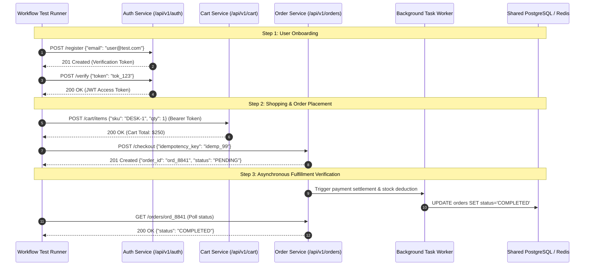

# User Workflow & Journey Testing in Python 🚶

> **Authoritative Sources & Literature:**
> - Martin Fowler: *User Journey Tests & Narrative-Driven Testing* (martinfowler.com)
> - Gerard Meszaros: *xUnit Test Patterns: Refactoring Test Code* (Story Test Pattern)
> - Gojko Adzic: *Specification by Example: How Successful Teams Deliver the Right Software* (Manning)
> - Brian Okken: *Python Testing with pytest* (Chapter 7: Strategy & Architecture)

---

## 1. Conceptual Definition & Core Mental Model

While unit and integration tests verify individual functions and endpoints in isolation, **User Workflow Testing** (also called **Journey Testing** or **Story Testing**) verifies complete, chronological sequences of business interactions.

### The Problem: The "All Green, But Broken" Trap
An application can have 100% passing unit and endpoint tests, yet fail catastrophically in production:
- Step 1 (Register) outputs `user_id` as an integer.
- Step 2 (Create Order) expects `userId` as a UUID string.
- Step 3 (Payment) fails because the authentication token was not properly refreshed after email verification.
Individual tests pass because each mocks the other; the system only breaks when components interact across a **continuous temporal timeline**.

### The Mental Model: The State Machine Journey
A user workflow models a stateful journey traversing multiple services, endpoints, and asynchronous workers:

```
   [ State 0: Anonymous Visitor ]
                 │
                 │ 1. POST /auth/register (Create account)
                 ▼
   [ State 1: Unverified User ]
                 │
                 │ 2. POST /auth/verify-email (Submit token from email)
                 ▼
   [ State 2: Authenticated Customer ]
                 │
                 │ 3. POST /cart/items (Add SKU "CHAIR-01")
                 │ 4. POST /checkout (Submit payment with idempotency key)
                 ▼
   [ State 3: Order Placed (Processing) ]
                 │
                 │ 5. Asynchronous Worker processes payment & inventory
                 ▼
   [ State 4: Order Fulfilled & Shipped ]
                 │
                 │ 6. GET /orders/{id}/invoice (Download receipt PDF)
                 ▼
   [ Journey Complete & Verified! ]
```

---

## 2. Why This Is Critical in Modern Python Backend Engineering

1. **Catching Integration Interface Mismatches**: Uncovers subtle serialization incompatibilities, header expectations, and parameter casing mismatches between microservices.
2. **Validating Cross-Service State Transitions**: Proves that actions taken in Service A (Checkout) correctly propagate to Service B (Inventory) and Service C (Notifications).
3. **Living Documentation of Critical Business Paths**: Serves as the ultimate executable specification for product managers and stakeholders.

---

## 3. Internal Mechanics & Architectural Workflow



---

## 4. Standard Syntax, Signatures & Configuration

### The Typed Workflow Context Pattern
Rather than declaring global variables or storing tokens across independent test functions, encapsulate state in a **Workflow Context Dataclass**:

```python
from dataclasses import dataclass, field
from typing import Optional, Dict

@dataclass
class CustomerJourneyContext:
    email: str
    password: str
    user_id: Optional[str] = None
    access_token: Optional[str] = None
    order_id: Optional[str] = None
    auth_headers: Dict[str, str] = field(default_factory=dict)

    def set_token(self, token: str) -> None:
        self.access_token = token
        self.auth_headers = {"Authorization": f"Bearer {token}"}
```

---

## 5. Execution Lifecycle & Teardown Protocol

Workflow tests should be structured as **atomic, ordered narratives**:
1. **Setup**: Generate isolated test customer credentials (using unique UUIDs).
2. **Execute Steps Sequentially**: Execute Steps 1 through 6 in a single test function or ordered class.
3. **Fail Fast**: If Step 2 fails, abort the test immediately with an explicit descriptive error rather than allowing downstream steps to fail with confusing `NoneType` errors.
4. **Teardown**: Release resources and delete test accounts via API `DELETE` calls.

---

## 6. Scopes, Isolation & System Boundaries

| Step | Endpoint Target | Verification Boundary |
| :--- | :--- | :--- |
| **1. Registration** | `POST /auth/register` | Verifies account creation & uniqueness |
| **2. Verification** | `POST /auth/verify` | Verifies cryptographic token validation |
| **3. Cart Operations** | `POST /cart/items` | Verifies price calculation & session cart |
| **4. Payment / Checkout** | `POST /checkout` | Verifies idempotency & payment gateway |
| **5. Asynchronous Polling**| `GET /orders/{id}` | Verifies background worker processing |
| **6. Document Download** | `GET /orders/{id}/invoice`| Verifies PDF binary streaming |

---

## 7. Pytest Fixture & conftest Integration

```python
# tests/e2e/conftest.py
import pytest
import uuid
from playwright.sync_api import sync_playwright, APIRequestContext

@pytest.fixture
def journey_user():
    """Generates unique user credentials for a fresh customer journey."""
    uid = str(uuid.uuid4())[:8]
    return {
        "email": f"journey_shopper_{uid}@enterprise.com",
        "password": "StrongJourneyPassword123!"
    }
```

---

## 8. Step-by-Step Practical Python 3.10+ Walkthrough

Let's execute a complete 5-step customer purchasing journey against a live application using Playwright's `APIRequestContext`.

```python
# tests/e2e/test_complete_user_journey.py
import time
import pytest
from playwright.sync_api import APIRequestContext, expect
from tests.e2e.conftest import CustomerJourneyContext

def test_full_customer_onboarding_and_purchase_journey(
    api_client: APIRequestContext,
    journey_user: dict
):
    ctx = CustomerJourneyContext(
        email=journey_user["email"],
        password=journey_user["password"]
    )

    # -------------------------------------------------------------
    # Step 1: Account Registration
    # -------------------------------------------------------------
    reg_resp = api_client.post("/api/v1/auth/register", data={
        "email": ctx.email,
        "password": ctx.password
    })
    expect(reg_resp).to_be_ok()
    reg_data = reg_resp.json()
    ctx.user_id = reg_data["user_id"]
    verification_token = reg_data["verification_token"]
    assert ctx.user_id is not None

    # -------------------------------------------------------------
    # Step 2: Email Verification & Token Login
    # -------------------------------------------------------------
    verify_resp = api_client.post("/api/v1/auth/verify-email", data={
        "user_id": ctx.user_id,
        "token": verification_token
    })
    expect(verify_resp).to_be_ok()

    login_resp = api_client.post("/api/v1/auth/token", form={
        "username": ctx.email,
        "password": ctx.password
    })
    expect(login_resp).to_be_ok()
    ctx.set_token(login_resp.json()["access_token"])

    # -------------------------------------------------------------
    # Step 3: Add Items to Shopping Cart
    # -------------------------------------------------------------
    cart_resp = api_client.post(
        "/api/v1/cart/items",
        headers=ctx.auth_headers,
        data={"sku": "MODERN-DESK-01", "quantity": 1}
    )
    expect(cart_resp).to_be_ok()
    cart_data = cart_resp.json()
    assert cart_data["total_cents"] == 35000

    # -------------------------------------------------------------
    # Step 4: Checkout with Idempotency Key
    # -------------------------------------------------------------
    checkout_resp = api_client.post(
        "/api/v1/checkout",
        headers={
            **ctx.auth_headers,
            "Idempotency-Key": f"idemp_{ctx.user_id}_01"
        },
        data={"shipping_address": "123 Innovation Way, Suite 400"}
    )
    expect(checkout_resp).to_be_ok()
    checkout_data = checkout_resp.json()
    ctx.order_id = checkout_data["order_id"]
    assert ctx.order_id is not None

    # -------------------------------------------------------------
    # Step 5: Poll for Asynchronous Order Settlement
    # -------------------------------------------------------------
    # In enterprise systems, payments and inventory settle asynchronously.
    # We poll with a 5-second timeout until status == 'CONFIRMED'.
    settled = False
    for _ in range(10):
        poll_resp = api_client.get(
            f"/api/v1/orders/{ctx.order_id}",
            headers=ctx.auth_headers
        )
        if poll_resp.status == 200 and poll_resp.json()["status"] == "CONFIRMED":
            settled = True
            break
        time.sleep(0.5)

    assert settled is True, f"Order {ctx.order_id} failed to settle within timeout!"

    # -------------------------------------------------------------
    # Step 6: Download Receipt PDF
    # -------------------------------------------------------------
    receipt_resp = api_client.get(
        f"/api/v1/orders/{ctx.order_id}/receipt",
        headers=ctx.auth_headers
    )
    expect(receipt_resp).to_be_ok()
    assert receipt_resp.headers["content-type"] == "application/pdf"
    assert len(receipt_resp.body()) > 100
```

---

## 9. Framework & Ecosystem Integration: Reusable Workflow Helper Classes

To prevent sprawling 200-line test scripts, enterprise suites encapsulate steps into reusable **Workflow Driver DSLs**:

```python
# tests/e2e/drivers/shopper_driver.py
class ShopperDriver:
    """Domain-Specific Language (DSL) driver for shopper workflows."""
    def __init__(self, api_client: APIRequestContext):
        self.api = api_client
        self.headers = {}

    def register_and_login(self, email: str, password: str) -> str:
        reg = self.api.post("/api/v1/auth/register", data={"email": email, "password": password})
        tok = reg.json()["verification_token"]
        self.api.post("/api/v1/auth/verify-email", data={"token": tok})
        login = self.api.post("/api/v1/auth/token", form={"username": email, "password": password})
        token = login.json()["access_token"]
        self.headers = {"Authorization": f"Bearer {token}"}
        return token

    def purchase_sku(self, sku: str) -> str:
        self.api.post("/api/v1/cart/items", headers=self.headers, data={"sku": sku, "quantity": 1})
        resp = self.api.post("/api/v1/checkout", headers=self.headers)
        return resp.json()["order_id"]
```

---

## 10. Real-World Enterprise Scenario: Testing Negative Workflow Interruptions

What happens if the customer cancels mid-journey or their card is declined?

```python
# tests/e2e/test_interrupted_journey.py
def test_abandoned_cart_does_not_deduct_inventory(api_client, journey_user):
    shopper = ShopperDriver(api_client)
    shopper.register_and_login(journey_user["email"], journey_user["password"])

    # Add item to cart, but NEVER checkout (Abandoned cart)
    api_client.post("/api/v1/cart/items", headers=shopper.headers, data={"sku": "LIMITED-WATCH", "quantity": 1})

    # Query public stock
    stock_resp = api_client.get("/api/v1/products/LIMITED-WATCH")
    # Verify stock was NOT deducted simply by adding to cart!
    assert stock_resp.json()["available_quantity"] == 10
```

---

## 11. Anti-Patterns & Code Smells (Before vs After)

### Anti-Pattern 1: Splitting a Continuous Journey Across Multiple Tests with Global State
```python
# ❌ BEFORE: Depending on test execution order (Fragile, breaks with pytest-xdist!)
USER_ID = None

def test_step_1_register():
    global USER_ID
    USER_ID = register_user()  # If this test fails, all subsequent tests crash!

def test_step_2_checkout():
    checkout(USER_ID)

# ✅ AFTER: Self-contained narrative in a single test function
def test_full_onboarding_and_checkout():
    ctx = CustomerJourneyContext(...)
    step_1_register(ctx)
    step_2_checkout(ctx)  # Completely isolated and parallelizable!
```

### Anti-Pattern 2: Hardcoding Non-Deterministic Sleeps
```python
# ❌ BEFORE: time.sleep(10) hoping background worker finishes
# ✅ AFTER: Polling loop with clear timeout and assertion
```

---

## 12. Best Practices & Production Guidelines

1. **Keep Journeys Completely Self-Contained**: Every test function must create its own isolated test users and data. Never rely on state from previous tests.
2. **Use Descriptive Step Comments**: Clearly delineate `# Step 1`, `# Step 2` to make failure logs self-explanatory.
3. **Use Idempotency Keys on Payment Steps**: Verifies that network retries during checkout do not result in double charges.
4. **Poll Asynchronous Workers with Timeouts**: Implement bounded polling loops ($5\text{s}$ max) rather than arbitrary sleep delays.

---

## 13. Comprehensive Trade-Off Matrix

| Testing Level | Scope | Speed | Diagnostic Precision |
| :--- | :--- | :--- | :--- |
| **Workflow / Journey Test** | Multi-service, full lifecycle | $\approx 200 - 500\text{ms}$ | **Whole user experience verified** |
| **Endpoint Test** | Single route operation | $< 1\text{ms}$ | Exact endpoint failure |
| **Unit Test** | Single function / entity | $< 0.05\text{ms}$ | Exact code line |

---

## 14. Diagnostic & Troubleshooting Playbook

### Issue 1: `AssertionError: Order failed to settle within timeout`
- **Root Cause**: The background worker (Celery, ARQ, Redis Queue) was not started in the test environment, or encountered an unhandled exception.
- **Remediation**: Check worker container logs (`docker compose logs worker`) to verify task execution.

### Issue 2: `401 Unauthorized` midway through workflow
- **Root Cause**: The access token expired before the workflow completed, or the authorization header was omitted in a step.
- **Remediation**: Use `CustomerJourneyContext.auth_headers` uniformly across all authenticated requests.

---

## 15. Senior Staff Interview Questions & Answers

### Question 1: How do you design user workflow tests so they can execute reliably in parallel (`pytest -n 8`) without colliding?
**Answer**:
Parallel E2E workflow execution requires **strict data tenancy and identifier isolation**:
1. **Dynamic Namespacing**: Every workflow test generates an ephemeral tenant identifier using `uuid.uuid4()`. All created users, emails, credit card tokens, and orders incorporate this UUID (`user_e2e_a1b2c3d4@company.com`).
2. **Zero Shared Mutable Fixtures**: Tests do not share pre-seeded database rows. If a test needs a product to purchase, it either creates the product via admin API or queries an immutable catalog SKU.
3. **Dynamic Port Forwarding**: Each test worker targets the shared API gateway over HTTP keep-alive sockets without competing for local process resources.

### Question 2: Why are multi-step workflow tests structured inside a single test function rather than separated into multiple `@pytest.mark.order` tests?
**Answer**:
Separating workflow steps across independent test functions using ordering plugins (`@pytest.mark.order(1)`, `@pytest.mark.order(2)`) is an anti-pattern:
1. **Shared Global State**: Step 2 requires global variables (`USER_ID`, `TOKEN`) populated by Step 1, creating tight coupling.
2. **Incompatible with Parallelism**: `pytest-xdist` distributes tests across CPU cores. Step 1 will execute on Worker A while Step 2 runs on Worker B without access to Worker A's memory.
3. **Cascading False Failures**: If Step 1 fails, Steps 2, 3, and 4 fail with confusing null pointer errors rather than indicating that Step 1 was the root cause.
Packaging the entire narrative inside a single function keeps state local to that function call, permits clean parallel execution, and stops immediately at the exact failing step.

---

## 16. Practical Hands-On Exercises & Challenges

### Exercise 1: Build an Account Deactivation Journey
1. Register user.
2. Create two active orders.
3. Call `POST /auth/deactivate`.
4. Assert that subsequent logins return 401, but existing orders remain in the database for compliance.

### Exercise 2: Testing Idempotency in Payment Journeys
1. Dispatch checkout request with `Idempotency-Key: key_1`.
2. Dispatch identical request with `Idempotency-Key: key_1`.
3. Assert both return identical 200 responses, but payment gateway recorded only one charge.

---

## 17. Key Takeaways & Summary

- **Workflow tests verify multi-step business journeys** across time and service boundaries.
- **Enclose workflow state in a typed context object** (`CustomerJourneyContext`) rather than global variables.
- **Poll asynchronous workers with timeouts** to handle background tasks deterministically.
- **Keep each workflow self-contained** to enable safe parallel execution with `pytest-xdist`.

---

## 18. Next Steps & Cross-References

- Next: [Database Verification in E2E Tests](database-verification.md)
- [Playwright for Backend API Testing](playwright-api-testing.md)
- [API vs. Browser E2E Testing](api-vs-browser-e2e.md)
- [Test Environment Management & Orchestration](test-environment-management.md)
- [Transaction Rollback Sandboxing (`SAVEPOINT`)](../integration-testing/transaction-and-rollback.md)
