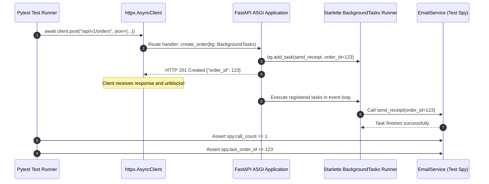

# Async Endpoints & BackgroundTasks Testing in FastAPI ⚡

> **Authoritative Sources & Literature:**
> - Sebastián Ramírez: *FastAPI Background Tasks & Concurrency Tutorial* (fastapi.tiangolo.com/tutorial/background-tasks/)
> - Tom Christie: *Starlette Concurrency Architecture & Threadpool Dispatch* (encode.io/starlette)
> - Gerard Meszaros: *xUnit Test Patterns: Refactoring Test Code* (Asynchronous Test Pattern)
> - Brian Okken: *Python Testing with pytest* (Chapter 5: Mocking and Plugins)

---

## 1. Conceptual Definition & Core Mental Model

FastAPI routes can be declared in two fundamentally different ways:
1. **`async def my_endpoint():`**: Scheduled as an asyncio coroutine executing directly on the **primary asyncio event loop**.
2. **`def my_sync_endpoint():`**: Executed inside an external **threadpool** (managed by `anyio.to_thread.run_sync`) to prevent blocking the event loop with synchronous I/O operations.

### The BackgroundTasks Paradigm
FastAPI includes a built-in `BackgroundTasks` utility that allows backend services to schedule operations to execute **after the HTTP response has been delivered to the client**:
- Sending confirmation emails / SMS notifications.
- Publishing audit log events to Kafka or Redis.
- Asynchronously warming caches or processing analytical metrics.

### The Testing Dilemma
Because background tasks execute *after* the HTTP response returns:
1. How does the test verify that the task executed successfully?
2. What happens if a background task crashes with an unhandled exception?
3. How do we test concurrent race conditions without thread deadlocks?

```
   [ Client Request ] ──► POST /api/v1/orders
                               │
                               ▼
   ┌────────────────────────────────────────────────────────┐
   │ FastAPI Async Endpoint Handler                         │
   │ 1. Create order in PostgreSQL                          │
   │ 2. background_tasks.add_task(send_receipt_email, ...)  │
   │ 3. return {"status": "created"}                        │
   └───────────────────────────┬────────────────────────────┘
                               │
            ┌──────────────────┴──────────────────┐
            ▼                                     ▼
   Deliver HTTP 201 Response             Execute Background Task
   to Test Client immediately            after response finishes
   (HTTP Status: 201 Created)            (send_receipt_email runs)
                                                  │
                                                  ▼
                                         [ Test Verifies Side Effect ]
                                         - Email Spy was called
                                         - Audit table has row
```

---

## 2. Why This Is Critical in Modern Python Backend Engineering

1. **Preventing Silent Background Task Failures**: In production, unhandled exceptions inside background tasks do *not* fail the HTTP response (the client already received `200 OK`). Automated tests must capture and verify background execution.
2. **Verifying Non-Blocking Concurrency**: Verifies that slow asynchronous endpoints (e.g., waiting for external microservices or long database queries) do not block parallel incoming requests.
3. **Ensuring Transaction Visibility**: Background tasks often run with their own database sessions; tests must verify that records committed during the main request are visible to the background worker.

---

## 3. Internal Mechanics & Architectural Workflow



---

## 4. Standard Syntax, Signatures & Configuration

### Declaring BackgroundTasks in FastAPI

```python
from fastapi import FastAPI, BackgroundTasks, status
from pydantic import BaseModel

app = FastAPI()

def send_notification_email(email: str, message: str) -> None:
    # Synchronous or asynchronous worker task
    print(f"Sending email to {email}: {message}")

class OrderCreate(BaseModel):
    email: str
    item: str

@app.post("/orders", status_code=status.HTTP_201_CREATED)
async def create_order(payload: OrderCreate, background_tasks: BackgroundTasks):
    # Schedule task to run after response delivery
    background_tasks.add_task(
        send_notification_email,
        email=payload.email,
        message=f"Order for {payload.item} confirmed!"
    )
    return {"status": "order_accepted"}
```

---

## 5. Execution Lifecycle & Teardown Protocol

When using `httpx.AsyncClient` with `ASGITransport(app=app)`:
- `ASGITransport` fully consumes the ASGI response lifecycle.
- Starlette's `BackgroundTasks` execute **inline on the asyncio event loop** immediately after the response stream completes, before the `client.post()` coroutine returns to the test!
- **This means in `httpx.AsyncClient`, background tasks finish before your test assertions run!** There is no need for fragile `asyncio.sleep(1)` hacks in standard tests!

---

## 6. Scopes, Isolation & System Boundaries

| Task Type | Execution Context | How to Verify in Tests |
| :--- | :--- | :--- |
| **`BackgroundTasks.add_task`** | Same process, runs after response | Test Spy / Mock inspection / DB state |
| **Async Endpoint (`async def`)** | Direct asyncio event loop | Native `await client.get()` |
| **Sync Endpoint (`def`)** | AnyIO worker threadpool | Thread-safe assertions |
| **Distributed Worker (Celery/RQ)** | Out-of-process worker daemon | Message queue verification / E2E test |

---

## 7. Pytest Fixture & conftest Integration

```python
# tests/conftest.py
import pytest
from typing import AsyncGenerator
from httpx import AsyncClient, ASGITransport
from src.main import app

@pytest.fixture
async def async_client() -> AsyncGenerator[AsyncClient, None]:
    transport = ASGITransport(app=app)
    async with AsyncClient(transport=transport, base_url="http://testserver") as client:
        yield client
```

---

## 8. Step-by-Step Practical Python 3.10+ Walkthrough

Let's test an asynchronous notification and audit logging system using `BackgroundTasks`.

### Step 1: Define Application Service and Endpoints
```python
# src/routes/orders_async.py
from dataclasses import dataclass
from typing import List, Protocol
from fastapi import APIRouter, BackgroundTasks, status
from pydantic import BaseModel, EmailStr

router = APIRouter(prefix="/api/v1/orders", tags=["Orders"])

class NotificationService(Protocol):
    async def send_email(self, recipient: str, subject: str) -> None:
        ...

# Global service instance for dependency injection
class MockNotificationService:
    def __init__(self):
        self.dispatched_emails: List[dict] = []

    async def send_email(self, recipient: str, subject: str) -> None:
        self.dispatched_emails.append({"to": recipient, "subject": subject})

notification_service = MockNotificationService()

class OrderRequest(BaseModel):
    email: EmailStr
    amount_cents: int

@router.post("", status_code=status.HTTP_201_CREATED)
async def submit_order(
    payload: OrderRequest,
    background_tasks: BackgroundTasks
):
    order_id = "ord_9981"
    
    # Schedule background notification
    background_tasks.add_task(
        notification_service.send_email,
        recipient=payload.email,
        subject=f"Receipt for Order {order_id}"
    )

    return {"order_id": order_id, "status": "submitted"}
```

### Step 2: Write Tests Verifying Background Tasks Execution
```python
# tests/test_background_tasks.py
import pytest
from httpx import AsyncClient, ASGITransport
from fastapi import FastAPI
from src.routes.orders_async import router, notification_service

app = FastAPI()
app.include_router(router)

@pytest.fixture(autouse=True)
def reset_notifications():
    notification_service.dispatched_emails.clear()
    yield
    notification_service.dispatched_emails.clear()

@pytest.mark.asyncio
async def test_background_task_executes_after_response():
    transport = ASGITransport(app=app)
    async with AsyncClient(transport=transport, base_url="http://test") as client:
        payload = {"email": "customer@enterprise.com", "amount_cents": 7500}
        
        # 1. Dispatch request
        response = await client.post("/api/v1/orders", json=payload)

        # 2. Assert HTTP response was immediate and successful
        assert response.status_code == 201
        assert response.json()["status"] == "submitted"

        # 3. Assert Background Task finished and executed side-effect!
        assert len(notification_service.dispatched_emails) == 1
        dispatched = notification_service.dispatched_emails[0]
        assert dispatched["to"] == "customer@enterprise.com"
        assert "ord_9981" in dispatched["subject"]
```

---

## 9. Framework & Ecosystem Integration: Testing Concurrency with `asyncio.gather`

In asynchronous backends, testing race conditions and connection pooling limits is critical:

```python
# tests/test_concurrent_load.py
import asyncio
import pytest
from httpx import AsyncClient, ASGITransport
from fastapi import FastAPI

counter_app = FastAPI()
ACTIVE_CONNECTIONS = 0
PEAK_CONNECTIONS = 0

@counter_app.get("/concurrency-test")
async def concurrency_endpoint():
    global ACTIVE_CONNECTIONS, PEAK_CONNECTIONS
    ACTIVE_CONNECTIONS += 1
    if ACTIVE_CONNECTIONS > PEAK_CONNECTIONS:
        PEAK_CONNECTIONS = ACTIVE_CONNECTIONS
        
    await asyncio.sleep(0.02)  # Simulate I/O work
    ACTIVE_CONNECTIONS -= 1
    return {"status": "ok"}

@pytest.mark.asyncio
async def test_high_concurrency_non_blocking():
    global PEAK_CONNECTIONS
    PEAK_CONNECTIONS = 0

    transport = ASGITransport(app=counter_app)
    async with AsyncClient(transport=transport, base_url="http://test") as client:
        # Fire 20 requests concurrently in the same event loop
        tasks = [client.get("/concurrency-test") for _ in range(20)]
        responses = await asyncio.gather(*tasks)

        # Assert all 20 finished with 200 OK
        assert len(responses) == 20
        assert all(r.status_code == 200 for r in responses)

        # Assert peak concurrency was achieved (proves non-blocking async execution!)
        assert PEAK_CONNECTIONS > 1
```

---

## 10. Real-World Enterprise Scenario: Capturing Background Task Exceptions

If a background task raises an unhandled exception, FastAPI logs the error to the console but cannot change the already-delivered HTTP response. How do we test that background task exceptions are monitored?

```python
# tests/test_failing_background_task.py
import pytest
import logging
from httpx import AsyncClient, ASGITransport
from fastapi import FastAPI, BackgroundTasks

app = FastAPI()

def buggy_background_job():
    raise ValueError("Database connection lost in background worker!")

@app.post("/trigger-buggy-job")
async def trigger_job(bg: BackgroundTasks):
    bg.add_task(buggy_background_job)
    return {"status": "enqueued"}

@pytest.mark.asyncio
async def test_failing_background_task_is_logged(caplog):
    transport = ASGITransport(app=app)
    async with AsyncClient(transport=transport, base_url="http://test") as client:
        with caplog.at_level(logging.ERROR):
            response = await client.post("/trigger-buggy-job")

            # Response still succeeds (HTTP 200) because task ran after response!
            assert response.status_code == 200

            # But exception is captured by pytest's caplog fixture!
            assert any("Database connection lost in background worker!" in rec.message for rec in caplog.records)
```

---

## 11. Anti-Patterns & Code Smells (Before vs After)

### Anti-Pattern 1: Putting CPU-Bound Operations in `async def`
```python
# ❌ BEFORE: Heavy hashing in async def (Blocks the entire asyncio event loop!)
@app.post("/hash")
async def compute_hash(data: str):
    return hashlib.pbkdf2_hmac("sha256", data.encode(), b"salt", 500_000)

# ✅ AFTER: Use standard def (FastAPI automatically runs it in threadpool)
@app.post("/hash")
def compute_hash(data: str):
    return hashlib.pbkdf2_hmac("sha256", data.encode(), b"salt", 500_000)
```

### Anti-Pattern 2: Arbitrary `asyncio.sleep` to Wait for Background Tasks
```python
# ❌ BEFORE: Sleeping in test hoping task finishes
response = await client.post("/orders")
await asyncio.sleep(2)  # Flaky, slow, anti-pattern!
assert email_sent()

# ✅ AFTER: HTTPX ASGITransport runs BackgroundTasks deterministically before returning!
response = await client.post("/orders")
assert email_sent()  # Immediately available!
```

---

## 12. Best Practices & Production Guidelines

1. **Rely on `ASGITransport` Execution Guarantees**: Starlette processes background tasks prior to closing the ASGI send channel, making assertions deterministic.
2. **Use `caplog` to Monitor Background Failures**: Always verify that background task exceptions are properly intercepted by structured logging.
3. **Use `def` for Synchronous Blocking I/O**: If an endpoint must call a legacy blocking library (e.g. `boto3` or `requests`), declare it as `def` so FastAPI routes it to a worker thread.
4. **Pass Bound State Rather than Mutable Objects**: When scheduling background tasks, pass primitive identifiers (`order_id`) rather than open database connections or mutable ORM entities.

---

## 13. Comprehensive Trade-Off Matrix

| Background Strategy | Latency to Client | Test Verification | Crash Resilience |
| :--- | :--- | :--- | :--- |
| **FastAPI `BackgroundTasks`** | **Zero (Runs after HTTP)** | **Immediate via ASGITransport** | ⚠️ Process restart loses task |
| **Celery / Redis Queue** | Zero | Requires message queue spy | **High (Persisted to Redis/RabbitMQ)** |
| **Inline Await** | High (Client waits) | Trivial (Same request) | Standard HTTP error |

---

## 14. Diagnostic & Troubleshooting Playbook

### Issue 1: `RuntimeError: There is no current event loop in thread 'AnyIO worker thread'`
- **Root Cause**: An endpoint was declared as `def` (running in a worker thread) and attempted to call an async coroutine via `asyncio.run()` or access an async database session.
- **Remediation**: Declare the endpoint as `async def` if interacting with async coroutines, or use `anyio.from_thread.run` to call back into the main event loop.

### Issue 2: Background Task Not Executed in Test
- **Root Cause**: The test used an external HTTP client over a real TCP socket without waiting for the background thread to finish.
- **Remediation**: Switch to `httpx.AsyncClient` with `ASGITransport(app=app)`.

---

## 15. Senior Staff Interview Questions & Answers

### Question 1: How does FastAPI manage the execution difference between `async def` and synchronous `def` endpoints under the hood?
**Answer**:
FastAPI is built on Starlette and AnyIO:
1. **`async def` endpoints**: When a request targets an async endpoint, FastAPI invokes it directly as a coroutine on the main asyncio event loop using `await endpoint(*args)`. This is ideal for non-blocking I/O (async SQLAlchemy, HTTPX, Redis). If CPU-heavy code is executed here, it blocks the entire event loop, halting all other incoming requests.
2. **`def` (sync) endpoints**: When an endpoint is declared without `async`, FastAPI recognizes that it may perform blocking synchronous operations. To prevent stalling the event loop, FastAPI dispatches the call to Starlette's threadpool using `anyio.to_thread.run_sync(endpoint, *args)`.
Testing must verify that synchronous endpoints do not block the event loop and that async endpoints execute concurrently without thread contention.

### Question 2: In what scenarios is FastAPI's `BackgroundTasks` unsuitable, requiring migration to a distributed queue like Celery or ARQ?
**Answer**:
`BackgroundTasks` is unsuitable when:
1. **Long-Running Compute Tasks**: Jobs taking longer than a few seconds should not run in the web server process, as they consume web worker memory and CPU.
2. **Durability & Persistence Guarantees**: `BackgroundTasks` resides purely in process RAM. If the Uvicorn worker crashes, is killed by Kubernetes during a rolling deploy, or exceeds memory limits, all queued background tasks are permanently lost.
3. **Retry & Backoff Requirements**: `BackgroundTasks` provides no built-in exponential backoff, dead-letter queues, or task deduplication.
For mission-critical tasks (payment reconciliation, video transcoding, external webhook delivery), distributed task queues (Celery, ARQ, Temporal) are mandatory.

---

## 16. Practical Hands-On Exercises & Challenges

### Exercise 1: Concurrency Race Condition Test
1. Create a bank account transfer endpoint that reads a balance and updates it.
2. Write a test firing 10 simultaneous transfer requests using `asyncio.gather()`.
3. Assert that without proper database row locks (`SELECT FOR UPDATE`), a race condition occurs, and verify the fix using atomic database operations.

### Exercise 2: Background Audit Log Capture
1. Write a route that schedules an audit log record into a list via `BackgroundTasks`.
2. Write a test asserting that the audit record is present immediately after `await client.post()` completes.

---

## 17. Key Takeaways & Summary

- **FastAPI runs `async def` on the main loop** and `def` inside worker threads.
- **`BackgroundTasks` execute after the HTTP response** is delivered to the client.
- **`httpx.AsyncClient` + `ASGITransport` executes background tasks synchronously** before returning to the test runner, guaranteeing zero test flakiness.
- **Use `caplog` to assert on background task failures**, since background exceptions do not alter the already-delivered HTTP response status code.

---

## 18. Next Steps & Cross-References

- Next: [Lifespan Protocol (`lifespan`) Testing](lifespan-testing.md)
- [TestClient vs. HTTPX AsyncClient](testclient-and-httpx.md)
- [Async Testing Mechanics](../advanced-pytest/async-testing.md)
- [Endpoint & Route Testing](endpoint-testing.md)
- [Dependency Overrides (`app.dependency_overrides`)](dependency-overrides.md)
