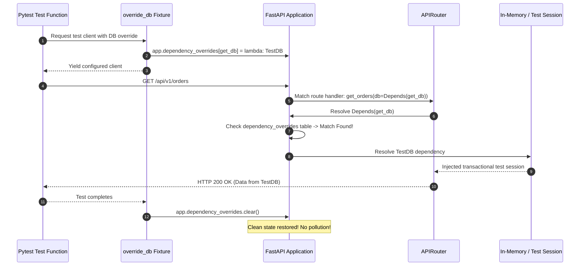

# Dependency Overrides (`app.dependency_overrides`) in FastAPI 💉

> **Authoritative Sources & Literature:**
> - Sebastián Ramírez: *FastAPI Dependency Injection & Testing Dependencies with Overrides* (fastapi.tiangolo.com/tutorial/dependencies/)
> - Martin Fowler: *Inversion of Control Containers and the Dependency Injection Pattern* (martinfowler.com)
> - Gerard Meszaros: *xUnit Test Patterns: Refactoring Test Code* (Test Double & Service Substitutor Patterns)
> - Harry Percival & Bob Gregory: *Architecture Patterns with Python* (Chapter 13: Dependency Injection)

---

## 1. Conceptual Definition & Core Mental Model

In FastAPI, **Dependency Injection (DI)** is a first-class architectural primitive. Route functions declare their required collaborators (database sessions, authenticated users, cache clients, rate limiters) via `Depends(...)`.

### The Problem with Monkeypatching
In traditional frameworks, tests replace dependencies by dynamically patching module attributes (`@patch("src.services.database.Session")`). This approach is notoriously brittle:
1. It breaks if an internal function is renamed, moved, or imported differently.
2. It breaks encapsulation by mutating global module namespaces.
3. It risks test pollution if teardown fails to un-patch the module.

### The Mental Model: The Dependency Registry Lookup
FastAPI resolves every `Depends(dependency_callable)` through an internal dictionary lookup: `app.dependency_overrides`.
- When an endpoint executes, FastAPI inspects `app.dependency_overrides`:
  - If `dependency_callable` exists as a key in `app.dependency_overrides`, FastAPI invokes the **override callable** instead of the original function!
  - If the key is absent, it executes the production callable.

```
                     Incoming HTTP Request
                              │
                              ▼
                   FastAPI Route Resolution
                              │
                              ▼
            Resolve Parameter: db = Depends(get_db)
                              │
                              ▼
                 Check app.dependency_overrides
                              │
               ┌──────────────┴──────────────┐
               │                             │
        Key Found in Overrides?        Key Not Found?
               │                             │
               ▼                             ▼
   [ Execute Test Override ]       [ Execute Production ]
   (Yields SAVEPOINT AsyncSession) (Yields Production DB Pool)
               │                             │
               └──────────────┬──────────────┘
                              ▼
                   Execute Endpoint Coroutine
```

---

## 2. Why This Is Critical in Modern Python Backend Engineering

1. **Clean Test Double Swapping**: You can substitute heavyweight production infrastructure (PostgreSQL clusters, Redis sentinels, AWS S3 clients) with in-memory fakes or transactional test harnesses without modifying application code.
2. **Deterministic Role & Identity Impersonation**: Easily test complex permission matrices by injecting mock `CurrentUser` entities with varying roles (`ADMIN`, `FINANCE_MANAGER`, `AUDITOR`) in single lines of test code.
3. **Resilient to Refactoring**: Dependency overrides reference the callable object directly in memory (`app.dependency_overrides[get_db] = ...`). Unlike string-based monkeypatching, Python IDEs and static analyzers track references through renames and package reorganizations.

---

## 3. Internal Mechanics & Architectural Workflow



---

## 4. Standard Syntax, Signatures & Configuration

### Overriding a Simple Dependency

```python
from fastapi import FastAPI, Depends

app = FastAPI()

def get_current_user():
    # Production implementation: Decodes JWT from Authorization header
    raise NotImplementedError("Production Auth Required")

@app.get("/profile")
def get_profile(user: dict = Depends(get_current_user)):
    return {"user": user["username"]}

# In automated test:
def test_profile_with_override():
    # 1. Register Override
    app.dependency_overrides[get_current_user] = lambda: {"username": "ada_lovelace"}

    # 2. Execute Test
    ...

    # 3. Teardown: ALWAYS clear overrides!
    app.dependency_overrides.clear()
```

---

## 5. Execution Lifecycle & Teardown Protocol

> [!CAUTION]
> **The Override Persistence Trap**: `app.dependency_overrides` is a mutable dictionary on the `FastAPI` instance.
> If a test sets `app.dependency_overrides[get_user] = ...` and does **not** clean it up, that override persists into all subsequent tests across the test session, causing subtle, cascading test pollution!

### The Golden Fixture Teardown Pattern:
Always encapsulate dependency overrides inside a **post-yield fixture**:

```python
# tests/conftest.py
import pytest
from src.main import app

@pytest.fixture(autouse=True)
def reset_dependency_overrides():
    """Guarantees that every test starts and finishes with clean dependency overrides."""
    app.dependency_overrides.clear()
    yield
    app.dependency_overrides.clear()
```

---

## 6. Scopes, Isolation & System Boundaries

| Dependency Type | Production Implementation | Test Override Strategy |
| :--- | :--- | :--- |
| **Relational Database** | Production connection pool (`create_async_engine`) | Yields transactional `SAVEPOINT` session |
| **Authentication (AuthN)** | Decodes JWT, validates with Auth0/Okta | Returns pre-constructed `CurrentUser` dataclass |
| **Object Storage (S3)** | Outbound boto3 HTTP upload to AWS S3 | In-memory dictionary / LocalStack mock |
| **Payment Gateway** | Live Stripe API client | Test double implementing `PaymentGateway` protocol |
| **Time Provider** | System clock `datetime.now()` | Frozen clock fixture (`time-machine`) |

---

## 7. Pytest Fixture & conftest Integration

Here is a modular suite of dependency override fixtures for enterprise applications:

```python
# tests/fixtures/dependency_fixtures.py
import pytest
from typing import Callable, Generator
from sqlalchemy.ext.asyncio import AsyncSession
from src.main import app
from src.database import get_db
from src.security import get_current_user, CurrentUser

@pytest.fixture
def override_db(db_session: AsyncSession) -> Generator[None, None, None]:
    """Injects the transactional test database session into FastAPI."""
    app.dependency_overrides[get_db] = lambda: db_session
    yield
    app.dependency_overrides.pop(get_db, None)

@pytest.fixture
def override_user() -> Callable[..., Generator[None, None, None]]:
    """Factory fixture for injecting arbitrary user identities."""
    def _override(user: CurrentUser):
        app.dependency_overrides[get_current_user] = lambda: user
    return _override
```

---

## 8. Step-by-Step Practical Python 3.10+ Walkthrough

Let's test an e-commerce checkout endpoint that depends on:
1. A Database Session (`get_db`).
2. An Authenticated User (`get_current_user`).
3. An External Payment Processor (`get_payment_gateway`).

### Step 1: Define Application Dependencies and Route
```python
# src/checkout_service.py
from dataclasses import dataclass
from typing import Protocol
from fastapi import FastAPI, Depends, HTTPException, status

@dataclass(frozen=True)
class User:
    id: str
    email: str
    is_vip: bool

class PaymentGateway(Protocol):
    async def charge(self, user_id: str, amount_cents: int) -> bool:
        ...

# Production dependencies
def get_current_user() -> User:
    raise NotImplementedError("Real JWT validation")

def get_payment_gateway() -> PaymentGateway:
    raise NotImplementedError("Real Stripe client")

def get_db():
    raise NotImplementedError("Real Database Engine")

app = FastAPI()

@app.post("/api/v1/checkout")
async def checkout(
    amount_cents: int,
    user: User = Depends(get_current_user),
    payment: PaymentGateway = Depends(get_payment_gateway),
    db: any = Depends(get_db)
):
    # VIP discount: 10% off
    final_amount = int(amount_cents * 0.9) if user.is_vip else amount_cents
    
    success = await payment.charge(user.id, final_amount)
    if not success:
        raise HTTPException(
            status_code=status.HTTP_402_PAYMENT_REQUIRED,
            detail="Payment transaction was declined"
        )

    return {
        "status": "confirmed",
        "charged_cents": final_amount,
        "customer": user.email
    }
```

### Step 2: Build Fake Collaborators and Write Tests
```python
# tests/test_checkout_overrides.py
import pytest
from httpx import AsyncClient, ASGITransport
from src.checkout_service import app, get_current_user, get_payment_gateway, get_db, User

class FakePaymentGateway:
    def __init__(self, should_succeed: bool = True):
        self.should_succeed = should_succeed
        self.recorded_charges: list[tuple[str, int]] = []

    async def charge(self, user_id: str, amount_cents: int) -> bool:
        self.recorded_charges.append((user_id, amount_cents))
        return self.should_succeed

@pytest.fixture
async def client():
    transport = ASGITransport(app=app)
    async with AsyncClient(transport=transport, base_url="http://test") as c:
        yield c

@pytest.mark.asyncio
async def test_standard_customer_checkout_success(client: AsyncClient):
    fake_gateway = FakePaymentGateway(should_succeed=True)
    standard_user = User(id="usr_std_1", email="standard@test.com", is_vip=False)

    # Apply overrides
    app.dependency_overrides[get_current_user] = lambda: standard_user
    app.dependency_overrides[get_payment_gateway] = lambda: fake_gateway
    app.dependency_overrides[get_db] = lambda: None  # Dummy DB

    try:
        response = await client.post("/api/v1/checkout", params={"amount_cents": 10000})

        assert response.status_code == 200
        data = response.json()
        assert data["status"] == "confirmed"
        assert data["charged_cents"] == 10000  # Full price
        assert data["customer"] == "standard@test.com"

        # Verify spy on payment gateway
        assert fake_gateway.recorded_charges == [("usr_std_1", 10000)]
    finally:
        app.dependency_overrides.clear()

@pytest.mark.asyncio
async def test_vip_customer_receives_ten_percent_discount(client: AsyncClient):
    fake_gateway = FakePaymentGateway(should_succeed=True)
    vip_user = User(id="usr_vip_99", email="vip@test.com", is_vip=True)

    app.dependency_overrides[get_current_user] = lambda: vip_user
    app.dependency_overrides[get_payment_gateway] = lambda: fake_gateway
    app.dependency_overrides[get_db] = lambda: None

    try:
        response = await client.post("/api/v1/checkout", params={"amount_cents": 10000})

        assert response.status_code == 200
        data = response.json()
        assert data["charged_cents"] == 9000  # 10% discount applied!
        assert fake_gateway.recorded_charges == [("usr_vip_99", 9000)]
    finally:
        app.dependency_overrides.clear()

@pytest.mark.asyncio
async def test_declined_payment_returns_402(client: AsyncClient):
    fake_gateway = FakePaymentGateway(should_succeed=False)  # Force card decline!
    standard_user = User(id="usr_fail_1", email="declined@test.com", is_vip=False)

    app.dependency_overrides[get_current_user] = lambda: standard_user
    app.dependency_overrides[get_payment_gateway] = lambda: fake_gateway
    app.dependency_overrides[get_db] = lambda: None

    try:
        response = await client.post("/api/v1/checkout", params={"amount_cents": 5000})

        assert response.status_code == 402
        assert "Payment transaction was declined" in response.json()["detail"]
    finally:
        app.dependency_overrides.clear()
```

---

## 9. Framework & Ecosystem Integration: Nested Sub-Dependencies

FastAPI supports hierarchical dependencies: Dependency A can depend on Dependency B (`Depends(get_b)`), which depends on Dependency C (`Depends(get_c)`).

```
[ Route Handler ] ──► Depends(get_order_service)
                             │
                             ▼
                    Depends(get_repository)
                             │
                             ▼
                    Depends(get_db_session)
```

### The Architectural Advantage of Sub-Dependency Overrides
You do **not** need to override the entire chain (`get_order_service`). You only override the leaf node:
```python
# Overriding just the leaf node automatically cascades up the dependency graph!
app.dependency_overrides[get_db_session] = lambda: test_session
```
FastAPI traverses the graph, detects the override at the leaf, injects `test_session` into `get_repository`, and delivers the assembled `order_service` to the route!

---

## 10. Real-World Enterprise Scenario: Context-Managed Overrides via Python `contextlib`

To prevent boilerplate `try...finally: app.dependency_overrides.clear()`, enterprise test suites wrap overrides inside a reusable context manager:

```python
# tests/utils/override_manager.py
from contextlib import contextmanager
from typing import Mapping, Callable, Any
from fastapi import FastAPI

@contextmanager
def dependency_overrides_ctx(app: FastAPI, overrides: Mapping[Callable[..., Any], Callable[..., Any]]):
    """
    Context manager that safely applies and reverts dependency overrides.
    Usage:
        with dependency_overrides_ctx(app, {get_db: lambda: test_session}):
            response = await client.get(...)
    """
    original_overrides = dict(app.dependency_overrides)
    app.dependency_overrides.update(overrides)
    try:
        yield
    finally:
        app.dependency_overrides = original_overrides
```

---

## 11. Anti-Patterns & Code Smells (Before vs After)

### Anti-Pattern 1: Leaking Overrides Between Tests
```python
# ❌ BEFORE: Overriding without clearing (Cascading test pollution!)
def test_admin_route():
    app.dependency_overrides[get_user] = lambda: AdminUser()
    client.get("/admin")
    # Missing cleanup! Next test running as regular user will accidentally run as Admin!

# ✅ AFTER: Automatic fixture cleanup
@pytest.fixture(autouse=True)
def clean_overrides():
    yield
    app.dependency_overrides.clear()
```

### Anti-Pattern 2: Monkeypatching Function Inside Route Module
```python
# ❌ BEFORE: Brittle monkeypatching of module globals
monkeypatch.setattr("src.routes.orders.get_db", mock_db)  # Bypasses FastAPI DI engine!

# ✅ AFTER: Using FastAPI's official dependency_overrides dictionary
app.dependency_overrides[get_db] = lambda: mock_db
```

---

## 12. Best Practices & Production Guidelines

1. **Always Use `autouse=True` Cleanup**: Include an autouse fixture in root `conftest.py` that invokes `app.dependency_overrides.clear()`.
2. **Override at the Leaf Level**: When testing business services, override leaf dependencies (database sessions, HTTP clients) rather than top-level application services.
3. **Use Typesafe Test Doubles**: Ensure your test fakes implement the exact same `typing.Protocol` or abstract base class as the production dependency.
4. **Prefer Fixture Packaging**: Wrap common overrides (`authenticated_client`, `admin_client`, `anonymous_client`) into reusable fixtures.

---

## 13. Comprehensive Trade-Off Matrix

| Strategy | Refactoring Safety | Speed | Cleanliness | Granularity |
| :--- | :--- | :--- | :--- | :--- |
| **`app.dependency_overrides`** | **Highest (Tracked by IDE)** | **$< 0.1\text{ms}$** | **High (Dictionary managed)** | **High (Per callable)** |
| **`unittest.mock.patch`** | Low (String path breakage) | $\approx 0.5\text{ms}$ | Moderate | Low (Patches entire module) |
| **Global Config Flag** | Low (Pollutes runtime state) | $< 0.1\text{ms}$ | Poor | Low (All or nothing) |

---

## 14. Diagnostic & Troubleshooting Playbook

### Issue 1: `app.dependency_overrides` has no effect on endpoint
- **Root Cause 1**: The route does not use `Depends(target_func)`. Instead, it called `target_func()` directly inside the endpoint body.
- **Root Cause 2**: Different module imports created two distinct function instances in memory (e.g. `from src.deps import get_db` vs `from .deps import get_db`).
- **Remediation**: Always verify that the function passed as a key to `dependency_overrides` is the exact same object reference referenced in `Depends(...)`.

### Issue 2: `MissingGreenlet` error during async session override
- **Root Cause**: The overridden dependency yielded a synchronous session or closed the session before the route coroutine finished streaming data.
- **Remediation**: Ensure the override callable returns an async generator or matching async session context.

---

## 15. Senior Staff Interview Questions & Answers

### Question 1: How does FastAPI resolve hierarchical dependency graphs, and how do dependency overrides interact with sub-dependencies?
**Answer**:
FastAPI uses a recursive DAG (Directed Acyclic Graph) solver to resolve dependencies declared via `Depends`:
1. When a route is invoked, FastAPI inspects the route parameters and builds a tree of all `Depends()` calls.
2. For each node in the dependency tree, FastAPI first checks if the callable key is present in `app.dependency_overrides`.
3. If an override is found, FastAPI halts recursion on that branch and executes the override callable.
4. If no override is found, FastAPI recursively resolves all child dependencies of that callable before executing it.
5. If a sub-dependency is shared across multiple branches (e.g., three different services all depend on `get_db`), FastAPI by default resolves it **only once per request** (due to `use_cache=True`) and passes the cached instance to all dependants.
Because overrides take precedence at any node in the tree, substituting a low-level leaf node (like `get_db`) automatically propagates the test double through all parent services.

### Question 2: Why is `app.dependency_overrides` preferred over Python's built-in `unittest.mock.patch` in enterprise test suites?
**Answer**:
`app.dependency_overrides` is superior because:
1. **Architectural Alignment**: It uses the framework's native Inversion of Control mechanism rather than hacking Python's runtime symbol tables.
2. **Zero Fragility**: `patch("my_app.routes.user.get_db")` relies on string paths that break silently when files are relocated or when imports change from `import foo` to `from bar import foo`. `dependency_overrides[get_db]` uses direct object identity, which is verified by IDEs and compiler type-checkers.
3. **Thread and Loop Safety**: Monkeypatching mutates global module state, causing race conditions in multi-threaded test runners. `dependency_overrides` is scoped specifically to the FastAPI instance.

---

## 16. Practical Hands-On Exercises & Challenges

### Exercise 1: Multi-Role Auth Matrix with Overrides
1. Create a protected admin endpoint `/api/v1/admin/purge-cache`.
2. Write a parameterized pytest test that injects three distinct user roles (`GUEST`, `MEMBER`, `ADMIN`) via `app.dependency_overrides[get_current_user]`.
3. Assert that `GUEST` and `MEMBER` receive `403 Forbidden`, while `ADMIN` receives `200 OK`.

### Exercise 2: Implementing a Scoped Override Fixture
1. Write a custom pytest fixture named `override_dependency(target, replacement)` that applies an override and automatically reverts it upon test completion.
2. Verify that two consecutive tests do not leak overrides to one another.

---

## 17. Key Takeaways & Summary

- **`app.dependency_overrides` is FastAPI's cleanest testing mechanism**, providing native, type-safe collaborator replacement.
- **Always clean up overrides** via `app.dependency_overrides.clear()` in an autouse fixture or context manager.
- **Sub-dependencies cascade cleanly**: Overriding a low-level database or clock dependency automatically propagates through all higher-level services.
- **Eliminates brittle monkeypatching**, maintaining refactoring safety across large codebases.

---

## 18. Next Steps & Cross-References

- Next: [Request Validation & Pydantic v2 Error Testing](request-validation.md)
- [Response Validation & Data Leak Prevention](response-validation.md)
- [Endpoint & Route Testing](endpoint-testing.md)
- [JWT Security & OAuth2 Testing](jwt-testing.md)
- [Dependency Injection Testing](../architecture-and-testing/dependency-injection.md)
