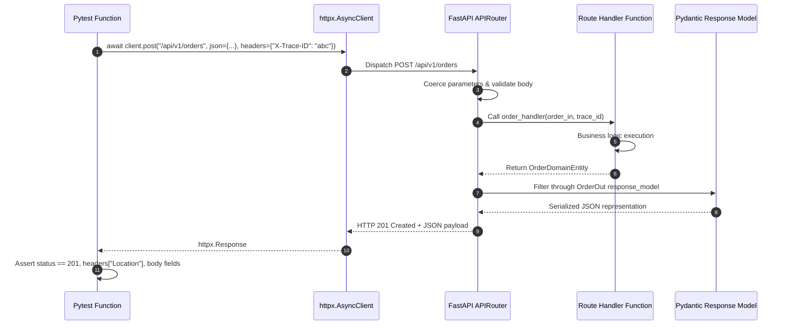

# Endpoint & Route Testing in FastAPI 🛣️

> **Authoritative Sources & Literature:**
> - Sebastián Ramírez: *FastAPI Path Parameters & Query Parameters* (fastapi.tiangolo.com/tutorial/path-params/)
> - Fielding, Roy: *Architectural Styles and the Design of Network-based Software Architectures* (REST Architectural Constraints)
> - Gerard Meszaros: *xUnit Test Patterns: Refactoring Test Code* (Round-Trip Test Pattern)
> - Brian Okken: *Python Testing with pytest* (Chapter 5: Parametrization & Fixtures)

---

## 1. Conceptual Definition & Core Mental Model

**Endpoint Testing** verifies the public HTTP surface of a FastAPI service. It validates that routes adhere to HTTP semantics, REST constraints, and application contracts:
- **HTTP Methods**: GET (safe, idempotent), POST (mutative, creates resource), PUT (idempotent replacement), PATCH (partial mutation), DELETE (idempotent removal).
- **HTTP Status Codes**: Precise signaling (`200 OK`, `201 Created`, `204 No Content`, `400 Bad Request`, `404 Not Found`, `409 Conflict`).
- **Parameter Binding**: Automatic deserialization and coercion of path variables, query strings, headers, cookies, and JSON request bodies.

### The Mental Model: The Inbound Protocol Pipeline
Every incoming HTTP request traverses FastAPI's pipeline:
1. **Route Resolution**: Matches URL path and HTTP method against the router table.
2. **Parameter Coercion**: Extracts path, query, header, and cookie values, converting strings into Python types (integers, UUIDs, datetimes, Enums).
3. **Pydantic Validation**: Validates payloads against schemas.
4. **Endpoint Execution**: Invokes route function with resolved dependencies.
5. **Response Serialization**: Filters and serializes output through `response_model`.

```
                    Incoming HTTP Request
                              │
                              ▼
               ┌──────────────────────────────┐
               │    1. Route Dispatching      │ (Path & Verb Match)
               └──────────────┬───────────────┘
                              ▼
               ┌──────────────────────────────┐
               │   2. Parameter Extraction    │ (Path, Query, Headers, Cookies)
               └──────────────┬───────────────┘
                              ▼
               ┌──────────────────────────────┐
               │   3. Pydantic Deserializer   │ (Type Coercion & Invariant Check)
               └──────────────┬───────────────┘
                              ▼
               ┌──────────────────────────────┐
               │ 4. Endpoint Execution Logic  │ (Async Handler / Services)
               └──────────────┬───────────────┘
                              ▼
               ┌──────────────────────────────┐
               │ 5. Response Model Serializer │ (Exclusions, Aliases, Status Code)
               └──────────────┬───────────────┘
                              ▼
                     Outgoing HTTP Response
```

---

## 2. Why This Is Critical in Modern Python Backend Engineering

1. **Strict REST Contract Compliance**: Guarantees that clients receive proper status codes (e.g., `201 Created` with a `Location` header on POST, or `204 No Content` with an empty body on DELETE).
2. **Preventing Query & Path Parameter Coercion Bugs**: Verifies that FastAPI correctly casts strings like `"123"` to `int`, or `"true"` to `bool`, and properly handles multi-valued query parameters like `?tag=backend&tag=python`.
3. **Idempotency Verification**: Proves that executing a `PUT` or `DELETE` request multiple times results in the identical system state.

---

## 3. Internal Mechanics & Architectural Workflow



---

## 4. Standard Syntax, Signatures & Configuration

### Prerequisites
```bash
pip install httpx fastapi pytest-asyncio pydantic
```

### Core Testing API Signatures with HTTPX

```python
# 1. Query Parameters
response = await client.get("/items", params={"limit": 20, "offset": 0, "tags": ["python", "api"]})

# 2. Path Parameters (Coerced to types)
response = await client.get(f"/items/{item_id}")

# 3. Custom Headers & Cookies
response = await client.post(
    "/items",
    json={"name": "Widget"},
    headers={"X-Tenant-ID": "tenant_123", "User-Agent": "TestSuite/1.0"},
    cookies={"session_id": "sess_abc987"}
)

# 4. Status Code & Header Assertions
assert response.status_code == 201
assert response.headers["Content-Type"] == "application/json"
assert response.headers["X-Request-ID"] is not None
```

---

## 5. Execution Lifecycle & Teardown Protocol

Endpoint tests should verify the complete **Round-Trip Lifecycle**:
1. **POST**: Create resource $\to$ Assert `201 Created` and capture `id`.
2. **GET**: Retrieve resource $\to$ Assert `200 OK` and verify exact field persistence.
3. **PATCH**: Partially update resource $\to$ Assert `200 OK` and verify changed fields.
4. **DELETE**: Remove resource $\to$ Assert `204 No Content`.
5. **GET (Follow-up)**: Verify deletion $\to$ Assert `404 Not Found`.

---

## 6. Scopes, Isolation & System Boundaries

| HTTP Verb | Semantic Role | Expected Status | Idempotent? | Safe (Read-Only)? |
| :--- | :--- | :--- | :--- | :--- |
| **GET** | Read resource representation | `200 OK` | ✅ Yes | ✅ Yes |
| **POST** | Create resource or execute command | `201 Created` / `200 OK` | ❌ No | ❌ No |
| **PUT** | Completely replace resource | `200 OK` / `201 Created` | ✅ Yes | ❌ No |
| **PATCH** | Partially update resource | `200 OK` | ❌ No (usually) | ❌ No |
| **DELETE** | Remove resource | `204 No Content` / `200 OK` | ✅ Yes | ❌ No |

---

## 7. Pytest Fixture & conftest Integration

```python
# tests/conftest.py
import pytest
from httpx import AsyncClient, ASGITransport
from typing import AsyncGenerator
from src.main import app

@pytest.fixture
async def api_client() -> AsyncGenerator[AsyncClient, None]:
    """Provides a fresh, asynchronous HTTP client bound to FastAPI via ASGITransport."""
    transport = ASGITransport(app=app)
    async with AsyncClient(transport=transport, base_url="http://testserver") as client:
        yield client
```

---

## 8. Step-by-Step Practical Python 3.10+ Walkthrough

Let's build and test a comprehensive CRUD API managing **Products** with path parameters, query filters, pagination, and status codes.

### Step 1: Define the Domain Model, Schemas, and Router
```python
# src/routes/products.py
from enum import Enum
from typing import List, Optional
from uuid import UUID, uuid4
from fastapi import APIRouter, HTTPException, Query, Header, status
from pydantic import BaseModel, Field

router = APIRouter(prefix="/api/v1/products", tags=["Products"])

class ProductCategory(str, Enum):
    ELECTRONICS = "electronics"
    BOOKS = "books"
    CLOTHING = "clothing"

class ProductCreate(BaseModel):
    name: str = Field(..., min_length=2, max_length=100)
    category: ProductCategory
    price_cents: int = Field(..., gt=0)

class ProductUpdate(BaseModel):
    name: Optional[str] = Field(None, min_length=2)
    price_cents: Optional[int] = Field(None, gt=0)

class ProductResponse(BaseModel):
    id: UUID
    name: str
    category: ProductCategory
    price_cents: int

# In-memory database for endpoint demonstration
PRODUCTS_DB: dict[UUID, ProductResponse] = {}

@router.post("", status_code=status.HTTP_201_CREATED, response_model=ProductResponse)
async def create_product(payload: ProductCreate):
    product_id = uuid4()
    product = ProductResponse(
        id=product_id,
        name=payload.name,
        category=payload.category,
        price_cents=payload.price_cents
    )
    PRODUCTS_DB[product_id] = product
    return product

@router.get("", response_model=List[ProductResponse])
async def list_products(
    category: Optional[ProductCategory] = None,
    min_price: Optional[int] = Query(None, ge=0),
    max_price: Optional[int] = Query(None, ge=0),
    limit: int = Query(10, ge=1, le=50),
    offset: int = Query(0, ge=0)
):
    results = list(PRODUCTS_DB.values())
    if category:
        results = [p for p in results if p.category == category]
    if min_price is not None:
        results = [p for p in results if p.price_cents >= min_price]
    if max_price is not None:
        results = [p for p in results if p.price_cents <= max_price]
    return results[offset:offset + limit]

@router.get("/{product_id}", response_model=ProductResponse)
async def get_product(product_id: UUID):
    if product_id not in PRODUCTS_DB:
        raise HTTPException(
            status_code=status.HTTP_404_NOT_FOUND,
            detail=f"Product with id {product_id} not found"
        )
    return PRODUCTS_DB[product_id]

@router.patch("/{product_id}", response_model=ProductResponse)
async def partial_update_product(product_id: UUID, payload: ProductUpdate):
    if product_id not in PRODUCTS_DB:
        raise HTTPException(status_code=status.HTTP_404_NOT_FOUND, detail="Product not found")
    
    existing = PRODUCTS_DB[product_id]
    update_data = payload.model_dump(exclude_unset=True)
    updated = existing.model_copy(update=update_data)
    PRODUCTS_DB[product_id] = updated
    return updated

@router.delete("/{product_id}", status_code=status.HTTP_204_NO_CONTENT)
async def delete_product(product_id: UUID):
    if product_id not in PRODUCTS_DB:
        raise HTTPException(status_code=status.HTTP_404_NOT_FOUND, detail="Product not found")
    del PRODUCTS_DB[product_id]
    return None
```

### Step 2: Write the Complete Lifecycle Endpoint Test Suite
```python
# tests/test_products_endpoints.py
import pytest
from uuid import uuid4
from httpx import AsyncClient, ASGITransport
from fastapi import FastAPI
from src.routes.products import router, PRODUCTS_DB

app = FastAPI()
app.include_router(router)

@pytest.fixture(autouse=True)
def clean_db():
    PRODUCTS_DB.clear()
    yield
    PRODUCTS_DB.clear()

@pytest.fixture
async def client():
    transport = ASGITransport(app=app)
    async with AsyncClient(transport=transport, base_url="http://test") as c:
        yield c

@pytest.mark.asyncio
async def test_create_product_success(client: AsyncClient):
    payload = {
        "name": "Mechanical Keyboard",
        "category": "electronics",
        "price_cents": 12900
    }
    response = await client.post("/api/v1/products", json=payload)

    assert response.status_code == 201
    data = response.json()
    assert data["name"] == "Mechanical Keyboard"
    assert data["category"] == "electronics"
    assert data["price_cents"] == 12900
    assert "id" in data

@pytest.mark.asyncio
async def test_get_product_by_id(client: AsyncClient):
    # Setup: Create product
    create_resp = await client.post("/api/v1/products", json={
        "name": "Clean Code",
        "category": "books",
        "price_cents": 4500
    })
    product_id = create_resp.json()["id"]

    # Action: Retrieve
    get_resp = await client.get(f"/api/v1/products/{product_id}")
    assert get_resp.status_code == 200
    assert get_resp.json()["id"] == product_id
    assert get_resp.json()["name"] == "Clean Code"

@pytest.mark.asyncio
async def test_get_product_not_found(client: AsyncClient):
    random_uuid = str(uuid4())
    response = await client.get(f"/api/v1/products/{random_uuid}")

    assert response.status_code == 404
    assert f"Product with id {random_uuid} not found" in response.json()["detail"]

@pytest.mark.asyncio
async def test_invalid_uuid_path_parameter_returns_422(client: AsyncClient):
    # Passing an invalid string instead of a UUID
    response = await client.get("/api/v1/products/not-a-valid-uuid")

    assert response.status_code == 422
    data = response.json()
    assert data["detail"][0]["loc"] == ["path", "product_id"]
    assert "uuid" in data["detail"][0]["type"]

@pytest.mark.asyncio
async def test_query_parameter_filtering_and_pagination(client: AsyncClient):
    # Seed 3 products
    await client.post("/api/v1/products", json={"name": "Book A", "category": "books", "price_cents": 1000})
    await client.post("/api/v1/products", json={"name": "Book B", "category": "books", "price_cents": 2000})
    await client.post("/api/v1/products", json={"name": "Shirt", "category": "clothing", "price_cents": 1500})

    # Filter by books with min_price=1500
    response = await client.get(
        "/api/v1/products",
        params={"category": "books", "min_price": 1500, "limit": 10, "offset": 0}
    )

    assert response.status_code == 200
    items = response.json()
    assert len(items) == 1
    assert items[0]["name"] == "Book B"

@pytest.mark.asyncio
async def test_patch_partial_update(client: AsyncClient):
    # Setup
    create_resp = await client.post("/api/v1/products", json={
        "name": "T-Shirt",
        "category": "clothing",
        "price_cents": 2500
    })
    product_id = create_resp.json()["id"]

    # Action: Update price only
    patch_resp = await client.patch(f"/api/v1/products/{product_id}", json={"price_cents": 2999})
    assert patch_resp.status_code == 200
    data = patch_resp.json()
    assert data["price_cents"] == 2999
    assert data["name"] == "T-Shirt"  # Preserved!

@pytest.mark.asyncio
async def test_delete_product_roundtrip(client: AsyncClient):
    # Setup
    create_resp = await client.post("/api/v1/products", json={
        "name": "Old Monitor",
        "category": "electronics",
        "price_cents": 5000
    })
    product_id = create_resp.json()["id"]

    # Delete
    del_resp = await client.delete(f"/api/v1/products/{product_id}")
    assert del_resp.status_code == 204
    assert del_resp.content == b""  # 204 MUST have empty body!

    # Verify gone
    get_resp = await client.get(f"/api/v1/products/{product_id}")
    assert get_resp.status_code == 404
```

---

## 9. Framework & Ecosystem Integration: Testing Custom Headers & Cookies

```python
# src/routes/headers_cookies.py
from fastapi import APIRouter, Header, Cookie, Response, HTTPException

auth_router = APIRouter()

@auth_router.get("/api/v1/secure-ping")
async def secure_ping(
    x_api_key: str = Header(..., alias="X-API-Key"),
    session_id: str = Cookie(None)
):
    if x_api_key != "secret-token-999":
        raise HTTPException(status_code=401, detail="Invalid API Key")
    return {"status": "authenticated", "session": session_id}

@auth_router.post("/api/v1/set-cookie")
async def set_cookie_endpoint(response: Response):
    response.set_cookie(key="tracking_id", value="trk_777", httponly=True, secure=True)
    return {"message": "cookie set"}
```

### Testing the Header & Cookie Endpoint
```python
# tests/test_headers_cookies.py
import pytest
from httpx import AsyncClient, ASGITransport
from fastapi import FastAPI
from src.routes.headers_cookies import auth_router

app = FastAPI()
app.include_router(auth_router)

@pytest.mark.asyncio
async def test_header_and_cookie_evaluation():
    transport = ASGITransport(app=app)
    async with AsyncClient(transport=transport, base_url="http://test") as client:
        # 1. Missing header returns 422
        resp = await client.get("/api/v1/secure-ping")
        assert resp.status_code == 422

        # 2. Invalid header returns 401
        resp = await client.get("/api/v1/secure-ping", headers={"X-API-Key": "wrong"})
        assert resp.status_code == 401

        # 3. Valid header with cookie returns 200
        resp = await client.get(
            "/api/v1/secure-ping",
            headers={"X-API-Key": "secret-token-999"},
            cookies={"session_id": "sess_live_123"}
        )
        assert resp.status_code == 200
        assert resp.json()["session"] == "sess_live_123"

@pytest.mark.asyncio
async def test_response_cookie_inspection():
    transport = ASGITransport(app=app)
    async with AsyncClient(transport=transport, base_url="http://test") as client:
        resp = await client.post("/api/v1/set-cookie")
        assert resp.status_code == 200
        assert "tracking_id" in resp.cookies
        assert resp.cookies["tracking_id"] == "trk_777"
```

---

## 10. Real-World Enterprise Scenario: Testing Query Parameter List Deserialization

When building search or reporting APIs, clients transmit repeated query parameters (e.g. `?status=pending&status=active`):

```python
@app.get("/api/v1/reports")
async def generate_report(statuses: list[str] = Query(default=["all"])):
    return {"queried_statuses": statuses}

# Test asserting multi-value query parameter dispatch:
@pytest.mark.asyncio
async def test_multi_value_query_params(client: AsyncClient):
    response = await client.get("/api/v1/reports", params=[("statuses", "active"), ("statuses", "pending")])
    assert response.status_code == 200
    assert response.json()["queried_statuses"] == ["active", "pending"]
```

---

## 11. Anti-Patterns & Code Smells (Before vs After)

### Anti-Pattern 1: Returning HTTP 200 for Mutative POST Actions
```python
# ❌ BEFORE: Defaulting to 200 OK for resource creation (Violates REST conventions)
@app.post("/users")
async def create_user(user: UserIn):
    return db.save(user)  # Returns 200 OK

# ✅ AFTER: Explicit 201 CREATED status code
@app.post("/users", status_code=status.HTTP_201_CREATED, response_model=UserOut)
async def create_user(user: UserIn):
    return db.save(user)
```

### Anti-Pattern 2: Returning HTTP 200 with Empty Body on DELETE
```python
# ❌ BEFORE: Returning empty dict or string with 200
@app.delete("/users/{id}")
async def delete_user(id: int):
    db.delete(id)
    return {}  # 200 OK with redundant {}

# ✅ AFTER: Standard 204 NO CONTENT
@app.delete("/users/{id}", status_code=status.HTTP_204_NO_CONTENT)
async def delete_user(id: int):
    db.delete(id)
    return None
```

---

## 12. Best Practices & Production Guidelines

1. **Verify Empty Response Body on 204**: Always assert `response.status_code == 204 and response.content == b""`.
2. **Test Route Parameter Boundaries**: Write test cases for minimum/maximum integers, invalid UUID strings, and negative values.
3. **Assert Content-Type Headers**: Verify `Content-Type: application/json` is delivered for standard APIs, and appropriate media types for binaries/SSE.
4. **Parametrize HTTP Status Codes**: Test success, not-found, and validation failure paths for every endpoint.

---

## 13. Comprehensive Trade-Off Matrix

| Testing Level | Scope Verified | Execution Speed | DB State Checked? |
| :--- | :--- | :--- | :--- |
| **Endpoint Test (In-Memory)** | Routing, Status, Schema, Serialization | **$< 1\text{ms}$ (Ultra Fast)** | In-memory / Mocked |
| **API Integration Test** | Routing + Real PostgreSQL SAVEPOINT | $\approx 2 - 5\text{ms}$ | **Real Database Persisted** |
| **E2E Browser Test** | Full UI + Backend + Network Socket | $\approx 1500 - 3000\text{ms}$ | Real Environment |

---

## 14. Diagnostic & Troubleshooting Playbook

### Issue 1: `AssertionError: response.status_code == 422 (Expected 200)`
- **Root Cause**: The test JSON payload missed a required field, or passed a field with an incompatible data type (e.g. string instead of int).
- **Diagnostic Step**: Print `response.json()["detail"]` to inspect the exact Pydantic validation error:
  ```python
  print(response.json())  # Shows [{'loc': ['body', 'price_cents'], 'msg': 'Field required', 'type': 'missing'}]
  ```

### Issue 2: `AssertionError: response.status_code == 307 Temporary Redirect`
- **Root Cause**: FastAPI route was declared with a trailing slash (`@app.get("/items/")`), but the test requested `/items` without a trailing slash (or vice versa).
- **Remediation**: Align the URL paths or configure `follow_redirects=True` on `AsyncClient`.

---

## 15. Senior Staff Interview Questions & Answers

### Question 1: How does FastAPI differentiate between path parameters, query parameters, headers, and request body fields during parameter resolution?
**Answer**:
FastAPI leverages Python type hints and default parameter assignments:
1. **Path Parameters**: Any parameter whose name matches a template variable in the route path (e.g., `@app.get("/users/{user_id}")` with `def get_user(user_id: int)`) is resolved as a path parameter.
2. **Query Parameters**: Any singular primitive type (e.g., `limit: int = 10` or `q: Optional[str] = None`) that is *not* present in the path template is automatically treated as a query string parameter.
3. **Headers & Cookies**: Explicitly marked using FastAPI's marker functions: `token: str = Header(...)` or `session: str = Cookie(...)`.
4. **Request Body**: Any parameter typed as a Pydantic `BaseModel` (or marked with `Body(...)`) is automatically extracted from the incoming JSON request body.
Testing must verify that invalid inputs to each category return `422 Unprocessable Entity` with the appropriate `loc` indicator (`["path", ...]`, `["query", ...]`, `["header", ...]`, or `["body", ...]`).

### Question 2: Why must a DELETE endpoint returning `HTTP 204 No Content` return `None` rather than an empty dictionary `{}`?
**Answer**:
RFC 9110 specifies that an HTTP 204 response *must not* include a message body; it indicates that the action has been successfully fulfilled and there is no additional content to send.
If a route returns `{}`, FastAPI serializes it to `b"{}"` and transmits a `Content-Length: 2` header, violating the HTTP 204 specification. In FastAPI, returning `None` (or leaving the return statement implicit) with `status_code=status.HTTP_204_NO_CONTENT` ensures an empty byte string `b""` and no payload content.

---

## 16. Practical Hands-On Exercises & Challenges

### Exercise 1: Parametrized Query String Filter Tests
Write a parameterized test for `/api/v1/products` evaluating combinations of:
- `category` present vs absent.
- `min_price` and `max_price` ranges.
- Pagination bounds (`limit=0` returning 422, `limit=51` returning 422).

### Exercise 2: Testing File Download Endpoint
1. Create a FastAPI endpoint `@app.get("/files/{file_id}")` returning a `FileResponse` or `StreamingResponse`.
2. Write an `AsyncClient` test that requests the file and validates:
   - Status code is 200.
   - `Content-Disposition` header contains `attachment; filename=...`.
   - Raw byte length matches expectations.

---

## 17. Key Takeaways & Summary

- **Endpoint tests verify the complete HTTP contract**: status codes, headers, query parsing, and response schemas.
- **Enforce strict REST semantics**: `201 Created` on resource creation, `204 No Content` with an empty body on deletion, and `404 Not Found` on missing resources.
- **Inspect 422 validation errors**: Assert that invalid path and query variables produce detailed, structured error details.
- **Round-trip testing (POST -> GET -> PATCH -> DELETE -> GET)** guarantees state consistency across operations.

---

## 18. Next Steps & Cross-References

- Next: [Dependency Overrides (`app.dependency_overrides`)](dependency-overrides.md)
- [TestClient vs. HTTPX AsyncClient](testclient-and-httpx.md)
- [Request Validation & Pydantic v2 Error Testing](request-validation.md)
- [Response Validation & Data Leak Prevention](response-validation.md)
- [API Integration Testing](../integration-testing/api-integration-testing.md)
