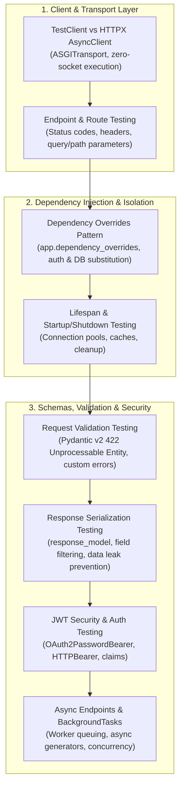

# Modern FastAPI Testing Architecture ⚡

> **Authoritative Sources & Literature:**
> - Sebastián Ramírez: *FastAPI Testing Tutorial & Dependency Injection* (fastapi.tiangolo.com/tutorial/testing/)
> - Tom Christie: *Starlette & HTTPX ASGI Architecture* (encode.io)
> - Samuel Colvin: *Pydantic v2 Core Validation & Serialization* (docs.pydantic.dev)
> - Brian Okken: *Python Testing with pytest* (Chapter 5: Mocking and Plugins)

---

## 📖 Module Overview

FastAPI has emerged as the premier asynchronous web framework for Python backends. Its architectural strengths—native ASGI concurrency, automatic OpenAPI schemas, Pydantic v2 validation, and hierarchical Dependency Injection—require modern testing methodologies.

Traditional synchronous WSGI testing techniques fail when applied to FastAPI:
- Using synchronous test clients creates event loop deadlocks when testing async database sessions (`asyncpg`).
- Testing routes without understanding `app.dependency_overrides` leads to fragile monkeypatching.
- In-flight lifespan events (`@asynccontextmanager lifespan`) require explicit ASGI context handling.

This module provides backend engineers with an enterprise-grade testing blueprint for FastAPI services: from zero-overhead ASGI in-process testing with `httpx.AsyncClient` to dependency override harnesses, Pydantic v2 request/response validation, JWT security, and lifespan management.

---

## 🗺️ Module Guides

### 1. [TestClient vs. HTTPX AsyncClient](testclient-and-httpx.md)
Master the shift from Starlette's legacy synchronous `TestClient` to `httpx.AsyncClient(transport=ASGITransport(app=app))`. Understand event loop lifecycles, streaming responses, and eliminating ASGI threadpool overhead.

### 2. [Endpoint & Route Testing](endpoint-testing.md)
Comprehensive patterns for testing HTTP GET, POST, PUT, PATCH, and DELETE endpoints. Validate status codes, JSON payload mutations, custom headers, and query/path parameter coercion.

### 3. [Dependency Overrides (`app.dependency_overrides`)](dependency-overrides.md)
FastAPI's premier architectural testing superpower. Swap production databases, Redis caches, and third-party APIs for test doubles and mocks without monkeypatching or touching application source code.

### 4. [Request Validation & Pydantic v2 Error Testing](request-validation.md)
Test Pydantic v2 validation boundaries. Assert HTTP 422 Unprocessable Entity responses, verify `loc`, `msg`, and `type` error structures, test custom field validators, and prevent invalid input processing.

### 5. [Response Validation & Data Leak Prevention](response-validation.md)
Verify FastAPI's `response_model` contract. Ensure hashed passwords, internal tenant IDs, and secret tokens are never leaked to clients, and verify serialization aliases and exclusion parameters.

### 6. [JWT Security & OAuth2 Testing](jwt-testing.md)
Test authentication flows across `OAuth2PasswordBearer` and `HTTPBearer`. Validate cryptographically signed RS256/HS256 tokens, test expired token rejection, and verify permission scope barriers.

### 7. [Async Endpoints & BackgroundTasks Testing](async-endpoint-testing.md)
Test high-concurrency async endpoints, streaming SSE/WebSocket feeds, and verify that FastAPI's `BackgroundTasks` execute asynchronous jobs reliably after HTTP response delivery.

### 8. [Lifespan Protocol (`lifespan`) Testing](lifespan-testing.md)
Test modern ASGI `lifespan` context managers. Ensure database connection pools, ML model warmups, and Redis connections initialize properly during startup and terminate cleanly during shutdown.

---

## 📊 Client Comparison Matrix

| Feature | Starlette `TestClient` | `httpx.AsyncClient` + `ASGITransport` | Live Uvicorn Server |
| :--- | :--- | :--- | :--- |
| **Execution Model** | Synchronous (via `requests`) | **Asynchronous (`asyncio` / `anyio`)** | Standalone Process (Socket) |
| **Async Compatibility** | Runs async routes in worker thread | **Runs directly in test event loop** | Full real HTTP network |
| **Event Loop Deadlocks** | ⚠️ Can deadlock with `asyncpg` | **Zero deadlocks** | Zero deadlocks |
| **Lifespan Triggering** | Automatic (Context Manager) | Manual (`LifespanManager`) | Automatic |
| **Per-Request Overhead** | $\approx 2 - 5\text{ms}$ | **$< 0.5\text{ms}$ (Fastest)** | $\approx 15 - 30\text{ms}$ |
| **Network Socket Used** | None (In-memory WSGI/ASGI) | **None (Direct ASGI memory call)** | Real TCP Loopback |

---

## ⏭️ Next Steps

Begin with **[TestClient vs. HTTPX AsyncClient](testclient-and-httpx.md)** to configure modern asynchronous test harnesses for your FastAPI applications.
