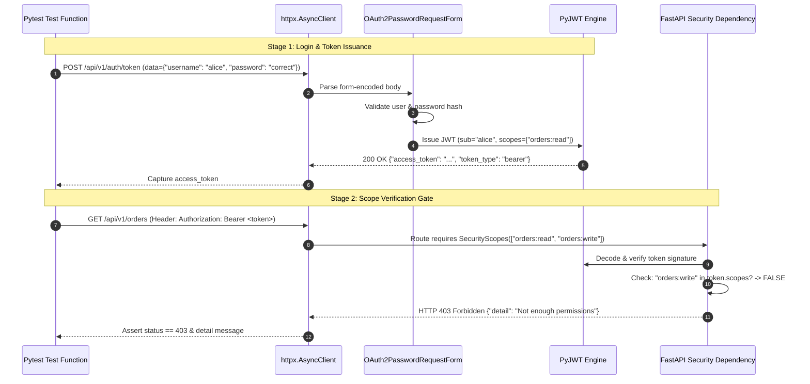

# JWT Security & OAuth2 Testing in FastAPI 🔑

> **Authoritative Sources & Literature:**
> - Sebastián Ramírez: *FastAPI Security with OAuth2 & Scopes* (fastapi.tiangolo.com/tutorial/security/oauth2-jwt/)
> - RFC 6749: *The OAuth 2.0 Authorization Framework* (datatracker.ietf.org/doc/html/rfc6749)
> - RFC 7519: *JSON Web Token (JWT)* (datatracker.ietf.org/doc/html/rfc7519)
> - Brian Okken: *Python Testing with pytest* (Chapter 3: Fixtures & Scopes)

---

## 1. Conceptual Definition & Core Mental Model

FastAPI provides dedicated security classes that integrate with OpenAPI standards and the HTTP authorization protocol:
- **`OAuth2PasswordBearer`**: Defines the URL where clients exchange credentials for tokens (`tokenUrl="token"`).
- **`OAuth2PasswordRequestForm`**: Parses incoming `application/x-www-form-urlencoded` login requests.
- **`Security` & `SecurityScopes`**: Enforces granular OAuth2 permission scopes on specific routes.
- **`HTTPBearer`**: Lightweight bearer token handler for pure JWT architectures.

### The Security Testing Challenge
Testing security in FastAPI requires verifying two distinct dimensions:
1. **The Login & Token Issuance Flow**: Ensuring `/token` validates credentials, rejects invalid passwords with `401 Unauthorized`, and returns a compliant OAuth2 JSON object with `access_token` and `token_type: bearer`.
2. **The Protected Route & Scope Gate**: Ensuring authenticated endpoints inspect signatures, parse token scopes, and return `401 Unauthorized` for bad tokens or `403 Forbidden` when permission scopes are missing.

```
   [ Client: Test Runner ]
              │
              │ 1. POST /token (Form: username, password)
              ▼
   ┌─────────────────────────────────────────┐
   │ FastAPI OAuth2PasswordRequestForm       │
   │ Verify password hash (Argon2 / Passlib) │
   └────────────────────┬────────────────────┘
                        │
                        ▼ 2. Return access_token (JWT with scopes)
   [ Signed JWT Issued ]
              │
              │ 3. GET /protected/resource
              │    Header: Authorization: Bearer <jwt>
              ▼
   ┌─────────────────────────────────────────┐
   │ FastAPI: Security(get_user, scopes=...) │
   │ - Validate signature & expiration       │
   │ - Assert token scopes ⊇ required scopes │
   └────────────────────┬────────────────────┘
                        │
         ┌──────────────┴──────────────┐
         ▼                             ▼
   Scope Missing?                Scope Present?
   [ HTTP 403 Forbidden ]        [ HTTP 200 OK ]
```

---

## 2. Why This Is Critical in Modern Python Backend Engineering

1. **Strict OAuth2 Spec Compliance**: Clients, API gateways, and mobile SDKs expect exact OAuth2 response structures and `WWW-Authenticate: Bearer` headers. Tests verify RFC compliance.
2. **Preventing Privilege Escalation**: Ensures that a user holding a `read` scope cannot call an endpoint demanding a `write` or `admin` scope.
3. **Validating Real Cryptographic Verification**: Proves that invalid algorithms, expired timestamps, and tampered signatures are caught before route business logic executes.

---

## 3. Internal Mechanics & Architectural Workflow



---

## 4. Standard Syntax, Signatures & Configuration

### Prerequisites
```bash
pip install fastapi pyjwt[crypto] passlib[bcrypt] httpx pytest-asyncio python-multipart
```

### Core Security & Scope Declaration in FastAPI

```python
from typing import List, Optional
from fastapi import FastAPI, Depends, HTTPException, Security, status
from fastapi.security import OAuth2PasswordBearer, SecurityScopes
import jwt

oauth2_scheme = OAuth2PasswordBearer(
    tokenUrl="/api/v1/auth/token",
    scopes={
        "orders:read": "Read orders",
        "orders:write": "Create and modify orders",
        "admin": "Administrative privileges"
    }
)

SECRET_KEY = "test-secret-key-for-auth"
ALGORITHM = "HS256"

async def get_current_user_with_scopes(
    security_scopes: SecurityScopes,
    token: str = Depends(oauth2_scheme)
):
    authenticate_value = f'Bearer scope="{security_scopes.scope_str}"' if security_scopes.scopes else "Bearer"
    credentials_exception = HTTPException(
        status_code=status.HTTP_401_UNAUTHORIZED,
        detail="Could not validate credentials",
        headers={"WWW-Authenticate": authenticate_value},
    )
    try:
        payload = jwt.decode(token, SECRET_KEY, algorithms=[ALGORITHM])
        username: str = payload.get("sub")
        token_scopes: List[str] = payload.get("scopes", [])
    except jwt.PyJWTError:
        raise credentials_exception

    # Scope validation
    for required_scope in security_scopes.scopes:
        if required_scope not in token_scopes:
            raise HTTPException(
                status_code=status.HTTP_403_FORBIDDEN,
                detail="Not enough permissions",
                headers={"WWW-Authenticate": authenticate_value},
            )
    return {"username": username, "scopes": token_scopes}
```

---

## 5. Execution Lifecycle & Teardown Protocol

FastAPI security test suites should follow this structured sequence:
1. **Form Authentication Test**: Test `/token` with valid and invalid credentials.
2. **Missing Token Test**: Verify route returns `401 Unauthorized` with `WWW-Authenticate: Bearer` header.
3. **Invalid Token Test**: Verify garbage or malformed strings return `401`.
4. **Insufficient Scope Test**: Valid token, but missing required scope returns `403 Forbidden`.
5. **Authorized Scope Test**: Valid token with all matching scopes returns `200 OK`.

---

## 6. Scopes, Isolation & System Boundaries

| Authorization Stage | Failure Condition | HTTP Status | Response Header |
| :--- | :--- | :--- | :--- |
| **Token Acquisition** | Wrong username or password | `400 Bad Request` or `401` | None |
| **Header Inspection** | Missing `Authorization: Bearer` | `401 Unauthorized` | `WWW-Authenticate: Bearer` |
| **Cryptographic Check** | Expired, wrong signature, alg none | `401 Unauthorized` | `WWW-Authenticate: Bearer error="invalid_token"` |
| **Scope Authorization** | Token lacks required scope | `403 Forbidden` | `WWW-Authenticate: Bearer error="insufficient_scope"` |

---

## 7. Pytest Fixture & conftest Integration

```python
# tests/conftest.py
import pytest
from datetime import datetime, timezone, timedelta
from typing import Callable, Dict
import jwt
from httpx import AsyncClient, ASGITransport
from src.main import app, SECRET_KEY, ALGORITHM

@pytest.fixture
def make_jwt() -> Callable[..., str]:
    """Generates a valid JWT with configurable scopes and expiration."""
    def _create(
        username: str = "test_user",
        scopes: list[str] = None,
        expires_delta: timedelta = timedelta(minutes=15)
    ) -> str:
        now = datetime.now(timezone.utc)
        payload = {
            "sub": username,
            "scopes": scopes or ["orders:read"],
            "iat": now,
            "exp": now + expires_delta,
        }
        return jwt.encode(payload, SECRET_KEY, algorithm=ALGORITHM)
    return _create

@pytest.fixture
def auth_headers(make_jwt) -> Callable[..., Dict[str, str]]:
    def _header(**kwargs) -> Dict[str, str]:
        token = make_jwt(**kwargs)
        return {"Authorization": f"Bearer {token}"}
    return _header

@pytest.fixture
async def client():
    transport = ASGITransport(app=app)
    async with AsyncClient(transport=transport, base_url="http://test") as c:
        yield c
```

---

## 8. Step-by-Step Practical Python 3.10+ Walkthrough

Let's test both the login endpoint and protected routes with granular scopes.

### Step 1: Define Application Routes
```python
# src/routes/auth_routes.py
from datetime import datetime, timezone, timedelta
from fastapi import APIRouter, Depends, HTTPException, Security, status
from fastapi.security import OAuth2PasswordRequestForm
import jwt
from src.security import get_current_user_with_scopes, SECRET_KEY, ALGORITHM

router = APIRouter(prefix="/api/v1", tags=["Auth"])

# Mock credential store
MOCK_USERS = {
    "alice": {"password": "alice_secret_password", "scopes": ["orders:read", "orders:write"]},
    "bob": {"password": "bob_secret_password", "scopes": ["orders:read"]},
}

@router.post("/auth/token")
async def login_for_access_token(form_data: OAuth2PasswordRequestForm = Depends()):
    user = MOCK_USERS.get(form_data.username)
    if not user or user["password"] != form_data.password:
        raise HTTPException(
            status_code=status.HTTP_400_BAD_REQUEST,
            detail="Incorrect username or password"
        )

    now = datetime.now(timezone.utc)
    token = jwt.encode(
        {"sub": form_data.username, "scopes": user["scopes"], "exp": now + timedelta(hours=1)},
        SECRET_KEY,
        algorithm=ALGORITHM
    )
    return {"access_token": token, "token_type": "bearer"}

@router.get("/orders")
async def read_orders(current_user: dict = Security(get_current_user_with_scopes, scopes=["orders:read"])):
    return {"message": f"Orders fetched for {current_user['username']}"}

@router.post("/orders")
async def create_order(current_user: dict = Security(get_current_user_with_scopes, scopes=["orders:write"])):
    return {"message": f"Order created by {current_user['username']}"}
```

### Step 2: Write the Complete Security Test Suite
```python
# tests/test_oauth2_security.py
import pytest
from httpx import AsyncClient
from src.main import app

@pytest.mark.asyncio
async def test_successful_login_returns_token(client: AsyncClient):
    # OAuth2 spec requires form-encoded data (not JSON!)
    login_data = {
        "username": "alice",
        "password": "alice_secret_password"
    }
    response = await client.post("/api/v1/auth/token", data=login_data)

    assert response.status_code == 200
    body = response.json()
    assert "access_token" in body
    assert body["token_type"] == "bearer"

@pytest.mark.asyncio
async def test_failed_login_with_invalid_credentials(client: AsyncClient):
    response = await client.post("/api/v1/auth/token", data={
        "username": "alice",
        "password": "wrong_password"
    })
    assert response.status_code == 400
    assert "Incorrect username or password" in response.json()["detail"]

@pytest.mark.asyncio
async def test_access_orders_without_token_returns_401(client: AsyncClient):
    response = await client.get("/api/v1/orders")
    assert response.status_code == 401
    assert "WWW-Authenticate" in response.headers
    assert response.headers["WWW-Authenticate"] == 'Bearer scope="orders:read"'

@pytest.mark.asyncio
async def test_user_with_read_scope_can_read_orders(client: AsyncClient, auth_headers):
    # Bob has orders:read
    headers = auth_headers(username="bob", scopes=["orders:read"])
    response = await client.get("/api/v1/orders", headers=headers)

    assert response.status_code == 200
    assert response.json()["message"] == "Orders fetched for bob"

@pytest.mark.asyncio
async def test_user_lacking_write_scope_receives_403(client: AsyncClient, auth_headers):
    # Bob only has orders:read, but POST /orders requires orders:write!
    headers = auth_headers(username="bob", scopes=["orders:read"])
    response = await client.post("/api/v1/orders", headers=headers)

    assert response.status_code == 403
    assert response.json()["detail"] == "Not enough permissions"
    assert "WWW-Authenticate" in response.headers
    assert 'scope="orders:write"' in response.headers["WWW-Authenticate"]

@pytest.mark.asyncio
async def test_user_with_write_scope_can_create_order(client: AsyncClient, auth_headers):
    # Alice has orders:write
    headers = auth_headers(username="alice", scopes=["orders:read", "orders:write"])
    response = await client.post("/api/v1/orders", headers=headers)

    assert response.status_code == 200
    assert response.json()["message"] == "Order created by alice"
```

---

## 9. Framework & Ecosystem Integration: Testing with OpenAPI Swagger Documentation

FastAPI automatically generates OAuth2 scopes into `/openapi.json`. Tests can verify that security definitions are accurately documented:

```python
# tests/test_openapi_security_schema.py
import pytest
from httpx import AsyncClient

@pytest.mark.asyncio
async def test_openapi_declares_security_schemes(client: AsyncClient):
    response = await client.get("/openapi.json")
    assert response.status_code == 200
    schema = response.json()

    # Verify securitySchemes exist
    security_schemes = schema["components"]["securitySchemes"]
    assert "OAuth2PasswordBearer" in security_schemes
    oauth_config = security_schemes["OAuth2PasswordBearer"]
    assert oauth_config["type"] == "oauth2"
    assert "orders:read" in oauth_config["flows"]["password"]["scopes"]
    assert "orders:write" in oauth_config["flows"]["password"]["scopes"]
```

---

## 10. Real-World Enterprise Scenario: Overrides vs Real Tokens

| Scenario | Strategy | Rationale |
| :--- | :--- | :--- |
| **Testing Route Business Logic** | `app.dependency_overrides` | Fast ($< 0.1\text{ms}$), avoids generating and decoding tokens on every business test. |
| **Testing Security Gates & Scopes** | Real signed JWTs in `headers` | Verifies cryptographic decoding, expiry validation, and `SecurityScopes` parsing. |

---

## 11. Anti-Patterns & Code Smells (Before vs After)

### Anti-Pattern 1: Sending JSON to `/token` Instead of Form-Data
```python
# ❌ BEFORE: Sending JSON payload (Fails! OAuth2 spec mandates application/x-www-form-urlencoded)
response = await client.post("/token", json={"username": "alice", "password": "pwd"})  # Returns 422!

# ✅ AFTER: Sending form data via `data=`
response = await client.post("/token", data={"username": "alice", "password": "pwd"})  # Returns 200 OK!
```

### Anti-Pattern 2: Returning 403 on Invalid Signature
```python
# ❌ BEFORE: Returning 403 Forbidden for bad tokens (Violates RFC 6750)
if not valid_signature:
    raise HTTPException(status_code=403, detail="Bad token")

# ✅ AFTER: Returning 401 Unauthorized with WWW-Authenticate header
if not valid_signature:
    raise HTTPException(
        status_code=status.HTTP_401_UNAUTHORIZED,
        headers={"WWW-Authenticate": "Bearer error=\"invalid_token\""}
    )
```

---

## 12. Best Practices & Production Guidelines

1. **Always Include `WWW-Authenticate` Header on 401 and 403**: Mandatory under RFC 6750.
2. **Use Form Data for OAuth2 Password Flow**: In HTTPX, use `client.post(..., data={...})` rather than `json={...}`.
3. **Parametrize Scope Matrices**: Write tests combining permutations of permissions to ensure principle of least privilege.
4. **Isolate Token Minting to Test Fixtures**: Keep token generation functions in fixtures to prevent duplication across test files.

---

## 13. Comprehensive Trade-Off Matrix

| Testing Method | Speed | Cryptographic Fidelity | Scope Verification |
| :--- | :--- | :--- | :--- |
| **Real In-Memory JWTs** | **$< 0.5\text{ms}$** | **100% Cryptographic Check** | **Full (`SecurityScopes`)** |
| **`dependency_overrides`** | $< 0.1\text{ms}$ | None (Bypasses JWT decode) | Bypasses Scope Gate |
| **External Auth0/Okta Call** | $> 500\text{ms}$ | High | High |

---

## 14. Diagnostic & Troubleshooting Playbook

### Issue 1: `AssertionError: response.status_code == 422 Unprocessable Entity on /token`
- **Root Cause**: The test dispatched `json={...}` instead of `data={...}`.
- **Remediation**: `OAuth2PasswordRequestForm` requires `application/x-www-form-urlencoded`. Change to `await client.post("/token", data={"username": ..., "password": ...})`.

### Issue 2: `AssertionError: 401 received instead of 403`
- **Root Cause**: The token was expired or had an invalid signature before scopes could be evaluated.
- **Remediation**: Verify `exp` claim is in the future and secret key matches the decoder.

---

## 15. Senior Staff Interview Questions & Answers

### Question 1: What is the architectural difference between `Depends()` and `Security()` in FastAPI?
**Answer**:
Both `Depends()` and `Security()` resolve dependencies using FastAPI's dependency injection container.
However, `Security()` provides two unique architectural capabilities:
1. **Scope Declaration**: `Security(dependency, scopes=["orders:read", "admin"])` passes an instance of `fastapi.security.SecurityScopes` containing the declared scopes directly into the dependency callable.
2. **OpenAPI Documentation**: `Security()` automatically registers the declared scopes in the OpenAPI JSON schema under `security` for that specific path operation, allowing Swagger UI to display checkboxes for permissions and document authentication requirements.
In tests, using `Security()` enables testing that requests lacking required scopes are halted with `403 Forbidden` and `WWW-Authenticate` response headers.

### Question 2: Why does the OAuth2 specification mandate `application/x-www-form-urlencoded` rather than JSON for the token endpoint?
**Answer**:
RFC 6749 was published in 2012 when HTML forms and browser clients communicated primarily via form-encoded data without specialized JavaScript libraries.
Mandating `application/x-www-form-urlencoded` allowed simple user agents to submit credentials using standard HTML `<form>` elements without custom AJAX wrappers. FastAPI's `OAuth2PasswordRequestForm` strictly adheres to this standard, requiring tests to transmit data via form dictionaries (`data={...}`).

---

## 16. Practical Hands-On Exercises & Challenges

### Exercise 1: Multi-Scope Permutation Matrix
1. Define an endpoint requiring `["reports:read", "reports:export"]`.
2. Write a parameterized test asserting:
   - Token with `[]` returns 403.
   - Token with `["reports:read"]` returns 403.
   - Token with `["reports:export"]` returns 403.
   - Token with `["reports:read", "reports:export"]` returns 200.

### Exercise 2: Testing Token Refresh Endpoint
1. Create a `/auth/refresh` endpoint that takes a `refresh_token` and issues a new `access_token`.
2. Write a test asserting that an expired `access_token` cannot be refreshed without a valid `refresh_token`.

---

## 17. Key Takeaways & Summary

- **FastAPI integrates OAuth2 and JWTs seamlessly** via `OAuth2PasswordBearer` and `SecurityScopes`.
- **Always test with form-data (`data=...`)** on token endpoints to adhere to RFC 6749.
- **Distinguish 401 vs 403**: Return 401 when the token cannot be cryptographically validated, and 403 when the token lacks required scopes.
- **Always transmit `WWW-Authenticate` headers** with detailed scope error information.

---

## 18. Next Steps & Cross-References

- Next: [Async Endpoints & BackgroundTasks Testing](async-endpoint-testing.md)
- [Response Validation & Data Leak Prevention](response-validation.md)
- [Dependency Overrides (`app.dependency_overrides`)](dependency-overrides.md)
- [Authentication & RBAC Testing](../integration-testing/authentication-testing.md)
- [Lifespan Protocol Testing](lifespan-testing.md)
