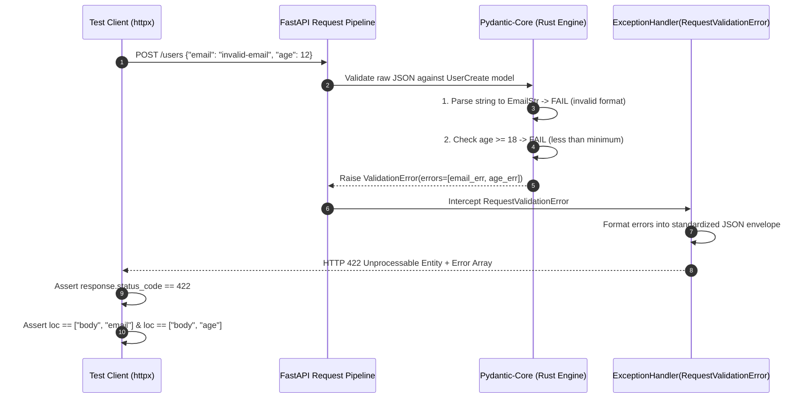

# Request Validation & Pydantic v2 Error Testing in FastAPI 🛡️

> **Authoritative Sources & Literature:**
> - Samuel Colvin: *Pydantic v2 Architecture & Rust Core (pydantic-core)* (docs.pydantic.dev)
> - Sebastián Ramírez: *FastAPI Handling Errors & RequestValidationError* (fastapi.tiangolo.com/tutorial/handling-errors/)
> - IETF RFC 7807 / RFC 9457: *Problem Details for HTTP APIs* (datatracker.ietf.org/doc/html/rfc9457)
> - Brian Okken: *Python Testing with pytest* (Chapter 5: Parametrization & Exception Testing)

---

## 1. Conceptual Definition & Core Mental Model

In FastAPI, **Request Validation** is powered by **Pydantic v2**, whose validation engine is implemented in high-performance Rust (`pydantic-core`).

### The Defensive Validation Frontier
Before an incoming HTTP request ever executes route logic or touches a database, FastAPI passes the raw input through Pydantic models. If any invariant fails:
1. FastAPI short-circuits request processing immediately.
2. It raises an internal `RequestValidationError`.
3. It transforms the validation errors into a standardized **HTTP 422 Unprocessable Entity** response.

### The Mental Model: The 422 Error Taxonomy
A standard Pydantic v2 validation error payload contains four critical diagnostic elements:
- `loc` (Location): An array identifying the exact path to the invalid field (e.g., `["body", "orders", 1, "quantity"]` or `["query", "limit"]`).
- `msg` (Message): A human-readable description of the constraint violation (e.g., `Input should be greater than 0`).
- `type` (Error Code): A programmatic machine-readable identifier (e.g., `missing`, `greater_than`, `string_too_short`, `value_error`).
- `input`: The actual invalid value transmitted by the client.

```
                      Incoming HTTP Request
                                │
                                ▼
                     Pydantic v2 Rust Engine
                                │
               ┌────────────────┴────────────────┐
               │                                 │
         All Fields Valid?              Validation Invariant Broken?
               │                                 │
               ▼                                 ▼
       Route Handler Runs               Raise RequestValidationError
       (HTTP 200 / 201)                          │
                                                 ▼
                                        Default or Custom Handler
                                                 │
                                                 ▼
                                     [ HTTP 422 Unprocessable Entity ]
                                     {
                                       "detail": [
                                         {
                                           "loc": ["body", "age"],
                                           "msg": "Input should be greater than or equal to 18",
                                           "type": "greater_than_equal",
                                           "ctx": {"ge": 18}
                                         }
                                       ]
                                     }
```

---

## 2. Why This Is Critical in Modern Python Backend Engineering

1. **Defending Against Garbage Data & Injection**: Prevents malformed, out-of-range, or malicious payloads from entering database layers, preventing data corruption and runtime crashes.
2. **Predictable API Contracts for Frontend & Mobile Clients**: Client applications rely on exact `loc` field coordinates to highlight invalid input fields in user interfaces. Tests must verify that `loc` structures remain stable.
3. **Validating Custom Business Constraints**: Pydantic `@field_validator` and `@model_validator` enforce cross-field domain invariants (e.g., `end_date > start_date`, or passwords matching confirmation fields).

---

## 3. Internal Mechanics & Architectural Workflow



---

## 4. Standard Syntax, Signatures & Configuration

### Prerequisites
```bash
pip install fastapi pydantic[email] httpx pytest-asyncio
```

### Pydantic v2 Invariants & Model Validators

```python
from datetime import date
from typing import Optional
from pydantic import BaseModel, Field, EmailStr, field_validator, model_validator

class UserRegistration(BaseModel):
    username: str = Field(..., min_length=3, max_length=30, pattern=r"^[a-zA-Z0-9_]+$")
    email: EmailStr
    age: int = Field(..., ge=18, le=120)
    start_date: date
    end_date: date

    @field_validator("username")
    @classmethod
    def reject_reserved_usernames(cls, val: str) -> str:
        if val.lower() in {"admin", "root", "system"}:
            raise ValueError("Username is reserved and cannot be registered")
        return val

    @model_validator(mode="after")
    def verify_date_range(self) -> "UserRegistration":
        if self.end_date < self.start_date:
            raise ValueError("end_date must be chronologically after start_date")
        return self
```

---

## 5. Execution Lifecycle & Teardown Protocol

Testing validation behavior requires evaluating **three standard failure modes** alongside the happy path:
1. **Missing Required Fields**: Payload omits required fields $\to$ verify `type == "missing"`.
2. **Type Coercion Failures**: Payload passes string for integer $\to$ verify `type == "int_parsing"`.
3. **Domain Constraint Failures**: Valid types, but violates bounds/regex/validators $\to$ verify custom message and `loc`.

---

## 6. Scopes, Isolation & System Boundaries

| Source of Error | Error Type | `loc` Coordinate | HTTP Status Code |
| :--- | :--- | :--- | :--- |
| **Missing Request Body** | `missing` | `["body"]` | `422 Unprocessable Entity` |
| **Invalid Query String** | `int_parsing` | `["query", "limit"]` | `422 Unprocessable Entity` |
| **Invalid Path Parameter** | `uuid_parsing` | `["path", "order_id"]` | `422 Unprocessable Entity` |
| **Malformed JSON Syntax** | JSON Decode Error | `["body"]` | `400 Bad Request` or `422` |
| **Cross-Field Violation** | `value_error` | `["body"]` (Model root) | `422 Unprocessable Entity` |

---

## 7. Pytest Fixture & conftest Integration

```python
# tests/conftest.py
import pytest
from httpx import AsyncClient, ASGITransport
from typing import AsyncGenerator
from src.main import app

@pytest.fixture
async def validation_client() -> AsyncGenerator[AsyncClient, None]:
    """Test client dedicated to verifying schema validation boundaries."""
    transport = ASGITransport(app=app)
    async with AsyncClient(transport=transport, base_url="http://testserver") as client:
        yield client
```

---

## 8. Step-by-Step Practical Python 3.10+ Walkthrough

Let's test the registration service defined in Section 4 against exhaustive validation scenarios.

### Step 1: Define the Application Route
```python
# src/routes/auth_registration.py
from fastapi import APIRouter, status
from src.models import UserRegistration

router = APIRouter(prefix="/api/v1/users", tags=["Registration"])

@router.post("/register", status_code=status.HTTP_201_CREATED)
async def register_user(payload: UserRegistration):
    return {"message": "User registered successfully", "username": payload.username}
```

### Step 2: Write Parametrized Validation Tests
```python
# tests/test_request_validation.py
import pytest
from httpx import AsyncClient, ASGITransport
from fastapi import FastAPI
from src.routes.auth_registration import router

app = FastAPI()
app.include_router(router)

@pytest.fixture
async def client():
    transport = ASGITransport(app=app)
    async with AsyncClient(transport=transport, base_url="http://test") as c:
        yield c

@pytest.mark.asyncio
async def test_successful_registration(client: AsyncClient):
    payload = {
        "username": "ada_lovelace",
        "email": "ada@analyticalengine.org",
        "age": 36,
        "start_date": "2026-01-01",
        "end_date": "2026-12-31"
    }
    response = await client.post("/api/v1/users/register", json=payload)
    assert response.status_code == 201
    assert response.json()["username"] == "ada_lovelace"

@pytest.mark.asyncio
async def test_missing_required_fields_produces_structured_422(client: AsyncClient):
    # Completely empty body
    response = await client.post("/api/v1/users/register", json={})

    assert response.status_code == 422
    errors = response.json()["detail"]
    
    # Assert missing field indicators
    missing_fields = {tuple(err["loc"]): err["type"] for err in errors}
    assert (("body", "username"), "missing") in missing_fields.items()
    assert (("body", "email"), "missing") in missing_fields.items()
    assert (("body", "age"), "missing") in missing_fields.items()

@pytest.mark.parametrize(
    "invalid_username,expected_error_type",
    [
        ("a", "string_too_short"),                     # Less than 3 chars
        ("user!name", "string_pattern_mismatch"),     # Contains forbidden special char
        ("admin", "value_error"),                     # Custom field_validator triggered!
        ("ROOT", "value_error"),                      # Case-insensitive reserved check
    ]
)
@pytest.mark.asyncio
async def test_username_validation_constraints(
    client: AsyncClient,
    invalid_username: str,
    expected_error_type: str
):
    payload = {
        "username": invalid_username,
        "email": "valid@email.com",
        "age": 25,
        "start_date": "2026-01-01",
        "end_date": "2026-06-01"
    }
    response = await client.post("/api/v1/users/register", json=payload)

    assert response.status_code == 422
    errors = response.json()["detail"]
    matching_errors = [e for e in errors if e["loc"] == ["body", "username"]]
    assert len(matching_errors) >= 1
    assert matching_errors[0]["type"] == expected_error_type

@pytest.mark.asyncio
async def test_cross_field_model_validator_failure(client: AsyncClient):
    # end_date is BEFORE start_date
    payload = {
        "username": "valid_user",
        "email": "valid@email.com",
        "age": 30,
        "start_date": "2026-12-31",
        "end_date": "2026-01-01"
    }
    response = await client.post("/api/v1/users/register", json=payload)

    assert response.status_code == 422
    errors = response.json()["detail"]
    # Model validators appear with loc=['body']
    assert any("end_date must be chronologically after start_date" in e["msg"] for e in errors)
```

---

## 9. Framework & Ecosystem Integration: Custom RFC 7807 Exception Handlers

In enterprise APIs, returning default FastAPI 422 error arrays leaks raw schema internals. Instead, enterprise gateways override `RequestValidationError` with **RFC 7807 / RFC 9457 Problem Details**:

```python
# src/error_handlers.py
from fastapi import FastAPI, Request, status
from fastapi.exceptions import RequestValidationError
from fastapi.responses import JSONResponse

def configure_custom_exception_handlers(app: FastAPI):
    @app.exception_handler(RequestValidationError)
    async def custom_validation_exception_handler(request: Request, exc: RequestValidationError):
        invalid_params = []
        for error in exc.errors():
            invalid_params.append({
                "name": ".".join(str(loc) for loc in error["loc"] if loc != "body"),
                "reason": error["msg"],
                "code": error["type"]
            })

        problem_detail = {
            "type": "https://api.enterprise.com/errors/validation-error",
            "title": "Your request parameters failed validation.",
            "status": status.HTTP_422_UNPROCESSABLE_ENTITY,
            "detail": f"{len(invalid_params)} validation error(s) occurred.",
            "invalid_parameters": invalid_params,
            "instance": str(request.url)
        }
        return JSONResponse(
            status_code=status.HTTP_422_UNPROCESSABLE_ENTITY,
            content=problem_detail,
            media_type="application/problem+json"
        )
```

### Testing the Custom RFC 7807 Handler
```python
# tests/test_custom_error_handler.py
import pytest
from httpx import AsyncClient, ASGITransport
from fastapi import FastAPI
from src.routes.auth_registration import router
from src.error_handlers import configure_custom_exception_handlers

app = FastAPI()
app.include_router(router)
configure_custom_exception_handlers(app)

@pytest.mark.asyncio
async def test_custom_rfc7807_error_envelope():
    transport = ASGITransport(app=app)
    async with AsyncClient(transport=transport, base_url="http://test") as client:
        # Send empty payload to trigger validation errors
        response = await client.post("/api/v1/users/register", json={})

        assert response.status_code == 422
        assert response.headers["Content-Type"] == "application/problem+json"
        body = response.json()
        assert body["type"] == "https://api.enterprise.com/errors/validation-error"
        assert "invalid_parameters" in body
        assert len(body["invalid_parameters"]) > 0
```

---

## 10. Real-World Enterprise Scenario: Testing Malformed JSON Syntax

What happens if a client transmits syntactically broken JSON (e.g., truncated payload `{"name": `)?

```python
# tests/test_malformed_json.py
import pytest
from httpx import AsyncClient, ASGITransport
from src.main import app

@pytest.mark.asyncio
async def test_malformed_json_syntax_returns_422():
    transport = ASGITransport(app=app)
    async with AsyncClient(transport=transport, base_url="http://test") as client:
        # Transmit raw truncated JSON bytes
        broken_json = b'{"username": "broken_payload", "age": '
        response = await client.post(
            "/api/v1/users/register",
            content=broken_json,
            headers={"Content-Type": "application/json"}
        )

        assert response.status_code == 422
        body = response.json()
        # Pydantic v2 reports json_invalid
        assert any(e["type"] == "json_invalid" for e in body["detail"])
```

---

## 11. Anti-Patterns & Code Smells (Before vs After)

### Anti-Pattern 1: Performing Manual Validation Inside Endpoint Functions
```python
# ❌ BEFORE: Cluttering route functions with manual checks (Bypasses OpenAPI schemas)
@app.post("/users")
async def create_user(data: dict):
    if "age" not in data or data["age"] < 18:
        raise HTTPException(400, "Invalid age")  # Inconsistent error structure!

# ✅ AFTER: Declarative Pydantic v2 Schema
class UserIn(BaseModel):
    age: int = Field(..., ge=18)

@app.post("/users")
async def create_user(user: UserIn):
    # Runs only after validation has 100% succeeded!
```

### Anti-Pattern 2: Weak Assertions on Status Code Only
```python
# ❌ BEFORE: Testing only status code (Hides incorrect error causes)
assert response.status_code == 422  # Did it fail on 'email' or 'age'?

# ✅ AFTER: Testing specific field location and failure type
assert response.status_code == 422
error = response.json()["detail"][0]
assert error["loc"] == ["body", "email"]
assert error["type"] == "value_error"
```

---

## 12. Best Practices & Production Guidelines

1. **Verify Exact `loc` Tuples**: In tests, convert `loc` to tuples (`tuple(err["loc"])`) to assert that the exact nested field failed.
2. **Test Boundary Values (BVA)**: If a field requires `ge=18`, test `17` (fails 422), `18` (passes 200/201), and `19` (passes).
3. **Assert Media Types**: When using custom error formatters, ensure the response headers contain `Content-Type: application/problem+json`.
4. **Test Strip Whitespace & Normalization**: Verify that Pydantic string cleaners (e.g. `str_strip_whitespace=True`) execute before validation.

---

## 13. Comprehensive Trade-Off Matrix

| Strategy | Speed | OpenAPI Documentation | Frontend UI Mapping |
| :--- | :--- | :--- | :--- |
| **Pydantic v2 Rust Engine** | **Sub-millisecond (Rust core)** | **Automatic (`/docs`)** | **High (`loc` field mapping)** |
| **Manual Python `if` Checks** | Slow | ❌ None | Low (Manual error strings) |
| **JSONSchema Validation** | Moderate | Partial | Moderate |

---

## 14. Diagnostic & Troubleshooting Playbook

### Issue 1: `pydantic.errors.PydanticUserError: Cannot use @validator in Pydantic v2`
- **Root Cause**: Code is using deprecated Pydantic v1 syntax (`@validator` instead of `@field_validator`).
- **Remediation**: Migrate to `@field_validator("field_name")` with `@classmethod` decorator.

### Issue 2: `type: "value_error"` without custom message
- **Root Cause**: Custom validator raised a plain `AssertionError` rather than `ValueError`.
- **Remediation**: Always raise `ValueError("Clear error message")` inside `@field_validator`.

---

## 15. Senior Staff Interview Questions & Answers

### Question 1: How does Pydantic v2's `pydantic-core` improve request validation performance compared to Pydantic v1, and how does this affect testing?
**Answer**:
In Pydantic v1, validation was executed entirely in interpreted Python: every field traversed a tree of Python functions, instance dictionaries, and reflection calls. In Pydantic v2, Samuel Colvin rebuilt the core engine in Rust (`pydantic-core`).
When raw JSON bytes arrive via ASGI:
1. `pydantic-core` deserializes the JSON and executes validation rules directly in compiled Rust memory before constructing Python objects.
2. It yields a **5x to 20x performance improvement**, dramatically reducing CPU overhead during high-throughput validation.
- **Impact on Testing**:
  In tests, invalid payloads fail significantly faster. Furthermore, Pydantic v2 introduced standardized error types (e.g., `string_too_short`, `greater_than`), replacing inconsistent string error messages. Tests should assert on these stable `type` codes rather than volatile human-readable strings.

### Question 2: Why should an enterprise API override FastAPI's default `RequestValidationError` with RFC 7807 Problem Details?
**Answer**:
FastAPI's default 422 JSON array format (`{"detail": [...]}`) is non-standard.
Adopting RFC 7807 / RFC 9457 ("Problem Details for HTTP APIs") provides:
1. **Standardized Contract**: Conforms to an established IETF standard used across enterprise microservices regardless of programming language (Go, Java, Python).
2. **Machine-Readable Metadata**: Provides clear fields (`type`, `title`, `status`, `detail`, `instance`, `invalid_params`).
3. **Content Negotiation**: Transmits the official media type `application/problem+json`, enabling API gateways and client SDKs to handle validation errors uniformly.

---

## 16. Practical Hands-On Exercises & Challenges

### Exercise 1: Testing Nested Model Validation
1. Create a `PurchaseOrder` model with a nested list of `OrderItem` models.
2. Ensure each `OrderItem` validates `quantity > 0` and `sku` matches regex `^[A-Z]{3}-\d{4}$`.
3. Write a test asserting that if the 3rd item has an invalid SKU, the error location is exactly `["body", "items", 2, "sku"]`.

### Exercise 2: Testing Regex Pattern Bounds
1. Define a field `phone_number: str = Field(..., pattern=r"^\+?[1-9]\d{1,14}$")` (E.164 standard).
2. Write a parameterized test verifying valid phone numbers pass, and letters or malformed inputs return `string_pattern_mismatch`.

---

## 17. Key Takeaways & Summary

- **Pydantic v2 provides compiled Rust validation** before any application code executes.
- **HTTP 422 Unprocessable Entity** is the standard status code for validation failures.
- **Inspect `loc`, `msg`, and `type`**: Reliable tests assert the exact location and programmatic error type.
- **Adopt RFC 7807 Problem Details** to provide enterprise-grade, standardized error envelopes.

---

## 18. Next Steps & Cross-References

- Next: [Response Validation & Data Leak Prevention](response-validation.md)
- [Dependency Overrides (`app.dependency_overrides`)](dependency-overrides.md)
- [Endpoint & Route Testing](endpoint-testing.md)
- [Edge Case Testing Strategies](../unit-testing/edge-case-testing.md)
- [Boundary Value Testing](../unit-testing/boundary-value-testing.md)
