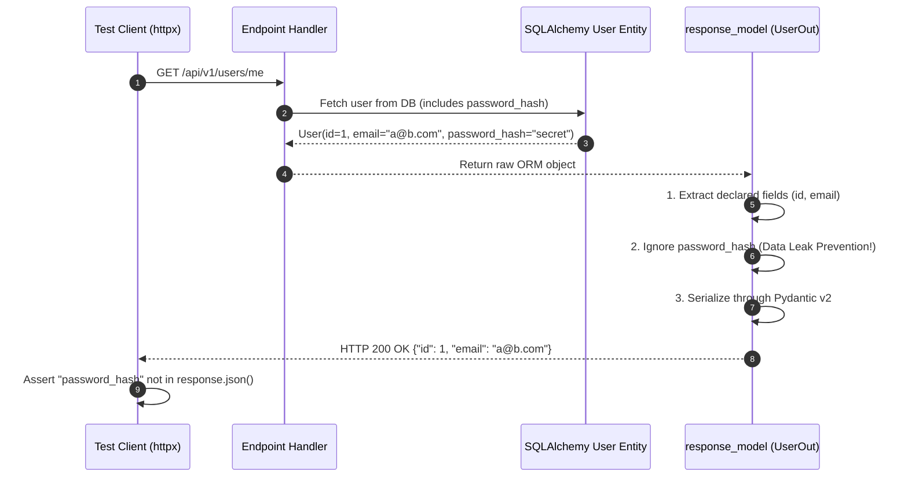

# Response Validation & Data Leak Prevention in FastAPI 🔒

> **Authoritative Sources & Literature:**
> - Sebastián Ramírez: *FastAPI Response Model & Data Filtering* (fastapi.tiangolo.com/tutorial/response-model/)
> - OWASP: *API Security Top 10 - API3: Broken Object Property Level Authorization & Data Exposure* (owasp.org)
> - Samuel Colvin: *Pydantic v2 Serialization Architecture* (docs.pydantic.dev)
> - Brian Okken: *Python Testing with pytest* (Chapter 5: Parametrization & Fixtures)

---

## 1. Conceptual Definition & Core Mental Model

In FastAPI, the **`response_model`** parameter is not merely documentation—it is a **cryptographic security boundary and data-sanitizing filter**.

### The Data Leak Vulnerability (OWASP API 3)
When an endpoint queries an ORM entity or database model, the object contains sensitive internal fields:
- `password_hash` (Bcrypt/Argon2 hashes).
- `tenant_id` / `internal_notes`.
- `stripe_customer_id` / `ssn_last_4`.
- Secret recovery codes.

If an endpoint returns the raw ORM object directly, FastAPI's `response_model` guarantees that **only the fields explicitly declared in the public response schema** are serialized to the HTTP response JSON.

### The Mental Model: The Unidirectional Egress Filter
Regardless of what internal object the route handler returns (an ORM instance, a dictionary with 50 fields, or an internal domain entity), FastAPI forces the object through the `response_model` egress filter:
1. It validates that the return value conforms to the response schema.
2. It strips all undeclared fields.
3. It applies serialization rules (`serialization_alias`, `exclude_unset`, `exclude_none`).
4. It encodes the output to JSON.

```
   [ Database / ORM Model ]
   UserEntity(
     id=1,
     email="user@test.com",
     password_hash="$2b$12$e8y...",  <── SENSITIVE DATA!
     internal_notes="VIP customer",
     is_admin=True
   )
              │
              ▼ (Returned by route handler)
   ┌─────────────────────────────────────────┐
   │ FastAPI Egress Filter: response_model   │
   │ class UserOut(BaseModel):               │
   │     id: int                             │
   │     email: str                          │
   │     (password_hash NOT declared!)       │
   └────────────────────┬────────────────────┘
                        │
                        ▼ (Filtered HTTP Output)
   [ JSON Client Response ]
   {
     "id": 1,
     "email": "user@test.com"
   }
   (password_hash and internal_notes completely filtered out!)
```

---

## 2. Why This Is Critical in Modern Python Backend Engineering

1. **Defending Against Accidental Secret Leaks**: Prevents catastrophic data breaches where developers add internal columns to ORM models that unintentionally get exposed to public API consumers.
2. **Contract Enforceability**: Guarantees that downstream mobile apps and microservices never receive malformed or unverified payloads. If a backend developer changes an internal field type, FastAPI throws an internal server error (500) during tests rather than quietly emitting broken JSON.
3. **Bandwidth Optimization**: Using `response_model_exclude_unset=True` ensures that sparse updates or null fields do not waste network bandwidth.

---

## 3. Internal Mechanics & Architectural Workflow



---

## 4. Standard Syntax, Signatures & Configuration

### Configuring Response Filtering in FastAPI

```python
from uuid import UUID
from typing import Optional
from fastapi import FastAPI, status
from pydantic import BaseModel, Field, EmailStr

app = FastAPI()

# 1. Internal Representation (e.g. from DB)
class InternalUserRecord:
    def __init__(self, user_id: UUID, email: str, password_hash: str, internal_notes: str):
        self.id = user_id
        self.email = email
        self.password_hash = password_hash
        self.internal_notes = internal_notes

# 2. Public Egress Schema
class UserPublicResponse(BaseModel):
    id: UUID
    email: EmailStr
    # Note: password_hash and internal_notes are strictly excluded!

    model_config = {
        "from_attributes": True  # Enables reading ORM object attributes
    }

@app.get(
    "/users/{user_id}",
    response_model=UserPublicResponse,
    response_model_exclude_unset=True,
    status_code=status.HTTP_200_OK
)
async def get_user_profile(user_id: UUID):
    # Returns raw internal entity with sensitive fields
    return InternalUserRecord(
        user_id=user_id,
        email="ada@analytical.org",
        password_hash="$2b$12$KIXgX4l9874...",
        internal_notes="Confidential audit flag"
    )
```

---

## 5. Execution Lifecycle & Teardown Protocol

Automated test suites must implement **Negative Data Exposure Assertions**:
1. Check that declared public fields exist in the response JSON.
2. Explicitly assert that sensitive field names (`password_hash`, `hashed_password`, `secret`, `ssn`, `auth_token`) **are absent** from the returned JSON dictionary keys.

---

## 6. Scopes, Isolation & System Boundaries

| Configuration Option | Behavior | Primary Use Case |
| :--- | :--- | :--- |
| `response_model` | Explicit schema through which output is validated & filtered | Mandatory on all endpoints |
| `response_model_exclude_unset` | Omits fields that were not explicitly set in the model instance | Sparse PATCH responses |
| `response_model_exclude_defaults` | Omits fields holding default values | Bandwidth optimization |
| `response_model_exclude_none` | Omits fields whose value is `None` | Cleaner JSON contracts |
| `from_attributes=True` | Enables reading arbitrary ORM objects/attributes directly | SQLAlchemy / Tortoise ORM mapping |

---

## 7. Pytest Fixture & conftest Integration

```python
# tests/conftest.py
import pytest
from httpx import AsyncClient, ASGITransport
from typing import AsyncGenerator
from src.main import app

@pytest.fixture
async def api_client() -> AsyncGenerator[AsyncClient, None]:
    transport = ASGITransport(app=app)
    async with AsyncClient(transport=transport, base_url="http://testserver") as client:
        yield client
```

---

## 8. Step-by-Step Practical Python 3.10+ Walkthrough

Let's test an enterprise user profile service to verify that sensitive database attributes never leak to clients.

### Step 1: Define Schemas and Routes
```python
# src/routes/users_exposure.py
from uuid import UUID, uuid4
from typing import Optional
from fastapi import APIRouter, status
from pydantic import BaseModel, EmailStr, Field

router = APIRouter(prefix="/api/v1/accounts", tags=["Accounts"])

class UserAccountInternal:
    """Simulates an internal database row with sensitive columns."""
    def __init__(self, user_id: UUID, email: str, password_hash: str, ssn_last4: str):
        self.id = user_id
        self.email = email
        self.password_hash = password_hash
        self.ssn_last4 = ssn_last4
        self.phone_number: Optional[str] = None

class UserAccountPublic(BaseModel):
    id: UUID
    email: EmailStr
    phone_number: Optional[str] = None

    model_config = {"from_attributes": True}

@router.get(
    "/{user_id}",
    response_model=UserAccountPublic,
    response_model_exclude_none=True,
    status_code=status.HTTP_200_OK
)
async def get_account(user_id: UUID):
    # Returns internal object containing secrets
    return UserAccountInternal(
        user_id=user_id,
        email="linus@kernel.org",
        password_hash="$argon2id$v=19$m=65536,t=3,p=4$v7a...",
        ssn_last4="9876"
    )
```

### Step 2: Write Rigorous Data Leak Assertions
```python
# tests/test_data_leak_prevention.py
import pytest
from uuid import uuid4
from httpx import AsyncClient, ASGITransport
from fastapi import FastAPI
from src.routes.users_exposure import router

app = FastAPI()
app.include_router(router)

SENSITIVE_FIELD_NAMES = {
    "password",
    "password_hash",
    "hashed_password",
    "ssn",
    "ssn_last4",
    "secret",
    "internal_notes"
}

@pytest.mark.asyncio
async def test_response_model_filters_sensitive_attributes():
    transport = ASGITransport(app=app)
    async with AsyncClient(transport=transport, base_url="http://test") as client:
        test_id = str(uuid4())
        response = await client.get(f"/api/v1/accounts/{test_id}")

        assert response.status_code == 200
        data = response.json()

        # 1. Assert public fields are present
        assert data["id"] == test_id
        assert data["email"] == "linus@kernel.org"

        # 2. Assert None fields were excluded by response_model_exclude_none=True
        assert "phone_number" not in data

        # 3. CRITICAL PENETRATION ASSERTION: Zero sensitive data leaks!
        for sensitive_key in SENSITIVE_FIELD_NAMES:
            assert sensitive_key not in data, (
                f"SECURITY CRITICAL: Sensitive field '{sensitive_key}' was leaked in response payload!"
            )
```

---

## 9. Framework & Ecosystem Integration: Polymorphic Responses (Unions)

In advanced APIs, an endpoint may return different response schemas based on business logic (e.g., standard response vs error/warning payload):

```python
# src/routes/polymorphic.py
from typing import Union, Literal
from fastapi import APIRouter
from pydantic import BaseModel, Field

class SuccessResult(BaseModel):
    status: Literal["success"] = "success"
    transaction_id: str
    amount_paid: int

class FailureResult(BaseModel):
    status: Literal["failure"] = "failure"
    error_code: str
    remediation_url: str

router = APIRouter()

@router.get("/transaction/{tx_id}", response_model=Union[SuccessResult, FailureResult])
async def get_transaction(tx_id: str):
    if tx_id.startswith("tx_err"):
        return FailureResult(error_code="INSUFFICIENT_FUNDS", remediation_url="https://pay.bank.com")
    return SuccessResult(transaction_id=tx_id, amount_paid=5000)
```

### Testing Both Polymorphic Response Variants
```python
# tests/test_polymorphic_responses.py
import pytest
from httpx import AsyncClient, ASGITransport
from fastapi import FastAPI
from src.routes.polymorphic import router

app = FastAPI()
app.include_router(router)

@pytest.mark.asyncio
async def test_polymorphic_success_schema():
    transport = ASGITransport(app=app)
    async with AsyncClient(transport=transport, base_url="http://test") as client:
        response = await client.get("/transaction/tx_999")
        assert response.status_code == 200
        data = response.json()
        assert data["status"] == "success"
        assert "transaction_id" in data
        assert "error_code" not in data

@pytest.mark.asyncio
async def test_polymorphic_failure_schema():
    transport = ASGITransport(app=app)
    async with AsyncClient(transport=transport, base_url="http://test") as client:
        response = await client.get("/transaction/tx_err_001")
        assert response.status_code == 200
        data = response.json()
        assert data["status"] == "failure"
        assert data["error_code"] == "INSUFFICIENT_FUNDS"
        assert "amount_paid" not in data
```

---

## 10. Real-World Enterprise Scenario: Testing Field Serialization Aliases

Modern backends often maintain Pythonic `snake_case` attributes internally while serving `camelCase` to JavaScript/TypeScript frontends:

```python
# src/models/camel_models.py
from pydantic import BaseModel, Field

class OrderSummary(BaseModel):
    order_id: str = Field(..., serialization_alias="orderId")
    total_amount_cents: int = Field(..., serialization_alias="totalAmountCents")

# Test asserting that camelCase alias was dispatched to client:
@pytest.mark.asyncio
async def test_serialization_alias(client: AsyncClient):
    response = await client.get("/api/v1/orders/123")
    assert response.status_code == 200
    data = response.json()
    assert "orderId" in data
    assert "totalAmountCents" in data
    assert "order_id" not in data  # Internal snake_case filtered!
```

---

## 11. Anti-Patterns & Code Smells (Before vs After)

### Anti-Pattern 1: Returning Raw ORM Instances Without `response_model`
```python
# ❌ BEFORE: Omitting response_model (Leads directly to OWASP API 3 Data Leaks)
@app.get("/users/{id}")
async def get_user(id: int, db: Session = Depends(get_db)):
    return db.query(User).get(id)  # Returns ALL columns, including password_hash!

# ✅ AFTER: Strict public response schema
@app.get("/users/{id}", response_model=UserPublicOut)
async def get_user(id: int, db: Session = Depends(get_db)):
    return db.query(User).get(id)  # Only UserPublicOut fields are serialized!
```

### Anti-Pattern 2: Manual Dictionary Serialization Inside Endpoints
```python
# ❌ BEFORE: Handwriting dictionary filters (Tedious, error-prone, skips validation)
@app.get("/users/{id}")
async def get_user(id: int):
    user = fetch_user(id)
    return {"id": user.id, "email": user.email}  # No schema validation, no OpenAPI doc!

# ✅ AFTER: Letting FastAPI and Pydantic handle validation & serialization
@app.get("/users/{id}", response_model=UserPublicOut)
async def get_user(id: int):
    return fetch_user(id)
```

---

## 12. Best Practices & Production Guidelines

1. **Mandate `response_model` on Every Route**: Configure a linter or integration test asserting that all registered routes declare a `response_model`.
2. **Use Shared Security Assertion Helpers**: Maintain a test helper that asserts zero sensitive field names appear in any API response dictionary.
3. **Always Set `model_config = {"from_attributes": True}`**: Ensures Pydantic v2 can extract fields directly from SQLAlchemy 2.0 ORM instances without manual conversion.
4. **Test Serialization Aliases Explicitly**: Verify that camelCase or custom aliases serialize correctly to outgoing JSON.

---

## 13. Comprehensive Trade-Off Matrix

| Strategy | Security Fidelity | Execution Speed | OpenAPI Docs Generated? |
| :--- | :--- | :--- | :--- |
| **FastAPI `response_model`** | **Highest (Guaranteed filter)** | **Sub-millisecond (Rust core)** | **✅ Full documentation** |
| **Manual Python dict filtering** | Moderate (Human error prone) | Moderate | ❌ None |
| **Direct JSONResponse dumping** | Low (No schema checking) | Fast | ❌ None |

---

## 14. Diagnostic & Troubleshooting Playbook

### Issue 1: `pydantic.errors.PydanticSerializationError: Unable to serialize object`
- **Root Cause**: The route returned an ORM instance or custom object, but `model_config = {"from_attributes": True}` was omitted from the Pydantic model.
- **Remediation**: Add `model_config = ConfigDict(from_attributes=True)` to the response model.

### Issue 2: `AssertionError: password_hash appeared in response`
- **Root Cause**: The route returned a raw `Response(content=...)` or `JSONResponse(...)` directly, bypassing the `response_model` filter!
- **Remediation**: Return domain objects or dictionaries and let FastAPI's route decorator handle response serialization.

---

## 15. Senior Staff Interview Questions & Answers

### Question 1: How does FastAPI's `response_model` defend against OWASP API 3 (Broken Object Property Level Authorization / Excessive Data Exposure)?
**Answer**:
In typical web applications, ORM queries load complete database rows containing sensitive attributes (hashed passwords, internal audit logs, foreign keys, private tokens). If an endpoint returns the raw entity, frameworks without egress filtering serialize every attribute directly into the JSON response body.
FastAPI resolves this through **declarative egress validation**:
1. The route decorator binds a public Pydantic model via `response_model=PublicSchema`.
2. When the handler completes, FastAPI intercepts the returned object and serializes it strictly through `PublicSchema.model_validate(return_val, from_attributes=True)`.
3. Any field present on the internal entity that is *not* explicitly declared on `PublicSchema` is discarded before JSON serialization.
4. Tests verify this by asserting that sensitive keywords (`password_hash`, `salt`, `internal_id`) never appear in response keys.

### Question 2: What is the performance cost of `response_model` validation in high-throughput APIs, and how does Pydantic v2 mitigate it?
**Answer**:
In Pydantic v1, `response_model` validation introduced measurable CPU latency ($2 - 5\text{ms}$ per request) because Python had to recursively iterate over object attributes and create intermediary Pydantic model instances.
In Pydantic v2:
1. The serialization engine was completely re-architected in Rust (`pydantic-core`).
2. Objects are serialized directly into JSON strings or Python primitives in compiled Rust code without instantiating intermediary Python wrapper objects.
3. This delivers a **5x to 15x serialization speedup**, rendering `response_model` overhead negligible ($< 0.1\text{ms}$) while preserving 100% cryptographic data leak prevention.

---

## 16. Practical Hands-On Exercises & Challenges

### Exercise 1: Build an Automated "Data Leak Detector" Fixture
1. Write a custom pytest fixture or assertion function `assert_no_sensitive_fields(data: dict)`.
2. Recursively check all dictionary keys and nested lists for words like `password`, `hash`, `token`, `secret`.
3. Run it across all GET endpoint responses in your test suite.

### Exercise 2: Testing Response Field Exclusions
1. Create a model with 5 fields, 2 of which have default values (`None` or default strings).
2. Write a route with `response_model_exclude_defaults=True`.
3. Assert that when the defaults are unmodified, only 3 fields appear in the resulting JSON response.

---

## 17. Key Takeaways & Summary

- **`response_model` is an essential egress firewall**, stripping internal database secrets before responses reach external networks.
- **Always write negative security assertions**: Verify that fields like `password_hash` are strictly absent from JSON keys.
- **Pydantic v2's Rust serialization core** makes response filtering nearly instantaneous ($< 0.1\text{ms}$).
- **Use `response_model_exclude_none` and serialization aliases** to maintain clean, idiomatic API contracts for frontend consumers.

---

## 18. Next Steps & Cross-References

- Next: [JWT Security & OAuth2 Testing](jwt-testing.md)
- [Request Validation & Pydantic v2 Error Testing](request-validation.md)
- [Endpoint & Route Testing](endpoint-testing.md)
- [Dependency Overrides (`app.dependency_overrides`)](dependency-overrides.md)
- [Authentication & RBAC Testing](../integration-testing/authentication-testing.md)
