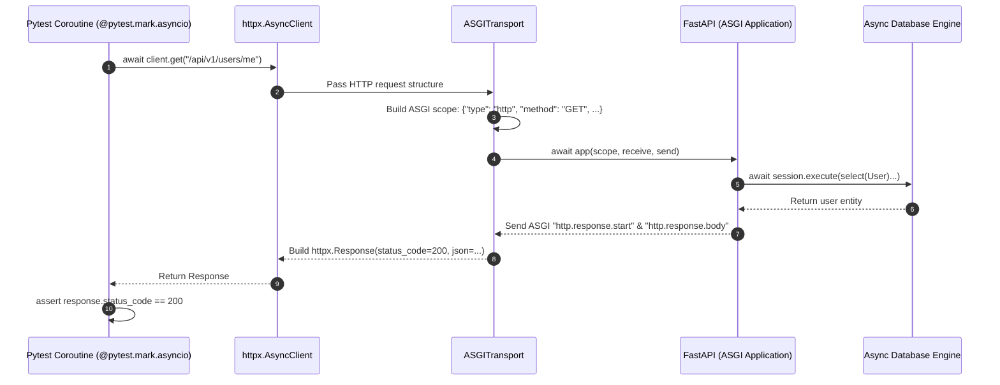
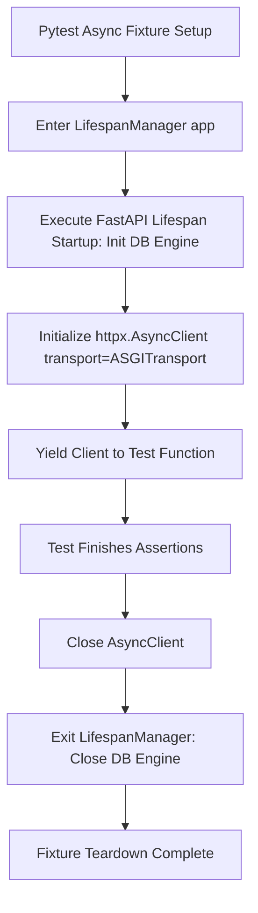

# TestClient vs. HTTPX AsyncClient in FastAPI 🚀

> **Authoritative Sources & Literature:**
> - Tom Christie: *HTTPX Documentation & Async ASGI Transports* (www.python-httpx.org)
> - Sebastián Ramírez: *FastAPI Advanced Testing with AsyncClient* (fastapi.tiangolo.com/advanced/async-tests/)
> - encode/starlette: *Starlette TestClient Internals & AnyIO Architecture* (github.com/encode/starlette)
> - Brian Okken: *Python Testing with pytest* (Chapter 4: Built-in Fixtures)

---

## 1. Conceptual Definition & Core Mental Model

When testing a FastAPI application, backend engineers must choose between two primary testing clients:
1. **Starlette `TestClient`**: A synchronous test client built on top of the `requests` library and `anyio`.
2. **`httpx.AsyncClient` with `ASGITransport`**: A fully asynchronous HTTP client that communicates directly with the FastAPI ASGI application in memory.

### The Synchronous Illusion vs. The Asynchronous Reality
FastAPI is fundamentally an **Asynchronous Server Gateway Interface (ASGI)** framework. When you declare `async def my_endpoint():`, the endpoint is an asyncio coroutine scheduled on an event loop.

- **The `TestClient` Trap**: Starlette's `TestClient` is synchronous. When you run `client.get("/users")`, `TestClient` spawns a private event loop in a separate worker thread to run the async endpoint, while the test execution thread blocks. If your test also interacts with an async database connection (e.g., `asyncpg`), two separate event loops compete for the same database socket, triggering dreaded `RuntimeError: Task attached to a different loop` exceptions!
- **The `httpx.AsyncClient` Solution**: `AsyncClient` executes in the **exact same asyncio event loop** as your pytest test runner (`pytest-asyncio`). Requests are converted directly into ASGI scope dictionaries and dispatched in memory without network sockets or secondary threads.

```
┌────────────────────────────────────────────────────────────────────────┐
│                   Starlette TestClient (Thread Boundary)               │
│                                                                        │
│  [Test Thread]  ──► TestClient.get() (Synchronous)                    │
│                            │                                           │
│                            ▼ (Spawns worker thread & private loop)     │
│  [Worker Thread]──► Event Loop B ──► FastAPI Async Endpoint            │
│                            │                                           │
│                            ▼ (Conflict!)                               │
│  [DB Pool]      ◄── Event Loop A (Pytest-asyncio session)             │
│                     RuntimeError: Attached to different loop!          │
└────────────────────────────────────────────────────────────────────────┘

┌────────────────────────────────────────────────────────────────────────┐
│                 httpx.AsyncClient (Unified Event Loop)                 │
│                                                                        │
│  [Test Coroutine] ──► await async_client.get()                        │
│                              │                                         │
│                              ▼ (Direct memory dispatch)                │
│  [Single Event Loop] ──► ASGITransport(app=app)                        │
│                              │                                         │
│                              ▼ (Zero conflict)                         │
│  [FastAPI Coroutine] ──► AsyncSession (asyncpg) ──► PostgreSQL         │
└────────────────────────────────────────────────────────────────────────┘
```

---

## 2. Why This Is Critical in Modern Python Backend Engineering

1. **Elimination of Event Loop Conflicts**: Modern backend services use async ORMs (SQLAlchemy 2.0 `AsyncSession`, Tortoise ORM) and async drivers (`asyncpg`). `httpx.AsyncClient` guarantees that database connections, cache clients, and HTTP endpoints share the identical asyncio event loop.
2. **Support for True Concurrency Testing**: With `AsyncClient`, you can test concurrent endpoint invocations using `asyncio.gather()`, verifying database row locking, race conditions, and rate limits directly from tests.
3. **Sub-Millisecond Execution**: `ASGITransport` bypasses the entire operating system network stack. No TCP sockets are bound, no OS ports are allocated, and requests execute in $< 0.5\text{ms}$.

---

## 3. Internal Mechanics & Architectural Workflow



---

## 4. Standard Syntax, Signatures & Configuration

### Prerequisites
```bash
pip install httpx fastapi pytest-asyncio asgi-lifespan
```

### Modern ASGITransport Syntax (HTTPX 0.24+)

```python
import pytest
from httpx import AsyncClient, ASGITransport
from fastapi import FastAPI

app = FastAPI()

@app.get("/ping")
async def ping():
    return {"status": "pong"}

# Modern, robust asynchronous test client configuration:
@pytest.mark.asyncio
async def test_ping():
    transport = ASGITransport(app=app)
    async with AsyncClient(transport=transport, base_url="http://testserver") as client:
        response = await client.get("/ping")
        assert response.status_code == 200
        assert response.json() == {"status": "pong"}
```

> [!WARNING]
> In older HTTPX versions ($< 0.24$), developers wrote `AsyncClient(app=app)`. Passing `app` directly to `AsyncClient` is **deprecated**; you must explicitly wrap the application inside `ASGITransport(app=app)`.

---

## 5. Execution Lifecycle & Teardown Protocol

### Managing Lifespan Contexts in Async Tests
By default, `ASGITransport` does **not** trigger FastAPI's `@asynccontextmanager lifespan` (startup and shutdown events). If your application establishes database connection pools in lifespan:
- Use `asgi-lifespan`'s `LifespanManager` to trigger startup and shutdown hooks cleanly in fixtures.



---

## 6. Scopes, Isolation & System Boundaries

| Boundary | Starlette `TestClient` | `httpx.AsyncClient` |
| :--- | :--- | :--- |
| **Async Loop Boundary** | Spawns separate thread & event loop | Operates directly within test's event loop |
| **I/O Model** | Blocking / Synchronous | Non-blocking / Coroutine |
| **Transport Medium** | In-memory Starlette adapter | In-memory `ASGITransport` |
| **Timeout Handling** | Handled by `requests` | Handled by `httpx.Timeout` |
| **Streaming Responses** | Buffered in memory | True async chunk streaming (`response.aiter_bytes()`) |

---

## 7. Pytest Fixture & conftest Integration

Here is the standardized, production-ready async client fixture configured for `tests/conftest.py`:

```python
# tests/conftest.py
import pytest
from typing import AsyncGenerator
from fastapi import FastAPI
from httpx import AsyncClient, ASGITransport
from asgi_lifespan import LifespanManager
from src.main import app as main_app

@pytest.fixture(scope="session")
def anyio_backend() -> str:
    """Configures AnyIO/pytest-asyncio backend to use standard asyncio."""
    return "asyncio"

@pytest.fixture
async def async_client() -> AsyncGenerator[AsyncClient, None]:
    """
    Production-grade async test client fixture.
    1. Triggers FastAPI lifespan events (startup / shutdown).
    2. Uses in-memory ASGITransport for sub-millisecond execution.
    3. Guarantees clean teardown.
    """
    async with LifespanManager(main_app) as manager:
        transport = ASGITransport(app=manager.app)
        async with AsyncClient(
            transport=transport,
            base_url="http://testserver",
            follow_redirects=True
        ) as client:
            yield client
```

---

## 8. Step-by-Step Practical Python 3.10+ Walkthrough

Let's test an asynchronous streaming endpoint (Server-Sent Events) and concurrent request dispatching.

### Step 1: Define the FastAPI Application
```python
# src/main.py
import asyncio
from fastapi import FastAPI
from fastapi.responses import StreamingResponse
from typing import AsyncGenerator

app = FastAPI()

async def generate_event_stream() -> AsyncGenerator[str, None]:
    for i in range(1, 4):
        await asyncio.sleep(0.01)
        yield f"event: update\ndata: {{\"step\": {i}}}\n\n"

@app.get("/api/v1/stream")
async def stream_progress():
    return StreamingResponse(generate_event_stream(), media_type="text/event-stream")

@app.get("/api/v1/counter/{item_id}")
async def get_counter(item_id: int):
    await asyncio.sleep(0.01)
    return {"item_id": item_id, "processed": True}
```

### Step 2: Test Streaming Response Chunk-by-Chunk
```python
# tests/test_streaming.py
import pytest
from httpx import AsyncClient, ASGITransport
from src.main import app

@pytest.mark.asyncio
async def test_streaming_response():
    transport = ASGITransport(app=app)
    async with AsyncClient(transport=transport, base_url="http://test") as client:
        # Use aiter_lines() to read the async stream line by line
        async with client.stream("GET", "/api/v1/stream") as response:
            assert response.status_code == 200
            assert response.headers["content-type"] == "text/event-stream; charset=utf-8"

            lines = [line async for line in response.aiter_lines() if line]
            assert "event: update" in lines[0]
            assert 'data: {"step": 1}' in lines[1]
            assert 'data: {"step": 3}' in lines[5]
```

### Step 3: Test Concurrent Requests with `asyncio.gather`
```python
# tests/test_concurrency.py
import asyncio
import pytest
from httpx import AsyncClient, ASGITransport
from src.main import app

@pytest.mark.asyncio
async def test_concurrent_requests():
    transport = ASGITransport(app=app)
    async with AsyncClient(transport=transport, base_url="http://test") as client:
        # Fire 10 concurrent HTTP requests simultaneously!
        tasks = [client.get(f"/api/v1/counter/{i}") for i in range(10)]
        responses = await asyncio.gather(*tasks)

        assert len(responses) == 10
        for i, resp in enumerate(responses):
            assert resp.status_code == 200
            assert resp.json() == {"item_id": i, "processed": True}
```

---

## 9. Framework & Ecosystem Integration: Combining with Database Sessions

```python
# tests/test_db_endpoints.py
import pytest
from httpx import AsyncClient
from sqlalchemy.ext.asyncio import AsyncSession
from src.database import get_db
from src.main import app

@pytest.mark.asyncio
async def test_create_user_endpoint(
    async_client: AsyncClient,
    db_session: AsyncSession  # Transactional SAVEPOINT fixture
):
    # Inject test session into FastAPI dependency graph
    app.dependency_overrides[get_db] = lambda: db_session

    payload = {"username": "grace_hopper", "email": "grace@navy.mil"}
    response = await async_client.post("/api/v1/users", json=payload)

    assert response.status_code == 201
    data = response.json()
    assert data["username"] == "grace_hopper"
    assert "id" in data

    app.dependency_overrides.clear()
```

---

## 10. Real-World Enterprise Scenario: Testing File Uploads

Testing multipart file uploads in FastAPI with `AsyncClient`:

```python
# tests/test_uploads.py
import pytest
from httpx import AsyncClient, ASGITransport
from fastapi import FastAPI, UploadFile, File

upload_app = FastAPI()

@upload_app.post("/api/v1/upload")
async def upload_document(file: UploadFile = File(...)):
    contents = await file.read()
    return {
        "filename": file.filename,
        "content_type": file.content_type,
        "size_bytes": len(contents)
    }

@pytest.mark.asyncio
async def test_multipart_file_upload():
    transport = ASGITransport(app=upload_app)
    async with AsyncClient(transport=transport, base_url="http://test") as client:
        files = {
            "file": ("contract.pdf", b"%PDF-1.4 simulated pdf data...", "application/pdf")
        }
        response = await client.post("/api/v1/upload", files=files)

        assert response.status_code == 200
        data = response.json()
        assert data["filename"] == "contract.pdf"
        assert data["content_type"] == "application/pdf"
        assert data["size_bytes"] == 28
```

---

## 11. Anti-Patterns & Code Smells (Before vs After)

### Anti-Pattern 1: Deprecated `AsyncClient(app=app)`
```python
# ❌ BEFORE: Passing app directly (Deprecated in HTTPX >= 0.24.0, causes deprecation warnings)
async with AsyncClient(app=app, base_url="http://test") as client:
    response = await client.get("/users")

# ✅ AFTER: Using explicit ASGITransport
transport = ASGITransport(app=app)
async with AsyncClient(transport=transport, base_url="http://test") as client:
    response = await client.get("/users")
```

### Anti-Pattern 2: Mixing Synchronous `TestClient` with Async Fixtures
```python
# ❌ BEFORE: Calling sync TestClient inside async test fixture (Thread deadlock risk!)
@pytest.fixture
def sync_client():
    return TestClient(app)

@pytest.mark.asyncio
async def test_deadlock(sync_client, async_db_session):
    # sync_client runs in worker thread; async_db_session runs in main thread!
    resp = sync_client.get("/users")  # 💥 Crash: Event loop attached to different thread!

# ✅ AFTER: Unify everything on async
@pytest.fixture
async def async_client():
    transport = ASGITransport(app=app)
    async with AsyncClient(transport=transport, base_url="http://test") as client:
        yield client
```

---

## 12. Best Practices & Production Guidelines

1. **Standardize on `httpx.AsyncClient`**: Eliminate `TestClient` from async codebases to guarantee consistent event loop execution.
2. **Always Provide a Dummy `base_url`**: Pass `base_url="http://testserver"` to `AsyncClient` to ensure relative URL resolution functions properly.
3. **Use `LifespanManager` for App Fixtures**: Ensures database engines, cache clients, and connection pools initialize via lifespan before tests invoke endpoints.
4. **Follow Redirects Explicitly**: Pass `follow_redirects=True` or `False` deliberately to verify 301/307 HTTP behaviors.

---

## 13. Comprehensive Trade-Off Matrix

| Feature | `httpx.AsyncClient` | Starlette `TestClient` | Live Process via Uvicorn |
| :--- | :--- | :--- | :--- |
| **Execution Speed** | **$< 0.5\text{ms}$ (Instant)** | $\approx 2 - 4\text{ms}$ | $\approx 20 - 50\text{ms}$ |
| **Event Loop Compatibility** | **Native AsyncIO** | Thread-isolated AnyIO | Independent Process |
| **Supports Streaming (SSE)** | **Yes (`client.stream`)** | ❌ Clunky | Yes |
| **Complexity to Setup** | Low (`ASGITransport`) | Minimal (`TestClient(app)`) | High (Subprocess/socket management) |
| **Parallel Execution** | **100% Safe with `pytest-xdist`** | Safe | Risky (Port contention) |

---

## 14. Diagnostic & Troubleshooting Playbook

### Issue 1: `RuntimeError: Task attached to a different loop`
- **Root Cause**: Starlette `TestClient` was invoked in an async test where an async database connection (e.g. `asyncpg`) was already initialized on the pytest event loop.
- **Remediation**: Replace `from starlette.testclient import TestClient` with `from httpx import AsyncClient, ASGITransport`.

### Issue 2: `AssertionError: Lifespan state missing`
- **Root Cause**: `ASGITransport` does not automatically invoke FastAPI startup events.
- **Remediation**: Wrap the test app with `LifespanManager(app)` as shown in Section 7.

---

## 15. Senior Staff Interview Questions & Answers

### Question 1: How does `ASGITransport` in HTTPX execute requests without opening a network socket?
**Answer**:
The ASGI specification defines an asynchronous callable interface: `async def app(scope, receive, send)`.
When `AsyncClient.get("/users")` executes with `ASGITransport(app=app)`:
1. `ASGITransport` translates the HTTP request into a standard ASGI `scope` dictionary (`type: "http"`, `method: "GET"`, `headers`, `path: "/users"`).
2. It constructs two async queues: `receive` (for incoming request body chunks) and `send` (for outgoing response headers and body chunks).
3. It directly invokes `await app(scope, receive, send)` as an in-memory coroutine.
4. FastAPI processes the request and calls `send({"type": "http.response.start", ...})` and `send({"type": "http.response.body", ...})`.
5. `ASGITransport` captures these messages from the queue and packages them into an `httpx.Response` object.
Because this entire exchange takes place via memory references and asyncio coroutine calls, zero TCP sockets are opened, zero network system calls (`bind`, `connect`, `poll`) occur, and execution is nearly instantaneous.

### Question 2: Under what circumstances might a team still choose Starlette `TestClient` over `AsyncClient`?
**Answer**:
A team might choose `TestClient` if:
1. **100% Synchronous Application**: The entire application is written using synchronous `def` endpoints and synchronous ORMs (e.g. standard sync SQLAlchemy or Django ORM), requiring no async coroutines.
2. **Simpler Test Syntax**: The test authors want to avoid writing `async def` and `await` on every test and prefer a purely procedural, synchronous syntax.
However, in modern enterprise architectures where async features (Kafka consumers, Redis async pools, asyncpg, SSE) are utilized, `TestClient` quickly becomes a technical liability.

---

## 16. Practical Hands-On Exercises & Challenges

### Exercise 1: Build a Streaming SSE Test Harness
1. Create a FastAPI endpoint that yields 5 ticks with timestamps using `StreamingResponse`.
2. Write a test with `httpx.AsyncClient` using `client.stream("GET", "/ticks")`.
3. Assert that each line matches the SSE contract and that total received ticks equals 5.

### Exercise 2: Benchmarking TestClient vs AsyncClient
1. Write 50 identical test cases querying a mock FastAPI endpoint.
2. Execute the suite using Starlette `TestClient`, recording total wall-clock duration.
3. Execute the suite using `httpx.AsyncClient`, comparing duration and CPU utilization.

---

## 17. Key Takeaways & Summary

- **`httpx.AsyncClient` with `ASGITransport(app=app)` is the modern standard** for testing FastAPI applications.
- **It eliminates multi-loop deadlocks**, allowing async database sessions, Redis clients, and HTTP endpoints to run harmoniously on the same event loop.
- **Use `LifespanManager`** to trigger application startup and shutdown lifecycles cleanly during tests.
- **Support for concurrency and streaming** makes `AsyncClient` superior for testing complex real-time workflows.

---

## 18. Next Steps & Cross-References

- Next: [Endpoint & Route Testing](endpoint-testing.md)
- [Dependency Overrides (`app.dependency_overrides`)](dependency-overrides.md)
- [Async Testing Mechanics](../advanced-pytest/async-testing.md)
- [API Integration Testing](../integration-testing/api-integration-testing.md)
- [Lifespan Protocol Testing](lifespan-testing.md)
