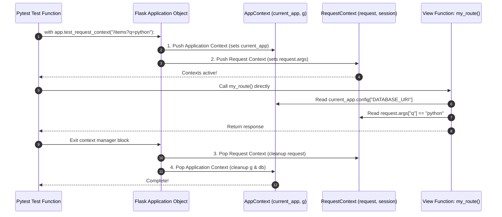

# Flask Contexts: Application vs. Request Context 🌀

> **Authoritative Sources & Literature:**
> - Pallets Projects: *The Flask Application Context & Request Context* (flask.palletsprojects.com/en/latest/appcontext/)
> - Armin Ronacher: *Werkzeug & Flask Context Locals Implementation Architecture* (palletsprojects.com)
> - Miguel Grinberg: *Flask Web Development: Developing Web Applications with Python* (Chapter 2: Basic Application Structure)
> - Brian Okken: *Python Testing with pytest* (Chapter 3: Fixtures & Scopes)

---

## 1. Conceptual Definition & Core Mental Model

One of the most confusing hurdles for developers testing Flask applications is understanding **Flask's Dual Context Architecture**:
1. **The Application Context (`app_context`)**: Powers `current_app` and `g`. It exists to make application-level configuration and database extensions accessible without passing `app` around explicitly.
2. **The Request Context (`request_context`)**: Powers `request` and `session`. It exists when handling an incoming HTTP request (URL, headers, query strings, cookies).

### The Classic Exception
When running tests outside of an HTTP request, attempting to access database models or configuration raises:
```text
RuntimeError: Working outside of application context.
This typically means that you attempted to use functionality that needed
the "current application". To solve this, set up an application context
with app.app_context().
```

### The Mental Model: The Dual Context Stacks
Flask maintains two independent context stacks (implemented via Python's `contextvars.ContextVar` in modern Flask 2.2+ / 3.0+):

```
┌────────────────────────────────────────────────────────────────────────┐
│                        Thread / Async Context                          │
│                                                                        │
│   ┌────────────────────────────────────────────────────────────────┐   │
│   │ Application Context Stack (app_context)                        │   │
│   │ - Binds: current_app (Active Flask instance)                   │   │
│   │ - Binds: g (General-purpose per-context data storage)          │   │
│   │ - Active during: DB migrations, CLI commands, background tasks │   │
│   └───────────────────────────────┬────────────────────────────────┘   │
│                                   │                                    │
│   ┌───────────────────────────────┴────────────────────────────────┐   │
│   │ Request Context Stack (request_context)                        │   │
│   │ - Binds: request (WSGI Request: URL, headers, args, body)      │   │
│   │ - Binds: session (Signed cookie session dictionary)            │   │
│   │ - Note: Pushing a Request Context automatically pushes an      │   │
│   │         Application Context if one is not already active!      │   │
│   └────────────────────────────────────────────────────────────────┘   │
└────────────────────────────────────────────────────────────────────────┘
```

---

## 2. Why This Is Critical in Modern Python Backend Engineering

1. **Eliminating Test Suite Crashes**: Understanding when to push `app.app_context()` prevents `RuntimeError` crashes when initializing database schemas (`db.create_all()`) or inspecting configuration.
2. **Direct View Function Unit Testing**: With `app.test_request_context()`, you can test view functions directly as pure Python functions without invoking the full WSGI test client!
3. **Inspecting Context Globals (`g`)**: `g` is widely used to store request-scoped metadata (authenticated users, database transaction handles, request trace IDs). Testing requires binding an active request context to verify `g`.

---

## 3. Internal Mechanics & Architectural Workflow



---

## 4. Standard Syntax, Signatures & Configuration

### 1. Pushing the Application Context
Use when interacting with extensions, database models, or configuration outside of an HTTP request:

```python
from flask import current_app, g
from src.app import create_app
from src.extensions import db

app = create_app("testing")

# Pushing app_context
with app.app_context():
    # current_app points to 'app'
    assert current_app.config["TESTING"] is True
    
    # db can query models because an application context is active!
    db.create_all()
    user_count = User.query.count()
```

### 2. Pushing the Request Context
Use when testing request-dependent functions, URL generation (`url_for`), or simulating request variables:

```python
from flask import request, session, url_for

# Pushing test_request_context with custom method, path, headers:
with app.test_request_context(
    "/api/v1/search?category=books",
    method="GET",
    headers={"X-Request-ID": "req_123"}
):
    assert request.path == "/api/v1/search"
    assert request.args.get("category") == "books"
    assert request.headers.get("X-Request-ID") == "req_123"
    
    # url_for works outside test_client!
    assert url_for("search.search_items") == "/api/v1/search"
```

---

## 5. Execution Lifecycle & Teardown Protocol

Flask executes **Teardown Callbacks** when contexts pop:
- `@app.teardown_appcontext`: Invoked when the application context pops (e.g. closing database sessions: `db.session.remove()`).
- `@app.teardown_request`: Invoked when the request context pops.

### The Pytest Fixture Teardown Pattern:
```python
# tests/conftest.py
import pytest
from src.app import create_app

@pytest.fixture(autouse=True)
def app_context_fixture():
    app = create_app("testing")
    ctx = app.app_context()
    ctx.push()  # Activate context
    yield app
    ctx.pop()   # Ensure teardown callbacks run!
```

---

## 6. Scopes, Isolation & System Boundaries

| Global Object | Context Required | Bound Values | Lifetime |
| :--- | :--- | :--- | :--- |
| **`current_app`** | Application Context | Active Flask instance & `config` | Until `app_context.pop()` |
| **`g`** | Application Context | Per-context scratchpad (`g.user`, `g.tenant`) | Reset upon `app_context.pop()` |
| **`request`** | Request Context | WSGI Environ, headers, query, body | Until `request_context.pop()` |
| **`session`** | Request Context | Signed cookie dictionary | Until `request_context.pop()` |

---

## 7. Pytest Fixture & conftest Integration

```python
# tests/conftest.py
import pytest
from typing import Generator
from flask import Flask
from src.app import create_app
from src.extensions import db

@pytest.fixture(scope="session")
def session_app() -> Flask:
    return create_app("testing")

@pytest.fixture
def app_ctx(session_app: Flask) -> Generator[Flask, None, None]:
    """Pushes a fresh application context for the duration of a test."""
    with session_app.app_context():
        yield session_app

@pytest.fixture
def request_ctx(app_ctx: Flask):
    """Factory fixture for pushing custom test request contexts."""
    def _create(path: str = "/", method: str = "GET", **kwargs):
        return app_ctx.test_request_context(path, method=method, **kwargs)
    return _create
```

---

## 8. Step-by-Step Practical Python 3.10+ Walkthrough

Let's test view functions, context globals (`g`), and error conditions directly using `test_request_context()`.

### Step 1: Define Application Logic Relying on `g` and `request`
```python
# src/routes/context_demo.py
import uuid
from flask import Blueprint, request, g, jsonify, current_app

demo_bp = Blueprint("demo", __name__)

@demo_bp.before_request
def assign_trace_id():
    # Store request-scoped trace ID on g
    g.trace_id = request.headers.get("X-Trace-ID", str(uuid.uuid4()))

@demo_bp.route("/trace")
def trace_endpoint():
    return jsonify(
        trace_id=g.trace_id,
        app_name=current_app.config.get("APP_NAME", "DefaultApp"),
        user_agent=request.headers.get("User-Agent", "Unknown")
    )

def pure_view_logic():
    """A helper function that reads directly from Flask's request proxy."""
    query = request.args.get("q", "")
    if not query:
        return {"error": "Missing query"}, 400
    return {"results": [f"Result for {query}"]}, 200
```

### Step 2: Test Directly via Contexts Without `test_client`
```python
# tests/test_context_mechanics.py
import pytest
from flask import Flask, g, current_app, request
from src.routes.context_demo import demo_bp, pure_view_logic

@pytest.fixture
def app():
    test_app = Flask(__name__)
    test_app.config["TESTING"] = True
    test_app.config["APP_NAME"] = "EnterpriseTestApp"
    test_app.register_blueprint(demo_bp)
    return test_app

def test_working_inside_app_context(app):
    """Demonstrates that current_app and g are active inside app_context."""
    with app.app_context():
        assert current_app.config["APP_NAME"] == "EnterpriseTestApp"
        g.custom_flag = True
        assert g.custom_flag is True

    # Outside block: accessing current_app raises RuntimeError!
    with pytest.raises(RuntimeError, match="Working outside of application context"):
        _ = current_app.name

def test_pure_view_logic_via_test_request_context(app):
    """
    Direct Unit Testing of View Functions!
    No WSGI test_client required. We push request context and call the function directly!
    """
    # 1. Test missing query
    with app.test_request_context("/search"):
        data, status = pure_view_logic()
        assert status == 400
        assert data["error"] == "Missing query"

    # 2. Test valid query
    with app.test_request_context("/search?q=pytest"):
        data, status = pure_view_logic()
        assert status == 200
        assert data["results"] == ["Result for pytest"]

def test_request_context_pushes_app_context_automatically(app):
    """Verifies that pushing a request context automatically provides an app context."""
    with app.test_request_context("/test", headers={"X-Trace-ID": "custom_trace_999"}):
        # Both request AND current_app are accessible!
        assert request.headers["X-Trace-ID"] == "custom_trace_999"
        assert current_app.config["APP_NAME"] == "EnterpriseTestApp"
```

---

## 9. Framework & Ecosystem Integration: Testing Teardown Callbacks

Testing that database sessions and resource handles are safely destroyed on context pop:

```python
# tests/test_teardown_callbacks.py
from flask import Flask

def test_teardown_callback_fires_on_context_pop():
    app = Flask(__name__)
    teardown_called = False

    @app.teardown_appcontext
    def cleanup_resources(exception=None):
        nonlocal teardown_called
        teardown_called = True

    # Push and pop context
    with app.app_context():
        assert teardown_called is False

    # Once the with-block exits, the context pops and triggers cleanup!
    assert teardown_called is True
```

---

## 10. Real-World Enterprise Scenario: Generating Links Outside Requests

A common enterprise backend task is generating password reset or email verification links in background jobs (e.g. Celery workers) where there is no incoming HTTP request.

```python
# src/services/email_links.py
from flask import url_for

def generate_verification_link(user_id: int, token: str) -> str:
    # Requires an active context and SERVER_NAME in config!
    return url_for("auth.verify_email", user_id=user_id, token=token, _external=True)

# Test generating link in test:
def test_generate_verification_link_in_test(app):
    with app.app_context():
        link = generate_verification_link(user_id=42, token="secure_tok_123")
        assert link.startswith("http://localhost.localdomain")
        assert "user_id=42" in link or "/42" in link
```

---

## 11. Anti-Patterns & Code Smells (Before vs After)

### Anti-Pattern 1: Calling Route Functions Without Context
```python
# ❌ BEFORE: Calling view function directly without context
def test_crash():
    resp = search_view()  # 💥 Crash: RuntimeError: Working outside of request context!

# ✅ AFTER: Wrapping in test_request_context
def test_success(app):
    with app.test_request_context("/search?q=flask"):
        resp = search_view()
```

### Anti-Pattern 2: Manual `app.app_context().push()` Without `pop()`
```python
# ❌ BEFORE: Pushing context without popping (Cascading context leaks!)
def test_leak(app):
    app.app_context().push()  # Never popped! Leaks into next tests!

# ✅ AFTER: Context manager guarantees cleanup
def test_clean(app):
    with app.app_context():
        # Cleanly popped upon block exit
        ...
```

---

## 12. Best Practices & Production Guidelines

1. **Always Use `with app.app_context():`**: Ensures contexts are automatically popped and teardown callbacks run, even if an assertion fails.
2. **Use `test_request_context` for Fast Unit Tests**: Direct view function testing runs 5x faster than WSGI `test_client`.
3. **Verify `g` Reset Between Requests**: Verify that request-scoped data placed on `g` does not persist into subsequent requests.
4. **Set `SERVER_NAME` for `_external=True` URLs**: Required when generating absolute URLs inside `app_context()`.

---

## 13. Comprehensive Trade-Off Matrix

| Testing Method | Speed | Full WSGI Stack Checked? | Use Case |
| :--- | :--- | :--- | :--- |
| **`app.test_request_context()`** | **$< 0.2\text{ms}$ (Fastest)** | ❌ No (Direct view call) | Unit testing view functions & helpers |
| **`app.test_client()`** | $\approx 1 - 2\text{ms}$ | **✅ Full WSGI pipeline** | Integration testing & HTTP contract check |
| **`app.app_context()`** | $< 0.1\text{ms}$ | ❌ No (No request data) | Database schema migrations & CLI commands |

---

## 14. Diagnostic & Troubleshooting Playbook

### Issue 1: `RuntimeError: Working outside of application context`
- **Root Cause**: Code attempted to access `current_app`, `g`, or an extension (like `db.session`) outside of an active context block.
- **Remediation**: Wrap code in `with app.app_context():`.

### Issue 2: `RuntimeError: Working outside of request context`
- **Root Cause**: Code attempted to access `request` or `session` when only an `app_context()` was active.
- **Remediation**: Replace `app.app_context()` with `app.test_request_context(path)`.

---

## 15. Senior Staff Interview Questions & Answers

### Question 1: How did the internal implementation of Flask's context locals change between Flask 1.x and Flask 2.2+ / 3.0+?
**Answer**:
- In Flask 1.x, context locals were implemented using **Werkzeug's `LocalStack`**, which relied on thread IDs (`threading.get_ident()`). This meant that context variables were strictly thread-local. If code spawned an async coroutine or greenlet, context state was lost.
- In Flask 2.2+ and 3.0+, Pallets refactored the context architecture to use Python 3.7+'s native **`contextvars.ContextVar`**.
- `ContextVar` is asynchronous-aware and task-local: it automatically propagates across asyncio coroutines, threads, and context copies. This modernization allowed Flask to introduce async route handlers (`async def`) and improved context isolation in modern concurrent test runners.

### Question 2: Why does pushing a Request Context automatically push an Application Context, but not vice versa?
**Answer**:
A web request cannot exist without an application to serve it.
When a Request Context is pushed:
1. Flask checks whether an Application Context is already active for this thread/task.
2. If none is found, it automatically pushes an Application Context for the corresponding app object.
3. This ensures that route handlers processing the request can always access `current_app` and `g`.
Conversely, an Application Context can legitimately exist **without an HTTP request** (e.g. CLI management commands, cron scripts, scheduled background jobs, database schema initialization). Therefore, an `app_context` does not instantiate or push a fake `request` or `session`.

---

## 16. Practical Hands-On Exercises & Challenges

### Exercise 1: Testing Request-Scoped Trace ID Middleware
1. Implement a `before_request` hook that reads `X-Request-ID` and stores it on `g.trace_id`.
2. Write a test using `test_request_context` verifying that `g.trace_id` matches the header when provided, or generates a valid UUID when omitted.

### Exercise 2: Direct View Unit Testing
1. Take an existing Flask route handler taking query parameters.
2. Write a unit test that pushes `test_request_context("/items?limit=5")` and calls the view function directly, asserting on the returned tuple `(data, 200)`.

---

## 17. Key Takeaways & Summary

- **Application Context (`current_app`, `g`)** is for application-level state and extensions.
- **Request Context (`request`, `session`)** is for HTTP-specific request details.
- **Pushing a Request Context automatically pushes an Application Context**.
- **Use `test_request_context()` for ultra-fast unit testing of view functions** without invoking the full WSGI client stack.

---

## 18. Next Steps & Cross-References

- Next: [Authentication & Session Testing in Flask](authentication-testing.md)
- [The Flask Test Client (`test_client`)](flask-test-client.md)
- [Application Factory Testing (`create_app`)](application-factory-testing.md)
- [Route & Blueprint Testing](route-testing.md)
- [Database Fixtures with Flask-SQLAlchemy](database-fixtures.md)
